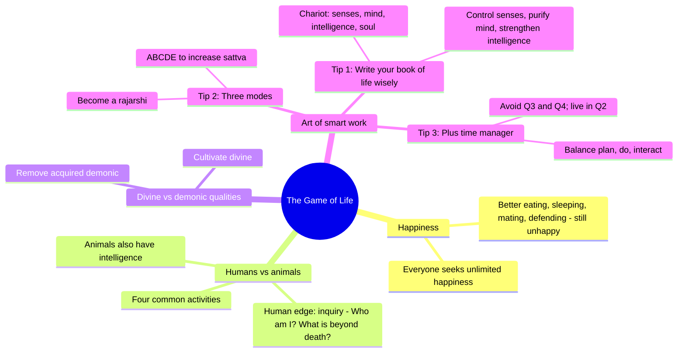

# Know Yourself — Session 1 | Discover the Game of Life | Presenter Notes

> **Source note:** Prepared by hand from the Hindi auto-captions of [Discover the Game of Life — Radheshyam Das](https://www.youtube.com/watch?v=aDJ1jTu2dK8) (1:36:39). Content is drawn only from what the speaker says; no outside commentary is added. Timestamps `[mm:ss]` point to the source's two-minute caption windows so you can re-watch any part. Garbled names, figures, and research claims are kept as spoken and listed under **Verification Flags** — check them before you put them on a slide.

---

## Session Snapshot

- **Series:** *Know Yourself* — a youth/corporate course (Session 1 of the series; the speaker says the next eight sessions cover the remaining topics). [00:00; 64:00; 68:00]
- **Audience in the original:** college students and young professionals, on Zoom, with live polling by unmute and chat questions.
- **Running time in the original:** ~68 min talk + ~25 min Q&A.
- **Goal of the session:** Move the audience from *"I want happiness"* to *"I need to develop sattva (the mode of goodness) to get it"* — and give three immediately usable tips for smart work.
- **Central questions:**
  - Everyone is seeking happiness — why don't our efforts make us happy?
  - If animals also eat, sleep, mate and defend, what makes a human being special?
  - How do the three modes (*guṇas*) show up in my study, work, and time management?

**One-Line Argument Map:** Everyone seeks unlimited happiness -> we keep switching objects because none satisfy -> eating, sleeping, mating, defending are common with animals (and they do them better) -> technology has not made us happier -> the human advantage is the ability to inquire (Who am I? Where is real happiness?) -> divine qualities lift us, demonic qualities pull us down -> **Tip 1:** write your book of life wisely and control the senses -> **Tip 2:** know the three modes and become a *rājarṣi* (passion guided by goodness) -> **Tip 3:** be a "plus" time manager and live in Quadrant 2.

---

## Suggested Run-Sheet (≈ 75 min + Q&A)

| # | Segment | Source time | Suggested time | Format |
|---|---------|-------------|----------------|--------|
| 1 | Hook: What is everyone searching for? | 02:00 – 08:00 | 6 min | Ask the room |
| 2 | Are we happy? Humans vs. animals | 08:00 – 18:00 | 10 min | Slides + humour |
| 3 | The human advantage: inquiry | 18:00 – 22:00 | 5 min | Slide: questions only humans ask |
| 4 | **Tip 1** — Book of Life & the Chariot | 22:00 – 30:00 | 10 min | Story + analogies |
| 5 | **Tip 2** — The three modes & personality test | 28:00 – 40:00 | 15 min | Picture test + cap-seller activity |
| 6 | **Tip 3** — Plus / minus time manager & four quadrants | 40:00 – 56:00 | 15 min | Pen-and-paper quiz + polling |
| 7 | Videos: Metro Man & "why successful people wake at 4 am" | 56:00 – 64:00 | 6 min | Video clips |
| 8 | Preview of upcoming sessions | 64:00 – 68:00 | 3 min | Slide |
| 9 | Mind-map summary | 68:00 – 72:00 | 4 min | Single summary slide |
| 10 | Q&A | 72:00 – 94:00 | open | See Q&A bank |

---

## 1. Hook — What Is Everyone Searching For? [02:00 – 08:00]

**Open with a question to the audience:** *"What is everyone in this world looking for?"*

- Let them call out answers. The speaker's list: a good college, a good career, a fat salary, a fast car, a beautiful spouse, a big bungalow.
- Then ask: *"Why do you want these? What does getting them give you?"* — land on the one word: **happiness**.
- Ask this question in India, America, Australia, Canada, Russia — the answer is the same.

**The life-stage ladder (tell it as a personal story):**

- **Child** — wants the balloon, not the apple. Mother warns: "It will burst in a moment." The child insists anyway.
- **Growing up** — tricycle -> football/volleyball -> teenage thrills and attraction to the opposite sex -> as a professional, lots of money -> in old age, love from grandchildren.
- **The pattern:** pick up a balloon, drop it; pick up a tricycle, throw it; football, throw it; bicycle, lose interest; car… We keep switching because **none of them satisfies**.

**Two quick show-of-hands questions:**

- *"How much happiness do you want — this much, or this much?"* -> Unlimited.
- *"How much suffering do you want?"* -> Zero. And not just a little happiness, but **ever-increasing** happiness.

**The desperation point:**

- People skydive at the risk of their lives for a thrill.
- Everyone knows smoking causes lung cancer, alcohol causes liver cirrhosis, illicit relationships bring disease — yet people do these things, driven by a desperate desire for happiness.

<Callout type="idea" title="Takeaway">
Every human being wants unlimited happiness and zero suffering; our constant switching of objects shows we haven't found it yet.
</Callout>

---

## 2. Are We Actually Happy? Humans vs. Animals [08:00 – 18:00]

### Do we get the happiness we strive for? [08:00]

- We want to stay young — everyone grows old.
- We want to stay healthy — everyone falls sick. (The speaker cites COVID: young, old, any colour, any background — all affected.)

### The four basic activities [08:00 – 10:00]

| Activity | The speaker's example |
|----------|----------------------|
| **Eating** | Gulab jamun — the tongue says "more!", the stomach says "I'm full, stop." |
| **Sleeping** | Comfortable bed, want to sleep forever — but must get up for college. |
| **Mating** | People like to have families and children. |
| **Defending** | Defending family, country, nation — wars everywhere. |

**Pivot question:** *"Animals also eat, sleep, mate and defend. So how are humans superior?"*

### "But we do it in style!" [10:00 – 12:00]

Anticipate the objection, then dismantle it:

- "Animals eat in garbage, I eat in a five-star hotel." / "They sleep on railway platforms, I sleep on a pillowed bed." / "They mate on the road, I live in a bungalow." / "They bark; we have Scud missiles."
- Quote the speaker attributes to Martin Luther King: *guided missiles and misguided men*.
- **The quality of the activity is the same.** At best we are a "refined" or "luxury version" of animals.
- **Society?** Bees have an organised society — worker bees collect honey and never go on strike. Weaver birds build excellent homes.

### "But we are more intelligent!" [12:00 – 14:00]

- **The cat:** milk is in the kitchen, mother is in the next room — the cat tiptoes in silently, drinks, and leaves. It never meows.
- **The dog:** sees you pick up a stone and runs.
- **The birds:** you clap, they all fly away.
- Animals have reasoning intelligence too — but they use it only for eating, sleeping, mating and defending.

### Animals beat us at all four [14:00 – 16:00]

A fun slide of animals with "super-human" abilities:

- **Eagle** — telescopic eyesight from the sky.
- **Horse** — no human wins a race against it.
- **Dog** — a human has one child a year; a dog, a couple of dozen puppies.
- **Elephant** — eats tons of grass a day; who can compete in a gulab-jamun-eating contest with that?
- **Polar bear** — sleeps for months. (Speaker's IIT friend slept Friday to Sunday and everyone laughed — the polar bear beats him easily.)
- **Cuckoo** — who can sing that sweetly?
- **Mosquitoes** — millions from one drain of stagnant water.

> **Line to use:** *"To compete with animals in eating, sleeping, mating and defending is foolishness."* [16:00]

### "But we have technology!" [16:00 – 18:00]

Ask: *"Is advancement in technology, energy, science and medicine producing happiness?"*

- Metro cities: polluted air, polluted water, traffic jams; highest stress from workload, lifestyle and food habits.
- When Srila Prabhupada went to America, he saw students from top universities jumping to their deaths; the speaker says it is still happening in India, including suicides at an IIT. [16:00]
- **"If knowledge is power, why do educated people commit suicide?"**
- Crime rising, weapons increasing, stress increasing, sleeping pills and painkillers everywhere.
- **Animals don't commit suicide.** Have you ever read that a dog or cat killed itself out of frustration? They don't take drugs either.
- Man has tamed elephants, lions and tigers and put them in cages — **but has failed to control his own mind.** The uncontrolled mind leads to suicide, murder, crime and unlimited greed.

<Callout type="idea" title="Takeaway">
Improving the *quality* of the four animal activities has not made us happy. We have conquered the outside world but not our mind.
</Callout>

---

## 3. The Human Advantage — Inquiry [18:00 – 22:00]

- The speaker cites a verse he attributes to the **Mahābhārata**: eating, sleeping, mating and defending are common to animals and humans; what makes the human special is the ability to inquire about God, His creation, His laws, and *"Who am I?"* [18:00 – 20:00] — *see Verification Flags before displaying any Sanskrit.*
- **Questions only humans can ask:** What is the real meaning of life? Where is real happiness? How can I get inner satisfaction? What happens at death and after?
- **External vs. internal (good contrast slide):**
  - You can have a beautiful dress but not be beautiful.
  - You can have a pillared bed but no sleep.
  - You can have lots of money but no happiness.
  - You can have lots of books but not the needed intelligence.

### Divine vs. demonic qualities [20:00 – 22:00]

| Divine qualities (lift us up) | Demonic qualities (pull us down) |
|---|---|
| Humility, tolerance, patience, kindness, compassion, courtesy, helpfulness, joy, love | Selfishness, pride, anger, greed, lust, envy |

- Happiness comes from divine qualities; negative qualities bring misery to us and to others.
- **Transition line:** *"In the next slides, we will learn how to live so we can work smart instead of only working hard."*

---

## 4. Tip 1 — Write Your Book of Life Wisely [22:00 – 30:00]

### The train journey [22:00]

- On a train you expect two things: a comfortable journey and reaching your destination.
- Likewise: a happy life *now* and the highest success at the end of life — "every religion speaks of life beyond this world."
- How you live now decides your future — this is **karma**: every action has an equal and opposite reaction.

### The Book of Life [22:00 – 24:00]

- Picture: one man out of control, disturbing himself and frightening others; another cheerful, happy and making others happy. Which page are you writing?
- **The math:** 100 chapters × 365 pages. The speaker (52 then) says 52 chapters are already written and he must face their consequences. **Good news for the audience: the rest of the pages are blank — write them with positive qualities.**

### Who is richer? [24:00]

- Two pictures: poor people who are smiling vs. rich people who are miserable. Ask: *"Who is richer? Who is happier?"*
- People have lots of money but are **bankrupt in love** — because they fill their book of life with negative qualities.

### The Chariot of the Body (Upaniṣadic analogy, also taught in the Gītā) [24:00 – 26:00]

| Part of the chariot | Represents |
|---|---|
| Five horses | Five senses — eyes, nose, tongue, ears, skin |
| Reins | Mind |
| Charioteer (driver) | Intelligence |
| Passenger | The soul (you) |

- The body is dead matter like a car; the soul is always alive like the person inside.
- **Strong intelligence** pulls the reins and the horses stay in control. **Weak intelligence** — the reins go slack, horses run everywhere, and the passenger suffers.
- *(In Q&A someone confused this — be clear: the soul is the **passenger**, intelligence is the **driver**. [76:00])*

### Why control the senses? Three analogies [26:00]

- **Kite:** cut the string and it won't fly higher — it gets stuck in a tree. You hold the reel and release gradually.
- **Gas cylinder:** needs a regulator, otherwise it explodes.
- **Flood vs. dam:** a flood destroys cattle, houses and people; a dammed river irrigates. Self-control turns energy into something useful.

### Acquired vs. inborn qualities [26:00 – 28:00]

- Slide with yellow (inborn, divine) qualities covered by red (acquired, bad) qualities.
- **Rainwater analogy:** pure when it falls from the sky; becomes muddy when it touches the ground. We were pure when we came; we picked up bad qualities later.
- **Task:** remove the acquired qualities and keep the inborn divine ones.
- **Examples of acquired qualities, from minor to serious:**
  - *Minor:* postponing study until semester end; "it's cloudy, I don't feel like working."
  - *More serious:* getting irritated easily; managers who can't control anger or work in a team.
  - *Grave:* disloyalty, back-biting, drinking, smoking, illicit relationships.

<Callout type="idea" title="Takeaway">
Your remaining pages are blank. Strengthen the intelligence, rein in the mind, control the senses — and write with divine qualities.
</Callout>

---

## 5. Tip 2 — The Three Modes & Your Personality Type [28:00 – 40:00]

### Picture test [28:00 – 30:00]

- Show three pictures (a manager shouting at a subordinate at a computer; a depressed student; a calm person).
- Ask: *"In the second picture, who is suffering — the shouting manager or the person typing?"* -> **Both.** The manager yells without training or helping the subordinate improve.

### The three modes — the core three slides [30:00 – 34:00]

Tell the audience: *"Please watch these three slides carefully — they will help you in daily life."*

| | **Tamo-guṇa** (ignorance) | **Rajo-guṇa** (passion) | **Sattva-guṇa** (goodness) |
|---|---|---|---|
| **Animal** | Fox | Lion | Cow |
| **Key words** | *Nidrā, ālasya, pramāda* — oversleeping, laziness, madness | Hungry for honour, lone worker | Gentle, peaceful |
| **Habits** | Awake at night (like the fox), lazy by day; intoxicants even though outside air is already polluted | Over-ambitious, exhausts himself, wants all credit, quick decisions with little thought | Early to bed, early to rise, clean habits, sanctified vegetarian food, simple life |
| **Inner state** | Careless, procrastinating, dull -> frustrated, depressed, sometimes suicidal; confused, indecisive, insecure, lonely | Domineering, frequently angry and lustful, very attached | Likes to read and teach; philosophical; happy; disciplined |
| **With others** | Never takes initiative — copies others' assignments, like the fox eating the tiger's leftovers | Can't work in a team — "I'll do it all myself" | Obedient to seniors, friendly to peers, compassionate to juniors |
| **Thinking** | Doesn't think | Thinks a little, not deeply | Calm, clear, creative; **thinks twice before acting** |

- **Cow detail the speaker uses:** a gentle animal; gives pure milk, which he says nourishes brain tissue and sharpens memory. [32:00]
- **Sattvic prayer/slogan:** may the wicked become virtuous, may the virtuous find peace, may the peaceful be free, may the free free others. [32:00 – 34:00]

### Activity — The Cap Seller and the Monkeys [34:00 – 36:00]

**Tell the story:** a cap seller with a basket of caps sleeps under a banyan tree full of naughty monkeys. He wakes up — the basket is empty; every monkey is wearing a cap.

**Ask the audience:** *"What would a person in each mode do?"*

- **Tamas:** starts crying, goes home with an empty basket — "My business is ruined." Panics.
- **Rajas:** throws stones or swings a stick — the monkeys just jump to other trees.
- **Sattva:** thinks twice, reflects, remembers monkeys imitate — **throws his own cap into the basket; the monkeys do the same.**

**Follow-up analogies for "think before you act":**

- **Tailor:** measure twice, cut once — not cut twice, measure once.
- **Pothole:** see it first and walk around it, rather than fall in and wonder how.
- **Formula:** first hypothesis, then action — that is sattva.

### Become a *Rājarṣi* — passion guided by goodness [36:00 – 38:00]

- Venn diagram of sattva, rajas, tamas.
- A king (*rāja*) has rajas — but a great king's rajas is guided by sattva:
  - Arjuna guided by Kṛṣṇa
  - Chandragupta Maurya guided by Chāṇakya
  - Shivaji guided by Samarth Ramdas
- That combination makes a determined, visionary leader.
- **To students:** you have ambition and passion — *don't be a flood, be a dam; don't be a gas cylinder without a regulator.* **Sattva doesn't reduce your enthusiasm; it gives it direction.**
- **Blind runner:** if a blind man is running fast toward the sea, a wise person doesn't tell him to stop running — he tells him to turn around. **Direction matters.**

### How to increase sattva — the ABCDE formula [38:00 – 40:00; recap at 70:00]

| Letter | Practice |
|---|---|
| **A** | **Association** with saintly people whose hearts are full of love, compassion and devotion |
| **B** | **Books** of wisdom — Bhagavad-gītā, Śrīmad-Bhāgavatam |
| **C** | **Chanting** and mantra meditation (to be taught in a later session) |
| **D** | **Diet** — fruits, milk, grains, vegetables; light vegetarian food offered to God (*karma-free diet*). *"The elephant is vegetarian — do you think it is weak?"* |
| **E** | **Environment** — avoid tempting environments and bad company |

### Brainwave slide [40:00]

The speaker presents brainwave bands (cycles per second) and maps them to the modes:

- **Below 8** — drowsy/sleep -> *tamas*
- **Above 13** — active; above ~18 hyperactive -> *rajas* (anecdote: Japanese managers collapsing on the shop floor from hyperactivity)
- **8 – 13** — relaxed alertness -> *sattva*; reached through meditation and chanting
- He attributes supporting research to Harvard University. *See Verification Flags.*

<Callout type="idea" title="Takeaway">
Ignorance doesn't think, passion thinks but doesn't stick, goodness thinks and sticks. Keep your passion — just let goodness steer it.
</Callout>

---

## 6. Tip 3 — Plus or Minus Time Manager? [40:00 – 56:00]

### Activity — The three-sign quiz [40:00 – 42:00]

**Ask everyone to take pen and paper** and write three signs (+ or –) for:

1. **Plan** — Are you good at planning?
2. **Do** — Are you good at hard work / execution?
3. **Interact** — Are you good at making friends and connecting?

**Then reveal the answer key:**

| Plan / Do / Interact | Type | What it means |
|---|---|---|
| **+ + +** | Balanced | Very rare — the ideal |
| **+ + –** or **– + –** | Workaholic (*rajas*) | Works hard alone; doesn't connect or ask advice out of ego |
| **– – +** | Popular person | Friendly, chats over tea and coffee, but does no work — the boss will be angry |
| **+ – –** | Daydreamer (*tamas*) | Keeps planning and postponing; achieves nothing |
| two or more – | Minus time manager | Daydreamer, workaholic or ineffective; **– – – is dangerous** |

- **Workaholic story:** driving Pune to Mumbai — if unsure, just ask "Is this the right road?" If you don't ask, you may drive 20 km and have to U-turn. [42:00]
- **The answer:** plan a little, do a little, take a one- or two-minute break every hour to connect with people, then repeat. Combine all three into **+ + +**. [44:00]

### Media and the four "happy hormones" [44:00]

As presented by the speaker — the modern media explosion is suppressing hormones needed for a satisfying life:

- **Dopamine** — sense of accomplishment
- **Endorphin** — happiness and health
- **Serotonin** — selfless contribution
- **Oxytocin** — social bonding *(captions say "oxygen" — clearly oxytocin)*

Example: everyone on a train on their own phone; a father asking his son, "Shall I send you a bedtime story on WhatsApp?"

### The four quadrants — urgent vs. important [46:00 – 48:00]

Tell the audience: *"If you understand this slide and the next, your life will not be the same."*

| | **Urgent** | **Not urgent** |
|---|---|---|
| **Important** | **Q1 — Action / Crisis** (*rajas*) — gas cylinder ran out and the sabzi is half-cooked | **Q2 — Quality / Planning** (*sattva*) — the cylinder will run out in four days, so book it; health check-ups; train and empower subordinates; build a successor |
| **Not important** | **Q3 — Delegate** (*tamas*) — e.g., downloading emails, photos and videos: ask an assistant | **Q4 — Waste** (*tamas*) — useless calls, emails, WhatsApp messages, time-wasting visitors, or wasting time yourself |

- **Key insight:** whatever is not done in Q2 eventually falls into Q1 as a crisis. Neglect preventive maintenance and you get a breakdown; don't train a successor and the company stops when you fall ill.
- **Most important quadrant: Q2.** Eliminate Q3 and Q4 from your life.

### Polling activity — "Which mode is this?" [48:00 – 54:00]

Read each behaviour and let the audience call out the mode. Answers as given by the speaker:

| Behaviour | Answer | Why |
|---|---|---|
| Not setting goals / not sticking to them | **Tamas** | Always postponing |
| Roaming around socialising **for a sense of security** | **Tamas** *(most people will say rajas)* | Like the insecure, lonely fox. Socialising to be **popular** would be rajas. |
| Low concentration, distracted by small things | **Rajas** | Greedy for "something better" — channel-hopping, jumping between YouTube videos. Tamas is sluggish; rajas is restless. |
| Multitasking and accepting unrealistic deadlines | **Rajas** | "I'm in a dozen clubs, president of this one — I'm indispensable." Trying to take credit, playing God. |
| "Nobody else can do my work in my absence" | **Rajas** | |
| Difficulty working with highly skilled, intelligent people | **Both tamas and rajas** | Tamas: insecure ("he might become better than me"). Rajas: proud ("nobody is better than me — I'll fire him"). |
| Forgetting things; messy, cluttered desk | **Tamas** | |
| Excessive perfectionism leading to micromanagement | *(discussed — controlling subordinates, no freedom)* | |

**Honda story (for the "can't work with skilled people" item)** [52:00 – 54:00]: a newly joined young engineer submitted a file suggesting air-cooled engines instead of water-cooled. His boss was furious — "You've just joined and you're commenting on the company?" — and fired him. He went to a Buddhist monastery. The file reached Mr Honda, who found it logical and sent it to R&D; the air-cooled engine cut costs dramatically. Mr Honda called the young man back with a big post and salary, and he later became CEO of Honda. **Moral: a rajasic leader can drive away talent and cause huge losses.** *(Name in captions unclear — see Verification Flags.)*

### Two hours of life: relationships and results [54:00 – 56:00]

- Ask: *"What are you looking for at home, and what at college/company?"* -> **Relationships at home, results at work.**
- Results sit in Q1; relationships sit in Q2. **If relationships are good, results will follow.**
- **Smart-worker checklist (all Q2):**
  - Improve communication with people using sattva; give up rajas
  - Prepare better; plan and organise
  - Take care of yourself with yoga and similar practices
  - Seize new opportunities through planning
  - Do preventive maintenance so you avoid breakdowns and repairs
  - Empower subordinates — then you can relax while they work

<Callout type="idea" title="Takeaway">
Be a + + + person. Live in Quadrant 2 — plan, prevent, empower and build relationships — and crises and waste will shrink.
</Callout>

---

## 7. Video Segment [56:00 – 64:00]

### Interview: "Metro Man" (Delhi Metro) [56:00 – 62:00]

Points from the interview to highlight:

- Delhi Metro is estimated to save at least 200 road-accident deaths a year.
- **Daily routine:** wakes at 4:30 am (4:00 am now) — "the secret of my efficiency"; *prāṇāyāma*, ~45 minutes of Gītā reading every day when at headquarters, yoga, breakfast, early to office.
- **Never takes files home**; discourages calls at home except emergencies — home time is for himself and family. All work done 9:00 – 5:30 at the office.
- Transferred ~25 times in his first 15 years in Indian Railways — learned not to see transfers as punishment but as **opportunity**.
- **Why the Gītā?** It gives practical suggestions for everyday problems — exactly what professional life needs.
- **Favourite teaching** (paraphrased): do your work wholeheartedly without worrying about its fruit or expecting personal benefit, and don't be discouraged by good or bad results. *This matches **Bhagavad-gītā 2.47** (see below).*

**Bhagavad-gītā 2.47** ([vedabase.io](https://vedabase.io/en/library/bg/2/47/))

- *karmaṇy evādhikāras te / mā phaleṣu kadācana / mā karma-phala-hetur bhūr / mā te saṅgo ’stv akarmaṇi*
- **Translation:** "You have a right to perform your prescribed duty, but you are not entitled to the fruits of action. Never consider yourself the cause of the results of your activities, and never be attached to not doing your duty."

### Video: Why successful people wake at 4 am [62:00 – 64:00]

- On waking, the brain is in the alpha range (8 – 13 Hz), "the gateway to the subconscious"; very early it's between theta and alpha — calm, effortless focus.
- The **first 20 minutes** after waking set the tone for the day — so they meditate, hear positive things, and don't check social media or email first thing.
- Deepest sleep is said to be 10 pm – 2 am; after 2 am sleep becomes shallower.
- **Practical step:** go to bed 15 – 30 minutes earlier each week until you reach 10 pm.
- The video names Tim Cook, Oprah Winfrey and Dwayne Johnson as early risers.
- The brain works best when it isn't multitasking; early-morning quiet gives the focus.

---

## 8. Preview of Upcoming Sessions [64:00 – 68:00]

The speaker previews topics in the upcoming eight sessions, which he says will build sattva and positive thinking:

- **The soul as the driver of the body** — the body is a machine; the soul is the real person inside (to be explained scientifically).
- **The Supreme Controller** — if the small body-machine has a driver, who runs the cosmic machine? An intelligent designer.
- **Scriptures as the manual** — like the manual that comes with a pressure cooker, otherwise it may burst.
- **Vedic solutions** to getting unlimited happiness and zero suffering, and getting free of karmic reactions.
- **Sound vibration / mantra** — overcoming stress (from rajas) and depression (from tamas) to reach a calm, alert mind.

---

## 9. Closing Mind-Map Summary [68:00 – 72:00]

Show one summary slide and walk through it:

**Closing line (adapted from the speaker):** *Smart students keep Quadrants 1 and 2 active, drop 3 and 4 by increasing sattva and rising above rajas and tamas — they are not just hard workers, they are smart workers.*

---

## 10. Q&A Bank (Questions Asked in the Original Session) [72:00 – 94:00]

**Q: According to Kṛṣṇa, is marriage necessary? Can we live without marriage?** [72:00]
- Both are fine. Marrying religiously and raising children is the *gṛhastha* path. Some choose lifelong celibacy (the speaker has been a monk since 1994). Arjuna was married with children and was a great devotee; Nārada was unmarried and travelled chanting with his vīṇā. Choose whichever path best helps you awaken Kṛṣṇa consciousness. [72:00; 90:00]

**Q: Is the difference between us and animals consciousness?** [72:00 – 74:00]
- No — animals are conscious too (they flee a stone, feel pain). The soul is present in both. The human privilege is the ability to ask *why am I suffering, who am I, who is God.*
- **Analogy:** a car and an aeroplane both move on the runway, but only the plane can take off. Studying the Gītā lets the human "take off."

**Q: How do soul, mind and intelligence play their roles?** [74:00 – 76:00]
- Intelligence = driver, mind = reins, senses = horses, soul = passenger. Strengthen intelligence to control the impure mind and senses.
- **Simple analogy:** intelligence is like the husband, mind like the wife, senses like the children.

**Q: Which mode is a person who thinks and answers questions?** [76:00 – 78:00]
- Sattva thinks and acts and sticks to the plan. Rajas thinks but doesn't follow through (plans to read a book in a week, stops after 2 – 3 days). Tamas neither thinks nor acts.

**Q: How do we offer food to Kṛṣṇa? What if it contains onion and garlic?** [78:00 – 80:00]
- Before eating, chant Hare Kṛṣṇa and think for a moment: *"You give the grains, fruits, rain, sunlight and moonlight. Thank you."* Scientists can make nuts and bolts, but not grains you can eat.
- In a hostel where onion-garlic food is unavoidable: pray, "Kṛṣṇa, this is the best I can get, please forgive me," and chant.

**Q: If I'm humble, peaceful and tolerant, won't people think I'm weak?** [80:00 – 82:00]
- Three styles: **passive** (tamas — lets everyone walk over them), **aggressive** (rajas — dominates others), **assertive** (sattva — uses your rights and respects others' rights).
- Be assertive, not aggressive. To lead, combine rajas with sattva — a *rājarṣi*.

**Q: How do we avoid the negative mindset from social media?** [82:00 – 84:00]
1. Put **parental controls** on your devices.
2. **Limit** your daily hours; some keep **two phones** — a basic button phone for calls and a smartphone only for study.
3. **Avoid tempting friends and environments**; find good, devotional friends — "birds of a feather flock together."

**Q: My friend is going through depression. What can we do?** [84:00 – 86:00]
- They need genuine encouragement and affection. Srila Prabhupada taught the Hare Kṛṣṇa mantra to hippies in America who were caught in drugs and tranquilisers. Take your friend to good programmes like this one — they will feel refreshed and inspired.

**Q: If Kṛṣṇa says "my wife, my children" is illusion, how can a married person become Kṛṣṇa conscious?** [86:00 – 90:00]
- Husband and wife can practise devotion together; devotees neither run away from the world nor exploit it — they use everything in God's service.
- **Story — The King's Ring:** a king throws his diamond ring bearing his initials to test his people.
  - **The enjoyer (*bhogī*):** a thief pockets it -> jailed.
  - **The renouncer (*tyāgī*):** someone sees it is precious and dangerous, throws it on the ground and walks away.
  - **The devotee (*bhakta*):** someone recognises it as the king's and returns it -> the king pulls him onto his chariot and makes him a minister.
  - **Moral:** everything belongs to God; use it in His service. (The speaker uses his laptop and Zoom for this session as an example.)

**Q (off-topic): How can a monk in saffron like Gaur Gopal Prabhu talk about material topics?** [92:00 – 94:00]
- Historically brāhmaṇas gave medical advice, judged, taught — Droṇācārya even taught archery. A brāhmaṇa is a teacher. He teaches selflessness and humility, a step-by-step path; many who hear him later start reading the Gītā and chanting.

---

## Presenter Prep Checklist

- [ ] Slides: life-stage ladder, four activities, "animals beat us" collage, rich-vs-happy pictures, chariot diagram, red/yellow qualities, three-modes table, cap-seller pictures, Venn diagram, brainwave chart, plus/minus key, four quadrants, polling list, mind-map
- [ ] Video clips: Metro Man interview, "why successful people wake at 4 am"
- [ ] Audience has pen and paper for the plus/minus quiz
- [ ] Polling mechanism (unmute/chat or show of hands) for the "which mode?" activity
- [ ] Announcements: next session timing and topic (original: *Discover the Soul Within*, next day 6:30 pm), WhatsApp/Google group for leftover questions

---

## Transcript Verification Flags

Check these before putting them on a slide — the captions were garbled or the claim is the speaker's own:

- **Mahābhārata verse on eating, sleeping, mating, defending** [18:00] — the speaker doesn't recite the Sanskrit in the captions. Verify the exact text and source before displaying it.
- **Martin Luther King quote** "guided missiles and misguided men" [12:00] — as attributed by the speaker.
- **IIT suicides "in 2019-19"** [16:00] — year garbled in captions.
- **Brainwave figures and the Harvard research** [40:00] — as stated by the speaker; the "2122" figure for the Japanese managers is unclear.
- **Honda story** [52:00 – 54:00] — the captions render the engineer's name as "तादाशी कौ"; confirm the name and details before citing.
- **"Metro Man"** [56:00 – 60:00] — captions render the name as "मेट्रो सैंड / मेट्रो शिदान"; he is not named clearly in the captions. Confirm before naming him on a slide.
- **Four hormones** [44:00] — captions say "ऑक्सीजन" (oxygen) for social bonding; rendered here as oxytocin.
- **"Dr Brian Wol…" research on stress and depression** [66:00] — name garbled in captions.
- **Rājarṣi pairs** [36:00] — "Chandragupta Maurya – Chāṇakya" and "Shivaji – Samarth Ramdas" are reconstructed from garbled captions ("चंद्रौतमोरिया चाणक", "शिवराज समरमदासुकरम").
- **Speaker's bio** [00:00] — read out by the host; award names are garbled in the captions.
