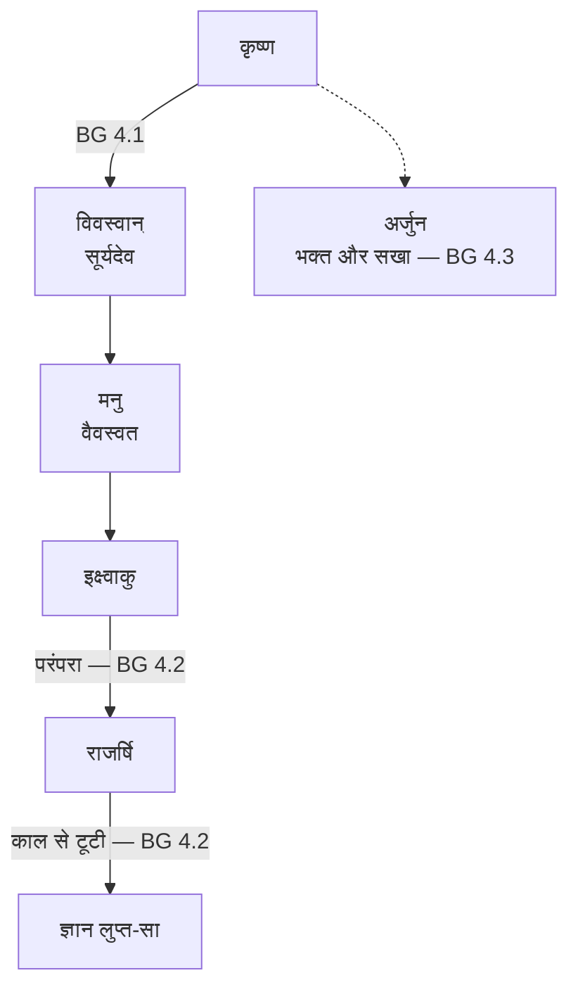

# दिन 38 | BG 4.1 – 4.4 | दिव्य ज्ञान | भक्ति शास्त्र कोर्स

> **Source note:** यह टिप्पणी इसी कक्षा के निकाले गए मूल हिन्दी ऑटो-कैप्शन से सीधे तैयार की गई है — किसी बाहरी भाष्य से नहीं, और Gemini के बिना। यह अंग्रेज़ी टिप्पणी का अनुवाद नहीं है; दोनों संस्करण एक ही ट्रांसक्रिप्ट से तैयार किए गए हैं और उनका ढाँचा तथा टाइमस्टैम्प एक समान रखे गए हैं। टाइमस्टैम्प स्रोत की दो-मिनट की खिड़कियों के अनुसार हैं, और पहले घंटे के बाद संचयी मिनटों में दिए गए हैं। अस्पष्ट पाठ, उद्धरण और संदर्भ स्मृति से पूरे नहीं किए गए — उन्हें चिह्नित रखा गया है। प्रत्येक मुख्य श्लोक का संस्कृत, लिप्यंतरण, शब्दार्थ और अनुवाद एक अलग संदर्भ-परत है, जो सीधे [vedabase.io](https://vedabase.io/en/library/bg/4/) (Bhaktivedanta VedaBase, Bhagavad-gita As It Is, Bhaktivedanta Book Trust) से सत्यापित है; vedabase पर भगवद्गीता का हिन्दी संस्करण उपलब्ध न होने के कारण ये सत्यापित खंड अंग्रेज़ी में ही दिए गए हैं, और कोई हिन्दी अनुवाद या शब्दार्थ गढ़ा नहीं गया है। ये खंड कक्षा में हुए उच्चारण की शुद्धता प्रमाणित नहीं करते।

---

## कक्षा सार एवं एक-पंक्ति तर्क-क्रम

- **स्रोत:** [दिन 38 की कक्षा](https://www.youtube.com/watch?v=0OMeQVwJ8Ws), अवधि 1:14:55.
- **विषय-विस्तार:** BG 4.1–4.4 चौथे अध्याय का आरंभ करते हैं, जिसे श्रील प्रभुपाद ने _ट्रांसेंडेंटल नॉलेज_ — दिव्य ज्ञान — नाम दिया है। भगवान परंपरा द्वारा गीता के ज्ञान का इतिहास बताते हैं, बताते हैं कि वह समय के साथ कैसे लुप्त हुआ, और क्यों वे उसे फिर से अर्जुन को कह रहे हैं; और अर्जुन पूछते हैं कि अभी जन्मे भगवान ने प्राचीन सूर्यदेव को उपदेश कैसे दिया। [02:00 – 06:00; 42:00 – 48:00]
- **केंद्रीय प्रश्न:** भगवान अध्याय का आरंभ गीता के इतिहास से क्यों करते हैं? आध्यात्मिक ज्ञान कैसे सुरक्षित रहता है, और कैसे लुप्त होता है? उसे समझने के लिए व्यक्ति में कौन-सी योग्यता चाहिए? आध्यात्मिक जीवन में प्रश्न करने का स्वस्थ तरीका क्या है?
- **One-Line Argument Map:** भगवान का कथन: यह अव्यय ज्ञान सबसे पहले सूर्यदेव को दिया गया, सूर्यदेव ने मनु को दिया, मनु ने इक्ष्वाकु को दिया -> राजर्षियों ने इसे परंपरा द्वारा प्राप्त किया -> समय के प्रभाव से परंपरा टूट गई और ज्ञान लुप्त-सा हो गया -> इसलिए भगवान वही पुरातन ज्ञान फिर से अर्जुन को कहते हैं, क्योंकि अर्जुन उनके भक्त और सखा हैं | अर्जुन का प्रश्न: आपका जन्म अभी का है और सूर्यदेव का जन्म प्राचीन है -> मैं कैसे समझूँ कि आपने आरंभ में उन्हें यह उपदेश दिया? -> यह चुनौती नहीं, "मैं कैसे समझूँ" के रूप में पूछा गया, उन सबकी ओर से जो आगे चलकर संदेह करेंगे।

---

## पूर्व कक्षा से निरंतरता एवं पुनरावलोकन (अध्याय 3) [02:00 – 06:00]

आचार्य चौथे अध्याय का आरंभ उसे तीसरे अध्याय से जोड़कर करते हैं।

- **तीसरा अध्याय कहाँ समाप्त हुआ।** भगवान ने _निष्काम कर्म-योग_ (_niṣkāma karma-yoga_) का उपदेश दिया और उसका सबसे बड़ा शत्रु _काम_ बताया। निष्कर्ष में उन्होंने कहा कि यह काम ज्ञान को ढक लेता है और इसी के कारण व्यक्ति यहाँ अटका रहता है। [02:00 – 04:00]
- **सेतु।** जीव जब निष्काम भाव से कर्म करता है, तो वह एक **माध्यम** है जिससे वह _दिव्य ज्ञान_ (_divya jñāna_) प्राप्त करता है। चौथा अध्याय इसी दिव्य ज्ञान का वर्णन करता है; प्रभुपाद जी ने इसे नाम दिया — _ट्रांसेंडेंटल नॉलेज_। [02:00 – 04:00]
- **अब भगवान का ज्ञान क्यों चाहिए।** 3.30 में निष्काम कर्म-योग का समापन करते हुए भगवान ने कहा — सारे कर्म मुझे अर्पित कर दो। तो प्रश्न उठता है: ये भगवान कौन हैं, जिन्हें सब कुछ अर्पित करना है? चौथे अध्याय में वह ज्ञान भी मिलता है — भगवान क्यों आते हैं, उनका जन्म क्या है। [02:00 – 04:00]
- **अध्याय में क्या है।** यह ज्ञान परंपरा में कैसे प्राप्त होता है, यह ज्ञान क्या है, इसे प्राप्त करने की विधि क्या है, और प्राप्त करने के बाद इसकी महिमा क्या है। [02:00 – 04:00]
- **क्रमिक सीढ़ी।** तीसरे अध्याय में निष्काम कर्म-योग कहने के बाद भगवान अब धीरे-धीरे स्तर बढ़ा रहे हैं: [04:00 – 06:00]
  - **चौथा अध्याय** — _ज्ञान-योग_।
  - **छठा अध्याय** — _ध्यान-योग_, _अष्टांग-योग_।
  - **अंततः** — भगवान को फाइनली _भक्ति-योग_ तक ले जाना है, पर उससे पहले वे यह सब बताना चाहते हैं।
- **अध्याय की रूपरेखा।** इस अध्याय में 42 श्लोक हैं। शुरू के 10 श्लोकों में दिव्य ज्ञान है, और वह भी अधिकतर **कृष्ण के बारे में** — परंपरा में यह कैसे प्राप्त होता है, भगवान का जन्म, उनके कार्य, और जो भगवान के जन्म-कर्म को समझ लेता है उसे क्या प्राप्त होता है। अध्याय का वास्तविक ज्ञान-योग आगे आएगा। [04:00 – 06:00]

---

## श्लोक-वार टिप्पणी एवं विश्लेषण

### भगवद्गीता 4.1 [06:00 – 22:00; 48:00 – 52:00]

<!-- verse:4.1 -->

**प्रसंग।** भगवान अध्याय का आरंभ उसी ज्ञान के इतिहास से करते हैं जो वे अर्जुन को देने वाले हैं: सबसे पहले किसे मिला, और कैसे नीचे आया। [06:00 – 08:00]

**कक्षा में समझाए गए प्रमुख शब्द**

- _इमम्_ (_imam_): यह — यह ज्ञान, गीता का वह ज्ञान जो भगवान अर्जुन को देने वाले हैं। [06:00 – 08:00]
- _प्रोक्तवान् अहम्_: मैंने बोला है। [06:00 – 08:00]
- _अव्ययम्_: अव्यय — यह अव्यय ज्ञान। [06:00 – 08:00]
- _विवस्वते_: विवस्वान् को — सूर्यदेव, सूर्य के अधिष्ठाता व्यक्तित्व। [06:00 – 08:00]
- _विवस्वान् मनवे प्राह_: विवस्वान् ने वह ज्ञान मनु को बोला। [06:00 – 08:00]
- _मनुर् इक्ष्वाकवे ऽब्रवीत्_: मनु ने इक्ष्वाकु को बोला — मनु के 10 पुत्रों में से एक। [06:00 – 08:00]
- _मनु_: यहाँ वैवस्वत मनु, स्वायंभुव मनु (पहले मनु) नहीं। [08:00]

#### भगवद्गीता का इतिहास [06:00 – 08:00]

- श्लोक ज्ञान के हस्तांतरण की एक श्रृंखला बताता है:
  1. **भगवान** ने सूर्यदेव विवस्वान् को बोला।
  2. **विवस्वान्** ने मनु को बोला।
  3. **मनु** ने इक्ष्वाकु को बोला।
- इस श्लोक में भगवान गीता का **पूरा इतिहास** बताते हैं, और आचार्य बताते हैं कि तात्पर्य की पहली पंक्ति यही कहती है: यहाँ हमें भगवद्गीता का इतिहास मिलता है।
- तीनों ग्रहण करने वाले **राजा** थे — सूर्यदेव, मनु, और सूर्यवंश के इक्ष्वाकु।

#### राजाओं को गीता क्यों जाननी चाहिए [08:00 – 10:00]

आचार्य तात्पर्य के आरंभिक अनुच्छेदों से दो सिद्धांत निकालते हैं:

- **राजवर्ग को भगवद्गीता का विज्ञान समझना चाहिए।** राजा या लीडर को प्रजा की रक्षा करनी है, और रक्षा केवल शरीर की रक्षा नहीं है — मुख्य है धर्म की रक्षा। धर्म की रक्षा करनी है तो धर्म का ज्ञान होना चाहिए। इसलिए हर लीडर को गीता का ज्ञान पता होना चाहिए।
- **मनुष्य जीवन आध्यात्मिक ज्ञान के अनुशीलन के लिए है।** मनुष्य जन्म का उद्देश्य है आध्यात्मिक ज्ञान को बढ़ाना, उसे कल्टीवेट करना — भगवान से संबंध-ज्ञान को स्थापित करना। लीडर्स को स्वयं समझकर फिर अपनी प्रजा को वह ज्ञान देना चाहिए।

#### एजुकेशन, कल्चर और डिवोशन [10:00 – 12:00]

यह रक्षा व्यवहार में कैसे दी जाए — इस पर आचार्य तात्पर्य के तीन शब्दों की ओर संकेत करते हैं — _एजुकेशन, कल्चर एंड डिवोशन_ — और कहते हैं कि तीनों की आवश्यकता है:

1. **एजुकेशन (शिक्षा)** — थ्योरी: गीता क्या है, भागवतम् क्या है, रामायण क्या है; उनके श्लोक बताना, याद करवाना। पर यह पर्याप्त नहीं है। भारत में बहुत लोगों को _रामचरितमानस_ आता है, वे यहाँ-वहाँ से उद्धरण दे सकते हैं, बहुत से श्लोक याद होते हैं — फिर भी वह पर्याप्त नहीं।
2. **कल्चर (संस्कृति)** — ऐसा वातावरण जिसमें सिद्धांत को जीवन में प्रैक्टिस किया जा सके। प्रभुपाद जी ने भक्ति करने की संस्कृति दी। आचार्य के उदाहरण:
   - प्रभुपाद जी से पहले ब्राह्मण परिवार का व्यक्ति भी शायद ही धोती-कुर्ता पहनता — कहीं शादी में कभी पहन लिया; प्रभुपाद जी ने कल्चर दिया, लोग धोती-कुर्ता पहनने लगे, _शिखा_ रखने लगे, _तिलक_ लगाने लगे।
   - मॉर्निंग प्रोग्राम, इवनिंग प्रोग्राम, डांस, ड्रामा — ये सब कल्चर का भाग हैं, जो मात्र रिचुअल को तोड़कर सिद्धांतों को एंगेज करने देते हैं।
3. **डिवोशन (भक्ति)** — केंद्र में कृष्ण न हों तो कल्चर भी पर्याप्त नहीं। गोल पता होना चाहिए: कृष्ण के प्रति समर्पण। उनका उदाहरण: नवरात्रि में लोग _गरबा_ और बहुत सारे डांस, डांस नाइट करते हैं — वह कल्चर है, पर उसके बीच में कृष्ण नहीं हैं।

- इसीलिए प्रभुपाद जी ने हर जगह इतने केंद्र, इतने मंदिर खोले: ऐसा कल्चर देने के लिए जिसमें व्यक्ति प्रैक्टिस कर सके। [12:00]
- तात्पर्य इस पर बल देता है कि एग्ज़ीक्यूटिव हेड्स, लीडर्स इस ज्ञान का उपयोग करें ताकि अपनी प्रजा को बचा सकें। [12:00]

#### गीता की प्राचीनता का आकलन [12:00 – 16:00]

- तात्पर्य में सूर्यदेव के विषय में _ब्रह्म-संहिता_ से उद्धरण है, और फिर गीता के इतिहास के लिए _महाभारत_ से एक श्लोक: त्रेता युग के आरंभ में विवस्वान् ने यह ज्ञान मनु को दिया, और मनु ने अपने पुत्र इक्ष्वाकु को, जो रघु वंश में थे। [12:00 – 14:00]
- **गणना, जैसा आचार्य सारांश देते हैं।** हम सामान्यतः कहते हैं कि गीता को 5000 वर्ष हुए। वैसे गीता _सनातन_ है, नित्य है — पर करंट वैल्यू में देखें तो प्रभुपाद जी गणना देते हैं: [14:00 – 16:00]
  - कलियुग 4,32,000 वर्ष; उससे पहले द्वापर 8 लाख; उससे पहले त्रेता।
  - तो यदि इक्ष्वाकु को त्रेता के आरंभ में ज्ञान मिला, तो कम से कम लगभग 20 लाख वर्ष हो गए।
  - फिर मनु की आयु से गणना करके प्रभुपाद जी निष्कर्ष देते हैं कि गीता कम से कम 12 करोड़ वर्ष पहले बोली गई।
- **यह इतिहास देने का प्रयोजन?** भगवान अर्जुन को अभी बोल रहे हैं, फिर भी कहते हैं कि पहले मैंने सूर्य को दिया — और सूर्य कब से है, पता नहीं। आचार्य दो बिंदु निकालते हैं: [14:00 – 18:00]
  - **हमें पता होना चाहिए कि हमारा इतिहास कितना पुराना है।** बहुत से धर्म तुलना में नए हैं; यह ज्ञान उनसे कहीं पुराना है।
  - **ज्ञान इतना विशेष है, तभी इतने विशेष लोगों को दिया गया।** भगवान अर्जुन को इसके प्रति जागृत करना चाहते हैं।

#### ग्रहण करने वाले महान शिक्षक थे [16:00 – 18:00]

- **सूर्यदेव** स्वयं एक बहुत बड़े टीचर हैं। कक्षा में आगे आचार्य जोड़ते हैं कि _ब्रह्म-संहिता_ के उद्धरण के अनुसार सबसे अधिक अनुभवी ज्ञान सूर्यदेव का है, और हनुमान जी ने भी सूर्यदेव से ज्ञान लिया। [16:00; 50:00]
- **मनु** — उन्हीं से _मनु-संहिता_ और _मानव-शास्त्र_ आते हैं, मनुष्यों के लिए आचार-संहिता। वे भी बहुत बड़े राजा थे, और 71 दिव्य युगों तक राज्य करते हैं। [16:00; 50:00]
- **इक्ष्वाकु** भी बहुत बड़े राजा थे, जो यहाँ से स्वर्ग जाते थे; उस समय स्वर्ग और पृथ्वी के बीच आवागमन अलाउड था, लोगों की इतनी पवित्रता थी। [16:00]
- अर्जुन से भगवान का आशय, जैसा आचार्य कहते हैं: **ये सारे महान टीचर मेरे स्टूडेंट थे, और वही स्पेशल चीज़ मैं आज तुमको देने जा रहा हूँ।** [16:00 – 18:00]

#### जब ब्राह्मण और क्षत्रिय का संयोग होता है [18:00 – 20:00]

- ब्राह्मण ज्ञान दे सकता है, पर जब ब्राह्मण और क्षत्रिय का कॉम्बिनेशन होता है तो प्रीचिंग बहुत इफ़ेक्टिव हो जाती है — उसमें मैनेजमेंट और एडमिनिस्ट्रेशन भी लगता है।
- आचार्य के ऐतिहासिक उदाहरण:
  - **बौद्ध धर्म** — भिक्षु इधर-उधर भिक्षा माँगते घूमते थे और ज़्यादा प्रचार नहीं हुआ; जब राजा अशोक ने उसे अपना लिया, तो वह बहुत फैल गया।
  - **ईसाई धर्म** — बहुत नहीं फैला था, जब तक कॉन्स्टेंटाइन नाम के राजा ने उसे स्वीकार नहीं किया।
  - **प्रतापरुद्र महाराज** — _चैतन्य-चरितामृत_ में, जब वे चैतन्य महाप्रभु के वैष्णव भक्त बन गए, तो धर्म बहुत फैला।
- **प्रयोग:** यदि कोई लीडर भक्त बन जाता है तो बहुत अच्छा है; और यदि हमारे संपर्क में ऐसा कोई व्यक्ति है जिसकी रुचि है, तो हम प्रयास कर सकते हैं।
- **इस्कॉन के बारे में शिकायत।** लोग कहते हैं कि यह सोसाइटी एजुकेटेड या इन्फ्लुएंशियल लोगों को पकड़ती है। आचार्य का उत्तर: **यह डिस्क्रिमिनेशन नहीं, प्रिसीज़न है।** इस्कॉन में हर कोई आ सकता है; पर जितने बुद्धिमान लोगों को प्रचार करेंगे, वे उतना ज़्यादा प्रचार बढ़ाएँगे।

#### भगवान की विरासत [20:00 – 22:00]

- आचार्य बताते हैं कि इस पूरे तात्पर्य में प्रभुपाद जी ने यह सिद्धांत कम से कम चार-पाँच बार बताया है।
- **प्रेम से दी गई विरासत।** जैसे व्यक्ति विल के द्वारा अपनी प्रॉपर्टी किसी को ट्रांसफ़र करता है, वैसे भगवान हम सबके लिए एक लिगेसी छोड़ते हैं। सृष्टि के आरंभ से ही वे ज्ञान की लिगेसी देते हैं — ऐसा ज्ञान जिसे प्राप्त करके और जीवन में अपनाकर व्यक्ति इस संसार से भगवान के धाम जा सकता है।
- **परंपरा उसे सुरक्षित रखने के लिए है।** इस अनोखी लिगेसी को सेट करने के लिए भगवान _परंपरा_ की स्थापना करते हैं, जिससे वह ज्ञान प्रिज़र्व रहे।
- **विडंबना।** इस संसार में बच्चे माता-पिता की प्रॉपर्टी लेने के लिए बड़े उत्सुक रहते हैं। भगवान हमारे लिए इतनी बड़ी प्रॉपर्टी छोड़ गए हैं, पर उसके लिए लोग सामान्यतः लिथार्जिक रहते हैं — शास्त्र पढ़ते नहीं, उतनी उत्सुकता नहीं रहती।

#### पुनरावलोकन: ज्ञान — लीडर की रक्षा [48:00 – 52:00]

चारों श्लोकों के बाद के सारांश में आचार्य 4.1 पर लौटते हैं:

- भगवान ने स्थापित किया कि दिव्य ज्ञान कितना महत्वपूर्ण है — उसे सबसे महत्वपूर्ण लोगों को देकर; बेसिकली वे सृष्टि के लीडर्स थे। [48:00 – 50:00]
- **हर व्यक्ति कहीं न कहीं लीडर है।** यह सिद्धांत याद दिलाते हुए कि श्रेष्ठ व्यक्ति जो आचरण करता है लोग उसी का अनुसरण करते हैं — जिसकी चर्चा पहले हो चुकी है — आचार्य कहते हैं कि हर व्यक्ति कहीं न कहीं लीड कर ही रहा है, कम से कम अपने परिवार को। इसलिए गीता का ज्ञान सबके लिए बहुत महत्वपूर्ण है, और जो जितनी ऊँची पोज़ीशन में है, उसके लिए उतना ही। [50:00]
- **रक्षा के स्तर।** बेसिक रक्षा है शरीर की रक्षा; उसके ऊपर रोटी, कपड़ा, मकान; उसके ऊपर एक बहुत महत्वपूर्ण रक्षा है — **ज्ञान के द्वारा रक्षा।** किसी को सही ज्ञान देंगे तो वह बहुत सी चीज़ों से बच सकता है, क्योंकि **ज्ञान दिशा तय करता है।** [50:00]
- **ज्ञान पर रुकना नहीं है।** ज्ञान के बाद कल्चर और डिवोशन। गृहस्थ को घर पर कल्चर स्थापित करना पड़ेगा — "बच्चे सुनते नहीं, सुनते नहीं" कहने से नहीं होगा; वैसी संस्कृति बनानी पड़ेगी — और फिर डिवोशन: यह सुनिश्चित करना कि सब चीज़ों में कृष्ण केंद्र में रहें। [50:00 – 52:00]

<Callout type="idea" title="सार">
भगवान अध्याय का आरंभ गीता के इतिहास से यह दिखाने के लिए करते हैं कि यह ज्ञान कितना विशेष है: यह सबसे पहले सृष्टि के लीडर्स — सूर्यदेव, मनु और इक्ष्वाकु — महान राजाओं और महान शिक्षकों को दिया गया, और अब अर्जुन को दिया जा रहा है। राजाओं को इसकी आवश्यकता थी क्योंकि लीडर की मुख्य रक्षा धर्म की रक्षा है, और उसके लिए ज्ञान चाहिए; और चूँकि हर कोई किसी न किसी को — कम से कम परिवार को — लीड करता है, यह सबके लिए आवश्यक है। पर केवल ज्ञान पर्याप्त नहीं: शिक्षा के बाद प्रैक्टिस की संस्कृति और कृष्ण-केंद्रित भक्ति चाहिए। भगवान यह ज्ञान प्रेमपूर्ण विरासत के रूप में छोड़ते हैं और उसे सुरक्षित रखने के लिए परंपरा स्थापित करते हैं — फिर भी लोग माता-पिता की संपत्ति के लिए उत्सुक और भगवान की संपत्ति के प्रति उदासीन रहते हैं। [06:00 – 22:00; 48:00 – 52:00]
</Callout>

---

### भगवद्गीता 4.2 [22:00 – 30:00; 52:00 – 54:00]

<!-- verse:4.2 -->

**प्रसंग।** भगवान बताते हैं कि जिस ज्ञान का उन्होंने वर्णन किया, वह कैसे प्राप्त हुआ — और कैसे लुप्त-सा हो गया। [22:00]

**कक्षा में समझाए गए प्रमुख शब्द**

- _एवं परम्परा-प्राप्तम्_ (_evaṁ paramparā-prāptam_): इस प्रकार परंपरा में प्राप्त — वही परंपरा जो पिछले श्लोक में बताई गई। [22:00]
- _राजर्षयो विदुः_: राजर्षियों ने इसे प्राप्त किया और समझा। [22:00]
- _राजर्षि_ (_rāja-ṛṣi_): ऐसा संयोग कि राजा भी — एक कुशल शासक, प्रशासक — और ऋषि भी, जिसका चरित्र ऋषि जैसा हो, हृदय शुद्ध हो। [22:00]
- _स कालेनेह महता_: इस संसार में महान काल के प्रभाव से। [22:00]
- _योगो नष्टः_: यह योग नष्ट हो गया — ऐसा लगा कि लुप्त हो गया। [22:00]

#### समय हर चीज़ को नीचे खींचता है [22:00 – 24:00]

- काल का प्रभाव स्वाभाविक है, और उससे बहुत कुछ होता है। आचार्य के उदाहरण:
  - चैतन्य महाप्रभु के जाने के बाद कई _अपसम्प्रदाय_ आ गए और वह ज्ञान लुप्त हो गया।
  - भक्तिविनोद ठाकुर को बंगाल में _चैतन्य-चरितामृत_ की एक प्रति ढूँढने में कई साल लग गए।
- **उनका सिद्धांत:** समय के साथ हर चीज़ नीचे जाती है। किसी भी चीज़ को प्रिज़र्व रखने के लिए, ऊपर रखने के लिए एनर्जी लगती है; छोड़ देंगे तो वह अपने आप नीचे चली जाएगी।
- **चेतना भी ठीक वैसे ही काम करती है।** कुछ मत कीजिए — रीडिंग, हियरिंग बंद कर दीजिए — तो वह अपने आप डाउन चली जाएगी; उसके लिए मेहनत नहीं करनी। मेहनत केवल पॉज़िटिव चीज़ के लिए चाहिए।

#### फ़ोटोकॉपी नहीं: ज्ञान अपने साधकों में जीवित रहता है [24:00 – 26:00]

- _परंपरा_ ऐसा नहीं है कि भगवान ने ज़ेरॉक्स निकालकर सूर्यदेव को दिया, सूर्यदेव ने एक और कॉपी निकालकर मनु को दी, मनु ने इक्ष्वाकु को।
- **कोई भी ज्ञान तभी प्रिज़र्व रहता है जब उसके प्रैक्टिशनर प्रिज़र्व रहते हैं** — जब कोई उसे प्रैक्टिस करता है। प्रैक्टिशनर नहीं रहते तो ज्ञान प्रिज़र्व नहीं रहता।
- इसीलिए यह ज्ञान राजर्षियों को दिया गया, और इसीलिए गीता के लिए **स्टडी और एप्लीकेशन** दोनों बहुत महत्वपूर्ण हैं।
- **राजा और ऋषि — दो अलग शासक।** सामान्यतः दोनों का काम बिल्कुल अलग है:
  - **राजा** बाहर की दुनिया पर राज्य करता है।
  - **ऋषि** अंदर की दुनिया पर राज्य करता है — वह इंटरनल रूलर है।
  - इनका संयोग बड़ा विशेष है। पहले लोग ऐसे होते थे; आज की डेट में ऐसा कोई नहीं।
- **उपाधियाँ रबर स्टैम्प नहीं।** आज किसी को भी कुछ भी बोल देते हैं; कितने लोगों के आगे _महात्मा_ टाइटल लगा दिया। प्रभुपाद जी ने कहा महात्मा कोई रबर स्टैम्प नहीं है — किसी का व्यवहार किसी पहलू में अच्छा हो सकता है, पर महात्मा वह है जो निरंतर भगवान के कीर्तन में लगा है।
- प्रभुपाद जी ने कहा राजा जनमेजय अंतिम राजर्षि थे। उसके बाद भी अच्छे राजा हुए, जैसे शिवाजी — रिलेटिवली — पर आज किसी को राजर्षि नहीं कह सकते।

#### डायग्राम: परंपरा कैसे टूटी और फिर स्थापित हुई [22:00 – 28:00]



#### मूल उद्देश्य कैसे खोया: टीकाकार [26:00 – 30:00]

- भगवान द्वापर में, युद्धभूमि में बोल रहे हैं, और कहते हैं कि ऐसा लगता है ज्ञान लुप्त हो गया है — वह कल्चर चला गया, वह ज्ञान ढक गया। जैसे दूध छोड़ देने पर समय के प्रभाव से विकृत हो जाता है, वैसे ही ज्ञान के सक्रिय, जेनुइन प्रैक्टिशनर न हों तो वह ढक जाता है। [26:00]
- **तात्पर्य का अर्थ।** गीता राजर्षियों के लिए है — जो शासन करते हैं और जिनका चरित्र और विचार ऋषि जैसा है। यह उन आसुरी लोगों के लिए **नहीं** है जो गीता का अपने लाभ के लिए, अपनी मनमानी के अनुसार उपयोग करेंगे। गीता का मूल उद्देश्य **टीकाकारों के कारण** खो गया। [26:00]
- **समानांतर।** जैसे भगवान ने 5000 साल पहले देखा कि ज्ञान लुप्त हो गया है और अर्जुन को फिर से देकर परंपरा की स्थापना की, वैसे ही प्रभुपाद जी कहते हैं कि आज भी वह ज्ञान लुप्त हो गया है। [26:00 – 28:00]
- **प्रभुपाद जी ने अपनी गीता क्यों लिखी।** पहले प्रभुपाद जी का गीता पर टीका लिखने का उद्देश्य नहीं था, क्योंकि बहुत सी टीकाएँ पहले से थीं; पर उन्हें एक भी बोनाफ़ाइड टीका नहीं मिली, तब उन्होंने लिखी। इस तात्पर्य में वे कहते हैं कि इतनी सारी टीकाओं में — आचार्य लगभग 500 बताते हैं — लगभग कोई भी परंपरा में नहीं है। [28:00]
- **भगवान के नाम से व्यापार।** आचार्य के उदाहरण: [28:00 – 30:00]
  - Amazon पर "गीता" डालिए: "माय गीता", यह गीता, वह गीता, गीता फ़ॉर डॉक्टर, गीता फ़ॉर इंजीनियर।
  - भारत के एक पूर्व राष्ट्रपति ने भी एक गीता लिखी; बाल गंगाधर तिलक ने एक गीता लिखी।
  - कोई अच्छा क्रांतिकारी, अच्छा नेता हो सकता है, उसका कोई नैतिक पहलू अच्छा हो सकता है — पर वह गीता का उद्देश्य नहीं बदल सकता। इन लोगों ने इंटरप्रिटेशन करके उसे बदल दिया।
  - महाराष्ट्र के एक क्रांतिकारी ने गीता लिखी और निष्कर्ष निकाला _युद्धाय कृत-निश्चयः_ — भगवान ने कहा निश्चय करके युद्ध करो।
  - एक योग टीचर ने टीका लिखी: गीता में हर जगह _योग_ आ रहा है, तो उसका निष्कर्ष है _युक्ताहार-विहारस्य_ — अच्छे से खाओ, बैलेंस करो, योग करो, खुश रहो।
- **प्रभुपाद जी की प्रतिक्रिया।** यह चीटिंग इतनी अधिक थी कि प्रभुपाद जी फ़्रस्ट्रेट हो गए, और उन्होंने इस प्रवृत्ति को आसुरी कहा: लिखना है तो अपनी पुस्तक लिखो — फिर कृष्ण का नाम क्यों उपयोग कर रहे हो, उसे गीता क्यों कह रहे हो? वे अपनी पुस्तक नहीं लिखेंगे; कृष्ण का नाम उपयोग करेंगे क्योंकि भीड़ आ जाएगी। [30:00]
- **तात्पर्य का समापन।** अंग्रेज़ी में गीता के ऐसे संस्करण की बड़ी आवश्यकता है जो परंपरा में, शिष्य-परंपरा से जैसा प्राप्त हुआ वैसा हो, और प्रभुपाद जी कहते हैं कि उनकी टीका उसी श्रृंखला में एक छोटा प्रयास है। इसीलिए प्रभुपाद जी की गीता इतनी विशेष है: उससे लाखों-करोड़ों लोग भक्त बन गए, जबकि अन्य से एक भी कृष्ण-भक्त नहीं बना। [30:00]

#### पुनरावलोकन: गाँव की पगडंडी [52:00 – 54:00]

- सारांश में आचार्य "काल के प्रभाव से नष्ट" पर एक दृष्टांत के साथ लौटते हैं, जिसे वे _श्रीमद्-भागवतम्_ से बताते हैं।
- बारिश के समय गाँव में रोड नहीं होती, हर जगह घास उग जाती है, रास्ता समझ में नहीं आता।
- फिर कोई बाइक पर गया, कोई साइकिल पर, तो वहाँ एक इंप्रेशन बन जाता है — एक ट्रैक-सा — और सब लोग वहीं से जाने लगते हैं। रोड नहीं बनी, वही ट्रैक रास्ता बन जाता है।
- यदि लोग वहाँ से जाना बंद कर दें, तो घास फिर से उसे ढक लेती है।
- **शास्त्र भी ऐसे ही है।** जब कोई शास्त्र का अध्ययन और पालन करता है, तो धर्म का ट्रैक बनता है। "काल के प्रभाव से नष्ट" का अर्थ है कि यदि कोई उसकी प्रैक्टिस नहीं कर रहा, तो वह ढक जाता है। इसलिए **शास्त्र पढ़ना और उसकी प्रैक्टिस करना बहुत महत्वपूर्ण है।**

<Callout type="idea" title="सार">
समय हर चीज़ को नीचे खींचता है, चेतना को भी: किसी चीज़ को बनाए रखने में ऊर्जा लगती है, जबकि गिरावट के लिए कुछ नहीं करना पड़ता। ज्ञान फ़ोटोकॉपी की तरह आगे नहीं बढ़ता — वह तभी तक जीवित रहता है जब तक उसके जेनुइन प्रैक्टिशनर हैं, इसीलिए वह राजर्षियों को सौंपा गया, जो बाहर और भीतर दोनों दुनिया पर राज्य करते थे। भगवान के समय में, और आज फिर, गीता का उद्देश्य उन टीकाकारों के कारण खो गया जिन्होंने कृष्ण के नाम का अपने लाभ के लिए उपयोग किया — इसी कारण प्रभुपाद जी ने परंपरा में प्राप्त गीता यथारूप लिखी। घास में बनी गाँव की पगडंडी की तरह, धर्म का मार्ग तभी तक दिखता है जब तक लोग शास्त्र का अध्ययन और पालन करते हुए उस पर चलते रहें। [22:00 – 30:00; 52:00 – 54:00]
</Callout>

---

### भगवद्गीता 4.3 [30:00 – 42:00; 54:00 – 60:00]

<!-- verse:4.3 -->

**प्रसंग।** यह कहने के बाद कि ज्ञान लुप्त हो गया, भगवान बताते हैं कि वे आज उसे अर्जुन को क्यों दे रहे हैं — और इसी में उसे समझने की योग्यता बता देते हैं। [30:00 – 32:00]

**कक्षा में समझाए गए प्रमुख शब्द**

- _स एवायम् ... योगः ... पुरातनः_ (_sa evāyam ... purātanaḥ_): यही पुरानी साइंस — वह ज्ञान जो पहले परंपरा में दिया गया था और नष्ट हो गया था। [30:00 – 32:00]
- _मया ते ऽद्य ... प्रोक्तः_: आज मेरे द्वारा तुमको बताया जा रहा है। _प्रोक्त_ — _प्रकृष्ट_ रूप से, अच्छे से समझाऊँगा, ऐसे कि सारे संशय मिटा दूँ। [32:00]
- _भक्तो ऽसि मे सखा चेति_: क्योंकि तुम मेरे भक्त हो और सखा हो — इसीलिए तुमको बता रहा हूँ। [32:00]
- _रहस्यम्_: रहस्य — हर कोई क्वालिफ़ाइड नहीं। [32:00]
- _उत्तमम्_: तमस से परे — यह ज्ञान तमस रूपी संसार से पार ले जा सकता है; गीता का ज्ञान भौतिक संसार से आध्यात्मिक जगत तक ले जाता है। [32:00]
- _पुरातन_: पुराना — भगवान पुराना ज्ञान दे रहे हैं, कुछ नया नहीं। [36:00]

#### योग्यता भक्ति है, बुद्धि नहीं [32:00 – 34:00]

- आचार्य इसे बहुत महत्वपूर्ण श्लोक कहते हैं। संसार की पढ़ाई में लोग ट्यूशन जाते हैं, किसी अच्छे टीचर के नोट्स मिल जाते हैं, YouTube पर कोई वीडियो मिल जाता है। आध्यात्मिक ज्ञान में हमें पता होना चाहिए कि गीता या किसी भी आध्यात्मिक ग्रंथ को समझने के लिए यह **पर्याप्त नहीं** है।
- भगवान ने क्या क्वालिफ़िकेशन बोली? ऐसा नहीं बोला कि बहुत इंटेलिजेंट है, वह समझ लेगा; या किसी ने कैम्ब्रिज यूनिवर्सिटी से, किसी ने IIT से किया है। उन्होंने कहा _भक्तो ऽसि मे सखा च_।
- **दोनों चाहिए — भक्त भी और सखा भी:**
  - **_सखा_** — प्रिय मित्र: जो भगवान से एक संबंध स्थापित करता है।
  - **_भक्त_** — सर्वेंट। कैसा सर्वेंट? हिन्दी में कहें तो _स्निग्ध दास_ — बहुत अच्छा, भरोसेमंद, स्नेहपूर्ण सेवक।

#### साधना — सेवा का लुब्रिकेशन [34:00]

- _दास_ अर्थात् जो भगवान की सेवा में लगा है। हम सब भगवान की सेवा करते हैं, नाम-जप करते हैं, बहुत कुछ करते हैं — पर उसके साथ **_साधना_ की भी आवश्यकता है।** साधना नहीं करते तो वह सेवा स्निग्ध रूप में नहीं होती।
- **मशीन का दृष्टांत।** जो मशीन काम करती रहती है, धीरे-धीरे उसकी आवाज़ बढ़ने लगती है। लुब्रिकेशन ऑयल नहीं डालेंगे तो आवाज़ और बढ़ेगी; ऑयल डाल देंगे तो एकदम स्मूथ। **साधना लुब्रिकेशन का काम करती है।**
- जब साधना अच्छे से होती है, चेतना अच्छी रहती है, और उसी चेतना से व्यक्ति भगवान की सेवा में लगता है — हृदयपूर्वक, इस भावना के साथ कि कितना दिव्य अवसर हमें मिला है।
- नहीं तो सेवा में लगा व्यक्ति सोचेगा, "अरे, मेरा शोषण हो रहा है — पूरी सेवा मुझे ही दे दी।"
- स्निग्ध दास बड़े प्रेम से सेवा करता है, और जो भी निर्देश सुनता है उसे बड़े प्रेम से फ़ॉलो करता है।

#### "अप्लाई गीता फ़ॉर लाइफ़ चेंज" [34:00 – 36:00]

- तो भगवद्गीता को पढ़ने-समझने की विधि यह है कि हममें **उसका पालन करने की इच्छा** हो।
- आचार्य ने जब पहली बार भक्ति शास्त्री अटेंड किया था, तो उनके ट्यूटर ने सबकी गीता की प्रति पर लिखवा दिया था: **"Apply Gita for life change."** गीता केवल कुछ श्लोक पढ़ने के लिए नहीं, अपनाने के लिए है।
- **जितना भक्ति भाव, उतना आत्मसात।** भगवान के प्रति सेवा का भाव जितना रहेगा, नॉलेज का एसिमिलेशन उतना ज़्यादा होगा। पहले सेवा होनी चाहिए, फिर उसमें एक प्रॉपर एटीट्यूड; उतना ही व्यक्ति ज्ञान से जुड़ पाएगा।

#### _पुरातन_: कुछ नया नहीं चाहिए [36:00 – 38:00]

- भगवान कहते हैं कि वे पुराना ज्ञान दे रहे हैं — अर्थात् **किसी नई चीज़ की आवश्यकता नहीं है**; आवश्यकता है परंपरा के वास्तविक ज्ञान की।
- **आधुनिक लालसा।** आज के समय में व्यक्ति को हर चीज़ नई चाहिए, उसे लगता है नया ज़्यादा अच्छा होगा। इसलिए ग्रंथ कोई पढ़ता नहीं:
  - गीता में से 15 लेसन निकालकर बुक निकाल दो — वह पढ़ेंगे, गीता नहीं।
  - "टॉप 10 स्टोरीज़ फ़्रॉम रामायण" निकाल दो — वह पढ़ेंगे, रामायण जीवन में कभी नहीं पढ़ी।
- **मूल ग्रंथ।** कम से कम गौड़ीय वैष्णवों के लिए हमारे शास्त्रों का फ़ाउंडेशनल ज्ञान है — _भगवद्गीता_, _भागवतम्_, _चैतन्य-चरितामृत_ और _चैतन्य-भागवत_ — और इन्हें पढ़ना चाहिए।
- भगवान भी कुछ नया नहीं दे रहे; वे परंपरा द्वारा प्राप्त ज्ञान दे रहे हैं — क्यों? **क्योंकि तुम भक्त हो। यही क्वालिफ़िकेशन है।** [38:00]

#### टिकट चेकर [38:00 – 40:00]

- किसी भी चीज़ की योग्यता समझना महत्वपूर्ण है; यदि व्यक्ति को वह समझ नहीं आई, तो आगे गाड़ी नहीं बढ़ती।
- **दृष्टांत:** कोई व्यक्ति ट्रेन में यात्रा कर रहा है। उसने संस्कृत में PhD किया है। TT आएगा — क्या पूछेगा? "टिकट कहाँ है?" वह बोले, "मैंने संस्कृत में PhD किया है।" TT पूछेगा, "टिकट कहाँ है?" कोई बोले, "मैंने IIT से M.Tech किया है।" TT पूछेगा, "टिकट कहाँ है?"
- जो कभी स्कूल भी नहीं गया, उसके पास टिकट है तो वह भी यात्रा कर सकता है; टिकट नहीं है तो PhD का भी कोई मतलब नहीं।
- **इसीलिए भगवद्गीता पर इतनी फ़ालतू टीकाएँ लिखी गईं** — हम योग्यताओं को मिला देते हैं। क्वालिफ़िकेशन यह नहीं कि कौन मॉरलिस्ट है, कौन देशभक्त है; चाहिए **भगवान का भक्त** — _भक्तो ऽसि मे सखा च_।

#### सखा अर्थात् द्वेष नहीं [40:00]

- _सखा_ अर्थात् प्रेम है, द्वेष नहीं। आचार्य इसे BG 9.1 से जोड़ते हैं, जहाँ भगवान बताएँगे कि वे द्वेष-रहित को यह ज्ञान कहते हैं।
- **भगवान द्वेषी को क्यों नहीं बताते:** उसका द्वेष बढ़ जाएगा। उनका दृष्टांत: आपका किसी से झगड़ा हो गया और मन में उसके प्रति ईर्ष्या है; अब कोई उसकी तारीफ़ करने लगे — "वह तो इतना अच्छा व्यक्ति है, इतना आइडियल है" — तो आप ज़्यादा सहन नहीं कर पाएँगे, और द्वेष बढ़ जाएगा। वैसे ही, भगवान से द्वेष रखने वाले के सामने उनकी महिमा कहने से दूरी और बढ़ती है।
- **जितना भक्ति भाव रहेगा, व्यक्ति उतना अच्छे से समझ सकता है।**

#### भक्त और असुर [40:00 – 42:00]

- तात्पर्य दो श्रेणियाँ बताता है: **डिवोटी और डीमन।** आसुरी प्रवृत्ति के लोग कभी नहीं समझेंगे। भगवान ने गीता सुनाने के लिए अर्जुन को चुना, क्योंकि वह भक्त था।
- प्रभुपाद जी स्पष्ट लिखते हैं कि भगवद्गीता के बहुत से संस्करण किसी भक्त ने नहीं लिखे — वे कहते हैं कि उन्हें असुरों ने लिखा है।
- **इतना कठोर शब्द क्यों?** क्योंकि वह भगवान के नाम का उपयोग अपना बिज़नेस करने के लिए कर रहा है और भगवान की बात का मिसइंटरप्रिटेशन कर रहा है। यह बहुत बड़ा अपराध है: वह गीता के नाम पर बहुत से लोगों को गुमराह कर रहा है।
- **गीता सोसाइटी का प्रसंग।** एक बार प्रभुपाद जी को एक "गीता सोसाइटी" के वर्षगाँठ समारोह में बुलाया गया। वहाँ पहुँचे तो भगवान का कोई चित्र ही नहीं था — केवल एक दीया जल रहा था। प्रभुपाद जी ने वहाँ बहुत हैवी लेक्चर दिया: गीता सोसाइटी की मीटिंग में सबसे पहले कृष्ण को तो रखो — कृष्ण ही नहीं हैं। ऐसे लोग दूसरों को मिसलीड करते हैं, इसलिए प्रभुपाद जी उन्हें _असुर_ कहते हैं। [42:00]

#### पुनरावलोकन: अध्ययन एक भक्तिमय प्रोजेक्ट [54:00 – 56:00]

- सारांश में आचार्य कहते हैं कि तीसरा श्लोक दिखाता है कि **पढ़ने का एटीट्यूड बहुत महत्वपूर्ण है।**
- सामान्यतः व्यक्ति कोई विषय उसे मास्टर करने के लिए पढ़ता है — डिग्रियाँ भी ऐसी हैं: मास्टर ऑफ़ साइंस, मास्टर ऑफ़ आर्ट्स। पर भगवद्गीता का अध्ययन एक **डिवोशनल प्रोजेक्ट** है।
- इसके लिए क्या चाहिए:
  1. सबसे पहले **समय निकालना।**
  2. बुद्धि के स्तर पर उसे अच्छे से समझने का प्रयास करना।
  3. एक **डिवोशनल एटीट्यूड** से — कि उसका उद्देश्य है कैसे अच्छे भाव से भगवान की सेवा और समर्पण कर सकें।
- **सेवा अनिवार्य है।** यदि कोई सेवा नहीं कर रहा और थ्योरेटिकल स्टडी कर रहा है, या स्कॉलर बनने के लिए स्टडी कर रहा है, तो उसका पॉइंट मिस हो जाएगा — क्योंकि **गीता जीवित है, और वह उन्हीं के द्वारा जीवित रहती है जो गीता को जीते हैं।** उसे थ्योरेटिकल लेवल पर एग्ज़ीक्यूट नहीं किया जा सकता। [56:00]
- **दक्षिण भारतीय ब्राह्मण।** _चैतन्य-चरितामृत_ में उस ब्राह्मण को संस्कृत नहीं आती थी, फिर भी उसने गीता का सार पकड़ लिया — _भक्तो ऽसि मे सखा_ के कारण। उसका एटीट्यूड ही उसकी योग्यता थी। [56:00]
- एटीट्यूड का अर्थ यह नहीं कि बुद्धि नहीं लगानी — पर सबसे पहले समय होना चाहिए। [56:00]

#### एक्सक्लूसिव समय [56:00 – 60:00]

- **विग्रह-सेवा की कसौटी।** अल्टर पर डीटी वरशिप करते हुए क्या एक हाथ से वरशिप और दूसरे हाथ से _महाप्रसाद_ का समोसा खा सकते हैं? वरशिप करते-करते मोबाइल पर WhatsApp कर सकते हैं? नहीं कर सकते। इसी तरह शास्त्र-अध्ययन के लिए एक स्तर का **एक्सक्लूसिव समय** चाहिए, क्योंकि मनोभाव बहुत महत्वपूर्ण है। [56:00]
- **पढ़ाई सामान्यतः कैसे होती है।** लोग ढंग से पढ़ते नहीं — बीच में WhatsApp का रिप्लाई कर रहे हैं, समय बिल्कुल फ़िक्स नहीं, 5 मिनट पढ़ लिया तो हो गया। तब वह ज्ञान प्रकट नहीं होता। [58:00]
- **क्यों प्रकट नहीं होता।** यह मटेरियल नॉलेज नहीं है। भगवद्गीता भगवान का स्वरूप है — आचार्य _पद्म पुराण_ का उल्लेख करते हैं कि यह भगवान का शरीर है — और हमारी भक्ति से भगवान जितने प्रसन्न होते हैं, उतनी वह प्रकाशित होती है। जो प्रकाशित होता है वह है उसका सार: समर्पण की भावना, वह कमिटमेंट। [58:00]
- **इसलिए समय की योजना बनाइए।** अपनी स्थिति के अनुसार समय का नियोजन कीजिए और एक्सक्लूसिव समय दीजिए; यह हर चीज़ पर लागू होता है, रीडिंग और हियरिंग पर भी। [58:00]
- **मल्टीटास्किंग।** कलियुग में मल्टीटास्किंग के कारण चीज़ें इनइफ़ेक्टिव होती हैं: [58:00 – 60:00]
  - लोग सोचते हैं कि वे कई काम समानांतर कर पा रहे हैं; वास्तव में वे कई काम अनुचित ढंग से कर पा रहे हैं — एक भी काम प्रभावी ढंग से नहीं।
  - हम इतने बुद्धिमान नहीं। हम चार सिर वाले ब्रह्मा जी नहीं कि चार काम कर लें; छोटा-सा सिर है, उसमें छोटी-सी बुद्धि है जो कभी-कभी काम करती है। हम एक समय पर एक ही चीज़ कर सकते हैं।
  - लोगों को लगता है मल्टीटास्किंग से एफ़िशिएंसी बढ़ेगी, पर कलियुग में लोगों की एफ़िशिएंसी बहुत कम है, और उसका एक कारण मल्टीटास्किंग है। एक काम कीजिए, अच्छे से कीजिए, तो उसकी इफ़ेक्टिविटी बढ़ेगी।

<Callout type="idea" title="सार">
भगवान गीता को समझने की योग्यता बताते हैं: बुद्धि या डिग्रियाँ नहीं, बल्कि उनका भक्त और सखा होना — ऐसा स्निग्ध दास जिसकी सेवा साधना से लुब्रिकेट होती है, और ऐसा सखा जिसमें द्वेष नहीं। ट्रेन के टिकट की तरह, इस योग्यता के बिना PhD का कोई अर्थ नहीं — इसीलिए इतनी टीकाएँ मूल बात से चूक गईं, और इसीलिए प्रभुपाद जी गीता का अपने व्यापार के लिए उपयोग करने वालों को असुर कहते हैं। ज्ञान पुराना है और उसमें कुछ नया नहीं चाहिए; यह एक भक्तिमय प्रोजेक्ट है, जिसे एक्सक्लूसिव समय, सेवा-भाव और उसे जीवन में उतारने की इच्छा से पढ़ना है — क्योंकि गीता उन्हीं के द्वारा जीवित रहती है जो उसे जीते हैं। [30:00 – 42:00; 54:00 – 60:00]
</Callout>

---

### भगवद्गीता 4.4 [42:00 – 48:00; 60:00 – 64:00]

<!-- verse:4.4 -->

**प्रसंग।** दो श्लोक तक अर्जुन ने प्रतीक्षा की; फिर उनके मन का प्रश्न सामने आया: भगवान का जन्म अभी का है, सूर्य का प्राचीन — तो उन्होंने सूर्यदेव को उपदेश कैसे दिया? आचार्य इसे एक लॉजिकल प्रश्न कहते हैं। [42:00 – 44:00]

**कक्षा में समझाए गए प्रमुख शब्द**

- _अपरं भवतो जन्म_ (_aparaṁ bhavato janma_): आपका जन्म _अपर_ है — अभी का, समकालीन; हम दोनों समकालीन हैं। प्रभुपाद जी ने इसका अनुवाद "जूनियर" किया। [42:00]
- _परं जन्म विवस्वतः_: सूर्यदेव का जन्म _पर_ है — सुपीरियर, वरिष्ठ; सूर्यदेव तो कब से हैं। [42:00]
- _कथम् एतद् विजानीयाम्_: मैं इसे कैसे समझ सकता हूँ? [42:00]
- _त्वम् आदौ प्रोक्तवान् इति_: कि आपने आरंभ में यह कहा — _आदौ_ अर्थात् शुरुआत में। [42:00]

#### आध्यात्मिक जीवन में प्रश्न कैसे करें [44:00]

- आचार्य यहाँ एक बहुत महत्वपूर्ण सिद्धांत निकालते हैं: आध्यात्मिक जीवन में प्रश्न कैसे करना चाहिए।
- अर्जुन भगवान से यह नहीं कहते, "अरे, क्या बोल रहे हैं, कुछ भी बोल रहे हैं! सूर्यदेव को दिया था? सूर्य कब से है, और आप तो अभी के हैं।"
- वे कहते हैं _कथम् एतद् विजानीयाम्_ — **मैं इसे कैसे समझ सकता हूँ?** इसका अर्थ यह नहीं कि "आप गलत हैं।" प्रश्न करने का यह तरीका स्वस्थ है: "यह मुझे समझ नहीं आ रहा।"

#### दो अतियाँ जिनसे बचना है [44:00 – 48:00]

1. **ब्लाइंड फ़ॉलोअर्स।** वे आँख मूँदकर फ़ॉलो करते हैं, समझ आए या न आए।
   - उन्हें डिटर्मिनेशन के साथ लंबे समय तक फ़ॉलो करने में दिक्कत होती है।
   - क्योंकि वे ब्लाइंड फ़ॉलोअर हैं, आज आपको फ़ॉलो कर रहे हैं, कल किसी और को कर सकते हैं, और बदलते रहते हैं।
   - आचार्य का उदाहरण: कुछ लोग बिना कुछ जाने हिन्दू से मुस्लिम, हिन्दू से क्रिश्चियन, क्रिश्चियन से कुछ और हो जाते हैं — पहले भी वे कुछ फ़ॉलो नहीं कर रहे थे, तो उनके लिए सब एक-सा है। [44:00 – 46:00]
2. **ब्लाइंड रिजेक्टर्स।** यह भी अच्छी श्रेणी नहीं है। आध्यात्मिकता को आँख मूँदकर फ़ॉलो भी नहीं करना चाहिए और आँख मूँदकर रिजेक्ट भी नहीं करना चाहिए। [46:00]
   - उनकी समस्या: वे कभी प्रैक्टिस ही नहीं कर पाते; भक्ति को कभी अवसर ही नहीं देते, इतना अच्छा पथ कभी ट्राई ही नहीं करते — बस रिजेक्ट कर देते हैं। [48:00]

#### तर्क, अभ्यास और समय [46:00]

- विशेषकर भक्ति में, क्योंकि यह एक सब्लाइम साइंस है, चीज़ें तीन तरीकों से समझ में आती हैं, और तीनों पता होने चाहिए:
  1. **लॉजिक से** — कुछ चीज़ें हम लॉजिक से समझ लेते हैं।
  2. **प्रैक्टिस से** — कुछ चीज़ों के लिए प्रैक्टिस महत्वपूर्ण है; प्रैक्टिस नहीं करेंगे तो थ्योरी रह जाएगी।
  3. **समय से** — कुछ चीज़ें प्रैक्टिस करने पर भी तुरंत समझ नहीं आतीं; समय देना पड़ेगा, फिर धीरे-धीरे समझ आती हैं।
- **भगवान की योजना।** _महाभारत_ में भगवान की पूरी योजना कभी किसी को समझ नहीं आई — बलराम जी को भी नहीं — कि भगवान क्या करना चाहते हैं। समय लगता है।
- **भगवान सर्वश्रेष्ठ आश्रय क्यों हैं।** भगवान के पास हमेशा बेस्ट प्लान रहता है। हमें भगवान का प्लान नहीं पता, पर यह पता है कि उनके पास बेस्ट प्लान है — इतना पता है। इसलिए हम उनका आश्रय लेते हैं।

#### अर्जुन दूसरों की ओर से पूछते हैं [48:00]

- तात्पर्य प्रश्न उठाता है: अर्जुन तो भगवान के भक्त हैं — उन्हें भगवान के वचनों पर विश्वास कैसे नहीं?
- प्रभुपाद जी बताते हैं कि अर्जुन वास्तव में अपने लिए नहीं, **हम सबके लिए** पूछ रहे हैं — और उन लोगों के लिए जो आगे जाकर पूछेंगे। अर्जुन जानते हैं कि लॉजिकल लोग हर जगह कुछ न कुछ पूछेंगे, तो वे पहले से ही उनकी ओर से पूछ रहे हैं।
- अर्जुन जानते हैं कि कृष्ण सुप्रीम पर्सनैलिटी ऑफ़ गॉडहेड हैं, पर पूछते हैं ताकि बाकी लोगों के संशय भी दूर हो सकें।
- **आगे क्या।** 4.5 से भगवान बताते हैं कि उन्होंने और अर्जुन ने कैसे बहुत जन्म लिए, अपने जन्म के बारे में, वे कब आते हैं, क्यों आते हैं, और जो भगवान के जन्म के तत्व को जान लेता है उसे क्या प्राप्त होता है। [48:00]

#### पुनरावलोकन: चुनौती से जिज्ञासा तक [60:00]

- भगवान के _भक्तो ऽसि मे सखा_ स्थापित करने के बाद अर्जुन ने प्रश्न किया — और हमें प्रश्न करने की विधि बताई: _कथम् एतत्_, मैं कैसे समझ सकता हूँ? उन्होंने भगवान को चैलेंज या रिफ़्यूट नहीं किया।
- **पहले अध्याय से तुलना।** पहले अध्याय में अर्जुन चैलेंज कर रहे थे: आपने कैसे कह दिया भीष्म को मार दो, द्रोण को मार दो — क्या आपने सांदीपनि मुनि को मारा? आपका नाम अरिसूदन है, सांदीपनि-सूदन नहीं। जब अर्जुन ने चैलेंज किया, तो भगवान कुछ नहीं बोले। एटीट्यूड सही न हो तो भी दिक्कत है।
- वही अर्जुन है, दो-तीन अध्याय बाद, फिर भी प्रश्न पूछ रहा है — पाँचवें अध्याय में भी पूछेगा, आगे भी — पर अब उसने अपना तरीका ठीक कर लिया है: **मैं कैसे समझ सकता हूँ?**

#### पुनरावलोकन: प्रश्न से पहले प्रैक्टिस [60:00 – 64:00]

- आचार्य लॉजिक–प्रैक्टिस–समय का सिद्धांत भक्तों के एक सामान्य प्रश्न पर लागू करते हैं: "शुरू में कहते हैं भक्ति में रस है — कहाँ है वह रस? हरे कृष्ण जपो, हैप्पी रहोगे; प्रभुपाद जी की बुक्स पढ़ोगे तो बहुत रस आएगा — पर भक्ति तो ड्राई ही चलती रहती है।" और: "कहते हैं कंडीशनिंग चली जाएगी, थॉट प्रोसेस बदलेगा — पर बहुत कुछ हो नहीं रहा।" [60:00 – 62:00]
- मटीरियलिस्ट से तुलना करें तो वास्तव में बहुत कुछ हो रहा है; फिर भी भक्तों को कई बार लगता है कि जितना होना चाहिए उतना नहीं हो रहा। [62:00]
- **प्रैक्टिस की भूमिका।** आचार्य का प्रश्न है: व्यक्ति ने वास्तव में कितना किया है? [62:00]
  - प्रभुपाद जी ने कहा **16 अच्छी माला न्यूनतम** — और लोग उसे अधिकतम पकड़ लेते हैं।
  - किसी को हरिनाम का प्रभाव देखना है, तो 32, 40, 64 माला करने वाले भक्तों से मिलिए — या स्वयं अनुभव करना है तो कम से कम 20–21 दिन रेगुलर कीजिए। कभी 21 दिन रेगुलर किया है?
  - गोपाल कृष्ण महाराज ने कहा कि दो घंटे प्रभुपाद जी की बुक पढ़ेंगे तो माया टच नहीं करेगी। एक शुद्ध भक्त यह अपने अनुभव से कह रहे हैं। क्या हमने कभी 20 दिन रेगुलरली दो घंटे अच्छे से प्रभुपाद जी की बुक पढ़ी है?
- **ईमानदार हिसाब।** कुल मिलाकर, हमने अभी तक जीवन में कृष्ण को ढंग से 15–20 दिन भी नहीं दिए, और इतने सारे प्रश्न करते हैं। घर में शादी होगी तो व्यक्ति 10 दिन की छुट्टी लेगा और 24 घंटे उसी में लगा रहेगा — भगवान के लिए कभी इतना समय निकाला? 15–20 दिन निकालकर देखो, **हर व्यक्ति को कुछ अनुभव आएगा।** [62:00 – 64:00]
- **और समय।** कुछ चीज़ों में प्रैक्टिस के बाद भी समय लगेगा, क्योंकि आध्यात्मिक जीवन में **चीज़ें रिवॉर्डेड — अवॉर्डेड — होती हैं; उन्हें अचीव नहीं किया जा सकता।** 20 दिन बाद भी कोई कह सकता है कि कुछ नहीं हो रहा। हम अपना बेस्ट कर सकते हैं; आचार्य कुछ अनुभव की गारंटी देते हैं, पर सब कुछ अनुभव हो जाए — यह हमारे हाथ में नहीं, ठाकुर जी के, भगवान के हाथ में है। [64:00]
- अगली कक्षा भगवान के जन्म और उनके तत्व के साथ आगे बढ़ेगी। [64:00]

<Callout type="idea" title="सार">
अर्जुन का प्रश्न जिज्ञासा का स्वस्थ तरीका दिखाता है: "आप गलत हैं" नहीं, बल्कि "मैं कैसे समझूँ?" — जो ब्लाइंड फ़ॉलोइंग से भी बचाता है, जो टिक नहीं पाती, और ब्लाइंड रिजेक्शन से भी, जो कभी प्रयास ही नहीं करता। भक्ति में कुछ सत्य लॉजिक से समझ आते हैं, कुछ केवल प्रैक्टिस से, और कुछ केवल समय से; और भगवान, जिनकी योजना कोई पूरी नहीं समझता, उनके पास हमेशा बेस्ट प्लान है। अर्जुन, जो जानते हैं कि कृष्ण कौन हैं, आगे संदेह करने वालों की ओर से पूछते हैं। प्रक्रिया पर संदेह करने से पहले उसे वास्तविक प्रैक्टिस देनी चाहिए — कम से कम 20 दिन अच्छा जप या पठन — यह याद रखते हुए कि आध्यात्मिक फल भगवान द्वारा दिए जाते हैं, अर्जित नहीं किए जाते। [42:00 – 48:00; 60:00 – 64:00]
</Callout>

---

## Cross-Shloka Conceptual Progression (BG 4.1 – 4.4)

```
BG 4.1: भगवान गीता का इतिहास बताते हैं कि उन्होंने यह अव्यय ज्ञान सबसे पहले सूर्यदेव को दिया, सूर्यदेव ने मनु को, और मनु ने इक्ष्वाकु को, ताकि इसे सबसे पहले ग्रहण करने वाले राजाओं और शिक्षकों की महानता से इसका महत्व स्पष्ट हो।
   │
   ▼
BG 4.2: राजर्षियों ने इसे परंपरा द्वारा प्राप्त किया, पर समय के प्रभाव से परंपरा टूट गई, क्योंकि ज्ञान केवल जेनुइन प्रैक्टिशनर्स के द्वारा ही जीवित रहता है, और इसलिए ज्ञान लुप्त-सा हो गया।
   │
   ▼
BG 4.3: इसलिए भगवान वही पुरातन ज्ञान फिर से अर्जुन को कहते हैं, क्योंकि अर्जुन उनके भक्त और सखा हैं, और यही इस गोपनीय ज्ञान को समझने की एकमात्र योग्यता है।
   │
   ▼
BG 4.4: अर्जुन पूछते हैं कि अभी जन्मे कृष्ण ने प्राचीन सूर्यदेव को उपदेश कैसे दिया, और यह चुनौती देकर नहीं बल्कि "मैं कैसे समझूँ" कहकर, उन सबकी ओर से पूछते हैं जो आगे चलकर संदेह करेंगे।
```

### तुलनात्मक सारांश तालिका

| श्लोक | मुख्य विषय                 | कक्षा में समझाए गए प्रमुख शब्द                                                  | केंद्रीय सिद्धांत / प्रक्रिया                                                                                          | व्यावहारिक निर्देश                                                                                                                                  |
| :---- | :------------------------- | :------------------------------------------------------------------------------ | :--------------------------------------------------------------------------------------------------------------------- | :-------------------------------------------------------------------------------------------------------------------------------------------------- |
| 4.1   | गीता का इतिहास             | _इमम्_, _प्रोक्तवान् अहम्_, _अव्ययम्_, _विवस्वते_, _मनवे_, _इक्ष्वाकवे_          | ज्ञान सृष्टि के लीडर्स को दिया गया; लीडर की मुख्य रक्षा ज्ञान के द्वारा धर्म की रक्षा है।                               | हर कोई किसी को लीड करता है, इसलिए गीता सीखिए, और शिक्षा के बाद प्रैक्टिस की संस्कृति और कृष्ण-केंद्रित भक्ति लाइए। [06:00 – 22:00; 48:00 – 52:00] |
| 4.2   | ज्ञान कैसे लुप्त होता है    | _परम्परा-प्राप्तम्_, _राजर्षि_, _कालेन महता_, _योगो नष्टः_                       | समय हर चीज़ को नीचे खींचता है; ज्ञान केवल प्रैक्टिशनर्स से जीवित रहता है, और स्वार्थी टीकाकारों के कारण खो गया।          | शास्त्र का अध्ययन और पालन करके धर्म की पगडंडी को दृश्य रखिए, और गीता को परंपरा में यथारूप ग्रहण कीजिए। [22:00 – 30:00; 52:00 – 54:00]            |
| 4.3   | समझने की योग्यता            | _स एवायम्_, _पुरातन_, _प्रोक्त_, _भक्तो ऽसि मे सखा च_, _रहस्यम्_, _उत्तमम्_       | केवल भक्त और सखा — द्वेष-रहित स्निग्ध दास — समझ सकता है; डिग्रियाँ टिकट का विकल्प नहीं।                                 | गीता को एक भक्तिमय प्रोजेक्ट की तरह पढ़िए — एक्सक्लूसिव समय, सेवा-भाव और उसे अपनाने की इच्छा के साथ। [30:00 – 42:00; 54:00 – 60:00]                |
| 4.4   | प्रश्न करने का स्वस्थ तरीका | _अपरं भवतो जन्म_, _परं जन्म विवस्वतः_, _कथम् एतद् विजानीयाम्_, _त्वम् आदौ_        | "मैं कैसे समझूँ" ब्लाइंड फ़ॉलोइंग और ब्लाइंड रिजेक्शन दोनों से बचाता है; कुछ सत्य लॉजिक से, कुछ प्रैक्टिस से, कुछ केवल समय से। | चुनौती दिए बिना जिज्ञासा कीजिए, और परिणाम आँकने से पहले प्रैक्टिस को वास्तविक समय दीजिए। [42:00 – 48:00; 60:00 – 64:00]                           |

---

## श्रोताओं के प्रश्न एवं स्पष्टीकरण

**1. यदि कोई जेनुइनली 20 दिन प्रैक्टिस करे, तो क्या अच्छा परिणाम निश्चित है? [64:00 – 66:00]**

- एक श्रोता कहती हैं कि अनुभव प्रैक्टिस की क्वालिटी पर भी निर्भर है, और कृष्ण का रेसिप्रोकेशन केवल हमारी सिंसियरिटी पर निर्भर नहीं — पर पूछती हैं कि जो 20 दिन जेनुइनली प्रयास करे, रोज़ _भागवतम्_ पढ़े या 16 क्वालिटी माला करे, उसे तो बहुत अच्छा परिणाम मिलेगा ही? आचार्य सहमत होते हैं।
- उनकी शर्त: **पूरी क्वालिटी हमारे हाथ में नहीं है।** कोई सोचे कि मैं हर माला एकदम अटेंटिव करूँगा, या पढ़ते हुए भागवतम् में एकदम डूब जाऊँगा — क्या यह हमारे हाथ में है? **प्रयास करना हमारे हाथ में है।**
- सबसे पहले क्वांटिटेटिवली कीजिए। जैसे-जैसे व्यक्ति प्रयास करता है, भगवान उसे बुद्धि देते हैं कि इसे और बेहतर कैसे करे — और वह निश्चित ही अनुभव करेगा।

**2. इतने ब्रह्मांडों में, भगवान किस सूर्यदेव और किस युग की बात कर रहे हैं? [66:00 – 68:00]**

- श्रोता पूछते हैं कि क्या हर ब्रह्मांड की अपनी कहानी है, या कुछ फ़िक्स है — जब भगवान कहते हैं कि सूर्य को दिया, तो कौन-से सूर्यदेव को, किस युग में?
- आचार्य का उत्तर: वह पता नहीं, क्योंकि **ज्ञान नित्य है** — भगवद्गीता का ज्ञान नित्य, इटर्नल ज्ञान है।
- वर्तमान प्रयोजन के लिए प्रभुपाद जी ने तात्पर्य लिखते समय अभी का करंट संदर्भ पकड़ा: अभी कलियुग, उससे पहले द्वापर, जिसमें भगवान ने ज्ञान दिया और कहा कि उन्होंने विवस्वान् और मनु को दिया था — और वहाँ से सतयुग, त्रेता, द्वापर की गणना की। ज्ञान शुरू से आ रहा है।

**3. मन को एक काम पर केंद्रित कैसे रखें? [68:00 – 70:00]**

- प्रश्न: कोई एक काम करते समय मन सोचता रहता है "यह करना है, फिर वह करना है" — उसे एक जगह कैसे फ़ोकस करें?
- आचार्य बताते हैं कि मन एक सूक्ष्म चीज़ है, और किसी भी चीज़ में **पहले स्थूल को फ़िक्स करते हैं, फिर स्थूल से सूक्ष्म की ओर जाते हैं।**
  - **एक समय पर एक काम** — यह फ़िक्स कीजिए।
  - **दिन की प्लानिंग कीजिए** — रीडिंग, हियरिंग और सर्विसेस का समय तय हो।
- यह विशेष रूप से आध्यात्मिक चीज़ों पर लागू होता है। जप कर रहे हैं तो जप कीजिए। मन पूरी तरह नहीं लगेगा, बहुत से विचार आएँगे — यह कोई प्रॉब्लम नहीं; मन को वापस सुनने में लगाने का प्रयास कीजिए।
- **यह अनुशासन बहुत महत्वपूर्ण है।** विचार आते ही तुरंत उस पर एक्ट कर देने की आदत — विचार आया और तुरंत WhatsApp का रिप्लाई कर दिया — से समय ज़्यादा बर्बाद होता है, और व्यक्ति फ़ोकस नहीं कर पाता।
- **क्या साथ किया जा सकता है।** रूटीन मटेरियल काम, जैसे कुकिंग, के साथ स्पिरिचुअल लेक्चर लगा सकते हैं; उसमें दोष नहीं। पर आध्यात्मिक चीज़ें एक्सक्लूसिव करनी चाहिए — एक समय पर एक चीज़।

**4. _भागवतम्_ पढ़ते समय थोड़ा ही समझ आता है — क्या निराश होना चाहिए? [70:00 – 72:00]**

- एक श्रोता कहते हैं कि _भागवतम्_ पढ़ते समय उन्हें एक-दो प्रतिशत ही समझ आता है, और पूछते हैं कि क्या, जैसा आचार्य ने बताया, कुछ चीज़ें बस समय के साथ, अलग-अलग फ़ेज़ से गुज़रते हुए समझ आती हैं।
- आचार्य पुष्टि करते हैं कि **यह सिद्धांत शास्त्र-अध्ययन पर भी और जीवन पर भी लागू होता है।**
- उनका उदाहरण: गौरांग प्रभु बताते हैं कि जब राधानाथ महाराज का एक प्रोजेक्ट का प्लान था, तो किसी को समझ नहीं आया — एक-दो बार वह रिजेक्ट हुआ, इस अर्थ में कि किसी ने उसे सीरियसली नहीं लिया — पर समय के साथ वह धीरे-धीरे समझ आया।
- आध्यात्मिक जीवन में भी, जब कोई निर्देश मिलता है, तो कई बार वह तुरंत लॉजिकली पूरा समझ नहीं आता; पर **कोई ईमानदार व्यक्ति उसे फ़ॉलो करेगा तो समय के साथ उसे समझ आएगा।** आचार्य उन लेक्चर्स को याद करते हैं जो उन्होंने शुरुआती दिनों में, VOICE में या पुणे में, सुने थे — तब समझ नहीं आते थे, अब थोड़ा-थोड़ा समझ आ रहे हैं।

**5. यदि गीता त्रेता से है, तो क्या सूर्यदेव की आयु सतयुग से गिनी जाए? [72:00 – 74:00]**

- आचार्य प्रश्न का आधार सुधारते हैं: **सूर्यदेव हमेशा से हैं।** प्रभुपाद जी की गणना उस अवधि को नहीं पकड़ती जब भगवान ने सूर्यदेव को ज्ञान दिया।
- वह क्या पकड़ती है: भगवान द्वापर के अंतिम चरण में ज्ञान दे रहे हैं; फिर सबसे हाल के चक्र को लेकर — द्वापर गया, त्रेता गया, उससे पहले सतयुग — प्रभुपाद जी गणना करते हैं कि सूर्यदेव ने मनु को कब दिया होगा।
- **इस गणना का सूर्यदेव की आयु से कोई संबंध नहीं।** आचार्य कहते हैं, यदि अभी स्पष्ट न हो, तो कोई बात नहीं।

---

## अंतिम-पृष्ठ पुनरावलोकन पत्रक

### उच्च-मूल्य तथ्य एवं शब्दावली-बिंदु

- **अध्याय 4:** श्रील प्रभुपाद ने इसे _ट्रांसेंडेंटल नॉलेज_ नाम दिया; इसमें 42 श्लोक हैं, और शुरू के 10 श्लोक कृष्ण के बारे में दिव्य ज्ञान देते हैं। [02:00 – 06:00]
- **अध्याय 4:** _निष्काम कर्म_ _दिव्य ज्ञान_ प्राप्त करने का माध्यम है; BG 3.30 का "सब मुझे अर्पित करो" यह प्रश्न उठाता है कि भगवान कौन हैं। [02:00 – 04:00]
- **अध्याय 4:** सीढ़ी — _निष्काम कर्म-योग_ (अ. 3), _ज्ञान-योग_ (अ. 4), _ध्यान/अष्टांग-योग_ (अ. 6), और अंततः _भक्ति-योग_। [04:00 – 06:00]
- **4.1:** कृष्ण → विवस्वान् (सूर्यदेव) → मनु (वैवस्वत) → इक्ष्वाकु: गीता का इतिहास। [06:00 – 08:00]
- **4.1:** राजवर्ग को गीता का विज्ञान समझना चाहिए, क्योंकि लीडर की मुख्य रक्षा धर्म की रक्षा है। [08:00 – 10:00]
- **4.1:** मनुष्य जीवन आध्यात्मिक ज्ञान के अनुशीलन के लिए है। [08:00 – 10:00]
- **4.1:** एजुकेशन, कल्चर और डिवोशन — तीनों चाहिए; कृष्ण-केंद्र के बिना कल्चर पर्याप्त नहीं। [10:00 – 12:00]
- **4.1:** युग-गणना से कम से कम लगभग 20 लाख वर्ष, और मनु की आयु से कम से कम 12 करोड़ वर्ष — जैसा प्रभुपाद जी गणना करते हैं। [14:00 – 16:00]
- **4.1:** ब्राह्मण और क्षत्रिय गुणों का संयोग प्रचार को प्रभावी बनाता है; प्रभावशाली लोगों को प्रचार करना प्रिसीज़न है, डिस्क्रिमिनेशन नहीं। [18:00 – 20:00]
- **4.1:** गीता भगवान की विरासत है, और परंपरा उसे सुरक्षित रखने का माध्यम। [20:00 – 22:00]
- **4.1:** ज्ञान दिशा तय करता है; ज्ञान द्वारा रक्षा रोटी-कपड़ा-मकान से ऊँची रक्षा है। [50:00]
- **4.2:** _राजर्षि_ बाहर और भीतर दोनों दुनिया पर राज्य करता है; जनमेजय अंतिम थे। [22:00 – 26:00]
- **4.2:** समय के साथ सब नीचे जाता है; बनाए रखने में ऊर्जा लगती है, और रीडिंग-हियरिंग बंद हो तो चेतना अपने आप गिरती है। [22:00 – 24:00]
- **4.2:** ज्ञान तभी तक सुरक्षित है जब तक उसके प्रैक्टिशनर सुरक्षित हैं। [24:00]
- **4.2:** गीता का मूल उद्देश्य टीकाकारों के कारण खोया; प्रभुपाद जी को लगभग 500 टीकाओं में से लगभग कोई परंपरा में नहीं मिली। [26:00 – 28:00]
- **4.2:** कृष्ण के नाम से अपने विचार बेचने को प्रभुपाद जी ने आसुरी कहा। [30:00]
- **4.3:** योग्यता है _भक्तो ऽसि मे सखा च_ — भक्त और सखा — बुद्धि या डिग्रियाँ नहीं। [32:00]
- **4.3:** _रहस्यम्_ — हर कोई योग्य नहीं; _उत्तमम्_ — तमस से परे। [32:00]
- **4.3:** _भक्त_ अर्थात् _स्निग्ध दास_; _साधना_ सेवा का लुब्रिकेशन है। [34:00]
- **4.3:** "Apply Gita for life change" — जितना सेवा-भाव, उतना आत्मसात। [36:00]
- **4.3:** _पुरातन_ — कुछ नया नहीं चाहिए; मूल ग्रंथ स्वयं पढ़िए। [36:00 – 38:00]
- **4.3:** _सखा_ में द्वेष नहीं; भगवान द्वेषी को नहीं बताते क्योंकि उसका द्वेष बढ़ेगा। [40:00]
- **4.3:** गीता उन्हीं के द्वारा जीवित है जो गीता को जीते हैं; यह भक्तिमय प्रोजेक्ट है, मास्टर्स डिग्री नहीं। [54:00 – 56:00]
- **4.3:** अध्ययन के लिए एक्सक्लूसिव समय चाहिए; मल्टीटास्किंग का अर्थ है कई काम अनुचित ढंग से करना। [56:00 – 60:00]
- **4.4:** _अपरम्_ — जूनियर, समकालीन; _परम्_ — वरिष्ठ, सुपीरियर। [42:00]
- **4.4:** _कथम् एतद् विजानीयाम्_ — "मैं कैसे समझूँ" का अर्थ "आप गलत हैं" नहीं। [44:00]
- **4.4:** ब्लाइंड फ़ॉलोइंग और ब्लाइंड रिजेक्शन दोनों से बचिए। [44:00 – 48:00]
- **4.4:** कुछ चीज़ें लॉजिक से, कुछ प्रैक्टिस से, कुछ केवल समय से समझ आती हैं। [46:00]
- **4.4:** अर्जुन उनकी ओर से पूछते हैं जो आगे संदेह करेंगे। [48:00]
- **4.4:** आध्यात्मिक जीवन में चीज़ें रिवॉर्डेड — अवॉर्डेड — होती हैं, अचीव नहीं की जातीं। [64:00]
- **प्रश्नोत्तर:** प्रयास हमारे हाथ में है; पूरी क्वालिटी नहीं। [64:00 – 66:00]
- **प्रश्नोत्तर:** पहले स्थूल फ़िक्स कीजिए — एक समय पर एक काम, नियोजित दिन — फिर सूक्ष्म मन पर काम कीजिए। [68:00 – 70:00]

### प्रमुख दृष्टांत एवं रूपक

- **अध्यायों की सीढ़ी:** _कर्म_ से _ज्ञान_, _ध्यान_ और _भक्ति_ तक — भगवान क्रम से स्तर बढ़ाते हैं। [04:00 – 06:00]
- **कृष्ण-रहित गरबा:** कल्चर है, पर केंद्र में कृष्ण नहीं। [12:00]
- **अशोक, कॉन्स्टेंटाइन, प्रतापरुद्र:** राजा के स्वीकार करने पर धर्म फैलता है। [18:00]
- **वसीयत और विरासत:** बच्चे माता-पिता की संपत्ति के लिए उत्सुक; लोग भगवान की विरासत के प्रति उदासीन। [20:00]
- **फ़ोटोकॉपी:** परंपरा ज़ेरॉक्स प्रतियों की श्रृंखला नहीं; ज्ञान अपने साधकों में जीवित रहता है। [24:00]
- **विकृत दूध:** छोड़ देने पर चीज़ें समय के साथ विकृत हो जाती हैं। [26:00]
- **"गीता फ़ॉर डॉक्टर, गीता फ़ॉर इंजीनियर":** अपनी पुस्तक बेचने के लिए कृष्ण के नाम का उपयोग। [28:00]
- **लुब्रिकेटेड मशीन:** साधना सेवा को शोर भरी शिकायत बनने से रोकती है। [34:00]
- **"टॉप 10 स्टोरीज़ फ़्रॉम रामायण":** मूल के स्थान पर नए की आधुनिक लालसा। [36:00]
- **टिकट चेकर:** PhD या IIT की डिग्री टिकट का विकल्प नहीं। [38:00 – 40:00]
- **प्रतिद्वंद्वी की प्रशंसा:** जिससे ईर्ष्या हो उसकी महिमा सुनकर ईर्ष्या और बढ़ती है। [40:00]
- **कृष्ण-रहित गीता सोसाइटी:** दीया जल रहा है, पर भगवान का चित्र नहीं। [42:00]
- **गाँव की पगडंडी:** घास में बना रास्ता तभी तक खुला रहता है जब तक लोग उस पर चलते रहें। [52:00 – 54:00]
- **अल्टर पर समोसा:** एक हाथ से पूजा और दूसरे से खाना या WhatsApp नहीं हो सकता। [56:00]
- **चार सिर वाले ब्रह्मा:** हमारा एक छोटा-सा सिर है, एक समय पर एक ही काम। [58:00]
- **शादी के लिए 10 दिन की छुट्टी:** भगवान को हमने इतना समय भी कभी नहीं दिया। [64:00]

---

## Transcript Verification Flags

- **Sanskrit:** [exact Sanskrit omitted: auto-captions uncertain] applies to the opening prayers, the main verse recitations, and all incidental scriptural quotations in this class. Do not treat captioned recitations as exact quotations. The four main verses of this class are supplied separately from vedabase.io and are not derived from the captions.
- **Verse text — BG 4.2:** The vedabase.io page for BG 4.2 renders the Devanagari as "योगे नष्टः" while its transliteration reads "yogo naṣṭaḥ". The shared verse file copies both fields exactly as published and does not reconcile them.
- **Speaker:** The captions do not state the speaker's name. The `speaker` field follows the preceding lectures of this course.
- **Reference [02:00 – 04:00]:** The teacher cites BG 3.30 as the conclusion of _niṣkāma karma-yoga_; the recitation is captioned as fragments. The verse number is retained as spoken; its wording has not been reconstructed.
- **Manu [06:00 – 08:00]:** The captions first name Svāyambhuva Manu and his ten sons, then specify Vaivasvata Manu "not Svāyambhuva Manu", followed by a garbled phrase. The note follows the teacher's correction to Vaivasvata Manu; the garbled phrase has not been reconstructed.
- **Purport [08:00 – 14:00; 26:00 – 30:00; 48:00]:** The teacher reads several English sentences from Srila Prabhupada's purports to BG 4.1, 4.2 and 4.4. The captioned renderings are approximate; the points are summarized in paraphrase and the purports themselves should be consulted directly.
- **Quotations [12:00 – 14:00]:** The _Brahma-saṁhitā_ quotation about the sun-god and the _Mahābhārata_ verse on the history of the Gita are mentioned but not recited intelligibly in the captions. Neither has been supplied from memory.
- **Figures [14:00 – 16:00]:** The yuga durations, the "at least two million years" and "at least 120 million years" figures, a captioned "84 years", and a later "500 years" (apparently a slip for 5,000) are retained only as the teacher's summary of the purport's calculation; the captioned arithmetic is partly garbled and has not been repaired.
- **Name [18:00]:** "प्रताप ऋतु महाराज" in the captions is rendered as Pratāparudra Mahārāja, the king in the _Caitanya-caritāmṛta_ the teacher describes.
- **Quotation [24:00]:** The definition of _mahātmā_ attributed to Prabhupada includes a captioned fragment resembling a verse phrase about constant glorification; it has not been identified or reconstructed.
- **Commentators [28:00 – 30:00]:** The former President of India who wrote a Gita is not named in the captions, and the Maharashtrian revolutionary and the yoga teacher are not named; none has been supplied. The recited phrases _yuddhāya kṛta-niścayaḥ_ and _yuktāhāra-vihārasya_ are captioned as fragments and retained only as the teacher's characterization.
- **Reference [40:00]:** The teacher cites BG 9.1 on the Lord speaking to the non-envious; the recitation is captioned indistinctly and has not been reconstructed.
- **Reference [50:00]:** The captions say "यह चर्चा हमने 32 में भी की थी" alongside a fragment resembling "_yad yad ācarati śreṣṭhaḥ_". It is unclear whether "32" refers to the Day 32 class or a verse number; the note refers to it only as an earlier discussion.
- **Platform interruption [52:00 – 54:00]:** An exchange about muting a participant and assigning a co-host interrupts the class and is omitted from the commentary.
- **References [56:00 – 58:00]:** The _Caitanya-caritāmṛta_ account of the South Indian brahmana and the _Padma Purāṇa_ statement that the Gita is the Lord's body are retained as the teacher states them; no chapter or verse was given in class.
- **Exchange [60:00]:** The Chapter 1 exchange about Sāndīpani Muni and "Arisūdana" is captioned loosely and summarized in paraphrase.
- **Quotation [62:00]:** The statement attributed to Gopal Krishna Maharaja about reading Prabhupada's books for two hours is retained as the teacher reports it.
- **Caption fragment [74:00]:** A closing phrase captioned as "अभी 55000 साल तो दिए ही है" is unclear in context and has not been interpreted.
