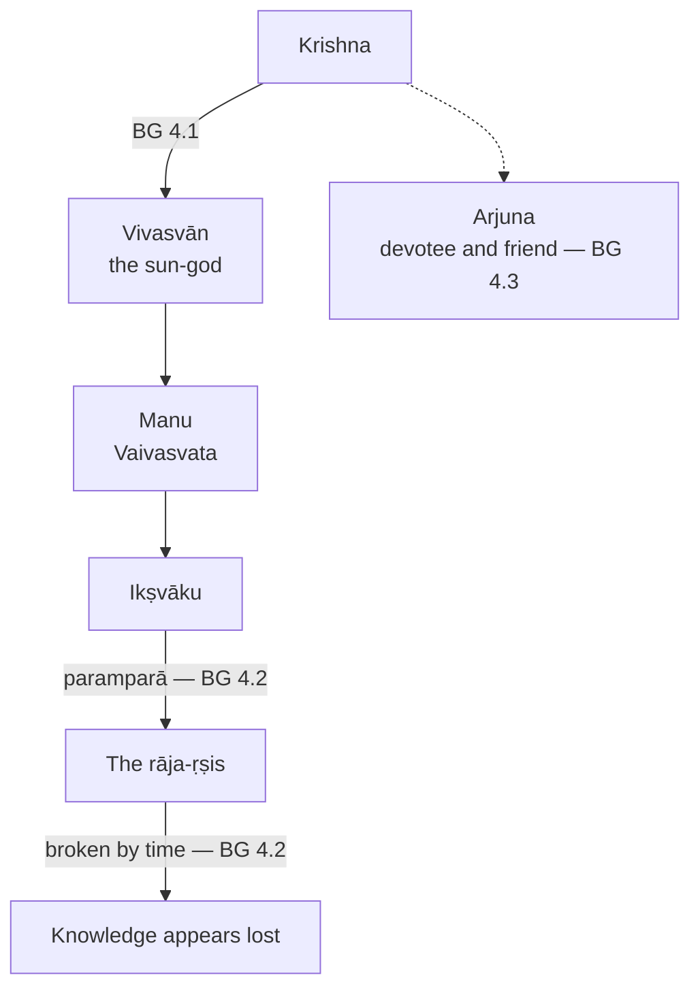

# Day 38 | BG 4.1 – 4.4 | Transcendental Knowledge | Bhakti Shastri Course

> **Source note:** Commentary is written manually from this lecture's extracted Hindi auto-captions, without Gemini or outside commentary. Timestamps use the source's two-minute windows, with cumulative minutes after the first hour. Uncertain recitations, quotations, and references remain flagged rather than reconstructed. Each main verse's Sanskrit, transliteration, synonyms, and translation is a separate reference layer verified directly against [vedabase.io](https://vedabase.io/en/library/bg/4/) (Bhaktivedanta VedaBase, Bhagavad-gita As It Is, Bhaktivedanta Book Trust); these verified blocks do not certify the accuracy of the captioned recitations.

---

## Class Snapshot & One-Line Argument Map

- **Source:** [Day 38 lecture](https://www.youtube.com/watch?v=0OMeQVwJ8Ws), duration 1:14:55.
- **Coverage:** BG 4.1–4.4 opens the Fourth Chapter, which Srila Prabhupada titles _Transcendental Knowledge_. Krishna gives the history of the Gita's knowledge through disciplic succession, explains how it was lost in time, says why He is speaking it again to Arjuna, and Arjuna asks how the Lord, born recently, could have taught the ancient sun-god. [02:00 – 06:00; 42:00 – 48:00]
- **Central questions:** Why does Krishna begin the chapter with the history of the Gita? How is spiritual knowledge preserved, and how does it get lost? What qualification does a person need to understand it? What is the healthy way to ask questions in spiritual life?
- **One-Line Argument Map:** Krishna's account: this imperishable knowledge was first given to the sun-god, who gave it to Manu, who gave it to Ikṣvāku -> the saintly kings received it through disciplic succession -> in the course of time the succession was broken and the knowledge appeared lost -> so Krishna speaks the same ancient knowledge again to Arjuna, because Arjuna is His devotee and friend | Arjuna's question: Your birth is recent and the sun-god's birth is ancient -> how am I to understand that You taught him in the beginning? -> asked not as a challenge but as "how can I understand," on behalf of all who will later doubt.

---

## Continuity & Recap from the Preceding Class (Chapter 3) [02:00 – 06:00]

The teacher opens the Fourth Chapter by tying it to the Third.

- **Where Chapter 3 ended.** Krishna taught _niṣkāma karma-yoga_ and identified its greatest enemy as _kāma_. In the conclusion He said that lust covers knowledge and keeps a person stuck here. [02:00 – 04:00]
- **The bridge.** Work done in a mood free of selfish desire is the **medium** through which the living entity attains _divya jñāna_ — transcendental knowledge. Chapter 4 describes that knowledge; Srila Prabhupada named the chapter _Transcendental Knowledge_. [02:00 – 04:00]
- **Why knowledge of the Lord is needed now.** Concluding _niṣkāma karma-yoga_ at BG 3.30, Krishna said to offer all actions to Him. So the question arises: who is this Lord to whom everything is offered? Chapter 4 supplies that knowledge — why the Lord comes and what His birth is. [02:00 – 04:00]
- **What the chapter covers.** How this knowledge is received in _paramparā_, what the knowledge is, the method of attaining it, and its glory once attained. [02:00 – 04:00]
- **The step-by-step ladder.** Having spoken _niṣkāma karma-yoga_ in Chapter 3, Krishna is now gradually raising the level: [04:00 – 06:00]
  - **Chapter 4** — _jñāna-yoga_.
  - **Chapter 6** — _dhyāna-yoga_, _aṣṭāṅga-yoga_.
  - **Finally** — Krishna wants to bring the discussion to _bhakti-yoga_, but first explains all of this.
- **The chapter's layout.** The chapter has 42 verses. The first ten verses give transcendental knowledge **about Krishna** — how it comes in _paramparā_, the Lord's birth, His activities, and what a person attains by understanding the Lord's birth and activities. The _jñāna-yoga_ proper of the chapter comes later. [04:00 – 06:00]

---

## Shloka-Wise Notes & Analytical Commentary

### Bhagavad-gita 4.1 [06:00 – 22:00; 48:00 – 52:00]

<!-- verse:4.1 -->

**Context.** Krishna begins the chapter by giving the history of the very knowledge He is about to give Arjuna: who first received it, and how it came down. [06:00 – 08:00]

**Key Terms Explained by the Teacher**

- _Imam_: This — this knowledge, the knowledge of the Gita that Krishna is giving Arjuna. [06:00 – 08:00]
- _Proktavān aham_: I have spoken it. [06:00 – 08:00]
- _Avyayam_: Imperishable — this imperishable knowledge. [06:00 – 08:00]
- _Vivasvate_: To Vivasvān, the sun-god — the personality presiding over the sun. [06:00 – 08:00]
- _Vivasvān manave prāha_: Vivasvān spoke it to Manu. [06:00 – 08:00]
- _Manur ikṣvākave 'bravīt_: Manu spoke it to Ikṣvāku, one of Manu's ten sons. [06:00 – 08:00]
- _Manu_: Here Vaivasvata Manu, not Svāyambhuva Manu, the first Manu. [08:00]

#### The history of the Bhagavad-gita [06:00 – 08:00]

- The verse lays out a chain of transmission:
  1. **Krishna** spoke it to the sun-god, Vivasvān.
  2. **Vivasvān** spoke it to Manu.
  3. **Manu** spoke it to Ikṣvāku.
- In this verse the Lord explains the **entire history of the Gita**, and the teacher notes that the purport's first line says exactly this: here we find the history of the Bhagavad-gita.
- All three recipients were **kings** — the sun-god, Manu, and Ikṣvāku of the solar dynasty.

#### Why kings must know the Gita [08:00 – 10:00]

The teacher draws two principles from the purport's opening paragraphs:

- **The royal order should understand the science of the Bhagavad-gita.** A king or leader must protect his citizens, and protection is not only protection of the body — the principal protection is protection of _dharma_. To protect _dharma_ one must have knowledge of _dharma_. So any leader should know the knowledge of the Gita.
- **Human life is meant for the cultivation of spiritual knowledge.** The purpose of human birth is to increase and cultivate spiritual knowledge — to establish one's knowledge of relationship with the Lord. Leaders should first understand it themselves and then give that knowledge to their people.

#### Education, culture, and devotion [10:00 – 12:00]

On the practical question of how such protection is given, the teacher points to three words in the purport — _education, culture and devotion_ — and says all three are required:

1. **Education** — the theory: what the Gita, the Bhāgavatam and the Rāmāyaṇa are; teaching their verses and having them memorized. But this alone is not enough. Many people in India know the _Rāmacaritamānasa_ and can quote from it here and there, or remember many verses — and it is not sufficient.
2. **Culture** — a setting in which the principles can be practised in life. Srila Prabhupada gave a culture of devotion. The teacher's examples:
   - Before Prabhupada, even a person from a brahmana family would hardly wear a _dhoti-kurta_ except perhaps for a wedding; Prabhupada gave the culture, and people began wearing _dhoti-kurta_, keeping a _śikhā_ and applying _tilaka_.
   - Morning programs, evening programs, dance and drama — all of these are part of culture, which breaks through mere ritual so that the principles can be engaged.
3. **Devotion** — even culture is not sufficient if Krishna is not at its centre. The goal must be known: surrender to Krishna. His example: during Navaratri people perform _garbā_ and many dances and dance nights — that is culture, but Krishna is not in the middle of it.

- This is why Prabhupada opened so many centres and temples: to give a culture in which a person can practise. [12:00]
- The purport stresses that executive heads and leaders should use this knowledge so that they can save their people. [12:00]

#### Dating the Gita's antiquity [12:00 – 16:00]

- The purport quotes the _Brahma-saṁhitā_ about the sun-god, and then a verse from the _Mahābhārata_ for the history of the Gita: at the beginning of Tretā-yuga, Vivasvān gave this knowledge to Manu, and Manu gave it to his son Ikṣvāku, of the Raghu dynasty. [12:00 – 14:00]
- **The calculation, as the teacher summarizes it.** We commonly say the Gita is 5,000 years old. In truth the Gita is _sanātana_, eternal — but taking current values, Prabhupada calculates: [14:00 – 16:00]
  - Kali-yuga is 432,000 years; before it Dvāpara of 800,000; before that Tretā.
  - So if Ikṣvāku received it at the beginning of Tretā, at least about two million years have passed.
  - Then, working from Manu's age, Prabhupada concludes that the Gita was spoken at least 120 million years ago.
- **Why give this history at all?** Krishna is speaking to Arjuna now, yet says He first gave it to the sun — and no one knows since when the sun has existed. The teacher draws two points: [14:00 – 18:00]
  - **We should know how ancient our history is.** Many religions are recent by comparison; this knowledge is far older.
  - **The knowledge is so special that it was given to such special people.** Krishna wants to awaken Arjuna to this.

#### The recipients were great teachers [16:00 – 18:00]

- **The sun-god** is himself a very great teacher. Later in the class the teacher adds that, as the _Brahma-saṁhitā_ quotation indicates, the sun-god has the most experienced knowledge, and that Hanumān too took knowledge from him. [16:00; 50:00]
- **Manu** — from him come the _Manu-saṁhitā_ and the _Mānava-śāstra_, the codes for human beings. He was also a very great king, and rules for seventy-one divine yugas. [16:00; 50:00]
- **Ikṣvāku** was also a great king, who used to go from here to the heavenly planets; in those times travel between heaven and earth was allowed, because of people's purity. [16:00]
- Krishna's point to Arjuna, as the teacher voices it: **all these great teachers were My students, and that same special thing I am now going to give you.** [16:00 – 18:00]

#### When the brahmana and the kshatriya combine [18:00 – 20:00]

- A brahmana can give knowledge, but when brahmana and kshatriya qualities combine, preaching becomes very effective — it also needs management and administration.
- The teacher's historical examples:
  - **Buddhism** — monks moved about begging, and it did not spread much; when King Aśoka accepted it, it spread widely.
  - **Christianity** — it had not spread much until a king named Constantine accepted it.
  - **Pratāparudra Mahārāja** — in the _Caitanya-caritāmṛta_, when he became a Vaiṣṇava devotee of Caitanya Mahāprabhu, the movement spread greatly.
- **Applying it:** if a leader becomes a devotee, that is very good, and if someone in our contact is such a person and has interest, we can try to help him.
- **On the complaint about ISKCON.** People sometimes say the society "catches" educated or influential people. The teacher's answer: **this is not discrimination, it is precision.** Anyone can come to ISKCON; but the more intelligent people one preaches to, the more they will spread the preaching.

#### The Lord's legacy [20:00 – 22:00]

- The teacher notes that Prabhupada states this principle at least four or five times in this purport.
- **A legacy given out of love.** As a person transfers his property to someone through a will, the Lord leaves a legacy for all of us. From the very beginning of creation He gives the legacy of knowledge — knowledge by which, if a person takes it and adopts it in life, he can go from this world to the Lord's abode.
- **Paramparā exists to preserve it.** To set up this unique legacy, the Lord establishes _paramparā_, so that the knowledge stays preserved.
- **The irony.** In this world children are very eager to receive their parents' property. The Lord has left so great a property for us, yet people are generally lethargic about it — they do not read the scriptures, and there is no such eagerness.

#### Recap: knowledge as the leader's protection [48:00 – 52:00]

In the later summary of the four verses, the teacher returns to 4.1:

- Krishna established how important transcendental knowledge is by giving it to the most important persons — basically, the leaders of creation. [48:00 – 50:00]
- **Everyone is a leader somewhere.** Recalling an earlier discussion of the principle that people follow whatever the great person does, the teacher says every person is leading somewhere — at least his own family. So the Gita's knowledge is important for everyone, and the higher a person's position, the more important it is. [50:00]
- **Layers of protection.** The basic protection is protecting the body; above that come food, clothing and shelter; above that is a very important protection — **protecting by knowledge.** Give someone right knowledge and he can be saved from many things, because **knowledge decides direction.** [50:00]
- **Do not stop at knowledge.** After knowledge come culture and devotion. A householder must establish a culture at home — saying "the children don't listen, they don't listen" will not work; such a culture has to be built — and then devotion: ensuring Krishna remains at the centre of everything. [50:00 – 52:00]

<Callout type="idea" title="Takeaway">
Krishna opens the chapter with the Gita's history to show how special this knowledge is: it was first given to the leaders of creation — the sun-god, Manu and Ikṣvāku — great kings and great teachers, and is now being given to Arjuna. Kings needed it because the main protection a leader gives is protection of _dharma_, and that requires knowledge; and since everyone leads someone, at least a family, it is needed by all. But knowledge alone is not enough: education must be followed by a culture of practice and by devotion with Krishna at the centre. The Lord leaves this knowledge as a loving legacy and sets up _paramparā_ to preserve it — though people are eager for their parents' property and lethargic about His. [06:00 – 22:00; 48:00 – 52:00]
</Callout>

---

### Bhagavad-gita 4.2 [22:00 – 30:00; 52:00 – 54:00]

<!-- verse:4.2 -->

**Context.** Krishna explains how the knowledge He described was received — and how it came to appear lost. [22:00]

**Key Terms Explained by the Teacher**

- _Evaṁ paramparā-prāptam_: Thus received in _paramparā_ — the succession given in the previous verse. [22:00]
- _Rājarṣayo viduḥ_: The _rāja-ṛṣis_ received and understood it. [22:00]
- _Rāja-ṛṣi_: The combination of a king — a skilled ruler and administrator — and a sage, whose character is like a sage's, with a purified heart. [22:00]
- _Sa kāleneha mahatā_: By the influence of time, in this world. [22:00]
- _Yogo naṣṭaḥ_: This _yoga_ was lost — it seemed to disappear. [22:00]

#### Time pulls everything down [22:00 – 24:00]

- The influence of time is natural, and a great deal happens because of it. The teacher's examples:
  - After Caitanya Mahāprabhu's departure, many _apasampradāyas_ arose and the knowledge was lost.
  - Bhaktivinoda Ṭhākura had to search in Bengal for many years to find a copy of the _Caitanya-caritāmṛta_.
- **His principle:** with time everything goes down. To preserve anything, to keep it up, energy is required; leave it alone and it will go down by itself.
- **Consciousness works exactly the same way.** Do nothing — stop reading and hearing — and it will go down on its own; no effort is needed for that. Effort is needed only for the positive.

#### Not a photocopy: knowledge lives in its practitioners [24:00 – 26:00]

- _Paramparā_ is not as if Krishna made a Xerox and gave it to the sun-god, who made another copy for Manu, who gave a copy to Ikṣvāku.
- **Knowledge stays preserved only when its practitioners are preserved** — when someone practises it. When there are no practitioners, the knowledge does not remain.
- This is why the knowledge was given to the _rāja-ṛṣis_, and why for the Gita both **study and application** are very important.
- **Rāja and ṛṣi — two different rulers.** In general their work is entirely different:
  - The **king** rules the outer world.
  - The **sage** rules the inner world — he is the internal ruler.
  - Their combination is very special. People were like this before; today there is no one like it.
- **Titles are not rubber stamps.** Today any title is given to anyone; so many people are called _mahātmā_. Prabhupada said _mahātmā_ is not a rubber stamp — someone's behaviour may be good in some respect, but a _mahātmā_ is one engaged in constantly glorifying the Lord.
- Prabhupada said King Janamejaya was the last _rāja-ṛṣi_. There were good kings after that, such as Shivaji — relatively — but no one now can be called a _rāja-ṛṣi_.

#### The diagram: how the succession was broken and restored [22:00 – 28:00]



#### How the original purpose was lost: commentators [26:00 – 30:00]

- Krishna is speaking in Dvāpara, on the battlefield, and says it looks as if the knowledge has been lost — the culture has gone and the knowledge is covered. Just as milk left alone spoils with time, knowledge without active, genuine practitioners gets covered. [26:00]
- **The purport's reading.** The Gita is meant for the _rāja-ṛṣis_ — those who rule and whose character and thinking are like a sage's. It is **not** meant for demoniac people who will use the Gita for their own benefit, according to their own whims. The original purpose of the Gita was lost **because of commentators.** [26:00]
- **The parallel.** As Krishna detected five thousand years ago that the knowledge was lost and re-established the _paramparā_ by giving it again to Arjuna, Prabhupada says the knowledge is lost today as well. [26:00 – 28:00]
- **Why Prabhupada wrote his Gita.** Prabhupada did not at first intend to write a commentary on the Gita, since there were already many; but he did not find a single bona fide one, and then he wrote it. In this purport he says that of so many commentaries — the teacher cites about 500 — almost all are not in _paramparā_. [28:00]
- **Using the Lord's name for business.** The teacher's illustrations: [28:00 – 30:00]
  - Search "Gita" on Amazon: "My Gita", this Gita, that Gita, Gita for doctors, Gita for engineers.
  - A former President of India wrote a Gita; Bal Gangadhar Tilak wrote a Gita.
  - A person may be a good revolutionary or a good leader, with some good moral aspect — but he cannot change the purpose of the Gita. These authors changed it through interpretation.
  - A revolutionary from Maharashtra wrote a Gita and concluded with _yuddhāya kṛta-niścayaḥ_ — the Lord said, fight with determination.
  - A yoga teacher wrote a commentary: _yoga_ appears everywhere in the Gita, so its conclusion is _yuktāhāra-vihārasya_ — eat well, keep balance, do yoga, be happy.
- **Prabhupada's response.** The cheating was so widespread that Prabhupada was frustrated, and he called this tendency demonic: if you want to write, write your own book — why use Krishna's name and call it the Gita? They will not write their own book; they use Krishna's name because a crowd will come. [30:00]
- **The purport's closing.** There is a great need for an edition of the Gita in English as it is received by _paramparā_ in disciplic succession, and Prabhupada says his commentary is a small attempt in that series. That is why Prabhupada's Gita is so special: through it lakhs and crores of people became devotees, while through the others not a single Krishna devotee was made. [30:00]

#### Recap: the village track [52:00 – 54:00]

- In the summary, the teacher returns to "lost by the influence of time" with an analogy he attributes to the _Śrīmad-Bhāgavatam_.
- In the rainy season, villages have no proper roads, and grass grows everywhere, so the path cannot be seen.
- Then someone goes by on a bike, someone on a cycle, and an impression forms — a kind of track — and everyone starts going that way. There is no road built; the track itself becomes the way.
- If people stop going that way, the grass covers it again.
- **So too with scripture.** When someone studies and follows the scriptures, the track of _dharma_ is formed. "Lost by the influence of time" means that if no one is practising it, it gets covered. Therefore **reading the scriptures and practising them is very important.**

<Callout type="idea" title="Takeaway">
Time pulls everything down, including consciousness: preserving anything takes energy, while decline needs none. Knowledge is not passed on like a photocopy — it survives only as long as it has genuine practitioners, which is why it was entrusted to the _rāja-ṛṣis_, who ruled the outer world and the inner world together. In Krishna's time, and again today, the Gita's purpose was lost through commentators who used Krishna's name for their own ends — the reason Prabhupada wrote the Gita as it is received in _paramparā_. Like a village track through grass, the path of _dharma_ stays visible only while people keep walking it by studying and practising scripture. [22:00 – 30:00; 52:00 – 54:00]
</Callout>

---

### Bhagavad-gita 4.3 [30:00 – 42:00; 54:00 – 60:00]

<!-- verse:4.3 -->

**Context.** Having said the knowledge was lost, Krishna explains why He is giving it to Arjuna today — and in doing so names the qualification for understanding it. [30:00 – 32:00]

**Key Terms Explained by the Teacher**

- _Sa evāyam ... yogaḥ ... purātanaḥ_: This same old science — the knowledge given earlier in _paramparā_, which had been lost. [30:00 – 32:00]
- _Mayā te 'dya ... proktaḥ_: Spoken by Me to you today. _Prokta_ in the sense of _prakṛṣṭa_ — explained very well, so as to remove all doubts. [32:00]
- _Bhakto 'si me sakhā ceti_: Because you are My devotee and My friend — therefore I am telling you. [32:00]
- _Rahasyam_: A secret — not everyone is qualified. [32:00]
- _Uttamam_: Beyond _tamas_ — this knowledge can take one across the world of darkness; the Gita's knowledge leads from the material world to the spiritual world. [32:00]
- _Purātana_: Old — Krishna is giving the old knowledge, nothing new. [36:00]

#### The qualification is devotion, not intelligence [32:00 – 34:00]

- The teacher calls this a very important verse. In worldly study, people go to a tuition, get a good teacher's notes, or find a YouTube video. In spiritual knowledge, we should know that this is **not sufficient** to understand the Gita or any spiritual scripture.
- What qualification did the Lord state? He did not say "very intelligent — he will understand," or "someone from Cambridge University, someone from an IIT." He said _bhakto 'si me sakhā ca_.
- **Both are needed — devotee and friend:**
  - **_Sakhā_** — a dear friend: one who establishes a relationship with the Lord.
  - **_Bhakta_** — a servant. What kind of servant? In Hindi, a _snigdha dāsa_ — a very good, reliable, affectionate servant.

#### Sādhana is the lubrication of service [34:00]

- _Dāsa_ means one engaged in the Lord's service. We all serve the Lord and chant, and do much more — but **_sādhana_ is also needed** alongside. Without _sādhana_, the service is not done in the _snigdha_ way.
- **The machine analogy.** A machine that keeps working gradually starts making more noise. Unless you put in lubricating oil, the noise increases; put in the oil and it runs perfectly smoothly. **_Sādhana_ does the work of lubrication.**
- When _sādhana_ is done well, consciousness stays good, and one serves the Lord from that consciousness — wholeheartedly, with the feeling of what a divine opportunity one has been given.
- Without it, a person engaged in service thinks, "I am being exploited — the whole service has been given only to me."
- The _snigdha dāsa_ serves with great love and follows whatever instruction he hears with great love.

#### "Apply Gita for life change" [34:00 – 36:00]

- So the method of reading and understanding the Bhagavad-gita is to have **the desire to follow it.**
- When the teacher first attended Bhakti Shastri, his tutor had everyone write on their copy of the Gita: **"Apply Gita for life change."** The Gita is not just for reading a few verses; it is for adopting.
- **The more devotional mood, the more assimilation.** The more one has a mood of service to the Lord, the more the knowledge is assimilated. First there must be service, and then within it the proper attitude; to that extent a person connects with the knowledge.

#### _Purātana_: nothing new is needed [36:00 – 38:00]

- Krishna says He is giving the old knowledge — meaning **there is no need for anything new**; what is needed is the actual knowledge of the _paramparā_.
- **The modern craving.** In modern times a person wants everything new and thinks the new will be better. So no one reads the scriptures themselves:
  - Take 15 lessons out of the Gita and publish a book — people will read that, not the Gita.
  - Publish "Top 10 Stories from the Rāmāyaṇa" — people will read it, never having read the Rāmāyaṇa in their life.
- **The foundational texts.** At least for Gauḍīya Vaiṣṇavas, the foundational knowledge of our scriptures is the _Bhagavad-gītā_, the _Bhāgavatam_, the _Caitanya-caritāmṛta_ and the _Caitanya-bhāgavata_ — and these should be read.
- Even the Lord is not giving anything new; He is giving the knowledge received through _paramparā_ — and why? **Because you are a devotee. That is the qualification.** [38:00]

#### The ticket inspector [38:00 – 40:00]

- Understanding the qualification for anything is important; if a person does not understand it, he cannot proceed.
- **The analogy:** a person is travelling on a train. He has a PhD in Sanskrit. The ticket examiner comes — what does he ask? "Where is the ticket?" The man says, "I have done a PhD in Sanskrit." The TTE asks, "Where is the ticket?" Someone says, "I have done an M.Tech from IIT." The TTE asks, "Where is the ticket?"
- Even someone who never went to school can travel if he has a ticket; without a ticket, a PhD means nothing.
- **This is why so many useless commentaries were written on the Gita** — we mix up the qualifications. The qualification is not being a moralist or a patriot; what is needed is a **devotee of the Lord** — _bhakto 'si me sakhā ca_.

#### Sakhā means no envy [40:00]

- _Sakhā_ means there is love, not envy. The teacher links this to BG 9.1, where the Lord will speak to one who is non-envious.
- **Why the Lord does not speak to the envious:** their envy would increase. His illustration: if you have quarrelled with someone and have envy toward him, and then someone starts praising him — "he is such a good person, so ideal" — you will not tolerate it, and your envy will increase. So too, glorifying the Lord before one envious of Him only increases the distance.
- **The more devotional mood, the better one understands.**

#### Devotee and demon [40:00 – 42:00]

- The purport gives two categories: **devotee and demon.** Those with a demoniac tendency will never understand. Krishna chose Arjuna to hear the Gita because he was a devotee.
- Prabhupada writes clearly that many editions of the Gita were not written by devotees — he says they were written by demons.
- **Why so strong a word?** Because such a person is using the Lord's name to run his own business and misinterpreting the Lord's message. That is a very great offence: he is misleading many people, in the name of the Gita.
- **The Gita Society anecdote.** Prabhupada was once invited to an anniversary function of a "Gita Society." When he went, there was not even a picture of the Lord — only a lamp burning. Prabhupada gave a very heavy lecture there: in a Gita society's meeting, keep Krishna first — Krishna is not even present. Because such people mislead others, Prabhupada calls them _asuras_. [42:00]

#### Recap: study as a devotional project [54:00 – 56:00]

- In the summary, the teacher says the third verse shows that **the attitude of reading is very important.**
- Generally a person studies a subject to master it — the degrees themselves are "Master of Science," "Master of Arts." But the study of the Bhagavad-gita is a **devotional project.**
- What it requires:
  1. First, **take out time.**
  2. Try to understand it well at the level of intelligence.
  3. Approach it with a **devotional attitude** — its purpose being how to serve the Lord in a good mood and how to surrender.
- **Service is essential.** If someone is not serving and studies theoretically, or to become a scholar, he will miss the point — because **the Gita is living, and it lives through those who live the Gita.** It cannot be executed at a theoretical level. [56:00]
- **The South Indian brahmana.** In the _Caitanya-caritāmṛta_, the brahmana did not know Sanskrit, yet he caught the essence of the Gita — because of _bhakto 'si me sakhā_. That attitude was his qualification. [56:00]
- Attitude does not mean intelligence is not to be applied — but first there must be time. [56:00]

#### Exclusive time [56:00 – 60:00]

- **The deity-worship test.** While performing deity worship on the altar, can you eat a _mahā-prasāda_ samosa with one hand and worship with the other? Can you do WhatsApp on the mobile while worshipping? You cannot. Likewise, studying scripture needs a level of **exclusive time**, because the inner mood is very important. [56:00]
- **How reading usually goes.** People do not read properly — in the middle they reply on WhatsApp, there is no fixed time at all, and five minutes of reading is considered enough. Then the knowledge is not revealed. [58:00]
- **Why it is not revealed.** This is not material knowledge. The Bhagavad-gita is the form of the Lord — the teacher cites the _Padma Purāṇa_ as saying it is the Lord's body — and it reveals itself to the extent He is pleased with our devotion. What is revealed is its essence: the mood of surrender, that commitment. [58:00]
- **So plan time.** According to one's situation, plan and give exclusive time; this applies to everything, including reading and hearing. [58:00]
- **Multitasking.** In Kali-yuga things become ineffective because of multitasking: [58:00 – 60:00]
  - People think they are able to do multiple things in parallel; actually they are able to do multiple things improperly — and not even one thing effectively.
  - We are not so intelligent. We are not Lord Brahmā with four heads who can do four jobs; we have a small head with a small intelligence that sometimes works. We can do one thing at one time.
  - People think multitasking increases efficiency, yet efficiency in Kali-yuga is very low, and multitasking is one cause. Do one thing, do it well, and its effectiveness will increase.

<Callout type="idea" title="Takeaway">
Krishna names the qualification for understanding the Gita: not intelligence or degrees, but being His devotee and friend — a _snigdha dāsa_ whose service is lubricated by _sādhana_, and a friend free of envy. Like the ticket on a train, without this qualification a PhD means nothing, which is why so many commentaries missed the point and why Prabhupada calls those who use the Gita for their own business demons. The knowledge is old and needs nothing new; it is a devotional project, to be studied with exclusive time, a mood of service and the desire to apply it — because the Gita lives through those who live it. [30:00 – 42:00; 54:00 – 60:00]
</Callout>

---

### Bhagavad-gita 4.4 [42:00 – 48:00; 60:00 – 64:00]

<!-- verse:4.4 -->

**Context.** For two verses Arjuna waits; then the question in his mind comes out: Krishna's birth is recent, the sun's ancient — how could He have taught the sun-god? The teacher calls it a logical question. [42:00 – 44:00]

**Key Terms Explained by the Teacher**

- _Aparaṁ bhavato janma_: Your birth is _apara_ — recent, contemporary; we two are contemporaries. Prabhupada translates it "junior." [42:00]
- _Paraṁ janma vivasvataḥ_: The sun-god's birth is _para_ — superior, senior; the sun-god has existed for so long. [42:00]
- _Katham etad vijānīyām_: How can I understand this? [42:00]
- _Tvam ādau proktavān iti_: That You spoke it in the beginning — _ādau_, at the start. [42:00]

#### How to ask a question in spiritual life [44:00]

- The teacher draws out a very important principle here: how one should ask questions in spiritual life.
- Arjuna does not say, "What are You saying — You are saying anything at all! You gave it to the sun-god? The sun has been there since when, and You are of the present."
- He says _katham etad vijānīyām_ — **how can I understand it?** It does not mean "You are wrong." This way of questioning is a healthy one: "this is not making sense to me."

#### Two extremes to avoid [44:00 – 48:00]

1. **Blind followers.** They follow blindly, whether or not they understand.
   - They have difficulty following for a long time, with determination.
   - Because they follow blindly, today they follow you; tomorrow they may follow someone else, and they keep changing.
   - The teacher's example: some people convert from Hindu to Muslim, Hindu to Christian, Christian to something else, without knowing anything — they were not following anything before either, so it is all the same to them. [44:00 – 46:00]
2. **Blind rejecters.** This is also not a good category. Spirituality should not be followed blindly, and it should not be rejected blindly either. [46:00]
   - Their problem: they never practise; they never give devotion a chance, never even try such a good path — they simply reject it. [48:00]

#### Logic, practice, and time [46:00]

- Especially in _bhakti_, because it is a sublime science, there are three ways in which things are understood, and one should know all three:
  1. **By logic** — some things we understand with logic.
  2. **By practice** — for some things practice is important; without practice it remains theory.
  3. **By time** — some things are not understood immediately even with practice; time must be given, and they are understood gradually.
- **The Lord's plan.** In the _Mahābhārata_, no one ever fully understood the Lord's plan — not even Balarāma — what the Lord wanted to do. It takes time.
- **Why the Lord is the best shelter.** The Lord always has the best plan. We do not know His plan, but we know that He has the best plan — that much we know. So we take His shelter.

#### Arjuna asks on behalf of others [48:00]

- The purport raises the question: Arjuna is the Lord's devotee — how can he not believe the Lord's words?
- Prabhupada explains that Arjuna is not actually asking for himself, but **for all of us** — and for those who will ask later. Arjuna knows that logical people will question something everywhere, so he asks in advance on their behalf.
- Arjuna knows Krishna is the Supreme Personality of Godhead, but asks so that others' doubts too can be cleared.
- **What follows.** From 4.5 Krishna explains how He and Arjuna have taken many births, speaks about His own birth, when He comes, why He comes, and what is attained by one who knows the truth of His birth. [48:00]

#### Recap: from challenge to inquiry [60:00]

- After Krishna established _bhakto 'si me sakhā_, Arjuna asked — and showed us the method of asking: _katham etat_, how can I understand? He did not challenge or refute the Lord.
- **The contrast with Chapter 1.** In the First Chapter Arjuna was challenging: how could You say kill Bhīṣma, kill Droṇa — did You kill Sāndīpani Muni? Your name is Arisūdana, not Sāndīpani-sūdana. When Arjuna challenged, the Lord said nothing. If the attitude is not right, there is difficulty.
- It is the same Arjuna, two or three chapters later, still asking questions — he will ask in the Fifth Chapter and beyond as well — but he has adjusted his approach: **how can I understand?**

#### Recap: practice before questions [60:00 – 64:00]

- The teacher applies the logic–practice–time principle to a common devotee question: "In the beginning they say there is _rasa_ in _bhakti_ — where is that _rasa_? Chant Hare Krishna and you'll be happy, read Prabhupada's books and you'll get great taste — but devotion just goes on dry." And: "They say the conditioning will go and the thought process will change — but not much is happening." [60:00 – 62:00]
- Compared with a materialist, a great deal is in fact happening; still, devotees sometimes feel it is not as much as it should be. [62:00]
- **The role of practice.** The question he asks is: how much has the person actually done? [62:00]
  - Prabhupada said **16 good rounds minimum** — and people take it as the maximum.
  - If someone wants to see the effect of the holy name, meet devotees who chant 32, 40 or 64 rounds — or experience it yourself: do it regularly for at least 20–21 days. Have you ever done it regularly for 21 days?
  - Gopal Krishna Maharaja said that if one reads Prabhupada's books for two hours, _māyā_ will not touch him. A pure devotee says this from his own experience. Have we ever read Prabhupada's books well, two hours regularly, for 20 days?
- **The honest accounting.** Altogether, we have not yet given Krishna even 15–20 proper days in our life, and we ask so many questions. For a wedding at home a person takes ten days' leave and is absorbed in it 24 hours a day — have we ever taken out time like that for the Lord? Give 15–20 days and **every person will get some experience.** [62:00 – 64:00]
- **And time.** Some things will take time even after practice, because in spiritual life **things are rewarded — awarded; they cannot be achieved.** Even after 20 days, someone may say nothing is happening. We can do our best; the teacher guarantees some experience, but whether everything is experienced is not in our hands — it is in Ṭhākurajī's, the Lord's, hands. [64:00]
- The next class continues with the Lord's birth and His nature. [64:00]

<Callout type="idea" title="Takeaway">
Arjuna's question models the healthy way to inquire: not "You are wrong" but "how can I understand?" — avoiding both blind following, which cannot persist, and blind rejection, which never even tries. In _bhakti_ some truths are understood by logic, some only by practice, and some only with time, and the Lord, whose plan no one fully grasps, always has the best plan. Arjuna, who knows who Krishna is, asks on behalf of later doubters. Before doubting the process, one should give it real practice — at least 20 days of good chanting or reading — while remembering that spiritual results are awarded by the Lord, not achieved. [42:00 – 48:00; 60:00 – 64:00]
</Callout>

---

## Cross-Shloka Conceptual Progression (BG 4.1 – 4.4)

```
BG 4.1: Krishna gives the history of the Gita, saying He first taught this imperishable knowledge to the sun-god, who taught Manu, who taught Ikṣvāku, so that its importance is shown by the greatness of the kings and teachers who first received it.
   │
   ▼
BG 4.2: The saintly kings received it through disciplic succession, but in the course of time the succession was broken, because knowledge survives only through genuine practitioners, and so the knowledge appeared to be lost.
   │
   ▼
BG 4.3: Krishna therefore speaks the same ancient knowledge again to Arjuna, because Arjuna is His devotee and friend, which is the only qualification for understanding this confidential knowledge.
   │
   ▼
BG 4.4: Arjuna asks how Krishna, born recently, could have taught the ancient sun-god, asking "how can I understand" rather than challenging, on behalf of all who would later doubt.
```

### Comparative Summary Table

| Verse | Primary Theme                   | Core Sanskrit Terms Explained                                                               | Central Mechanism / Principle                                                                                                           | Practical Imperative                                                                                                                                         |
| :---- | :------------------------------ | :------------------------------------------------------------------------------------------ | :-------------------------------------------------------------------------------------------------------------------------------------- | :----------------------------------------------------------------------------------------------------------------------------------------------------------- |
| 4.1   | The history of the Gita         | _Imam_, _proktavān aham_, _avyayam_, _vivasvate_, _manave_, _ikṣvākave_                      | The knowledge was given to the leaders of creation; a leader's chief protection is protection of _dharma_ through knowledge.            | Since everyone leads someone, learn the Gita, and follow education with a culture of practice and devotion centred on Krishna. [06:00 – 22:00; 48:00 – 52:00] |
| 4.2   | How the knowledge is lost       | _Paramparā-prāptam_, _rāja-ṛṣi_, _kālena mahatā_, _yogo naṣṭaḥ_                               | Time pulls everything down; knowledge survives only through practitioners, and was lost through self-serving commentators.              | Keep the track of _dharma_ visible by studying and practising scripture, and receive the Gita as it is in _paramparā_. [22:00 – 30:00; 52:00 – 54:00]        |
| 4.3   | The qualification to understand | _Sa evāyam_, _purātana_, _prokta_, _bhakto 'si me sakhā ca_, _rahasyam_, _uttamam_             | Only a devotee and friend — a _snigdha dāsa_ free of envy — can understand; degrees are no substitute for the ticket.                    | Study the Gita as a devotional project, with exclusive time, a service attitude and the desire to apply it. [30:00 – 42:00; 54:00 – 60:00]                   |
| 4.4   | The healthy way to ask          | _Aparaṁ bhavato janma_, _paraṁ janma vivasvataḥ_, _katham etad vijānīyām_, _tvam ādau_         | "How can I understand" avoids both blind following and blind rejection; some truths come by logic, some by practice, some only by time. | Inquire without challenging, and give the practice real time before judging its results. [42:00 – 48:00; 60:00 – 64:00]                                     |

---

## Audience Q&A & Clarifications

**1. If a person genuinely practises for 20 days, is a good result guaranteed? [64:00 – 66:00]**

- A listener notes that experience depends also on the quality of practice, and that Krishna's reciprocation does not depend on our sincerity alone — but asks whether someone who genuinely tries for 20 days, reading the _Bhāgavatam_ daily or chanting 16 quality rounds, is sure to get a very good result. The teacher agrees.
- His qualification: **the full quality is not in our hands.** Someone may resolve to chant every round completely attentively, or to read and be fully immersed in the _Bhāgavatam_ — is that in our hands? **Making the effort is in our hands.**
- First, do it quantitatively. As a person makes the effort, the Lord gives him intelligence about how to do it better — and he will definitely experience it.

**2. With so many universes, which sun-god and which yuga does Krishna mean? [66:00 – 68:00]**

- The listener asks whether each universe has its own story, or whether something is fixed — when Krishna says He gave it to the sun, which sun-god, in which yuga?
- The teacher's answer: that is not known, because **the knowledge is eternal** — the Bhagavad-gita's knowledge is eternal knowledge.
- For the present purpose, Prabhupada took the current reference point when writing the purport: Kali-yuga now, and before it Dvāpara, when the Lord gave the knowledge and spoke of having given it to Vivasvān and Manu — and calculated through Satya, Tretā and Dvāpara from there. The knowledge has been coming from the beginning.

**3. How can the mind be kept focused on one task? [68:00 – 70:00]**

- The question: when doing one task, the mind keeps thinking "this has to be done, then that" — how can it be focused in one place?
- The teacher notes that the mind is a subtle thing, and in anything one **first fixes the gross, then moves from gross to subtle.**
  - **Do one task at one time** — fix that.
  - **Plan the day**, with set times for reading, hearing and services.
- This applies especially to spiritual things. When chanting, chant. The mind will not be fully absorbed and many thoughts will come — that is no problem; bring the mind back to hearing.
- **This discipline is very important.** The habit of acting at once on a thought — a thought comes, and immediately the WhatsApp reply goes out — wastes more time, and the person cannot focus.
- **What can be combined.** For routine material work, such as cooking, one can play a spiritual lecture alongside; there is no fault in that. But spiritual things should be done exclusively — one thing at one time.

**4. When reading the _Bhāgavatam_, only a small part is understood — should one be discouraged? [70:00 – 72:00]**

- A listener says that when reading the _Bhāgavatam_ he understands only one or two percent, and asks whether, as the teacher said, some things are simply understood with time as one passes through different phases.
- The teacher confirms that **this principle applies both to the study of scripture and to life.**
- His example: Gauranga Prabhu narrates that when Radhanath Maharaja had a plan for a project, no one understood it — once or twice it was rejected, in the sense that no one took it seriously — but with time it was gradually understood.
- In spiritual life too, when we receive an instruction, we often do not understand it fully and logically at once; but **an honest person who follows it will understand it with time.** The teacher recalls lectures he heard in his early days, in VOICE or in Pune, that he did not understand then and is understanding little by little now.

**5. Does the sun-god's age begin from Satya-yuga, if the Gita dates from Tretā? [72:00 – 74:00]**

- The teacher corrects the premise: **the sun-god has always been there.** Prabhupada's calculation does not take the period when the Lord gave the knowledge to the sun-god.
- What it takes: the Lord gives the knowledge at the end of Dvāpara; then, taking the most recent cycle — Dvāpara gone, Tretā gone, Satya before — Prabhupada calculates when the sun-god would have given it to Manu.
- **This calculation has no connection with the sun-god's age.** If it is not yet clear, the teacher says, there is no problem.

---

## Last-Page Revision Sheet

### High-Yield Facts & Terminological Anchors

- **Chapter 4:** Srila Prabhupada titles it _Transcendental Knowledge_; it has 42 verses, and its first ten verses give transcendental knowledge about Krishna. [02:00 – 06:00]
- **Chapter 4:** _Niṣkāma karma_ is the medium for attaining _divya jñāna_; BG 3.30's "offer everything to Me" raises the question of who the Lord is. [02:00 – 04:00]
- **Chapter 4:** The ladder — _niṣkāma karma-yoga_ (Ch. 3), _jñāna-yoga_ (Ch. 4), _dhyāna/aṣṭāṅga-yoga_ (Ch. 6), and finally _bhakti-yoga_. [04:00 – 06:00]
- **4.1:** Krishna → Vivasvān (sun-god) → Manu (Vaivasvata) → Ikṣvāku: the history of the Gita. [06:00 – 08:00]
- **4.1:** The royal order should understand the science of the Gita, because a leader's main protection is protection of _dharma_. [08:00 – 10:00]
- **4.1:** Human life is meant for the cultivation of spiritual knowledge. [08:00 – 10:00]
- **4.1:** Education, culture and devotion — all three are needed; culture without Krishna at the centre is not enough. [10:00 – 12:00]
- **4.1:** At least about two million years by the yuga count, and at least 120 million years by Manu's age, as Prabhupada calculates. [14:00 – 16:00]
- **4.1:** Brahmana and kshatriya qualities combined make preaching effective; preaching to the influential is precision, not discrimination. [18:00 – 20:00]
- **4.1:** The Gita is the Lord's legacy, and _paramparā_ is how it is preserved. [20:00 – 22:00]
- **4.1:** Knowledge decides direction; protecting by knowledge is a higher protection than food, clothing and shelter. [50:00]
- **4.2:** A _rāja-ṛṣi_ rules both the outer world and the inner world; Janamejaya was the last. [22:00 – 26:00]
- **4.2:** Everything goes down with time; preserving takes energy, and consciousness declines on its own if reading and hearing stop. [22:00 – 24:00]
- **4.2:** Knowledge stays preserved only while its practitioners are preserved. [24:00]
- **4.2:** The Gita's original purpose was lost because of commentators; Prabhupada found almost none of some 500 commentaries in _paramparā_. [26:00 – 28:00]
- **4.2:** Prabhupada called using Krishna's name to sell one's own ideas demonic. [30:00]
- **4.3:** The qualification is _bhakto 'si me sakhā ca_ — devotee and friend — not intelligence or degrees. [32:00]
- **4.3:** _Rahasyam_ — not everyone is qualified; _uttamam_ — beyond _tamas_. [32:00]
- **4.3:** _Bhakta_ means a _snigdha dāsa_; _sādhana_ is the lubrication of service. [34:00]
- **4.3:** "Apply Gita for life change" — the more service attitude, the more assimilation. [36:00]
- **4.3:** _Purātana_ — nothing new is needed; read the foundational scriptures themselves. [36:00 – 38:00]
- **4.3:** _Sakhā_ implies no envy; the Lord does not speak to the envious because their envy would increase. [40:00]
- **4.3:** The Gita lives through those who live the Gita; it is a devotional project, not a master's degree. [54:00 – 56:00]
- **4.3:** Study needs exclusive time; multitasking means doing many things improperly. [56:00 – 60:00]
- **4.4:** _Aparam_ — junior, contemporary; _param_ — senior, superior. [42:00]
- **4.4:** _Katham etad vijānīyām_ — "how can I understand" is not "You are wrong." [44:00]
- **4.4:** Avoid blind following and blind rejection. [44:00 – 48:00]
- **4.4:** Some things are understood by logic, some by practice, some only by time. [46:00]
- **4.4:** Arjuna asks on behalf of those who will later doubt. [48:00]
- **4.4:** In spiritual life things are rewarded — awarded — not achieved. [64:00]
- **Q&A:** Effort is in our hands; full quality is not. [64:00 – 66:00]
- **Q&A:** Fix the gross first — one task at one time, a planned day — then work on the subtle mind. [68:00 – 70:00]

### Core Analogies & Metaphors

- **The ladder of chapters:** _Karma_ to _jñāna_ to _dhyāna_ to _bhakti_ — Krishna raises the level step by step. [04:00 – 06:00]
- **Garbā without Krishna:** Culture is present, but Krishna is not at the centre. [12:00]
- **Aśoka, Constantine, Pratāparudra:** A religion spreads when a ruler accepts it. [18:00]
- **The will and the inheritance:** Children are eager for their parents' property; people are lethargic about the Lord's legacy. [20:00]
- **The photocopy:** _Paramparā_ is not a chain of Xerox copies; knowledge lives in its practitioners. [24:00]
- **Spoiled milk:** Left alone, things spoil with time. [26:00]
- **"Gita for doctors, Gita for engineers":** Krishna's name used to sell one's own book. [28:00]
- **The lubricated machine:** _Sādhana_ keeps service from becoming noisy complaint. [34:00]
- **"Top 10 stories from the Rāmāyaṇa":** The modern craving for the new over the foundational. [36:00]
- **The ticket inspector:** A PhD or an IIT degree is no substitute for the ticket. [38:00 – 40:00]
- **Praise of a rival:** Hearing someone we envy glorified only increases the envy. [40:00]
- **The Gita Society with no Krishna:** A lamp burning, but no picture of the Lord. [42:00]
- **The village track:** A path through grass stays open only while people keep walking it. [52:00 – 54:00]
- **The samosa at the altar:** One cannot worship with one hand and eat or WhatsApp with the other. [56:00]
- **Four-headed Brahmā:** We have one small head and can do one thing at one time. [58:00]
- **Ten days' leave for a wedding:** We have never given the Lord even such time. [64:00]

---

## Transcript Verification Flags

- **Sanskrit:** [exact Sanskrit omitted: auto-captions uncertain] applies to the opening prayers, the main verse recitations, and all incidental scriptural quotations in this class. Do not treat captioned recitations as exact quotations. The four main verses of this class are supplied separately from vedabase.io and are not derived from the captions.
- **Verse text — BG 4.2:** The vedabase.io page for BG 4.2 renders the Devanagari as "योगे नष्टः" while its transliteration reads "yogo naṣṭaḥ". The shared verse file copies both fields exactly as published and does not reconcile them.
- **Speaker:** The captions do not state the speaker's name. The `speaker` field follows the preceding lectures of this course.
- **Reference [02:00 – 04:00]:** The teacher cites BG 3.30 as the conclusion of _niṣkāma karma-yoga_; the recitation is captioned as fragments. The verse number is retained as spoken; its wording has not been reconstructed.
- **Manu [06:00 – 08:00]:** The captions first name Svāyambhuva Manu and his ten sons, then specify Vaivasvata Manu "not Svāyambhuva Manu", followed by a garbled phrase. The note follows the teacher's correction to Vaivasvata Manu; the garbled phrase has not been reconstructed.
- **Purport [08:00 – 14:00; 26:00 – 30:00; 48:00]:** The teacher reads several English sentences from Srila Prabhupada's purports to BG 4.1, 4.2 and 4.4. The captioned renderings are approximate; the points are summarized in paraphrase and the purports themselves should be consulted directly.
- **Quotations [12:00 – 14:00]:** The _Brahma-saṁhitā_ quotation about the sun-god and the _Mahābhārata_ verse on the history of the Gita are mentioned but not recited intelligibly in the captions. Neither has been supplied from memory.
- **Figures [14:00 – 16:00]:** The yuga durations, the "at least two million years" and "at least 120 million years" figures, a captioned "84 years", and a later "500 years" (apparently a slip for 5,000) are retained only as the teacher's summary of the purport's calculation; the captioned arithmetic is partly garbled and has not been repaired.
- **Name [18:00]:** "प्रताप ऋतु महाराज" in the captions is rendered as Pratāparudra Mahārāja, the king in the _Caitanya-caritāmṛta_ the teacher describes.
- **Quotation [24:00]:** The definition of _mahātmā_ attributed to Prabhupada includes a captioned fragment resembling a verse phrase about constant glorification; it has not been identified or reconstructed.
- **Commentators [28:00 – 30:00]:** The former President of India who wrote a Gita is not named in the captions, and the Maharashtrian revolutionary and the yoga teacher are not named; none has been supplied. The recited phrases _yuddhāya kṛta-niścayaḥ_ and _yuktāhāra-vihārasya_ are captioned as fragments and retained only as the teacher's characterization.
- **Reference [40:00]:** The teacher cites BG 9.1 on the Lord speaking to the non-envious; the recitation is captioned indistinctly and has not been reconstructed.
- **Reference [50:00]:** The captions say "यह चर्चा हमने 32 में भी की थी" alongside a fragment resembling "_yad yad ācarati śreṣṭhaḥ_". It is unclear whether "32" refers to the Day 32 class or a verse number; the note refers to it only as an earlier discussion.
- **Platform interruption [52:00 – 54:00]:** An exchange about muting a participant and assigning a co-host interrupts the class and is omitted from the commentary.
- **References [56:00 – 58:00]:** The _Caitanya-caritāmṛta_ account of the South Indian brahmana and the _Padma Purāṇa_ statement that the Gita is the Lord's body are retained as the teacher states them; no chapter or verse was given in class.
- **Exchange [60:00]:** The Chapter 1 exchange about Sāndīpani Muni and "Arisūdana" is captioned loosely and summarized in paraphrase.
- **Quotation [62:00]:** The statement attributed to Gopal Krishna Maharaja about reading Prabhupada's books for two hours is retained as the teacher reports it.
- **Caption fragment [74:00]:** A closing phrase captioned as "अभी 55000 साल तो दिए ही है" is unclear in context and has not been interpreted.
