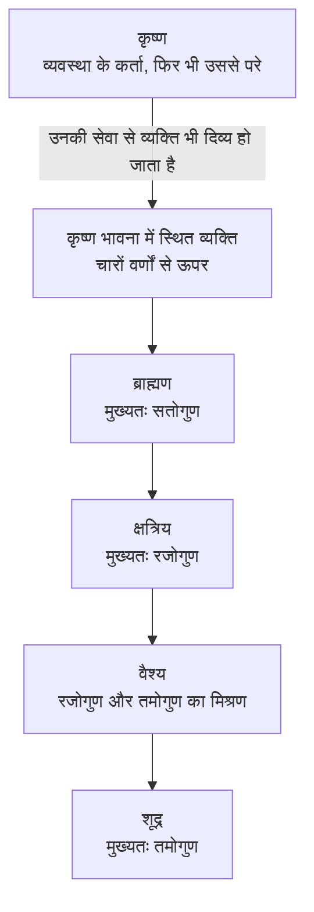

# दिन 40 | BG 4.11 – 4.14 | दिव्य ज्ञान | भक्ति शास्त्र कोर्स

> **Source note:** यह टिप्पणी इसी कक्षा के निकाले गए मूल हिन्दी ऑटो-कैप्शन से सीधे तैयार की गई है — किसी बाहरी भाष्य से नहीं। यह अंग्रेज़ी टिप्पणी का अनुवाद नहीं है; दोनों संस्करण एक ही ट्रांसक्रिप्ट से तैयार किए गए हैं और उनका ढाँचा तथा टाइमस्टैम्प एक समान रखे गए हैं। टाइमस्टैम्प स्रोत की दो-मिनट की खिड़कियों के अनुसार हैं, और पहले घंटे के बाद संचयी मिनटों में दिए गए हैं। अस्पष्ट पाठ, उद्धरण और संदर्भ स्मृति से पूरे नहीं किए गए — उन्हें चिह्नित रखा गया है। प्रत्येक मुख्य श्लोक का संस्कृत, लिप्यंतरण, शब्दार्थ और अनुवाद एक अलग संदर्भ-परत है, जो सीधे [vedabase.io](https://vedabase.io/en/library/bg/4/) (Bhaktivedanta VedaBase, Bhagavad-gita As It Is, Bhaktivedanta Book Trust) से सत्यापित है; vedabase पर भगवद्गीता का हिन्दी संस्करण उपलब्ध न होने के कारण ये सत्यापित खंड अंग्रेज़ी में ही दिए गए हैं। ये खंड कक्षा में हुए उच्चारण की शुद्धता प्रमाणित नहीं करते।

---

## कक्षा सार एवं एक-पंक्ति तर्क-क्रम

- **स्रोत:** [दिन 40 की कक्षा](https://www.youtube.com/watch?v=IHgI-VG3R34), अवधि 1:58:56.
- **विषय-विस्तार:** BG 4.11–4.14 से वह खंड आरंभ होता है जिसे आचार्य BG 4.1–4.10 में दिए गए दिव्य ज्ञान की एप्लीकेशन कहते हैं। भगवान बताते हैं कि वे हर किसी के साथ उसकी शरणागति के अनुसार आदान-प्रदान कैसे करते हैं, अधिकांश लोग फिर भी देवताओं के पास क्यों जाते हैं, उन्होंने गुण और कर्म के आधार पर चार वर्णों की सृष्टि कैसे की और फिर भी उनसे बँधे नहीं, और कर्म उन्हें कभी स्पर्श क्यों नहीं करता। [08:00 – 66:00]
- **केंद्रीय प्रश्न:** यदि सब लोग कृष्ण के ही मार्ग में हैं, तो क्या हर मार्ग एक ही गंतव्य तक पहुँचाता है? यदि कृष्ण भी इच्छाएँ पूरी करते हैं, तो देवताओं के मंदिरों में भीड़ क्यों है? यदि कृष्ण ने चार _वर्णों_ (varṇa) की सृष्टि की और स्वयं भी किसी परिवार में जन्म लिया, तो क्या वे पक्षपाती नहीं, और क्या वे कर्म से बँधे नहीं?
- **One-Line Argument Map:** भगवान का आदान-प्रदान: जो व्यक्ति जिस प्रकार शरण लेता है, भगवान ठीक उसी प्रकार उसके साथ आदान-प्रदान करते हैं -> इसलिए सकाम कर्मी, निर्विशेषवादी और भक्त का फल अलग-अलग है -> और लोग देवताओं को इसलिए चुनते हैं क्योंकि उन्हें अपनी इच्छाओं का फल जल्दी चाहिए -> जबकि चार वर्णों की व्यवस्था भगवान ने गुण और कर्म के अनुसार बनाई है, इसलिए वे पक्षपाती नहीं हैं | भगवान की दिव्यता: वे इस व्यवस्था के कर्ता होते हुए भी अकर्ता हैं -> क्योंकि उन्हें किसी भी कर्म के फल की इच्छा नहीं है -> और जो इसे सच में जानता है, अर्थात् उसके अनुसार जीता है, वह भी कर्म से नहीं बँधता।

---

## पूर्व कक्षाओं से निरंतरता एवं पुनरावलोकन (BG 4.1 – 4.10) [02:00 – 08:00]

आचार्य अब तक के अध्याय का पुनरावलोकन करते हैं, क्योंकि आज के श्लोक पहले दस श्लोकों में स्थापित ज्ञान की एप्लीकेशन हैं।

- **BG 4.1 — परंपरा।** भगवान ने यह ज्ञान सबसे पहले सूर्यदेव विवस्वान को दिया; विवस्वान ने मनु को, और मनु ने इक्ष्वाकु को। इस प्रकार राजर्षियों ने इसे परंपरा से प्राप्त किया। [02:00 – 04:00]
- **BG 4.2 — लोप।** काल के प्रभाव से यह ज्ञान नष्ट हो गया। [04:00]
- **BG 4.3 — पात्र।** भगवान वही ज्ञान अब अर्जुन को दे रहे हैं, क्योंकि अर्जुन उनका भक्त और सखा है; इसीलिए भगवान उसे यह रहस्यमय, दिव्य ज्ञान दे रहे हैं। [04:00]
- **BG 4.4 — अर्जुन का प्रश्न।** आपका जन्म तो अभी हुआ है और विवस्वान का बहुत पहले; मैं कैसे समझूँ कि आपने उन्हें यह ज्ञान दिया? [04:00]
- **BG 4.5 — अनेक जन्म।** भगवान अपने विषय में बोलना आरंभ करते हैं: मेरे और तुम्हारे बहुत से जन्म हो चुके हैं; मुझे उनका स्मरण है, तुम्हें नहीं। [04:00]
- **BG 4.6 — जन्म का रहस्य।** अजन्मा होते हुए भी वे अपनी अंतरंगा शक्ति _योग-माया_ (yoga-māyā) से, अपनी इच्छा से प्रकट होते हैं। [04:00]
- **BG 4.7 — कब आते हैं।** जब-जब धर्म की ग्लानि होती है और अधर्म बढ़ता है। [04:00]
- **BG 4.8 — क्यों आते हैं।** धर्म की सम्यक् स्थापना के लिए, दुष्टों के विनाश के लिए, और — जैसा आचार्य जोड़ते हैं — अपने प्रेमी भक्तों का विरह दूर करने के लिए। [06:00]
- **BG 4.9 — जन्म और कर्म को जानना।** जो भगवान के जन्म और कर्म की दिव्यता को तत्त्व से जान लेता है, वह फिर संसार में नहीं आता। आचार्य बल देते हैं कि यहाँ _जानने_ का अर्थ श्लोक याद कर लेना नहीं, बल्कि **उसके अनुसार जीवन जीना** है। [06:00]
- **BG 4.10 — अनेकों ने उन्हें प्राप्त किया।** एक-दो नहीं, बहुत से लोग राग, भय और क्रोध से मुक्त होकर, उनका आश्रय लेकर, संसार-चक्र से मुक्त हो चुके हैं और उनके भाव को प्राप्त हुए हैं — जैसे वे नित्य हैं, वैसे ही वे भी नित्य हुए। [06:00]
- **आज से जोड़।** अर्जुन का अंतर्निहित प्रश्न अगला खंड खोलता है: जो भक्त पूरी तरह आपका आश्रय लेते हैं और आपके जन्म-कर्म को दिव्य जानते हैं, वे तो आपको प्राप्त कर लेते हैं। पर बाकी श्रेणियों का क्या — कोई _ज्ञानी_ (jñānī) जो किसी और उद्देश्य से आपकी शरण ले, या ऐसे लोग जो आपके जन्म-कर्म की दिव्यता को पूरी तरह जाने बिना आपके पास आएँ? क्या आप उनके साथ आदान-प्रदान करते हैं? आचार्य BG 4.11–4.15 को **दिव्य ज्ञान की एप्लीकेशन** का खंड कहते हैं। [08:00]

---

## श्लोक-वार टिप्पणी एवं विश्लेषण

### भगवद्गीता 4.11 [08:00 – 28:00]

<!-- verse:4.11 -->

**प्रसंग।** अर्जुन जानना चाहते हैं कि जो शुद्ध भक्त नहीं हैं — _ज्ञानी_ और _कर्मी_ — क्या भगवान उनके साथ भी आदान-प्रदान करते हैं। आचार्य इसे बहुत प्रसिद्ध श्लोक कहते हैं, और ऐसा श्लोक भी जिस पर बड़ा कन्फ्यूज़न है। [08:00 – 10:00]

**कक्षा में समझाए गए प्रमुख शब्द**

- _ये यथा मां प्रपद्यन्ते_ (ye yathā māṁ prapadyante): जो लोग जिस प्रकार से मेरी शरण लेते हैं। [10:00]
- _तांस्तथैव भजाम्यहम्_ (tāṁs tathaiva bhajāmy aham): मैं ठीक वैसे ही उनको भजता हूँ — _भजामि_ का अर्थ यहाँ "उनके साथ आदान-प्रदान करता हूँ", और जैसा वे आगे स्पष्ट करते हैं, "उन्हें भजन का फल देता हूँ"। [10:00; 12:00]
- _मम वर्त्म_ (mama vartma): मेरा मार्ग — _वर्त्म_ अर्थात् पाथ, मार्ग। [10:00]
- _अनुवर्तन्ते_ (anuvartante): उसी का अनुवर्तन करते हैं, उसी को फॉलो करते हैं। [10:00]
- _मनुष्याः पार्थ सर्वशः_ (manuṣyāḥ pārtha sarvaśaḥ): हे पार्थ, सारे मनुष्य, सब प्रकार से — एक भी नहीं बचा। [10:00; 14:00]

#### वह गलत अर्थ जिससे आचार्य सावधान करते हैं [08:00 – 12:00]

- आचार्य बताते हैं कि बहुत सी ऑर्गनाइज़ेशन इस श्लोक का यह मिस-इंटरप्रिटेशन करती हैं कि कोई कुछ भी करे, भगवान के पास ही पहुँचता है — जैसे नदी कहीं से भी निकले, समुद्र में ही जाती है; इसलिए किसी की भी पूजा करो, भगवान की शरण में ही जा रहे हो। [08:00 – 10:00]
- इसी से जुड़ा एक रोंग एप्लीकेशन यह है कि किसी भी देवता को फॉलो करो, अंत में भगवान के पास ही पहुँचोगे, और कौन बड़ा है कौन छोटा, यह वे देवता आपस में देख लेंगे। [12:00]
- उनका उत्तर है कि पहली पंक्ति ठीक उलटी बात कहती है: **जो जैसे शरण में आता है, भगवान उसे वैसा ही फल देते हैं।** अलग-अलग मार्गों को समान फल नहीं मिलता। [12:00]
- वे कहते हैं कि आचार्यों ने इस श्लोक को तीन-चार स्तरों पर समझाया है। [10:00]

#### पहली पंक्ति: आशा देने वाला प्रस्ताव, और भगवान की क्षमता [10:00]

- वे पहली पंक्ति को **होप-गिविंग** कहते हैं। यह भगवान की कैपेसिटी बताती है: वे कितने भी जीवों के साथ पूर्ण मात्रा में आदान-प्रदान कर सकते हैं। किसी और में ऐसी क्षमता नहीं है।
- यह हर जीव के लिए भगवान का **ओपन ऑफर** भी है: जीव जैसे भी उनकी शरण में जाता है, वे वैसे ही आदान-प्रदान करते हैं।

#### पहली पंक्ति: अलग-अलग दृष्टिकोण, अलग-अलग फल [12:00 – 16:00]

- _कर्मी_ (karmī) को भोग चाहिए — स्वर्ग और भोगों की प्राप्ति — और उसे वही मिलता है। _ज्ञानी_ को मुक्ति चाहिए और उसे वही मिलती है। भक्त को सेवा चाहिए — नित्य सेवा — और भगवान उसे अपना धाम दे देते हैं। [12:00 – 14:00]
- निर्विशेषवादी _ज्ञानियों_ में आचार्य विश्वनाथ चक्रवर्ती ठाकुर की टीका के आधार पर दो प्रकार बताते हैं: [14:00]
  1. **मायावादी**, जो भगवान के शरीर को _माया_ (māyā) और नश्वर मानते हैं। उनसे भगवान कहते हैं, "तुम कहते हो न कि मैं माया हूँ — तो मैं तुम्हें माया के संसार में ही बार-बार घुमाता रहता हूँ।"
  2. **ब्रह्मवादी**, जो जानते हैं कि भगवान का शरीर _सच्चिदानंद_ (sac-cid-ānanda) है, फिर भी ब्रह्म में लीन होना चाहते हैं। उन्हें भगवान मुक्ति देते हैं।
- भक्त को भगवान का धाम मिलता है। [14:00]

#### दूसरी पंक्ति: सब उनके मार्ग में हैं — पर एक गंतव्य तक नहीं [12:00; 14:00 – 22:00]

- कोई यह नहीं कह सकता कि मैं भगवान से पूरी तरह इंडिपेंडेंट हूँ। किसी न किसी प्रकार सब लोग भगवान को ही ढूँढ रहे हैं और उन्हीं के प्रति आकर्षित हैं — कोई डायरेक्टली, कोई इनडायरेक्टली। [12:00]
- **नास्तिक भी** उनके मार्ग में है, इस अर्थ में: [14:00 – 16:00]
  - जो सीधे कृष्ण के शरणागत होता है, वह **अंतरंगा शक्ति** के अंतर्गत है — श्रीमती राधारानी का आश्रय लेता है।
  - जो कृष्ण के शरणागत नहीं होता, वह **बहिरंगा शक्ति**, माया देवी की सेवा करता है — और _माया_ भी भगवान की ही शक्ति है; भगवान स्वयं उसे "मेरी माया" कहते हैं। [उद्धरण चिह्नित; Verification Flags देखें।]
  - इस प्रकार सब उन्हीं के मार्ग में हैं, कोई अंतरंगा शक्ति की सेवा कर रहा है, कोई बहिरंगा की — **पर रिज़ल्ट एक नहीं है।** आचार्य कहते हैं, "आप भगवान से बच नहीं सकते, पर सबका डेस्टिनेशन एक नहीं है।"
- **ट्रेन का उदाहरण**, जिसे आचार्य श्रील प्रभुपाद के तात्पर्य से बताते हैं: कोई स्टेशन गया, मुंबई जाना है, पर दिल्ली का टिकट लेकर दिल्ली की ट्रेन में बैठ गया — वह मुंबई नहीं पहुँचेगा। [16:00]
- **गलत अर्थ लें तो विरोधाभास।** गीता में आगे भगवान कहेंगे कि जो देवताओं की पूजा करता है वह देवताओं के पास जाता है, जो पितरों की पूजा करता है वह पितरों के पास, और जो भूतों की पूजा करता है वह भूतों के पास जाता है। यदि दूसरी पंक्ति का अर्थ यह होता कि सब एक ही जगह पहुँचते हैं, तो गीता में कंट्राडिक्शन हो जाता। [20:00] [श्लोक-संदर्भ चिह्नित; Verification Flags देखें।]
- **दूसरी पंक्ति का वास्तविक अर्थ:** व्यक्ति जिस चीज़ से भी आकर्षित है, वह वास्तव में कृष्ण का ही स्प्लेंडर है, इसलिए वह वास्तव में कृष्ण से ही आकर्षित है। संसार की सारी आकर्षक चीज़ें कृष्ण से आ रही हैं — पर वे कृष्ण की ओर नहीं ले जातीं। कोई शराब की बोतल से आकर्षित है, कोई धन से, कोई स्त्री से; ये भी कृष्ण की शक्ति हैं, पर डेस्टिनेशन अलग है। [20:00 – 22:00]

#### सार: शरणागति के भाव को शुद्ध करना [16:00 – 20:00]

- चूँकि भगवान ठीक वैसे ही आदान-प्रदान करते हैं जैसे कोई शरण लेता है, जीव को एक ही काम करना है — **अपनी शरणागति को शुद्ध करना**। भगवान के साथ ज़्यादा कैलकुलेशन नहीं करना चाहिए। [16:00 – 18:00]
- आचार्य इसे सारे शास्त्रों का एसेंस कहते हैं: किसी को और कुछ समझ न आया, पर उसने शरणागति ले ली, तो उसे एसेंस मिल गया। सारी _साधना-भक्ति_ (sādhana-bhakti) हृदय और मन को शुद्ध करने के लिए है, ताकि व्यक्ति शुद्ध भाव से, बिना किसी अपेक्षा के, भगवान की सेवा में लग सके। [20:00]

#### पाँच _रसों_ में आदान-प्रदान [18:00]

- आचार्यों का दिया दूसरा अर्थ, जिसे वे विश्वनाथ चक्रवर्ती ठाकुर का बताते हैं: भगवान पाँचों _रसों_ (rasa) में आदान-प्रदान करते हैं। कोई उनकी माता-पिता के रूप में सेवा करना चाहे तो वे बच्चा बनने को तैयार हैं; मित्र के रूप में, तो सखा बनने को तैयार हैं; कोई उन्हें पिता माने, तो वे पिता बनने को तैयार हैं।
- इतना फ्लेक्सिबल कोई पर्सनैलिटी नहीं है, और किसी और की ऐसी कैपेसिटी भी नहीं है।

#### इस संसार में कोई आश्रय नहीं दे सकता [18:00]

- उनका चित्र: पाँच लोग आईसीयू में हैं, सबको ऑक्सीजन मास्क और बोतल लगी है, और सब एक-दूसरे से कह रहे हैं, "चिंता मत करो, ठीक हो जाओगे।" यही भौतिक जगत है — यहाँ कोई एक व्यक्ति को भी सच्चा आश्रय नहीं दे सकता, माता-पिता बच्चे को भी नहीं, क्योंकि सबकी अपनी हालत गंभीर है।
- एक भगवान ही सारी सृष्टि का पालन करते हैं, और वे बड़े प्रेमी हैं, सबके लिए ओपन ऑफर के साथ।

#### श्रील प्रभुपाद का तात्पर्य क्या स्पष्ट करता है [22:00 – 24:00]

- आचार्य तात्पर्य की प्रशंसा करते हैं कि उसमें सभी आचार्यों की टीकाओं का एसेंस सरल शब्दों में है। [22:00]
- **तीन पहलू:** सब लोग कृष्ण के अलग-अलग आस्पेक्ट से आकर्षित होते हैं — ब्रह्म, परमात्मा और भगवान। योगी परमात्मा का ध्यान करते हैं, _ज्ञानी_ ब्रह्म का, और भक्त भगवान से आकर्षित होता है। कृष्ण का पूर्ण साक्षात्कार केवल शुद्ध भक्तों को होता है। [22:00]
- **आध्यात्मिक जगत में भी** कृष्ण उसी दिव्य भाव में आदान-प्रदान करते हैं जैसा भक्त चाहता है: कोई उन्हें स्वामी के रूप में चाहता है, कोई मित्र, कोई पुत्र, कोई प्रेमी के रूप में। [24:00]
- **निर्विशेषवादी**, जो भगवान के नित्य, आनंदमय व्यक्तित्व को स्वीकार नहीं करते और उनके स्वरूप को _माया_ मानते हैं, उन्हें दिव्य सेवा नहीं मिलती; वे बताते हैं कि तात्पर्य उनके लक्ष्य को स्पिरिचुअल सुसाइड कहता है। [24:00]
- **निष्कर्ष:** किसी भी मार्ग में सफलता के लिए भगवान की कृपा आवश्यक है, इसलिए सबको — भौतिक इच्छा वाले को, बिना इच्छा वाले को, या मोक्ष की इच्छा वाले को — भगवान की शरण में जाना चाहिए। [24:00] [उद्धरण चिह्नित; Verification Flags देखें।]

#### "मैं तैयार हूँ — क्या आप तैयार हैं?" [26:00 – 28:00]

- पूरे संसार में कोई यह कमिटमेंट नहीं दे सकता। भगवान कह रहे हैं: **मैं तैयार हूँ, और मैं आदान-प्रदान में परफेक्ट हूँ।**
- उनका विरोधी चित्र हिन्दी फ़िल्म है: लगभग हर फ़िल्म टूटे दिल की कहानी है, जिसमें दिल बनाकर उसमें तीर लगा देते हैं — क्योंकि दिल गलत जगह दे दिया। वे कहते हैं कि पूरे इतिहास में एक भी केस नहीं है कि किसी ने भगवान का आश्रय लिया और उसे पश्चाताप करना पड़ा।
- भगवान हर रोल में परफेक्ट हैं: देवकी-वसुदेव के पुत्र के रूप में, नंद महाराज और यशोदा के पुत्र के रूप में; _गोपियों_ के साथ; मित्रों के बीच मित्र के रूप में; परफेक्ट राजा और परफेक्ट पति के रूप में। [संख्या चिह्नित; Verification Flags देखें।]
- **वास्तविक समस्या हमारी ओर है:** कृष्ण दे रहे हैं, पर जीव अनिच्छुक है। हम कृष्ण को कम से कम समय देते हैं, और वह भी पुअरेस्ट क्वालिटी का। उनका उदाहरण मंदिर की दान-पेटी है: दानदाता अपने पर्स में वे सिक्के ढूँढता है जो आज तक यूज़ नहीं हुए, और वह नोट जो बाहर कहीं चलता नहीं। [26:00 – 28:00]
- फिर भी यह श्लोक दिखाता है कि कृष्ण कितने दयालु हैं, जो हमारी ऐसी टूटी-फूटी भक्ति के साथ भी आदान-प्रदान करते हैं। वे श्रील भक्तिसिद्धांत सरस्वती ठाकुर का कथन स्मरण करते हैं कि इस संसार में एक ही प्रॉब्लम है — कृष्ण का अभाव। [28:00] [शब्दावली चिह्नित; Verification Flags देखें।]

<Callout type="idea" title="सार">
पहली पंक्ति भगवान का ओपन ऑफर और उनकी क्षमता का माप है: हर जीव जैसे शरण लेता है, वे ठीक वैसे ही आदान-प्रदान करते हैं — _कर्मी_ को भोग, _ज्ञानी_ को मुक्ति, भक्त को अपना धाम और सेवा। दूसरी पंक्ति कहती है कि सब उनके ही मार्ग में हैं — कोई उनकी अंतरंगा शक्ति की सेवा कर रहा है, कोई बहिरंगा की — और सारा आकर्षण वास्तव में उन्हीं के प्रति है; पर यह नहीं कहती कि सब एक ही गंतव्य तक पहुँचते हैं। चूँकि आदान-प्रदान शरणागति के अनुरूप है, जीव का एक ही काम है — शरणागति के भाव को शुद्ध करना और भगवान के साथ कैलकुलेशन छोड़ देना। [08:00 – 28:00]
</Callout>

---

### भगवद्गीता 4.12 [28:00 – 40:00]

<!-- verse:4.12 -->

**प्रसंग।** अर्जुन का अगला प्रश्न: यदि आप सबके साथ आदान-प्रदान करते हैं, तो लोग आपकी शरण में क्यों नहीं आते? शनि देव के मंदिर में और देवी माँ के मंदिर में बहुत भीड़ रहती है, जबकि कृष्ण के मंदिर अक्सर खाली रहते हैं। यदि सब आपके ही मार्ग में हैं, तो आपकी उपासना क्यों नहीं करते? [28:00]

**कक्षा में समझाए गए प्रमुख शब्द**

- _काङ्क्षन्तः कर्मणां सिद्धिम्_ (kāṅkṣantaḥ karmaṇāṁ siddhim): अपने कर्मों में सिद्धि की इच्छा — विशेषतः _सकाम कर्म_ (sakāma karma) में, अर्थात् फल के लिए किए गए कर्म में। [30:00]
- _यजन्त इह देवताः_ (yajanta iha devatāḥ): इस संसार में देवताओं की पूजा करते हैं। [30:00]
- _क्षिप्रम्_ (kṣipram): जल्दी — उन्हें फल तुरंत चाहिए। [30:00]
- _मानुषे लोके_ (mānuṣe loke): मनुष्य-लोक में। [30:00]
- _सिद्धिर्भवति कर्मजा_ (siddhir bhavati karma-jā): सकाम कर्म से उत्पन्न सिद्धि। [30:00]

#### लोग वास्तव में क्या चाहते हैं [30:00]

- _सकाम_ लक्ष्यों के उनके उदाहरण: किसी को लड़के की नौकरी लगवानी है, किसी को लड़की की शादी करनी है, किसी को घर का लेंटर पूरा करना है, किसी की लॉटरी लग जाए।
- वे बताते हैं कि अभी नवरात्र चल ही रहा है — देवी माँ से मुरादें पूरी करवाने का सीज़न — इसीलिए देवी माँ के यहाँ बहुत भीड़ रहती है।

#### कृष्ण नहीं, देवता क्यों: _क्षिप्रम्_ [30:00]

- अर्जुन की आपत्ति: इच्छाएँ तो आप भी पूरी करते हैं — आपने कहा कि मेरी शरण में कोई भौतिक इच्छा के साथ भी आएगा, तो मैं आदान-प्रदान करूँगा।
- उत्तर दूसरी पंक्ति में है: उन्हें **जल्दी** चाहिए। भगवान देते हैं, पर कहते हैं, "थोड़ा बैठो, थोड़ा शुद्ध हो जाओ, फिर देता हूँ।" इन लोगों को तुरंत चाहिए, वे वेट करने को रेडी नहीं हैं। आचार्य का आधुनिक चित्र: उन्हें सब कुछ फटाफट चाहिए, जैसे किसी इंस्टेंट-डिलीवरी ऐप से।
- वे इन्हें मूर्ख कहते हैं, क्योंकि ये नहीं जानते कि देवताओं में देने की अपनी कोई शक्ति नहीं है; भगवान ही उनके माध्यम से देते हैं।

#### भगवान बुरा नहीं मानते: सीईओ और टीम लीडर [32:00]

- भगवान इतने नॉन-एनवियस हैं कि वे बुरा नहीं मानते कि कोई उनके असिस्टेंट के पास, या असिस्टेंट के असिस्टेंट के असिस्टेंट के पास जाकर उसी की सुप्रीम के रूप में पूजा कर रहा है।
- **दृष्टांत:** किसी कंपनी में नया ट्रेनी इंजीनियर सोचता है कि उसका टीम लीडर ही मेन व्यक्ति है — वही सीईओ, वही सब कुछ — और ऐसे ही उसकी पूजा करता है। टीम लीडर के ऊपर कितने सारे लोग हैं। संसार का कोई भी बॉस यह देखे तो उसका दिमाग खराब हो जाए और वह दोनों को निकाल दे। भगवान ऐसा नहीं करते; देवताओं के माध्यम से वे स्वयं ही फल देते हैं।

#### दुकानदार और पिता [32:00 – 34:00]

- **देवता दुकानदार की तरह हैं; भगवान पिता की तरह।**
  - दुकानदार को बिना वस्तु दिए पैसे लेने का अधिकार नहीं है, और पैसे ले लिए तो वस्तु देनी ही पड़ेगी — वह आपके लिए अच्छी है या नहीं, इसकी उसे टेंशन नहीं। वह नहीं पूछेगा कि चॉकलेट से दाँत खराब होंगे।
  - पिता बिना पैसे लिए भी वस्तु दे सकता है, और अगर अच्छा यूटिलाइज़ेशन नहीं हो रहा तो वापस भी ले सकता है — पैसे भी, चॉकलेट भी। उसे आपकी चिंता है।
- देवताओं को कुछ मूल्य चुकाना ही पड़ता है; फ्री में कुछ नहीं मिलता। पिता को कोई मूल्य चुकाने की आवश्यकता नहीं, यदि आप उनसे संबंध में स्थापित हैं।
- इस बात का उनका सबसे तीखा रूप: लोग मेडिकल स्टोर से ज़हर तक खरीद लेते हैं — पैसे दो, ज़हर भी मिल जाएगा। पिता कभी नहीं देंगे। देवी-देवता हमारे हित-अहित का चिंतन नहीं करते; पिता निरंतर हमारे हित का चिंतन करते हैं। **अब हमें चुनना है कि किसके पास जाना है।** [34:00]

#### वह शॉर्टकट जो लॉन्ग-कट है [34:00 – 36:00]

- लोग जल्दी सफलता के लिए शॉर्टकट ले लेते हैं, यह न जानते हुए कि जीवन में वह वास्तव में **लॉन्ग-कट** है। [34:00]
- **रूप गोस्वामी के तीन गुण** _भक्ति_ के लिए, जैसा आचार्य बताते हैं: उत्साह, निश्चय और धैर्य। [34:00 – 36:00] [संदर्भ चिह्नित; Verification Flags देखें।]
  - **उत्साह** एक दिन नहीं, रोज़-रोज़ चाहिए।
  - **निश्चय** कि यही मार्ग है, कोई दूसरा नहीं — ऐसा नहीं कि नवरात्रि में कुछ, गणेश चतुर्थी में कुछ, शिवरात्रि में कुछ और, और फिर काँवड़ यात्रा में निकल गए। भक्त को इसी एक मार्ग में निश्चित रहना चाहिए।
  - **धैर्य** _भक्ति_ के फल के लिए — कब हृदय शुद्ध होगा, कब भगवान दर्शन देंगे। इसी के लिए धैर्य कहा गया है, और यही वास्तव में शॉर्टेस्ट पाथ है।
- देवता क्विक रिज़ल्ट देते हैं, और वे क्विकली चले भी जाते हैं: थोड़े समय के लिए छोटा रिज़ल्ट। न देवता परमानेंट हैं, न उनके रिज़ल्ट, और दोनों जन्म-मृत्यु के चक्र में घूमते रहते हैं। [36:00]

#### "भगवान प्रोडक्शन की स्पीड क्यों नहीं बढ़ाते?" [36:00 – 38:00]

- आचार्य हास्य में आपत्ति रखते हैं: भगवान थोड़ी प्रोडक्टिविटी बढ़ा दें तो उनका आइटम भी बिकेगा और उनके यहाँ भी भीड़ लगेगी।
- उनका उत्तर: **देवता हमें वह देते हैं जो हम चाहते हैं; कृष्ण वह देते हैं जिसकी हमें आवश्यकता है।**
- **माँ की मिठाई:** छोटा बच्चा चॉकलेट माँग रहा है; माँ जानती है कि इससे उसके दाँत खराब होंगे, इसलिए वह कोई दूसरी मिठाई बनाएगी, गुड़ की, शुद्ध चीज़ों से — और जो उसके लिए अच्छा है उसे बनने में थोड़ा समय लगेगा। बच्चा कहता है मैं क्यों वेट करूँ; माँ उसका स्वभाव और उसके लिए अच्छा क्या है, जानती है।
- मूल में हम वास्तव में कृष्ण को ही ढूँढ रहे हैं। **कृष्ण से दूर होने की पीड़ा ही सारे दुखों का मूल है**; बाकी सब उसका डिटेल है। इसीलिए कृष्ण हृदय को शुद्ध करके देते हैं। [38:00]

#### तात्पर्य क्या स्थापित करता है [38:00]

- बहुत बड़ी मिसकंसेप्शन यह है कि लोग देवताओं को ही सुप्रीम पर्सनैलिटी ऑफ़ गॉडहेड मान लेते हैं। देवता सुप्रीम नहीं हैं, और कृष्ण भावना में स्थित बुद्धिमान व्यक्ति कभी उनकी इस रूप में पूजा नहीं करता।
- देवता स्वयं अनित्य हैं: भौतिक संसार समाप्त होगा तो उनकी भी मृत्यु हो जाएगी। जो अनित्य है, उसका वरदान भी अनित्य है। भगवान शाश्वत हैं, और जो उनकी शरण आता है वह शाश्वत सिद्धि प्राप्त करता है।
- तात्पर्य के दूसरे भाग का एसेंस, जैसा वे बताते हैं: जो आश्रय के लिए देवी-देवताओं के पास जाते हैं, वे मूर्ख हैं।

#### इसका गलत प्रयोग न हो [38:00 – 40:00]

- ऐसे श्लोक सुनते समय यह पता होना चाहिए कि ये **आश्रय** के संदर्भ में कहे जा रहे हैं। भक्त सब देवी-देवताओं का सम्मान करते हैं — शिव जी, गणेश जी और अन्य सब बड़े महान व्यक्तित्व हैं, और उनकी तुलना में हमारी कोई स्थिति नहीं है।
- कोई देवी-देवताओं के मंदिर में जाकर दंडवत, प्रणाम और प्रार्थना कर सकता है — क्योंकि वे भगवान के बड़े निकट हैं — कि हमें कृष्ण की भक्ति में लगाइए। यहाँ सिद्धांत तुलना के स्तर पर बताया गया है, उसका मिस-एप्लीकेशन नहीं करना चाहिए। [40:00]

<Callout type="idea" title="सार">
लोग देवताओं के पास इसलिए नहीं जाते कि कृष्ण नहीं देंगे, बल्कि इसलिए कि उन्हें अपने कर्म का फल जल्दी चाहिए। देवता दुकानदार की तरह हैं जो पैसे के बदले कुछ भी दे देते हैं, ज़हर भी; कृष्ण पिता की तरह हैं जो हृदय शुद्ध करके वह देते हैं जिसकी हमें आवश्यकता है। शॉर्टकट लॉन्ग-कट है — देवताओं के रिज़ल्ट देवताओं की ही तरह अनित्य हैं — इसलिए भक्त को उत्साह, निश्चय और धैर्य चाहिए। फिर भी यह श्लोक आश्रय के विषय में है, अनादर के विषय में नहीं: देवताओं का सम्मान है, और उनसे कृष्ण-भक्ति की प्रार्थना भी की जा सकती है। [28:00 – 40:00]
</Callout>

---

### भगवद्गीता 4.13 [40:00 – 54:00]

<!-- verse:4.13 -->

**प्रसंग।** आचार्य विश्वनाथ चक्रवर्ती ठाकुर द्वारा उठाया गया प्रश्न रखते हैं: भक्ति और ज्ञान से व्यक्ति मुक्त हो जाता है, पर कर्म के मार्ग में बंधन में पड़ जाता है — और ये सारे मार्ग आपने ही बनाए हैं। तो क्या आपने पार्शियलिटी नहीं की? भगवान उत्तर देते हैं कि इसमें कोई पक्षपात नहीं, क्योंकि लोग अपने गुण और कर्म के अनुसार इनका चयन करते हैं। [40:00]

**कक्षा में समझाए गए प्रमुख शब्द**

- _चातुर्वर्ण्यम्_ (cātur-varṇyam): चार _वर्ण_ — _ब्राह्मण, क्षत्रिय, वैश्य_ और _शूद्र_। [40:00; 42:00]
- _मया सृष्टम्_ (mayā sṛṣṭam): मेरे द्वारा रचित — मेरी सृष्टि में हैं। [40:00]
- _गुणकर्मविभागशः_ (guṇa-karma-vibhāgaśaḥ): गुण और कर्म के आधार पर विभाजित। [40:00]
- _तस्य कर्तारम्_ (tasya kartāram): उसका कर्ता — "मैंने इसे बनाया है।" [48:00]
- _अकर्तारम्_ (akartāram): अकर्ता — "फिर भी मैंने इसे नहीं बनाया।" [48:00]

#### गलत प्रयोग: गुण-कर्म के स्थान पर जन्म [40:00 – 42:00]

- आचार्य कहते हैं कि इस श्लोक के गलत एप्लीकेशन — जातिवाद — से कितने लोग मरे, कितनी क्रांतियाँ हुईं, और यह गलत एप्लीकेशन आज तक चला आ रहा है।
- श्लोक **गुण और कर्म के आधार पर** विभाजन कहता है, जन्म के आधार पर नहीं। जातिवाद पर जितना झगड़ा होता है, वह जन्म के आधार पर है।

#### पहले यह कैसे चलता था, और अब मिश्रित क्यों है [42:00]

- पहले के समय में निश्चित रूप से ऐसी व्यवस्था थी: माता-पिता _ब्राह्मण_ हैं तो उनके अधिकांश बच्चे भी _ब्राह्मण_ होंगे, उनमें _ब्राह्मण_ के गुण अधिक होंगे; इसी प्रकार _क्षत्रिय_ और _वैश्य_ के साथ।
- कलियुग में सब मिक्स हो गया है; मोटे तौर पर सब _शूद्र_ हैं।
- उनका भेद: _शूद्र_ जॉब करता है, जबकि _ब्राह्मण_, _क्षत्रिय_ और _वैश्य_ किसी के अंडर काम नहीं कर सकते — वे इंडिपेंडेंट रहते हैं।

#### गुण और कर्म दोनों — केवल एक नहीं [42:00 – 44:00]

- **कर्म अर्थात् एक्टिविटी।** उनके उदाहरण:
  - पिता बिज़नेस करते हैं तो बेटा भी बिज़नेस करता है — उसने कर्म पकड़ लिया।
  - _ब्राह्मण_ परिवार में जन्मा लड़का, जिसके पिता शास्त्र पढ़ते थे, वह भी शास्त्र पढ़ने लगा।
  - राजपूत खानदान में पिता मैनेजमेंट वगैरह करते थे और गन चलाते थे, बेटा भी वही करने लगा।
- **गुण देखना भी इंपॉर्टेंट है।** _ब्राह्मण_ का कर्म है _यजन-याजन_ (पूजा करना और करवाना), _पठन-पाठन_ (शास्त्र पढ़ना और पढ़ाना), और _दान-प्रतिग्रह_ (दान लेना और आगे दे देना)। [44:00]
  - अंतिम के विषय में आचार्य बताते हैं कि _ब्राह्मण_ को बहुत लोग दान देते हैं, पर वह उतना ही रखता है जितनी आवश्यकता है और बाकी वापस दे देता है; ज़्यादा धन से सच्चे _ब्राह्मण_ को टेंशन होने लगती है।
- मान लीजिए किसी में कर्म है — पूजा कर रहा है, शास्त्र पढ़-पढ़ा रहा है — पर गुण क्या है? _ब्राह्मण_ के गुणों में क्षमा, सत्य, शांति, इंद्रिय-निग्रह और तप आते हैं। [44:00]
  - "तुरंत जिसका टेंपरेचर हाई हो जाता है, वह कैसा _ब्राह्मण_ है?" और जो सारे प्रिंसिपल तोड़ता है, _गुटखा_ खाता है और कहता है "मैं _ब्राह्मण_ हूँ", वह _ब्राह्मण_ नहीं है।
  - जीवन में तपस्या _ब्राह्मण_ का नेचुरल स्वभाव है।

#### शास्त्रीय उदाहरण: ऋषभदेव के सौ पुत्र [44:00 – 46:00]

- आचार्य श्रीमद्भागवतम् के पंचम स्कंध का उदाहरण देते हैं: ऋषभदेव के सौ पुत्र थे। यदि जन्म से तय होता, तो सब के सब _क्षत्रिय_ होते। इसके बजाय नौ _परमहंस_ बन गए, कुछ _क्षत्रिय_, कुछ _ब्राह्मण_ और कुछ _वैश्य_ बने — एक ही पिता के पुत्र। [विवरण चिह्नित; Verification Flags देखें।]
- अतः यह सिद्धांत आज का नहीं; पहले से यही चला आ रहा है। _क्षत्रिय_ का पुत्र _क्षत्रिय_ हुआ — जैसे अर्जुन के वंश में परीक्षित महाराज आए — तो ठीक है; पर गुण और कर्म होने चाहिए, और नहीं हैं तो वह नहीं है।

#### व्यावहारिक प्रयोग: स्वभाव के अनुसार एंगेजमेंट [46:00 – 48:00]

- गुण और कर्म के आधार पर व्यक्ति का एंगेज होना इंपॉर्टेंट है, और इस श्लोक का बड़ा प्रैक्टिकल एप्लीकेशन है।
- आज की शिक्षा की उनकी आलोचना: सबको एक ही एजुकेशन में डाल दिया है, जिसमें आदमी फ़ॉर्मूले रटे जा रहा है, डेरिवेशन किए जा रहा है। सबकी अलग स्ट्रेंथ होती है — भगवान ने सबको अलग बनाया है — फिर भी सब एक ही दिशा में भाग रहे हैं, और बैंक में नौकरी लग जाने को सक्सेस कहते हैं।
- किसी की स्मृति-शक्ति अच्छी नहीं, तो उसका कोई और टैलेंट हो सकता है; किसी को मैथ्स समझ नहीं आता, तो बेचारा इनफ़ीरियरिटी कॉम्प्लेक्स में चला जाता है।
- **एक बच्चे के पीछे पाँच-छह लोग:** पहली कक्षा से ही स्कूल का टीचर, फिर ट्यूशन वाला, माँ, और अब कोचिंग में एक मेंटर जो चेक करता है कि पढ़ाई हो रही है या नहीं। वे कहते हैं, पहले ट्यूशन का मतलब था कि बच्चे को कुछ समझ नहीं आता; आज यह सोशल स्टेटस हो गया है। वे इसे ओवर-केयर सोसाइटी और कलियुग का प्रोडक्ट कहते हैं।
- उनकी सलाह: बच्चे का जो गुण-कर्म है, उसके अनुसार वह अपने आप पकड़ लेगा; आप अपनी _भक्ति_ ढंग से कीजिए। [48:00]

#### कर्ता होते हुए भी अकर्ता [48:00 – 50:00]

- "मैंने बनाया, और फिर नहीं भी बनाया" — दोनों कैसे हो सकता है? भगवान का आशय है: **मैं इसमें लिप्त नहीं हूँ; मैं इसके बियॉन्ड हूँ।**
- **कर्ता किस अर्थ में:** भगवान के सैंक्शन के बिना कुछ नहीं होता।
- **अकर्ता किस अर्थ में:** जीवों का जैसा स्वभाव है, उसके रेस्पॉन्स में उन्होंने यह व्यवस्था बनाई है; यह केवल आदान-प्रदान है, जैसा पिछले श्लोक में कहा।
- **जज:** जज किसी को कहता है इसे छोड़ दो, किसी को कहता है जेल में डाल दो। पर जज वास्तव में डूअर नहीं है: एक ने गलत काम किया तो जेल, दूसरे का सही निकला तो छोड़ दो। वह एक ही समय में डूअर भी है और नॉन-डूअर भी। [50:00]

#### अपनी स्ट्रेंथ जानिए [50:00]

- हर व्यक्ति को अपनी बेसिक स्ट्रेंथ समझनी चाहिए और उस पर काम करना चाहिए, ज़्यादा फ्रस्ट्रेट हुए बिना। भगवान ने हर व्यक्ति को यूनिक बनाया है — कोई गा सकता है, कोई बजा सकता है, कोई मैनेजमेंट कर सकता है।
- गुण-कर्म के आधार पर एंगेजमेंट हो जाए तो स्ट्रगल कम होगा; नहीं तो चैलेंज बढ़ जाता है।

#### _वर्णाश्रम_ का लक्ष्य: सहयोग, भेदभाव नहीं [50:00 – 52:00]

- _वर्णाश्रम_ (varṇāśrama) का मेन गोल **कोऑपरेशन** था। ऐसा नहीं था कि _ब्राह्मण_ _शूद्र_ को हीन दृष्टि से देखे।
- आचार्य कहते हैं कि वैदिक समय में कभी कोई क्रांति या लिबरेशन मूवमेंट नहीं हुआ; लोग बड़े संतुष्ट थे। चारों का अपना-अपना स्वभाव था और उसी के अनुकूल कार्य में लगे थे, और चारों प्रगति की ओर अग्रसर थे — न इनफ़ीरियरिटी कॉम्प्लेक्स, न स्ट्रेस, न डिप्रेशन।
- आज इक्वलिटी के नाम पर सब फ्रस्ट्रेटेड हैं। [52:00]

#### तात्पर्य: चार वर्ण और गुण [52:00 – 54:00]

- श्रील प्रभुपाद का तात्पर्य, जैसा आचार्य सारांश देते हैं, गुणों के आधार पर एक और भेद बताता है:
  - **_ब्राह्मण_** — मुख्यतः सतोगुण।
  - **_क्षत्रिय_** — मुख्यतः रजोगुण।
  - **_वैश्य_** — रजोगुण और तमोगुण का मिश्रण, रजोगुण प्रमुख।
  - **_शूद्र_** — मुख्यतः तमोगुण।
- उसी के अनुसार सबकी एक्टिविटी है। **भगवान इनमें से किसी से बिलॉन्ग नहीं करते; वे इनसे परे हैं।**
- **कृष्ण भावना में स्थित व्यक्ति चारों से ऊपर है** — _ब्राह्मण_ से भी ऊपर। _ब्राह्मण_ के भी ऊपर _वैष्णव_ होता है। जैसे भगवान दिव्य हैं, वैसे ही जब हम सच में उनकी सेवा में लगते हैं तो हम भी इन विभाजनों से परे हो जाते हैं।
- इसलिए भगवान का सेवक यह नहीं देखता कि यह काम _ब्राह्मण_ का है, _वैश्य_ का या _शूद्र_ का; वह केवल देखता है कि यह भगवान की सेवा है। वह कभी नहीं कहेगा कि "मैं _ब्राह्मण_ परिवार का हूँ और मुझे टॉयलेट क्लीनिंग बोल दी।" वह टॉयलेट भी साफ़ कर सकता है, विग्रह की पूजा भी कर सकता है, मैनेजमेंट के लिए भी जा सकता है, फ़ंड कलेक्शन भी कर सकता है — सब कुछ कर देगा। [52:00 – 54:00]



<Callout type="idea" title="सार">
अलग-अलग मार्ग और चार वर्ण बनाने में भगवान पक्षपाती नहीं हैं: ये गुण और कर्म के अनुसार, जीवों के अपने स्वभाव के रेस्पॉन्स में व्यवस्थित हैं — इसलिए वे कर्ता हैं, क्योंकि उनके सैंक्शन के बिना कुछ नहीं होता, और अकर्ता हैं, उस जज की तरह जो केवल वही प्रतिक्रिया देता है जो हर व्यक्ति ने किया है। विभाजन गुण और कर्म दोनों से है, केवल जन्म से कभी नहीं, जैसा ऋषभदेव के सौ पुत्र दिखाते हैं। इसका उद्देश्य सहयोग था, और आज इसका व्यावहारिक उपयोग अपनी स्ट्रेंथ को जानना है। कृष्ण की सेवा में लगा व्यक्ति चारों वर्णों से परे हो जाता है और कोई भी सेवा कर देता है। [40:00 – 54:00]
</Callout>

---

### भगवद्गीता 4.14 [54:00 – 66:00]

<!-- verse:4.14 -->

**प्रसंग।** प्रश्न उठ सकता है: भगवान का जन्म हुआ तो वे वसुदेव-देवकी के पुत्र के रूप में _क्षत्रिय_ परिवार में आए, और नंद के यहाँ _वैश्य_ परिवार में पले — तो क्या उन्हें भी कर्म नहीं लगना चाहिए? भगवान इस श्लोक में उत्तर देते हैं। [54:00]

**कक्षा में समझाए गए प्रमुख शब्द**

- _न मां कर्माणि लिम्पन्ति_ (na māṁ karmāṇi limpanti): कर्म मुझमें लिप्त नहीं होते। _लिप्त_ _लेप_ (lepa) से है — जैसे चंदन-यात्रा में भगवान पर चंदन का लेप लगाते हैं। कर्म उन पर लेप नहीं चढ़ाते, उन्हें बाँधते नहीं, चाहे वे _क्षत्रिय_ कुल में जन्म लें या _वैश्य_ कुल में। [54:00]
- _न मे कर्मफले स्पृहा_ (na me karma-phale spṛhā): मुझे कर्म-फल की कोई स्पृहा नहीं। [54:00]
- _इति मां योऽभिजानाति_ (iti māṁ yo 'bhijānāti): जो मुझे इस प्रकार जानता है — उनकी दिव्य स्थिति को जानता है। [54:00 – 56:00]
- _कर्मभिर्न स बध्यते_ (karmabhir na sa badhyate): वह भी कर्मों से नहीं बँधता। [56:00]

#### कर्म जीव को बाँधता है, भगवान को क्यों नहीं [54:00]

- जीव कर्म में लिप्त हो जाता है क्योंकि हर कर्म के लिए वह कुछ फल की अपेक्षा करता है — किसी को स्वर्ग चाहिए, किसी को कुछ और।
- भगवान अपने आप में पूर्ण हैं, इसलिए वे किसी चीज़ में लिप्त नहीं होते। दिव्य स्तर पर होने के कारण उनमें कोई भौतिक इच्छा ही नहीं है — और भौतिक इच्छा से ही व्यक्ति कर्म-फल में अटकता है।

#### "जानना" अर्थात् उस स्तर पर कार्य करना [56:00]

- आचार्य BG 4.9 के विषय में कही बात दोहराते हैं: _जानने_ का अर्थ "अब मुझे पता चल गया" नहीं है। अर्थ है उसके अनुसार कार्य करना — ऐसा व्यक्ति कर्म-फल के लिए सकाम भाव से कर्म नहीं करेगा।
- **वह किस स्तर पर कार्य करता है:** कृष्ण के नाम, रूप, गुण और लीला में मग्न रहता है; केवल भगवान की सेवा के लिए कार्य करता है; भगवान को समर्पित होकर कार्य करता है, भौतिक चीज़ों के लिए नहीं। ऐसा व्यक्ति नहीं बँधता।

#### वन-बीएचके और मालिक का बोर्ड [56:00 – 58:00]

- बलदेव विद्याभूषण का उल्लेख करते हुए आचार्य कहते हैं कि भगवान इतना कुछ करते हैं — सृष्टि करते हैं, इतनी सारी योनियाँ बनाते हैं — फिर भी आसक्त नहीं होते। वहीं आदमी एक वन-बीएचके में अटक जाता है और उस पर अपना नाम लिखता है।
- **उनका अपना प्रसंग:** जिस बिल्डिंग में उनका केंद्र है, वहाँ भक्तों ने मंदिर का बड़ा बैनर लगाया। ओनर के नाम का एक पुराना, जर्जर बोर्ड बीच में आ रहा था, और एक भक्त ने उसे हटा दिया। ओनर बहुत डिस्टर्ब हो गए — "मेरा बोर्ड कैसे हटा दिया?"
- यही जीव की स्थिति है: मृत्यु तक वन-बीएचके में आसक्त, जबकि भगवान 84 लाख योनियाँ बनाकर भी, जिनसे अनंत कोटि ब्रह्मांड निकल रहे हैं, आसक्त नहीं होते।

#### सृष्टि जीवों के कर्म का रेस्पॉन्स है [58:00]

- जैसा बलदेव विद्याभूषण बताते हैं, सृष्टि, पालन और संहार **जीवों के कर्म के रेस्पॉन्स में** हैं। सृष्टि में भगवान की अपनी कोई पर्सनल डिज़ायर नहीं है, इसलिए वे कंटैमिनेट नहीं होते।
- **बारिश:** बारिश हर जगह होती है — बंजर भूमि पर, समुद्र में, पूरी पृथ्वी पर — पर कहीं फूल उगता है, कहीं गेहूँ, कहीं मक्का। क्या यह बारिश का दोष है? यह बीज पर निर्भर है। इसी तरह जीव अपनी पूर्व इच्छाओं और वासनाओं के कारण अलग-अलग कर्म करते हैं और अलग-अलग फल पाते हैं।

#### प्रॉब्लम ऑफ़ ईविल [58:00 – 62:00]

- आचार्य बताते हैं कि पाश्चात्य संस्कृति में यह बहुत बड़ा प्रश्न है, जिसे **प्रॉब्लम ऑफ़ ईविल** कहते हैं: अच्छे लोगों के साथ बुरा क्यों होता है? वे हास्य में कहते हैं कि यह सेशन इसलिए ज़रूरी है क्योंकि हर कोई सोचता है "अच्छा व्यक्ति मैं ही हूँ, और बुरा मेरे ही साथ हो रहा है।" [58:00 – 60:00]
- **प्रश्न का रूप:** यदि भगवान सर्वशक्तिमान भी हैं और कृपालु भी, तो जीव दुख क्यों भोग रहे हैं? [60:00]
- वे एक बेस्ट-सेलर पुस्तक का उल्लेख करते हैं जिसका उत्तर यह है कि भगवान हमारा दुख दूर करना चाहते हैं पर ईविल बहुत शक्तिशाली है — और कहते हैं कि यह सिद्धांत ही गलत है। ईविल भगवान से अधिक शक्तिशाली नहीं; कृष्ण सर्वशक्तिमान हैं। [60:00] [संदर्भ चिह्नित; Verification Flags देखें।]
- **कन्फ्यूज़न का पहला कारण:** लोग पूर्व जन्म को नहीं समझते — कि हम मल्टी-लाइफ़ जर्नी में हैं। [60:00 – 62:00]
- **कन्फ्यूज़न का दूसरा कारण:** सुख और दुख वास्तव में क्या हैं। [62:00]

#### दुख एक लक्षण है [62:00 – 64:00]

- **डेंगू:** व्यक्ति को कमज़ोरी है, ठंड लग रही है, शरीर गरम है, चलने में दिक्कत है। ये किसी रोग के लक्षण हैं। लक्षण अच्छा है या बुरा? अच्छा है — डेंगू में पता न चले तो प्लेटलेट्स गिर जाते हैं और कई लोग दो-तीन दिन में चले जाते हैं। बीमारी पता हो तो दवाई ली जा सकती है।
- इसी तरह **इस संसार में दुख एक लक्षण है।** शरीर में बीमारी आती है तो व्यक्ति सोचने को मजबूर होता है और डॉक्टर के पास जाता है; जीवन में दुख आता है तब व्यक्ति सोचता है कि क्या सही है, क्या गलत।
- वे कहते हैं कि कुछ धर्मों में इसी संसार को रहने और भोगने की अल्टीमेट जगह माना जाता है। वैदिक दर्शन स्पष्ट है: पुनर्जन्म है, यह फ़ॉरेन लैंड है, हम यहाँ गलती करके आए हैं, और यह भोग की जगह नहीं है। **यह भगवान की कृपा है कि लक्षण दुख के रूप में प्रकट होता है**, ताकि हम वास्तविक दुख से निकल सकें। यदि किसी को पता ही न चले, तो जीवन ऐसे ही चलता रहेगा — जन्म पर जन्म, दुख पर दुख। [62:00 – 64:00]

#### मुख्य समस्या के इर्द-गिर्द ड्रामा [64:00]

- श्रील प्रभुपाद कहते थे कि मेन प्रॉब्लम जन्म, मृत्यु, जरा और व्याधि है।
- **कैंसर का मरीज़:** चौथी स्टेज के कैंसर का मरीज़ डॉक्टर के पास जाता है, और डॉक्टर कहता है, "यह दवाई लो, गैस नहीं होगी।" "पर कैंसर का क्या हुआ?" "यह दूसरी लो, सिर-दर्द नहीं होगा।" "सिर-दर्द तो कैंसर का नाम सुनकर ही चला गया — कैंसर का क्या?" "यह तीसरी लो, डाइजेशन अच्छा होगा।" आचार्य इसे ड्रामा कहते हैं, और कहते हैं कि श्रील प्रभुपाद ऐसे आचार्य थे जिन्होंने इसे एक्सपोज़ किया: मेन प्रॉब्लम सॉल्व न हुई तो फिर से आना पड़ेगा।
- भगवान इस सबसे परे हैं और इसमें फँसते नहीं। वे बताते हैं कि तात्पर्य में दो-तीन उदाहरण दिए गए हैं, जैसे कंपनी का मालिक जो छोटी चीज़ों में नहीं पड़ता। [64:00] [संदर्भ चिह्नित; Verification Flags देखें।]

<Callout type="idea" title="सार">
कर्म जीव को इसलिए बाँधता है कि उसे उसका फल चाहिए; भगवान को वह कभी स्पर्श नहीं करता, क्योंकि वे पूर्ण हैं और उनमें कोई भौतिक इच्छा नहीं — चाहे वे _क्षत्रिय_ कुल में प्रकट हों या _वैश्य_ कुल में। वे अनंत ब्रह्मांड बनाकर भी आसक्त नहीं होते, जबकि हम एक वन-बीएचके और नाम के बोर्ड से चिपके रहते हैं, क्योंकि सृष्टि जीवों के कर्म का उनका रेस्पॉन्स है — जैसे बारिश सब पर समान गिरती है और हर बीज अपनी फ़सल उगाता है। दुख वह लक्षण है जो हमें जन्म-मृत्यु के वास्तविक रोग को खोजने के लिए प्रेरित करता है। जो इसे सच में जानता है — कृष्ण की सेवा में मग्न रहकर — वह भी कर्म से नहीं बँधता। [54:00 – 66:00]
</Callout>

---

## Cross-Shloka Conceptual Progression (BG 4.11 – 4.14)

```
BG 4.11: हर जीव जैसे शरण लेता है, भगवान ठीक वैसे ही उसके साथ आदान-प्रदान करते हैं, इसलिए सब उनकी अंतरंगा या बहिरंगा शक्ति के माध्यम से उन्हीं के मार्ग में हैं, पर फल और गंतव्य अलग-अलग हैं, और जीव का एक ही काम है अपनी शरणागति को शुद्ध करना।
   │
   ▼
BG 4.12: फिर भी अधिकांश लोग देवताओं की पूजा करते हैं क्योंकि उन्हें अपने सकाम कर्म का फल जल्दी चाहिए, और वे पिता की देखभाल के स्थान पर दुकानदार का शॉर्टकट लेते हैं, जबकि वे फल उन्हें देने वाले देवताओं की ही तरह अनित्य हैं।
   │
   ▼
BG 4.13: ये अलग-अलग मार्ग बनाने में भगवान पक्षपाती नहीं हैं, क्योंकि उन्होंने चार वर्णों को जीवों के स्वभाव के रेस्पॉन्स में गुण और कर्म के अनुसार व्यवस्थित किया है, इसलिए वे उनके कर्ता होते हुए भी अकर्ता हैं, और उनका भक्त चारों वर्णों से परे हो जाता है।
   │
   ▼
BG 4.14: कर्म भगवान को कभी नहीं बाँधता क्योंकि उन्हें उसके फल की कोई इच्छा नहीं, और जो उनकी सेवा में मग्न रहकर इस सत्य को जानता है, वह भी कर्म के बंधन से मुक्त हो जाता है।
```

### तुलनात्मक सारांश तालिका

| श्लोक | मुख्य विषय                         | कक्षा में समझाए गए प्रमुख शब्द                                                   | केंद्रीय सिद्धांत / प्रक्रिया                                                                                                         | व्यावहारिक निर्देश                                                                                                                  |
| :---- | :--------------------------------- | :------------------------------------------------------------------------------- | :------------------------------------------------------------------------------------------------------------------------------------ | :---------------------------------------------------------------------------------------------------------------------------------- |
| 4.11  | शरणागति के अनुसार आदान-प्रदान      | _ये यथा मां प्रपद्यन्ते_, _भजामि_, _मम वर्त्म_, _अनुवर्तन्ते_, _सर्वशः_          | सब उनकी अंतरंगा या बहिरंगा शक्ति के माध्यम से उन्हीं के मार्ग में हैं, पर फल दृष्टिकोण के अनुरूप है, इसलिए गंतव्य अलग हैं।            | शरणागति के भाव को शुद्ध कीजिए और उन भगवान के साथ कैलकुलेशन छोड़िए जो तैयार हैं और आदान-प्रदान में परफेक्ट हैं। [08:00 – 28:00]       |
| 4.12  | लोग देवताओं को क्यों चुनते हैं     | _काङ्क्षन्तः कर्मणां सिद्धिम्_, _यजन्त इह देवताः_, _क्षिप्रम्_, _कर्मजा सिद्धि_  | देवता दुकानदार की तरह जल्दी देते हैं; कृष्ण पिता की तरह, शुद्ध करके, वह देते हैं जिसकी आवश्यकता है।                                   | उत्साह, निश्चय और धैर्य से साधना कीजिए; देवताओं का सम्मान कीजिए पर आश्रय कृष्ण का लीजिए। [28:00 – 40:00]                             |
| 4.13  | गुण और कर्म से चार वर्ण            | _चातुर्वर्ण्यम्_, _मया सृष्टम्_, _गुणकर्मविभागशः_, _तस्य कर्तारम्_, _अकर्तारम्_ | वर्ण जीवों के स्वभाव का रेस्पॉन्स हैं, गुण और कर्म से, जन्म से नहीं; भगवान जज की तरह कर्ता होते हुए भी अकर्ता हैं।                     | अपनी स्ट्रेंथ जानकर उसके अनुसार एंगेज होइए; भक्त के रूप में, यह पूछे बिना कि काम किसका है, कोई भी सेवा कीजिए। [40:00 – 54:00]        |
| 4.14  | कर्म भगवान को स्पर्श नहीं करता     | _न मां कर्माणि लिम्पन्ति_, _लेप_, _न मे कर्मफले स्पृहा_, _अभिजानाति_, _न स बध्यते_ | कर्म केवल फल की इच्छा से बाँधता है; सृष्टि जीवों के कर्म का रेस्पॉन्स है, जैसे बारिश हर बीज के अनुसार फल देती है।                    | भगवान की स्थिति को उसके अनुसार जीकर जानिए — उनके नाम, रूप, गुण और लीला में मग्न, केवल उनकी सेवा के लिए कार्य करते हुए। [54:00 – 66:00] |

---

## श्रोताओं के प्रश्न एवं स्पष्टीकरण

**1. नए संपर्कों के लिए डेली क्लास [66:00]**

- आने वाले कार्तिक मास में अधिक बुक डिस्ट्रीब्यूशन की योजना बना रही एक श्रोता पूछती हैं कि क्या कोई डेली क्लास है जिसमें वे लोगों को जोड़ सकें, क्योंकि सब लोग सुबह-सुबह नहीं उठते।
- आचार्य बताते हैं कि उनकी कक्षाएँ सुबह ही होती हैं, और विषय अलग-अलग होते हैं — भगवद्गीता, भागवतम्, और _श्रील प्रभुपाद-लीलामृत_ पर चर्चा। [समय चिह्नित; Verification Flags देखें।]

**2. ऐसी पूजा जिसमें _ब्राह्मण_ जन्म आवश्यक है [66:00 – 68:00]**

- यह पूछे जाने पर कि ऐसी पूजा-पद्धतियों को कैसे समझें जिनमें _ब्राह्मण_ परिवार में जन्म आवश्यक है, आचार्य कहते हैं कि कई जगह परंपराएँ बहुत समय से चली आ रही हैं।
- **जगन्नाथ पुरी का उदाहरण:** विदेशियों को एंट्री नहीं दी जाती, जिसका बेसिक कारण यह था कि उन्हें अशुद्ध माना जाता था। पर श्रील प्रभुपाद ने इतना प्रचार कर दिया कि वे भक्त, उनके शब्दों में, बहुत से भारतीयों से हज़ार गुना अधिक शुद्ध हैं — फिर भी परंपरा के कारण अशुद्ध भारतीय अंदर जा रहे हैं, और हरिदास ठाकुर, रूप गोस्वामी जैसे व्यक्तित्व बाहर बैठे रहे।
- भक्त ऐसी परंपराओं का सम्मान करते हैं। पर हर जगह अपवाद भी हैं, और वे उनमें कनक दास का नाम लेते हैं। **टॉप-मोस्ट क्राइटेरिया _भक्ति_ है।** [68:00] [नाम चिह्नित; Verification Flags देखें।]

**3. क्या _ब्राह्मण_ परिवार में जन्म से गुण अपने आप नहीं आते? [68:00 – 72:00]**

- प्रश्नकर्ता सुझाते हैं कि माता-पिता के _संस्कार_ (saṁskāra) बच्चे में आने की ज़्यादा संभावना रहती है, और ऐसे परिवार में जन्म कुछ पुण्य कर्मों का परिणाम होता है।
- आचार्य सहमत हैं कि गुण और कर्म आते ही हैं: व्यक्ति माता-पिता का, और कुछ हद तक दादा-दादी, नाना-नानी का कॉम्बिनेशन होता है, जिसमें माता-पिता का मेन रोल रहता है। जब माता-पिता यूनाइट होते हैं, तो उनकी कॉन्शसनेस के अनुरूप सोल ही आता है। इसमें कोई डाउट नहीं। [70:00]
- **पर कलियुग में सब मिक्स है**, इसलिए केवल कर्म के आधार पर भी फ़ाइनल डिसीज़न नहीं लिया जा सकता। पिता बिज़नेस करते हैं तो बेटा नेचुरली बिज़नेस में एक्सपर्ट हो सकता है — पर _वैश्य_ में बाकी गुण भी होने चाहिए: कृषि, गो-रक्षा और वाणिज्य। आज कितनी डेरी केवल प्रॉफ़िट तक काम करती हैं और गायों का प्रोटेक्शन नहीं करतीं। [70:00 – 72:00]
- उनका पॉइंट: गुण और कर्म अलग-अलग चीज़ें हैं, और केवल कर्म के आधार पर निर्णय नहीं लिया जा सकता। वे एक लेक्चर का उल्लेख करते हैं जिसमें श्रील प्रभुपाद कहते हैं कि जनमेजय महाराज अंतिम _राजर्षि_ थे। [72:00] [संदर्भ चिह्नित; Verification Flags देखें।]

**4. जो _माया_ के माध्यम से इनडायरेक्टली भगवान की सेवा कर रहे हैं, क्या वे अंततः उन तक पहुँचेंगे? [72:00 – 76:00]**

- कभी न कभी, शायद — **पर यह ज़रूरी नहीं।** _माया_ का सुख बड़ा प्रबल सुख है; व्यक्ति बहुत समय तक उसमें लगा रह सकता है, शायद उसी में लगा रहे।
- जब तक किसी भक्त का संग नहीं मिलता, तब तक उसकी ग्रोथ नहीं होती — आचार्य उस श्लोक का उल्लेख करते हैं जिसमें ब्रह्मांड में भ्रमण करता हुआ कोई भाग्यवान जीव गुरु और कृष्ण की कृपा से भक्ति-लता का बीज पाता है। [74:00] [उद्धरण चिह्नित; Verification Flags देखें।]
- **फ्रस्ट्रेशन अपने आप नहीं आता।** सुख-दुख का आस्वादन करके अपने आप फ्रस्ट्रेशन नहीं आता, जब तक व्यक्ति धर्म के मार्ग में न लगा हो या उसे भक्त का संग न मिले। आदमी चाय नहीं छोड़ पाता; कई लोग डायबिटीज़ के बाद भी मीठा खा लेते हैं।
- हम बड़े सौभाग्यशाली हैं कि हमें श्रील प्रभुपाद का आश्रय मिला; नहीं तो व्यक्ति जन्म-जन्मांतर इसी चक्र में पड़ा रहता है। वे श्रील प्रभुपाद के एक लेक्चर का उल्लेख करते हैं जिसका नाम है "Finish the business in this life": ढीली-ढाली _भक्ति_ नहीं करनी चाहिए, नहीं तो फिर इसी में अटके रहेंगे। कलियुग के शरीर में न भोगने की कैपेसिटी है, न समस्याओं से मुक्ति — इसलिए इसे सीरियसली लेना चाहिए। [74:00 – 76:00] [संदर्भ चिह्नित; Verification Flags देखें।]

**5. यदि BG 4.12 सकाम कर्म के जल्दी फल की गारंटी देता है, तो भक्ति में गारंटी क्यों नहीं? [76:00 – 80:00]**

- **गारंटी दी गई है:** _सर्वधर्मान् परित्यज्य_ में भगवान स्वयं गारंटी ले रहे हैं। गलती हमेशा जीव की ओर से होती है। इतिहास में एक भी उदाहरण नहीं कि किसी ने भगवान का आश्रय लिया और भगवान ने उसे छोड़ दिया।
- **प्रसंग:** एक बार एक _ब्रह्मचारी_ ने अपने भविष्य को लेकर एंग्ज़ाइटी गोपाल कृष्ण महाराज के सामने व्यक्त की, जब महाराज एयरपोर्ट जा रहे थे। महाराज ने उससे कहा, "If you are surrendering to Krishna, you will never be cheated — it is my experience." [76:00 – 78:00]
- **सही प्रश्न** यह है: जब भगवान गारंटी ले रहे हैं, तो मैं _भक्ति_ क्यों नहीं कर रहा? प्रश्नकर्ता उल्टा प्रश्न कर रहे हैं। भगवान ने कभी नहीं कहा कि जो मेरी भक्ति करता है उसे रिज़ल्ट नहीं मिलेगा; आचार्य कई श्लोक गिनाते हैं जिनमें भगवान ने गारंटी ली है। [78:00] [श्लोक-संख्याएँ चिह्नित; Verification Flags देखें।]
- **देवता केवल पहली इंस्टॉलमेंट देते हैं।** कोई 10 करोड़ की मुराद लेकर जाता है, तीन बार दंडवत करता है, और 1000 मिल जाते हैं; तुरंत मिलने से इतना खुश होता है कि पाँच-छह महीने लगा रहता है और पाँच, छह, सात, आठ हज़ार मिलते हैं — बस, देवताओं की देने की औकात उतनी ही है। कुल मिलाकर समय उतना ही लगता है, या ज़्यादा। [78:00]
- **भगवान माँगे से अधिक देते हैं।** जो पूरी तरह लग जाता है और 10 करोड़ माँगता है, उसे भगवान हज़ार करोड़ देते हैं; उनकी कैपेसिटी अनलिमिटेड है। जिसने शरण ली, उसे माँगे से अधिक मिला; जिसने कैलकुलेशन किया, उसके साथ चीटिंग हुई। वे फल बेचने वाली स्त्री का उल्लेख करते हैं, जिसने बिना कैलकुलेशन के शरण ली, और बलि महाराज का, जो इंद्र का लोक चाहते थे और उन्हें सुतल लोक दिया गया, जिसे आचार्य कहीं बेहतर बताते हैं। [78:00 – 80:00] [विवरण चिह्नित; Verification Flags देखें।]
- **व्यर्थ जीवन:** शनि देव को जल और तेल चढ़ाया जा रहा है, शनि चालीसा पढ़ी जा रही है, और जीवन व्यर्थ हो जाता है। वे कहते हैं, श्रील प्रभुपाद ने जो क्लैरिटी दी, वह न होती तो हम भी यही कर रहे होते — ट्यूज़डे को किसी मंदिर, थर्सडे को किसी और मंदिर; कहीं जल चढ़ा रहे, कहीं _बेलपत्र_, कहीं दूध। [80:00]

**6. _वर्ण_ व्यवस्था की स्पष्ट समझ — और अपवाद [80:00 – 84:00]**

- प्रश्नकर्ता प्रस्ताव रखते हैं कि वैदिक समय में लोगों के इतने नियम-पालन के कारण स्वभाव अपने आप वंशजों में आता था; बाद में पतन हुआ, चीज़ें मिक्स हुईं, और लोगों ने बचपन से देखा कर्म पकड़ा, गुण नहीं। वे विश्वामित्र मुनि जैसे उदाहरणों के बारे में पूछते हैं, जो पहले _क्षत्रिय_ थे और बाद में _ब्राह्मण_ स्वीकार किए गए, और बलि महाराज व प्रह्लाद महाराज के, जो आसुरी परिवार में जन्म लेकर भी भक्तिमय थे।
- **आचार्य: अपवाद अपवाद ही हैं।** विश्वामित्र और परशुराम — _ब्राह्मण_ परिवार में _क्षत्रिय_ — एक्सेप्शनल केस हैं, और **कानून अपवादों के आधार पर नहीं बनाए जा सकते।** पहले के समय में जन्म और कर्म सामान्यतः मैच करते थे, और बच्चों का स्वभाव माता-पिता जैसा होता था। [82:00]
- अब अनहेल्दी कॉम्पिटिशन के कारण सक्सेस की डेफ़िनेशन लीनियर हो गई है — इंजीनियर, डॉक्टर, पैसा। [82:00]
- **गुण कर्म से गहरा है।** कर्म एक्सटर्नल है और परिवार के साथ कैरी-ऑन हो सकता है; गुण आना इतना आसान नहीं। गुण ही — क्षमा, दम, तप, सत्य — व्यक्ति को धर्म से स्ट्रॉन्गली जोड़ता है, जबकि एक्टिविटी केवल उसे एंगेज करती है। _ब्राह्मण_ परिवार के लड़के को स्मृति अच्छी होने के कारण गीता के 700 श्लोक याद हो सकते हैं, पर _ब्राह्मण_ के गुण न हों तो उसकी वास्तव में कोई वैल्यू नहीं। [84:00]
- **भक्ति अलग चीज़ है।** बलि महाराज का दान देना स्वयं _क्षत्रिय_ का गुण है। भक्ति चारों गुणों से परे है और उनसे जुड़ी नहीं; वह किसी में भी हो सकती है, किसी _महाभागवत_ (mahā-bhāgavata) की कृपा से — नारद मुनि की कृपा से प्रह्लाद महाराज भक्त बने, और प्रह्लाद महाराज के आशीर्वाद से बलि महाराज। [84:00]

**7. जो दार्शनिक कर्म और भगवान को नकारते हैं, क्या वे कुछ समझ सकते हैं? [84:00 – 88:00]**

- निष्कर्ष गलत ही होगा। जो शास्त्र के सिद्धांत स्वीकार नहीं करता, उसके पास बैकग्राउंड ही नहीं: भविष्य के बारे में स्पेक्युलेशन करेगा, भूतकाल का उसे पता नहीं, और वर्तमान में केवल तर्क के आधार पर चलता है। **"Logic becomes a problem when not founded on scripture."** [86:00]
- **हम शरणागति इसलिए नहीं लेते क्योंकि हम "लॉजिकल" हैं।** दुर्योधन और अर्जुन में कौन ज़्यादा लॉजिकल था? दुर्योधन। मंथरा ने कैकेयी से जो कहा, वह लॉजिकल था। लक्ष्मण जी का राम जी के साथ वन जाना "लॉजिकल" नहीं था — उन्हें किसी ने जाने को नहीं कहा था, और अभी-अभी उनकी शादी हुई थी। केवल लॉजिकल व्यक्ति इसी संसार में रहता है, बार-बार घूमता रहता है।
- **शास्त्र का लॉजिक:** जहाँ कृष्ण की बात आती है, समर्पण करो — और फिर देखो कि समर्पण का क्या अनुभव होता है।
- वे एक प्रसिद्ध वैज्ञानिक का उदाहरण देते हैं जिसकी थ्योरी और पुस्तकें लोग पढ़ते हैं, और जोड़ते हैं कि उनसे सृष्टि का सिद्धांत नहीं बदलेगा। [86:00 – 88:00] [संदर्भ चिह्नित; Verification Flags देखें।]
- **तर्क भगवान नहीं है।** तर्क का उपयोग शरणागति लेने में होना चाहिए, भगवान से दूर जाने में नहीं। [88:00]

**8. कुंडली, भाग्य और हमारी स्वाभाविक स्ट्रेंथ [88:00 – 94:00]**

- यह पूछे जाने पर कि क्या कुंडली में दिखने वाला _वर्ण_ पूर्व कर्म को दर्शाता है और क्या उसी के अनुसार चलना चाहिए, आचार्य कहते हैं कि ज्योतिष एक **इंडिकेटिव साइंस है, डिसाइसिव नहीं** — वह संकेत देता है, फ़िक्स नहीं करता। [88:00 – 90:00]
- कुंडली उस समय-काल के अनुसार बनती है जब जीव पूर्व जन्म के कर्म के आधार पर किसी माता-पिता के द्वारा संसार में आता है। पूर्व जन्म का कर्म प्रबल होता है, इसीलिए अच्छा ज्योतिषी हमारे बारे में बताता है तो लगता है कि काफ़ी कुछ सही बता रहा है। [90:00]
- **एक बार _भक्ति_ में आ गए, तो इस सबसे निकल सकते हैं**, क्योंकि आध्यात्मिक चीज़ें पहले से डिसाइडेड नहीं हैं। इसलिए भौतिक रूप से बहुत माथापच्ची नहीं करनी चाहिए — पिता के रूप में, बेटे के रूप में अपनी ड्यूटी कीजिए — और आध्यात्मिक रूप से फ़ोकस कीजिए। [90:00]
- **फिर हर चीज़ शुद्धिकरण में उपयोग हो जाती है।** कुंडली में लिखा है कि धन आएगा, तो भक्त उसे सेवा में लगाएगा; लिखा है कि हेल्थ खराब होगी, तो भक्त नाम-जप, श्रवण और प्रार्थना बढ़ा देगा। अभक्त की "फ़ाइव-स्टार" कुंडली हो, तो पैसा आने पर शराब पिएगा और दुख आने पर डिप्रेशन में चला जाएगा। वे कहते हैं, भक्तों के लिए दोनों हाथ में _लड्डू_ हैं। [92:00]
- **आज गुण-कर्म पहचानना** आसान नहीं, पर व्यक्ति अपनी सामान्य स्ट्रेंथ पहचान सकता है — कोई नेचुरली अच्छा सिंगर, आर्टिस्ट, एक्सपर्ट मैनेजर, या एनालिटिकली स्ट्रॉन्ग — और उस स्किल को रिफ़ाइन कर सकता है, क्योंकि वह उसके लिए नेचुरल है और उसमें वह बिना ज़्यादा मेहनत के एवरेज से ऊपर है। समय के साथ विकसित स्किल, जैसे डॉक्टर या इंजीनियर की, उसका भी उपयोग किया जा सकता है। [92:00]
- **आज _वर्णाश्रम_ का व्यावहारिक अर्थ:** जो काम आप करते हैं, उसमें **एक्सटर्नली कॉम्पिटेंट** (आज यह प्रायः एजुकेशन से आता है) और **इंटरनली कम्फ़र्टेबल** (जब काम आपके स्वभाव से मैच करे) होना। या तो वह फ़ील्ड चुनिए जिसमें आप एक्सपर्ट हैं, या जिस फ़ील्ड में जाते हैं उसमें एक्सपर्टीज़ प्राप्त कीजिए। [92:00 – 94:00]
- **भक्तों के लिए यह क्यों महत्त्वपूर्ण है:** एक्सपर्टीज़ से समय कम लगता है, व्यक्ति इफ़ेक्टिव रहता है, सैटिस्फ़ैक्शन मिलता है, और लोगों से एप्रिसिएशन मिलता है जो एक बेसिक सोशल नीड है — और तब व्यक्ति हेल्दी हार्ट के साथ _भक्ति_ कर पाता है। इसके बिना हर दिन की जॉब एक संघर्ष होगी, और वह _भक्ति_ को भी अफ़ेक्ट करेगी। [94:00]

**9. "बिना _माया_ के साधु आगे कैसे बढ़ेगा?" [94:00 – 108:00]**

- प्रश्नकर्ता एक परिचित की इस बात से विचलित थे कि आगे बढ़ने के लिए _माया_ से डील करना ही पड़ेगा। आचार्य की पहली सलाह: उनसे थोड़ा कम बात कीजिए। वे कहते हैं, कलियुग में "we are doubtful, they are confident fools." [94:00 – 96:00]
- **"स्पाइस ऑफ़ लाइफ़" वाला दर्शन डेविएटेड है।** दावा यह है कि दुख न हो तो सुख का आस्वादन कैसे करोगे — सुख-दुख मसाले की तरह हैं, जैसे सादी _खिचड़ी_ में थोड़ा चटपटा और थोड़ा मीठा चाहिए। आचार्य इसे डेविएटेड फ़िलॉसफ़ी कहते हैं, शास्त्र की नहीं। [96:00]
- **हम पहले से _माया_ में हैं।** वे कुलशेखर महाराज के _मुकुंद-माला-स्तोत्र_ का उल्लेख करते हैं: जीव जन्म-मृत्यु के सागर में डूबा है, द्वंद्वों से घिरा — ठंड आई तो हीटर लगाओ, स्वेटर निकालो; गर्मी आई तो सब फेंको, कूलर लाओ, एसी लाओ; मान-अपमान, लाभ-हानि। [96:00] [उद्धरण चिह्नित; Verification Flags देखें।]
- **भगवान ने इस संसार को क्या लेबल दिया:** उन्होंने यह नहीं कहा कि यहाँ थोड़ा सुख है, थोड़ा न्यूट्रल है और फिर दुख है — उन्होंने इसे दुखालय, अशाश्वत कहा। यहाँ केवल दुख है, और हमारा एक ही प्रोजेक्ट है: भगवान का आश्रय लेना। [98:00] [उद्धरण चिह्नित; Verification Flags देखें।]
- **_माया_ को टेस्ट मत करो।** _माया_ को टेस्ट करना शेर की पूँछ पर पाँव रखना है। इसके बजाय भगवान की शरण लेने का बेस्ट ट्राई कीजिए। [98:00]
- **क्रिकेटर:** अच्छे क्रिकेटर का परिवार है, पर्सनल लाइफ़ है — घर जाता है, खाना खाता है, सोता है, पत्नी से बात करता है, बाहर भी जाता है — पर हर समय उसके माइंड में यही चलता है कि खेल कैसे इम्प्रूव करना है। साधक को संसार में ऐसे ही रहना है: जॉब और बाकी सब, पर हर स्थिति में यह देखना कि भगवान की शरणागति और अधिक कैसे लेनी है। [98:00]
- **हथेली में पानी।** प्रह्लाद महाराज प्रश्न करते हैं कि इस संसार में सुख कहाँ है। आचार्य का चित्र: तपते जंगल में आपको प्यास लगी है, और कोई अपनी हथेली में थोड़ा शुद्ध पानी ले आता है। अच्छा है या बुरा? इतना कम है कि प्यास बुझेगी नहीं, बढ़ जाएगी — और इससे भी बुरा, यह गलत आशा पैदा करेगा कि जंगल में पानी है, और जो वास्तविक जलाशय थोड़ी दूर है, जिससे प्यास हमेशा के लिए मिट सकती है, उसके लिए आप प्रयास ही नहीं करेंगे। **"Maya keeps enough happiness to keep us trapped."** वे स्मरण करते हैं कि श्रील प्रभुपाद तृतीय अध्याय के एक तात्पर्य में लिखते हैं कि इंद्रिय-तृप्ति में तथाकथित सुख की अनुभूति ही वास्तविक शत्रु है। [98:00 – 102:00] [उद्धरण चिह्नित; Verification Flags देखें।]
- **_माया_ में एक्सटेंशन, _भक्ति_ में नहीं।** भौतिक जीवन में व्यक्ति कितना एक्सटेंड करता है — 10-12 घंटे की ड्यूटी, 60-70 साल में भी रिटायर नहीं, पॉलिसी, इंश्योरेंस, म्यूचुअल फ़ंड। आध्यात्मिक जीवन में क्या कभी किसी ने कहा, "आज गलती से 16 के बजाय 17 माला हो गई," या "आधा घंटा प्रभुपाद को पढ़ना था, गलती से तीन घंटे हो गए"? [102:00]
- **काल्पनिक प्रश्न।** स्टूडेंट पूछते हैं, "माला बढ़ा दी तो पढ़ाई कैसे करेंगे? दो घंटे प्रभुपाद की बुक पढ़ेंगे तो कॉलेज का कब पढ़ेंगे?" उनका उत्तर: बताइए, कितने दिन आपने सच में दो घंटे पढ़ाई की? इसी तरह गृहस्थ दान में मिनिमम देता है, और उससे कहा जाए कि सब दे दो, तो पहला "लॉजिकल" प्रश्न होता है कि फिर क्या होगा। वे कहते हैं, यह केवल तर्क पर चलती मनोकल्पना है — अभी हमारी छोटी-मोटी, टूटी-फूटी भक्ति से भी भगवान हमें पाल रहे हैं। [102:00 – 104:00]
- **कदम उठाइए।** समुद्र में मोती ऊपर नहीं मिलते; नीचे जाना पड़ता है। किनारे पर बैठा व्यक्ति तैरना नहीं सीख सकता। उनकी सामान्य सलाह: 20 दिन ट्राई करके देखिए; जो 64 माला ध्यान से करता है, उससे जप की शक्ति पूछिए। यह थ्योरी से नहीं समझा जा सकता; यह अनुभव की चीज़ है। लोग घंटों YouTube देख लेते हैं, WhatsApp पर समय बिताते हैं, पर रीडिंग, हियरिंग, चैंटिंग और सेवा के लिए समय निकालना कठिन लगता है — ऐसे _माया_ घुमाती है। [104:00]
- **क्या शहर बिना जेल के चल सकता है?** आगे प्रश्नकर्ता पूछते हैं कि क्या जीव का काम _माया_ के बिना चल सकता है। आचार्य भागवतम् के प्रथम स्कंध का उल्लेख करते हैं, जहाँ व्यासदेव रचना से पहले कृष्ण को देखते हैं और _माया_ को भी, जिसका "जॉब प्रोफ़ाइल" जीवों को मोहित करना है। जेल इसलिए है क्योंकि कुछ लोग गलत काम करते हैं; _माया_ भगवान की वह शक्ति है जो उनसे बहिर्मुख जीवों के लिए है। [106:00] [उद्धरण चिह्नित; Verification Flags देखें।]
- **जेलर।** जेल है तो जेलर रखना पड़ेगा: भौतिक संसार जेल है। हमें _माया_ से कुछ लेना-देना नहीं; हमें भगवान का आश्रय लेना है, और _माया_ भी भगवान की शक्ति होने के कारण हमारी मदद के लिए ही है। जब कोई भगवान की शरण लेता है, तो वास्तविक दुर्गा देवी प्रसन्न होती हैं; आचार्य उन्हें श्रीमती राधारानी का एक्सपैंशन बताते हैं। अंतर यह है कि बहिरंगा शक्ति के आश्रय में दुख बड़ा होता है — दुर्गा देवी के हाथ में त्रिशूल है, तीन ताप — और इस प्रकार _माया_ शुद्ध करती है। **शरणागति का कोई ऑप्शन नहीं है; ऑप्शन केवल यह है कि आश्रय किसका लेना है — सीधे राधारानी का, या _माया_ का।** [106:00 – 108:00]

**10. गाँव के भक्त जो "लोग क्या कहेंगे" में अटके हैं [108:00 – 110:00]**

- गाँव की माताओं और अन्य लोगों के बारे में पूछे जाने पर, जो 16 या अधिक माला करते हैं पर लोक-लज्जा के कारण संग या कक्षा में नहीं आते, आचार्य दो सिद्धांत देते हैं:
  1. **पहले अपनी _भक्ति_ अच्छे से कीजिए।** जीवन में सबसे पहले यह स्पष्ट हो कि मेरा पहला प्रोजेक्ट अपने हृदय को शुद्ध करके भगवान का आश्रय लेना है; पत्नी, घर, बच्चे, पड़ोसी और बाकी भक्त — ये सब सेकंड हैं।
  2. **फिर विनम्रता से दूसरों की मदद कीजिए**, जितनी शक्ति भगवान ने दी है, यथाशक्ति। जो मदद लेना चाहता है उसका स्वागत है; जो बहाने बना रहा है, तो ठीक है, दूसरे व्यक्ति को ढूँढिए। [108:00 – 110:00]
- **प्रचार का नियम:** "we get interested people; we don't try too much to create interest." एक बार किसी में रुचि जगाने का प्रयास कीजिए, पर उसके बाद जो पहले से इंटरेस्टेड हैं उन्हें ज़्यादा समय दीजिए। [110:00]

**11. क्या भक्त में ब्राह्मणोचित गुण होने चाहिए — तो क्या अर्जुन _ब्राह्मण_ हैं? [110:00 – 114:00]**

- प्रश्नकर्ता श्रील प्रभुपाद के कथनों का उल्लेख करते हैं कि ब्राह्मणोचित गुण विकसित करने चाहिए और _वैष्णव_ सर्वोच्च _ब्राह्मण_ है, और पूछते हैं कि अर्जुन, जो _क्षत्रिय_ हैं पर जिनमें सत्य, क्षमा, शौच जैसे गुण हैं, क्या _ब्राह्मण_ कहलाएँगे।
- **दोनों चाहिए — यह एक पैकेज है।** कर्म एक्सटर्नल एंगेजमेंट के लिए है और गुण इंटरनल है, पर दोनों की आवश्यकता है, एक की नहीं। [110:00]
- **ब्राह्मणोचित गुण विकसित करने का अर्थ**, जैसा तात्पर्य में है: मुख्यतः भक्त को सतोगुण में आने का प्रयास करना चाहिए। _ब्राह्मण_ ब्रह्म के स्तर पर रहता है और ब्रह्म का चिंतन करता है; _ब्राह्मण_ का स्तर भी छोटा नहीं — वह आध्यात्मिक स्तर है। [112:00]
- **_वैष्णव_ सर्वोच्च _ब्राह्मण_ क्यों:** उसमें _ब्राह्मण_ के सतोगुणी गुण भी हैं, और वह उससे भी ऊपर है क्योंकि वह सीधे भगवान की सेवा करना चाहता है और सीधे उन्हें समर्पण के लिए तैयार है। [112:00]
- **सतोगुण भक्त को इफ़ेक्टिव बनाता है।** सतोगुण के बिना इफ़ेक्टिविटी नहीं आती। सतोगुण क्या है, इसका अध्ययन करना चाहिए: रेगुलेशन; सतोगुणी भोजन कौन सा है; कैसे सोना, कैसे जागना; सतोगुण में कैसे विचार होते हैं — दूसरों के कल्याण का विचार, जबकि गलत विचार तमोगुण के हैं; कर्म से पहले चिंतन; स्वच्छता और ऑर्गनाइज़ेशन। जैसे-जैसे जीवन सतोगुण में आता है, वह अधिक इफ़ेक्टिव होता जाता है। [112:00]
- **सबसे अच्छा कॉम्बिनेशन:** सतोगुणी जीवन-शैली, और नवधा भक्ति की एक्टिविटी — श्रवण, कीर्तन, स्मरण, पाद-सेवन। उनका चित्र: सतोगुण एयरपोर्ट की तरह है — प्लेन लेना है तो एयरपोर्ट जाना पड़ेगा — और वहाँ से आध्यात्मिक स्तर तक टेक-ऑफ़ _भक्ति_ है। [112:00 – 114:00]

**12. _ब्राह्मण_ दीक्षा लेने वाले गृहस्थ [114:00]**

- यह पूछे जाने पर कि जो गृहस्थ बिज़नेस या जॉब करते हुए _ब्राह्मण_ दीक्षा लेते हैं, उन्हें क्या कहा जाए, आचार्य बताते हैं कि श्रील प्रभुपाद ने मोटे तौर पर एक सिस्टम बनाया: जो कुछ समय से चार नियमों का पालन कर रहा है, स्वच्छता और बाकी नियमों का पालन कर रहा है, मांसाहार नहीं कर रहा, और नाम-जप कर रहा है, उसमें एक स्तर का ब्राह्मणोचित स्वभाव अपेक्षित है और वह सतोगुणी जीवन-शैली फ़ॉलो कर रहा है, तो उसे _ब्राह्मण_ दीक्षा दी जाती है।
- इसे पुरानी श्रेणियों में एग्ज़ैक्टली फ़िट करने लगेंगे, तो पूरा फ़िट नहीं होगा। [114:00]

**13. आउटरीच के रूप में योग और ज्योतिष की कक्षाएँ [114:00 – 118:00]**

- **योग:** यह पूछे जाने पर कि क्या एक छोटी योग कक्षा से स्वास्थ्य के प्रति सजग लोगों को जोड़े रखकर उन्हें _भक्ति_ का कुछ इनपुट दिया जा सकता है, आचार्य कहते हैं कि अधिकांश लोग योग पहले ही सीख लेते हैं — कुछ YouTube से, कुछ योगा कोच से। [114:00 – 116:00]
- **ज्योतिष:** यह पूछे जाने पर कि सप्ताह में 10-15 मिनट ज्योतिष पढ़ना ठीक रहेगा या नहीं, वे इसे रिस्की कहते हैं। बेहतर है कि ज्योतिषी से कंसल्ट कर लिया जाए, और वह भी इमरजेंसी में — जब तक कोई गृहस्थ इसे प्रोफ़ेशनल करियर के लिए तैयार न कर रहा हो, जो अलग बात है। [116:00]
- **साधु और तलवार:** एक राजा ने एक साधु को तलवार दे दी। साधु ने कहा मुझे इसका कोई काम नहीं; राजा ने ज़ोर दिया कि बस रख लो। धीरे-धीरे साधु बदल गया — तलवार हाथ में है तो कहीं तो चलाएगा। ऐसे ही ये चीज़ें डेविएशन की ओर ले जाती हैं: व्यक्ति हर छोटी चीज़ के लिए ज्योतिष का आश्रय लेने लगता है, उस पर डिपेंडेंट हो जाता है, और _भक्ति_ को मिनिमाइज़ कर देता है। [116:00]
- **ज्योतिष दवाई की तरह है:** जब ज़्यादा बीमार हों तब ली जाती है, हर दिन डॉक्टर के पास नहीं घूमते — हालाँकि, वे जोड़ते हैं, डॉक्टर लोग ज़्यादा दवाई खाते हैं क्योंकि ज़्यादा जानते हैं। यह बहुत रिस्की ज़ोन है क्योंकि **भगवान में हमारा शेल्टर अफ़ेक्ट होता है।** [116:00 – 118:00]
- **पहले नींव जाँचिए:** क्या मैं कम से कम एक-डेढ़ घंटे प्रभुपाद की पुस्तकें पढ़ रहा हूँ? क्या 16 से कुछ अधिक माला हो रही है? क्या मैं लेक्चर सुन पा रहा हूँ? इसके बाद ही कुछ और सोचना चाहिए; नहीं तो _भक्ति_ कॉम्प्रोमाइज़ हो जाती है। [118:00]

---

## अंतिम-पृष्ठ पुनरावलोकन पत्रक

### उच्च-मूल्य तथ्य एवं शब्दावली-बिंदु

- **पुनरावलोकन:** भगवान के जन्म-कर्म को तत्त्व से _जानने_ (BG 4.9) का अर्थ उस ज्ञान के अनुसार जीना है, श्लोक याद कर लेना नहीं। [06:00]
- **खंड:** BG 4.11–4.15 BG 4.1–4.10 में दिए गए दिव्य ज्ञान की एप्लीकेशन है। [08:00]
- **4.11:** इस श्लोक का प्रायः यह गलत अर्थ लिया जाता है कि हर मार्ग एक ही भगवान तक पहुँचाता है; इसकी पहली पंक्ति कहती है कि फल दृष्टिकोण के अनुरूप है। [08:00 – 12:00]
- **4.11:** _भजामि_ — "मैं आदान-प्रदान करता हूँ," "मैं भजन का फल देता हूँ।" [10:00; 12:00]
- **4.11:** _कर्मी_ को भोग, _ज्ञानी_ को मुक्ति, भक्त को नित्य सेवा और भगवान का धाम। [12:00 – 14:00]
- **4.11:** मायावादी, जो भगवान के शरीर को _माया_ कहते हैं, माया के संसार में ही रखे जाते हैं; ब्रह्मवादियों को मुक्ति मिलती है। [14:00]
- **4.11:** सब — नास्तिक भी — उनके मार्ग में हैं, या तो अंतरंगा शक्ति (राधारानी) की सेवा में या बहिरंगा शक्ति (माया देवी) की; पर गंतव्य अलग हैं। [14:00 – 16:00]
- **4.11:** दिल्ली का टिकट आपको मुंबई नहीं ले जाता। [16:00]
- **4.11:** सारे शास्त्रों का एसेंस है शरणागति के भाव को शुद्ध करना। [16:00 – 20:00]
- **4.11:** भगवान पाँचों _रसों_ में आदान-प्रदान करते हैं — बच्चा, सखा, पिता आदि बनकर। [18:00]
- **4.11:** सारा आकर्षण भगवान के स्प्लेंडर के प्रति है, पर उनकी शक्ति के प्रति आकर्षण उनकी ओर नहीं ले जाता। [20:00 – 22:00]
- **4.11:** "मैं तैयार हूँ, और आदान-प्रदान में परफेक्ट हूँ" — उनकी शरण लेने वाले किसी को कभी पश्चाताप नहीं करना पड़ा। [26:00]
- **4.11:** हम कृष्ण को कम से कम समय, पुअरेस्ट क्वालिटी का देते हैं। [26:00 – 28:00]
- **4.12:** लोग _सकाम_ सिद्धि के लिए देवताओं की पूजा करते हैं, और इसलिए कि उन्हें _क्षिप्रम्_ — जल्दी — चाहिए। [30:00]
- **4.12:** देवताओं में देने की अपनी शक्ति नहीं; भगवान उनके माध्यम से देते हैं। [30:00]
- **4.12:** देवता दुकानदार की तरह, भगवान पिता की तरह। [32:00 – 34:00]
- **4.12:** शॉर्टकट लॉन्ग-कट है। _भक्ति_ के लिए उत्साह, निश्चय और धैर्य चाहिए। [34:00 – 36:00]
- **4.12:** देवता वह देते हैं जो हम चाहते हैं; कृष्ण वह देते हैं जिसकी हमें आवश्यकता है। [36:00]
- **4.12:** कृष्ण से दूर होने की पीड़ा सारे दुखों का मूल है। [38:00]
- **4.12:** देवता और उनके वरदान अनित्य हैं; भगवान और उनकी दी सिद्धि शाश्वत हैं। [38:00]
- **4.12:** सिद्धांत आश्रय के विषय में है: देवताओं का सम्मान है, और उनसे कृष्ण-भक्ति माँगी जा सकती है। [38:00 – 40:00]
- **4.13:** विभाजन गुण और कर्म दोनों से है, जन्म से नहीं। [40:00 – 44:00]
- **4.13:** _ब्राह्मण_ का कर्म: _यजन-याजन_, _पठन-पाठन_, _दान-प्रतिग्रह_। [44:00]
- **4.13:** ऋषभदेव के सौ पुत्र _परमहंस_, _क्षत्रिय_, _ब्राह्मण_ और _वैश्य_ बने। [44:00 – 46:00]
- **4.13:** कर्ता क्योंकि उनके सैंक्शन के बिना कुछ नहीं होता; अकर्ता क्योंकि वे केवल जीवों के स्वभाव का रेस्पॉन्स देते हैं। [48:00 – 50:00]
- **4.13:** _वर्णाश्रम_ का लक्ष्य सहयोग था, भेदभाव नहीं। [50:00]
- **4.13:** _ब्राह्मण_ — सतोगुण; _क्षत्रिय_ — रजोगुण; _वैश्य_ — रजोगुण सहित तमोगुण; _शूद्र_ — तमोगुण। [52:00]
- **4.13:** कृष्ण भावना में स्थित व्यक्ति चारों वर्णों से ऊपर है। [52:00]
- **4.14:** _लिप्त_ _लेप_ से — कर्म उन पर लेप नहीं चढ़ाता, जैसे चंदन विग्रह पर चढ़ता है। [54:00]
- **4.14:** कर्म केवल फल की इच्छा से बाँधता है, और भगवान में वह नहीं। [54:00]
- **4.14:** सृष्टि, पालन और संहार जीवों के कर्म के रेस्पॉन्स में हैं। [58:00]
- **4.14:** प्रॉब्लम ऑफ़ ईविल पूर्व जन्म और दुख के स्वरूप की अनभिज्ञता से उलझता है। [60:00 – 62:00]
- **4.14:** दुख एक लक्षण है, और उसका प्रकट होना भगवान की कृपा है। [62:00 – 64:00]
- **प्रश्नोत्तर:** कानून अपवादों के आधार पर नहीं बनाए जा सकते। [82:00]
- **प्रश्नोत्तर:** गुण व्यक्ति को धर्म से जोड़ता है; कर्म केवल उसे एंगेज करता है। [84:00]
- **प्रश्नोत्तर:** ज्योतिष इंडिकेटिव है, डिसाइसिव नहीं। [88:00 – 90:00]
- **प्रश्नोत्तर:** अपने काम में एक्सटर्नली कॉम्पिटेंट और इंटरनली कम्फ़र्टेबल होइए। [92:00 – 94:00]
- **प्रश्नोत्तर:** _माया_ उतना ही सुख रखती है जितना हमें फँसाए रखने के लिए पर्याप्त है। [100:00]
- **प्रश्नोत्तर:** सतोगुणी जीवन-शैली और नवधा भक्ति — सबसे अच्छा कॉम्बिनेशन। [112:00]

### प्रमुख दृष्टांत एवं रूपक

- **नदियाँ समुद्र की ओर:** BG 4.11 के गलत अर्थ का चित्र — आचार्य इसे अस्वीकार करते हैं। [08:00 – 10:00]
- **दिल्ली की ट्रेन:** दिल्ली का टिकट मुंबई नहीं पहुँचाएगा। [16:00]
- **आईसीयू वार्ड:** ऑक्सीजन पर पाँच मरीज़ एक-दूसरे से कह रहे हैं, चिंता मत करो। [18:00]
- **शराब की बोतल, धन और स्त्री:** कृष्ण की शक्ति, फिर भी कहीं और ले जाने वाली। [22:00]
- **हिन्दी फ़िल्मों का टूटा दिल:** गलत जगह दिया गया दिल। [26:00]
- **दान-पेटी:** वे सिक्के और नोट जो कहीं और नहीं चलते। [28:00]
- **इंस्टेंट-डिलीवरी ऐप:** फल तुरंत चाहिए। [30:00]
- **ट्रेनी और टीम लीडर:** अधीनस्थ को सीईओ मानकर पूजना। [32:00]
- **दुकानदार और पिता:** एक पैसे के बदले कुछ भी देता है; दूसरा वह देता है जो अच्छा है। [32:00 – 34:00]
- **मेडिकल स्टोर का ज़हर:** पैसे दिए, और मिल गया। [34:00]
- **गुड़ की मिठाई:** माँ का धीमा, पर बेहतर उपहार। [36:00]
- **गुटखा खाने वाला _ब्राह्मण_:** गुण के बिना कर्म। [44:00]
- **एक बच्चे के पीछे पाँच-छह लोग:** टीचर, ट्यूशन, माँ, मेंटर। [46:00 – 48:00]
- **जज:** एक साथ कर्ता और अकर्ता। [50:00]
- **चंदन का लेप:** _लेप_ का अर्थ। [54:00]
- **वन-बीएचके और मालिक का बोर्ड:** मृत्यु तक आसक्ति। [56:00 – 58:00]
- **बारिश और बीज:** एक ही बारिश, अलग-अलग फ़सलें। [58:00]
- **डेंगू के लक्षण:** दुख एक कृपापूर्ण चेतावनी। [62:00]
- **कैंसर के मरीज़ की दूसरी दवाइयाँ:** मुख्य समस्या के इर्द-गिर्द ड्रामा। [64:00]
- **पहली इंस्टॉलमेंट:** 10 करोड़ की प्रार्थना, 1000 प्राप्त। [78:00]
- **स्पाइस ऑफ़ लाइफ़:** दुख की आवश्यकता का डेविएटेड दर्शन। [96:00]
- **शेर की पूँछ:** _माया_ को टेस्ट करना। [98:00]
- **क्रिकेटर:** पूरा जीवन, पर मन में हमेशा एक लक्ष्य। [98:00]
- **हथेली में पानी:** तृप्ति के लिए बहुत कम, गलत आशा के लिए पर्याप्त। [100:00]
- **समुद्र-तल के मोती, किनारे पर तैराक:** कदम उठाइए। [104:00]
- **जेल और जेलर:** भगवान से बहिर्मुख जीवों के लिए _माया_ की भूमिका। [106:00]
- **एयरपोर्ट:** सतोगुण एयरपोर्ट है; _भक्ति_ टेक-ऑफ़ है। [112:00 – 114:00]
- **साधु की तलवार:** जो औज़ार देर तक हाथ में रहे, वह चल ही जाता है। [116:00]
- **दवाई की तरह ज्योतिष:** इमरजेंसी के लिए, रोज़ के लिए नहीं। [116:00 – 118:00]

---

## Transcript Verification Flags

- **Sanskrit:** [exact Sanskrit omitted: auto-captions uncertain] applies to the opening prayers, the main verse recitations, and all incidental scriptural quotations in this class. Do not treat captioned recitations as exact quotations. The four main verses of this class are supplied separately from vedabase.io and are not derived from the captions.
- **Verse fetch:** The vedabase.io pages for BG 4.11–4.14 were fetched live by direct HTTP request (the web-fetch tool received an error response from the site) and the shared `<Shloka>` blocks were copied field by field from that response.
- **Quotation [16:00]:** The phrase identifying _māyā_ as the Lord's own energy is captioned only as the fragment "देवी मम माया", with no reference given. The full verse and its number have not been supplied from memory.
- **Verse reference [20:00]:** The statement that worshippers of demigods, ancestors and ghosts go to them is recited partially, and the teacher says only that Krishna will say it later in the Gītā. No chapter or verse was stated in class, and none has been added.
- **Reference [20:00]:** A reference to a chapter describing all splendid things as Krishna's splendour is captioned indistinctly; no chapter or verse number is audible.
- **Quotation [24:00]:** A verse quoted at the end of the purport discussion (captioned "सर्व काम होगा मोक्ष काम पुरुष") is captioned as a fragment, without source. Only its sense, as the teacher explains it, is retained.
- **Figure [26:00]:** The number of Krishna's wives is captioned as "1618"; it is not repeated in the commentary.
- **Wording [28:00]:** Śrīla Bhaktisiddhānta Sarasvatī Ṭhākura's statement is captioned in mixed Hindi-English ("only problem in this world lack of Krishna"); the exact words are uncertain.
- **Reference [34:00 – 36:00]:** The three qualities attributed to Rūpa Gosvāmī are captioned as "उत्साह निश्चय धैर्य"; no work or verse number was named in class, and none has been added.
- **Details [44:00 – 46:00]:** The account of Ṛṣabhadeva's hundred sons (nine becoming _paramahaṁsas_, and others becoming _kṣatriyas_, _brāhmaṇas_ and _vaiśyas_) is retained as spoken; the captions do not permit checking the exact numbers given.
- **Commentator [56:00 – 58:00]:** The commentator cited is captioned as "बलदेव पिता" / "बलदेव विद्या"; it is rendered as Baladeva Vidyābhūṣaṇa.
- **Reference [60:00]:** The best-selling book on why bad things happen to good people is not named precisely in the captions; neither its title nor its author is supplied.
- **Reference [64:00]:** The teacher mentions that the BG 4.14 purport gives two or three examples, naming only the company owner, and moves on to questions; the purport itself should be consulted.
- **Timings [66:00]:** The class timings stated (captioned "सवा5" and "7:30 टू 8:30") are not reproduced, as the captions do not make clear which applies to which days.
- **Names [68:00]:** A _maṭha_ cited as an exception is captioned as "उी मठ" and is not named in the commentary. Kanaka Dāsa's family background, as captioned ("शुद्ध परिवार"), is uncertain and is not restated.
- **Reference [72:00]:** The Śrīla Prabhupāda lecture stating that Janamejaya Mahārāja was the last _rājarṣi_ is not identified.
- **Quotation [74:00]:** The verse about the fortunate soul receiving the seed of devotion (captioned "ब्रह्मांड भ्रमित को भाग्यवान जे गुरु कृष्ण प्रसाद पाए भक्ति लता बीच") is captioned as a fragment, with no reference given; it has not been reconstructed.
- **Reference [74:00]:** The lecture "Finish the business in this life" is captioned with a number ("162") whose meaning is unclear; no date or place is supplied.
- **Name [76:00]:** The sannyāsī in the airport anecdote is captioned as "गोपाल कृष्ण महाराज"; the name is retained as spoken.
- **Verse numbers [78:00]:** The verses cited as Krishna's guarantees are captioned as "9.22 अनन्य चिंते", "10.10 ते नाम भजना प्रीति पूर्वकम" and "8.15 अनन्य चेतम". The numbers are retained here only as spoken and have not been checked or corrected; the verse wording has not been reconstructed.
- **Details [78:00 – 80:00]:** The fruit-seller woman is mentioned without the story being narrated. The comparison of Sutala with Indra's planet is captioned as "द गुना" (probably "ten times"); the commentary says only "far better."
- **Reference [86:00 – 88:00]:** The scientist is captioned as "स्टीफन हॉकिंस" with a mention of a Nobel Prize; neither detail is restated in the commentary.
- **Quotation [96:00]:** The _Mukunda-mālā-stotra_ line (captioned in fragments as "भव जलता … द वाता नाम") has not been reconstructed.
- **Quotation [98:00]:** The Lord's description of the world as a temporary place of misery is captioned only as "दुखा अशाश्वत", with no verse number given in class.
- **Quotation [100:00]:** Prahlāda Mahārāja's question about where happiness is in this world is captioned as a fragment ("कुति सुखा"), with no source given. The Third Chapter purport sentence on sense gratification being the real enemy is captioned in partial English; it is paraphrased.
- **Quotation [106:00]:** The First Canto line on _māyā_ bewildering the living beings is captioned as "यया सम्मोहितो जीवो"; no verse number was given and the verse has not been reconstructed.
- **Names in Q&A:** Questioners' names (captioned as Pradeep, Pravesh, Kamalkant, Rahul, Parameshwar, Shri Mohan and others) are captioned inconsistently and are omitted from the commentary.
