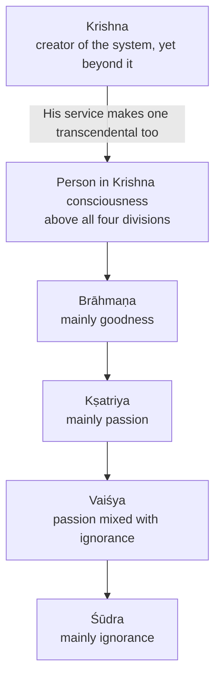

# Day 40 | BG 4.11 – 4.14 | Transcendental Knowledge | Bhakti Shastri Course

> **Source note:** Commentary is written manually from this lecture's extracted Hindi auto-captions, without Gemini or outside commentary. Timestamps use the source's two-minute windows, with cumulative minutes after the first hour. Uncertain recitations, quotations, and references remain flagged rather than reconstructed. Each main verse's Sanskrit, transliteration, synonyms, and translation is a separate reference layer verified directly against [vedabase.io](https://vedabase.io/en/library/bg/4/) (Bhaktivedanta VedaBase, Bhagavad-gita As It Is, Bhaktivedanta Book Trust); these verified blocks do not certify the accuracy of the captioned recitations.

---

## Class Snapshot & One-Line Argument Map

- **Source:** [Day 40 lecture](https://www.youtube.com/watch?v=IHgI-VG3R34), duration 1:58:56.
- **Coverage:** BG 4.11–4.14 opens what the teacher calls the application of the transcendental knowledge given in BG 4.1–4.10. Krishna explains how He reciprocates with everyone according to their surrender, why most people still run to the demigods, how He created the four divisions of society by quality and work without being bound by them, and why work never touches Him. [08:00 – 66:00]
- **Central questions:** If everyone is on Krishna's path, does every path lead to the same destination? If Krishna also fulfils desires, why are the demigods' temples crowded? If Krishna created the four _varṇas_ and was Himself born into a family, is He not partial, and is He not bound by work?
- **One-Line Argument Map:** Krishna's reciprocation: He reciprocates with each person exactly according to how that person surrenders -> so the fruit differs for the fruitive worker, the impersonalist and the devotee -> and people choose the demigods because they want quick results for their desires -> while the system of four divisions is created by Him according to quality and work, so He is not partial | Krishna's transcendence: He is the creator of this system yet the nondoer -> because He has no desire for the fruit of any work -> and one who truly knows this, by living accordingly, is also not bound by work.

---

## Continuity & Recap from the Preceding Classes (BG 4.1 – 4.10) [02:00 – 08:00]

The teacher reviews the chapter so far, because today's verses apply the knowledge established in the first ten verses.

- **BG 4.1 — the succession.** Krishna first gave this knowledge to Vivasvān, the sun-god; Vivasvān gave it to Manu, and Manu to Ikṣvāku. In this way the saintly kings received it in succession. [02:00 – 04:00]
- **BG 4.2 — the loss.** With the influence of time the knowledge was lost. [04:00]
- **BG 4.3 — the recipient.** Krishna is now giving the same knowledge to Arjuna, because Arjuna is His devotee and His friend; for that reason Krishna gives him this confidential, transcendental knowledge. [04:00]
- **BG 4.4 — Arjuna's question.** Your birth is recent and Vivasvān's was long ago; how am I to understand that You gave him this knowledge? [04:00]
- **BG 4.5 — many births.** Krishna begins speaking about Himself: both of us have had many births; I remember them, you do not. [04:00]
- **BG 4.6 — the mystery of His birth.** Though unborn, He appears by His own internal energy, _yoga-māyā_, by His own will. [04:00]
- **BG 4.7 — when He comes.** Whenever there is a decline of dharma and a rise of adharma. [04:00]
- **BG 4.8 — why He comes.** To establish dharma properly, to annihilate the miscreants, and — as the teacher adds — to remove the separation felt by His loving devotees. [06:00]
- **BG 4.9 — knowing His birth and activities.** One who knows the transcendental nature of His appearance and activities in truth does not come back to this world. The teacher stresses what _knowing_ means here: not having memorised the verse, but **living according to it**. [06:00]
- **BG 4.10 — many have attained Him.** Not one or two, but many persons, freed from attachment, fear and anger and taking shelter of Him, have already become free of the cycle of this world and attained His nature — eternal as He is eternal. [06:00]
- **The bridge to today.** Arjuna's implied question opens the next section: those devotees who fully take shelter of You and know Your birth and activities to be transcendental attain You. But what about the other categories — a _jñānī_ who may take Your shelter for another purpose, or people who come to You without fully knowing the transcendental nature of Your birth and activities? Do You reciprocate with them or not? The teacher calls BG 4.11–4.15 the section on the **application of transcendental knowledge**. [08:00]

---

## Shloka-Wise Notes & Analytical Commentary

### Bhagavad-gita 4.11 [08:00 – 28:00]

<!-- verse:4.11 -->

**Context.** Arjuna wants to know whether Krishna reciprocates with those who are not His pure devotees — the _jñānīs_ and the _karmīs_. The teacher calls this a very famous verse, and also one surrounded by great confusion. [08:00 – 10:00]

**Key Terms Explained by the Teacher**

- _Ye yathā māṁ prapadyante_: Those who, in whatever way, take shelter of Me. [10:00]
- _Tāṁs tathaiva bhajāmy aham_: In exactly that way I reciprocate with them — _bhajāmi_ here means "I exchange with them," and, as he later glosses it, "I give the fruit of their worship." [10:00; 12:00]
- _Mama vartma_: My path — _vartma_ means path or way. [10:00]
- _Anuvartante_: They follow it. [10:00]
- _Manuṣyāḥ pārtha sarvaśaḥ_: O Pārtha, all human beings, in all respects — not one is left out. [10:00; 14:00]

#### The misinterpretation the teacher warns against [08:00 – 12:00]

- Many organisations, the teacher notes, misinterpret this verse to mean that whatever anyone does reaches God — as all rivers, wherever they arise, reach the ocean; so worship anyone, and you are going to God's shelter. [08:00 – 10:00]
- A related wrong application holds that whichever deity one follows, one will finally reach the Lord, and that the deities will sort out among themselves who is greater and who is smaller. [12:00]
- His answer is that the first line says the opposite: **Krishna gives the fruit according to how one approaches Him.** Different paths do not receive the same result. [12:00]
- The ācāryas, he says, have explained the verse on three or four levels. [10:00]

#### First line: a hope-giving offer, and Krishna's capacity [10:00]

- He calls the first line **hope-giving**. It reveals Krishna's capacity: He can reciprocate fully with any number of living beings. No one else has such a capacity.
- It is also Krishna's **open offer** to every living being: however a soul approaches Him, He reciprocates in that way.

#### First line: different fruits for different approaches [12:00 – 16:00]

- The _karmī_ wants enjoyment — heaven and the attainment of pleasures — and receives that. The _jñānī_ wants liberation and receives that. The devotee wants service — eternal service — and Krishna gives the devotee His own abode. [12:00 – 14:00]
- Among the impersonalist _jñānīs_ the teacher distinguishes two kinds, citing Viśvanātha Cakravartī Ṭhākura's commentary: [14:00]
  1. **Māyāvādīs**, who consider the Lord's body to be _māyā_ and perishable. To them, the Lord says, "You say I am _māyā_ — so I keep you revolving in the world of _māyā_."
  2. **Brahmavādīs**, who know the Lord's body is _sac-cid-ānanda_ but still want to merge into Brahman. To them He gives liberation.
- The devotee attains the Lord's abode. [14:00]

#### Second line: everyone is on His path — but not to one destination [12:00; 14:00 – 22:00]

- No one can say he is completely independent of the Lord. In one way or another, everyone is searching for Him and attracted to Him — some directly, some indirectly. [12:00]
- **Even the atheist** is on His path, in this sense: [14:00 – 16:00]
  - One who surrenders directly to Krishna is under the **internal potency**, taking shelter of Śrīmatī Rādhārāṇī.
  - One who does not surrender to Krishna serves the **external potency**, Māyā-devī — and _māyā_ too is the Lord's energy; the Lord Himself calls it "My _māyā_." [Quotation flagged; see Verification Flags.]
  - So everyone is on His path, serving either His internal or His external potency — **but the result is not one.** "You cannot escape the Lord," the teacher says, "but everyone's destination is not the same."
- **The train example** from Śrīla Prabhupāda's purport, as the teacher retells it: a man goes to the station wanting to go to Mumbai, takes a ticket for Delhi and boards that train — he will not reach Mumbai. [16:00]
- **A contradiction if read wrongly.** Later in the Gītā Krishna says that those who worship the demigods go to the demigods, those who worship the ancestors go to the ancestors, and those who worship ghosts go to the ghosts. If the second line meant that everyone reaches one place, the Gītā would contradict itself. [20:00] [Verse reference flagged; see Verification Flags.]
- **What the second line does mean:** whatever a person is attracted to is actually Krishna's splendour, so he is really attracted to Krishna. All attractive things in this world come from Krishna — but they do not lead to Krishna. One person is attracted to a liquor bottle, another to wealth, another to a woman; these are Krishna's energy too, but the destination is different. [20:00 – 22:00]

#### The essence: purify the mood of surrender [16:00 – 20:00]

- Since Krishna reciprocates exactly as one surrenders, the one thing the living being must do is **purify his surrender**. One should not calculate too much with the Lord. [16:00 – 18:00]
- The teacher calls this the essence of all the scriptures: even if someone understood nothing else but took shelter, he has the essence. All _sādhana-bhakti_ is done to purify the heart and mind, so that one can engage in the Lord's service in a pure mood, without any expectation. [20:00]

#### Reciprocation in the five _rasas_ [18:00]

- A second meaning given by the ācāryas, which he attributes to Viśvanātha Cakravartī Ṭhākura: Krishna reciprocates in all five _rasas_. If someone wants to serve Him as a parent, He is ready to become the child; as a friend, He is ready to become the friend; if someone regards Him as father, He is ready to be the father.
- No personality is so flexible, and no one else has the capacity to reciprocate like this.

#### No one in this world can give shelter [18:00]

- His image: five people are in an ICU, each with an oxygen mask and a bottle attached, and each is telling the others, "Don't worry, you will be fine." That is the material world — no one can give real shelter even to one person, not even parents to a child, because everyone's own condition is serious.
- The Lord alone maintains the entire creation, and He is a great lover, with an open offer for all.

#### What Śrīla Prabhupāda's purport draws out [22:00 – 24:00]

- The teacher praises the purport for carrying the essence of all the ācāryas' commentaries in simple words. [22:00]
- **Three aspects:** everyone is attracted to different aspects of Krishna — Brahman, Paramātmā and Bhagavān. The yogī meditates on the Paramātmā, the _jñānī_ on Brahman, and the devotee is attracted to Bhagavān. Krishna is fully realised only by pure devotees. [22:00]
- **In the spiritual world too**, Krishna reciprocates in the transcendental attitude the devotee wants: some want Him as master, some as friend, some as son, some as lover. [24:00]
- **The impersonalists**, who do not accept the eternal, blissful personality of God and think His form is _māyā_, do not receive transcendental service; the purport, he notes, calls their goal spiritual suicide. [24:00]
- **The conclusion:** success on any path requires the Lord's mercy, so everyone — with material desires, without them, or desiring liberation — should take shelter of the Lord. [24:00] [Quotation flagged; see Verification Flags.]

#### "I am ready — are you ready?" [26:00 – 28:00]

- No one in the whole world can make this commitment. Krishna is saying: **I am ready, and I am perfect in reciprocation.**
- His contrast is the Hindi film: almost every one is the story of a broken heart, drawn with an arrow through it — because the heart was given in the wrong place. In all of history, he says, there is not a single case of someone who took shelter of the Lord and had to regret it.
- Krishna is perfect in every role: as the son of Devakī and Vasudeva, and of Nanda Mahārāja and Yaśodā; with the _gopīs_; as a friend among His friends; as a perfect king and perfect husband. [Figure flagged; see Verification Flags.]
- **The real problem is on our side:** Krishna is giving, yet the living being is reluctant. We offer Krishna the minimum time, and of the poorest quality. His example is the temple donation box: the donor searches his purse for the coins no one uses and the note that will not pass anywhere else. [26:00 – 28:00]
- Yet the verse shows how merciful Krishna is, reciprocating even with such broken devotion. He recalls Śrīla Bhaktisiddhānta Sarasvatī Ṭhākura's statement that the only problem in this world is the lack of Krishna. [28:00] [Wording flagged; see Verification Flags.]

<Callout type="idea" title="Takeaway">
The first line is Krishna's open offer and the measure of His capacity: He reciprocates with every soul exactly as that soul surrenders — enjoyment for the _karmī_, liberation for the _jñānī_, His abode and service for the devotee. The second line says everyone is on His path, serving either His internal or His external potency, and that all attraction is really to Him — but it does not say everyone reaches the same destination. Since the reciprocation matches the surrender, the one task of the living being is to purify the mood of surrender and stop calculating with the Lord. [08:00 – 28:00]
</Callout>

---

### Bhagavad-gita 4.12 [28:00 – 40:00]

<!-- verse:4.12 -->

**Context.** Arjuna's next question: if You reciprocate with everyone, why do people not come to You? Shani-deva's temple and the goddess's temple are crowded, while Krishna temples are often empty. If everyone is on Your path, why do they not worship You? [28:00]

**Key Terms Explained by the Teacher**

- _Kāṅkṣantaḥ karmaṇāṁ siddhim_: Desiring perfection in their work — specifically in _sakāma karma_, work done for its fruit. [30:00]
- _Yajanta iha devatāḥ_: They worship the demigods in this world. [30:00]
- _Kṣipram_: Quickly — they want the result immediately. [30:00]
- _Mānuṣe loke_: In the human world. [30:00]
- _Siddhir bhavati karma-jā_: The success that comes from fruitive work. [30:00]

#### What people actually want [30:00]

- His examples of _sakāma_ aims: a son's job, a daughter's marriage, completing the lintel of a house, winning a lottery.
- He notes that Navarātri is going on as he speaks — the season of asking the goddess to fulfil wishes — and that is why her temple is crowded.

#### Why the demigods and not Krishna: _kṣipram_ [30:00]

- Arjuna's objection: but You also fulfil desires — You said whoever comes to Me, even with material desires, I reciprocate.
- The answer is in the second line: they want it **quickly**. Krishna does give, but He says, "Sit a little, become a little purified, then I will give." These people want it immediately and are not ready to wait. The teacher's modern image: they want it at once, like an instant-delivery app.
- He calls them foolish because they do not know that the demigods have no power of their own to give; it is the Lord who gives through them.

#### Krishna does not mind: the CEO and the team leader [32:00]

- Krishna is so free of envy that He does not mind a person going to His assistant, or to His assistant's assistant's assistant, and worshipping that one as supreme.
- **The analogy:** a newly trained engineer in a company thinks his team leader is the main person — the CEO, everything — and worships him so. Above the team leader are many people. Any ordinary boss in this world who saw that would lose his temper and dismiss them both. The Lord does not; through the demigods He Himself gives the result.

#### Shopkeeper and father [32:00 – 34:00]

- **The demigods are like shopkeepers; the Lord is like a father.**
  - A shopkeeper has no right to take money without giving the goods, and once paid he must give them — whether or not they are good for you is not his concern. He will not ask whether the chocolate will spoil your teeth.
  - A father may give without taking anything, and may take things back — even the money, even the chocolate — if they are not being used well. He is concerned about you.
- A price must always be paid to the demigods; nothing is given free. No price is needed with the father, if one is established in relationship with Him.
- His sharpest form of the point: people buy even poison at a medical store — pay the money and it will be given. A father will never give it. The demigods do not consider what is beneficial and harmful for us; the father constantly thinks of our welfare. **We have to choose where to go.** [34:00]

#### The shortcut that is a long cut [34:00 – 36:00]

- People take a shortcut for quick success, not knowing that in life it is actually a **long cut**. [34:00]
- **Rūpa Gosvāmī's three qualities** for _bhakti_, as the teacher gives them: enthusiasm, determination and patience. [34:00 – 36:00] [Reference flagged; see Verification Flags.]
  - **Enthusiasm** is needed not for one day but every day.
  - **Determination** that this is the path and there is no other — not one thing at Navarātri, another at Gaṇeśa Caturthī, another at Śivarātri, and then off on the Kāṁvar Yātrā. The devotee must be fixed on this one path.
  - **Patience** for the fruit of _bhakti_ — when will the heart be purified, when will the Lord give _darśana_. This patience is what is called for, and this is in fact the shortest path.
- The demigods give quick results, and those results go quickly too: a small result for a short time. Neither the demigods nor their results are permanent, and both keep revolving in the cycle of birth and death. [36:00]

#### "Why doesn't Krishna speed up production?" [36:00 – 38:00]

- The teacher voices the objection humorously: if Krishna increased His productivity, His item too would sell and there would be crowds at His temple.
- His answer: **the demigods give us what we want; Krishna gives what we need.**
- **The mother's sweet:** a small child asks for chocolate; the mother knows it will spoil his teeth, so she makes a different sweet, with jaggery and pure ingredients — and what is good for him takes a little time. The child asks why he should wait; the mother knows his nature and what is good for him.
- At root, we are actually searching for Krishna. **The pain of being away from Krishna is the root of all misery**; everything else is detail. That is why Krishna gives after purifying the heart. [38:00]

#### What the purport establishes [38:00]

- A great misconception is that people take the demigods to be the Supreme Personality of Godhead. The demigods are not supreme, and an intelligent person in Krishna consciousness never worships them as such.
- The demigods are themselves temporary: when the material world ends, they too die. What is temporary gives temporary benedictions. The Lord is eternal, and one who takes His shelter attains eternal perfection.
- The essence of the purport's second half, as he summarises it: those who go to the demigods for shelter are foolish.

#### How this must not be misapplied [38:00 – 40:00]

- When such verses are heard, one must know that they are spoken about **shelter**. Devotees respect all the demigods — Śiva, Gaṇeśa and the others are very great personalities, and our position is nothing in comparison.
- One may go to a demigod's temple, offer obeisances and pray — because they are very near to the Lord — asking them to engage us in Krishna's devotion. The principle is given at the level of comparison, and one must not misapply it. [40:00]

<Callout type="idea" title="Takeaway">
People go to the demigods not because Krishna will not give, but because they want the fruit of their work quickly. The demigods are like shopkeepers who give whatever is paid for, even poison; Krishna is like a father who gives what we need after purifying the heart. The shortcut is a long cut — the demigods' results, like the demigods themselves, are temporary — so the devotee needs enthusiasm, determination and patience. Yet the verse is about shelter, not disrespect: the demigods are honoured and may even be asked for devotion to Krishna. [28:00 – 40:00]
</Callout>

---

### Bhagavad-gita 4.13 [40:00 – 54:00]

<!-- verse:4.13 -->

**Context.** The teacher introduces a question raised by Viśvanātha Cakravartī Ṭhākura: devotion and knowledge liberate, but the path of work binds — and You made all these paths. Does that not mean You are partial? Krishna answers that there is no partiality, because people choose according to their quality and work. [40:00]

**Key Terms Explained by the Teacher**

- _Cātur-varṇyam_: The four _varṇas_ — _brāhmaṇa, kṣatriya, vaiśya_ and _śūdra_. [40:00; 42:00]
- _Mayā sṛṣṭam_: Created by Me — they are in My creation. [40:00]
- _Guṇa-karma-vibhāgaśaḥ_: Divided on the basis of quality (_guṇa_) and work (_karma_). [40:00]
- _Tasya kartāram_: The creator of it — "I have created it." [48:00]
- _Akartāram_: The nondoer — "and yet I have not done it." [48:00]

#### The misapplication: birth instead of quality and work [40:00 – 42:00]

- The teacher says the wrong application of this verse — the caste system — has cost many lives and caused many revolutions, and the wrong application continues to this day.
- What the verse says is division **by quality and work**, not by birth. The quarrels over caste are about birth.

#### How it worked earlier, and why it is mixed now [42:00]

- In earlier times there was certainly such an arrangement: if the parents were _brāhmaṇas_, most of their children would also be _brāhmaṇas_, with more of the _brāhmaṇa_'s qualities; similarly for _kṣatriyas_ and _vaiśyas_.
- In Kali-yuga everything has become mixed; broadly speaking, everyone is a _śūdra_.
- His distinction: the _śūdra_ takes a job, while the _brāhmaṇa_, _kṣatriya_ and _vaiśya_ cannot work under someone else — they remain independent.

#### Both quality and work — not one alone [42:00 – 44:00]

- **Work (_karma_) is activity.** His examples:
  - A father does business and the son also does business — he has picked up the work.
  - A boy born into a _brāhmaṇa_ family whose father read śāstra also begins reading śāstra.
  - In a Rajput family the father handled management and carried guns, and the son does the same.
- **Quality (_guṇa_) must also be seen.** The _brāhmaṇa_'s work is _yajana-yājana_ (worshipping and having others worship), _paṭhana-pāṭhana_ (studying and teaching the śāstra), and _dāna-pratigraha_ (receiving charity and giving it on). [44:00]
  - On the last, the teacher explains that many people give a _brāhmaṇa_ charity, but he keeps only what he needs and gives the rest back; too much wealth makes a real _brāhmaṇa_ uneasy.
- Suppose someone has the work — performing worship, reading and teaching — but what of his qualities? The _brāhmaṇa_'s qualities include forgiveness, truthfulness, peacefulness, sense control and austerity. [44:00]
  - "If his temper rises at once, what kind of _brāhmaṇa_ is he?" And one who breaks every principle and chews _gutkā_ while saying "I am a _brāhmaṇa_" is not one.
  - Austerity in life is natural for a _brāhmaṇa_.

#### The classical example: Ṛṣabhadeva's hundred sons [44:00 – 46:00]

- The teacher cites the Fifth Canto of Śrīmad-Bhāgavatam: Ṛṣabhadeva had one hundred sons. If birth decided it, all of them would have been _kṣatriyas_. Instead nine became _paramahaṁsas_, some became _kṣatriyas_, some _brāhmaṇas_ and some _vaiśyas_ — sons of one father. [Details flagged; see Verification Flags.]
- So this principle is not new; it has been the same from the beginning. If the son of a _kṣatriya_ is a _kṣatriya_ — as from Arjuna's line came Parīkṣit Mahārāja — that is fine; but the quality and work must be there, and if they are not, he is not.

#### The practical application: engagement according to nature [46:00 – 48:00]

- Being engaged according to one's quality and work is important, and the verse has a strongly practical application.
- His criticism of present education: everything is put into a single education, in which everyone keeps cramming formulas and derivations. Everyone has a different strength — the Lord made everyone different — yet everyone runs in one direction, and getting a bank job is called success.
- Someone whose memory is not strong may have another talent; someone who cannot understand mathematics falls into an inferiority complex.
- **Five or six people behind one child:** from the first class, the school teacher, then the tuition teacher, the mother, and now a mentor at the coaching centre who checks whether the child is studying. Earlier, he says, tuition meant the child could not understand anything; today it has become a social status. He calls it an over-care society and a product of Kali-yuga.
- His advice: whatever the child's quality and work are, he will take them up by himself; do your own _bhakti_ properly. [48:00]

#### Creator, yet nondoer [48:00 – 50:00]

- "I created it, and yet I did not create it" — how can both be true? Krishna means: **I am not entangled in it; I am beyond it.**
- **In what sense the creator:** nothing happens without the Lord's sanction.
- **In what sense the nondoer:** He made the arrangement according to the nature of the living beings, in response to them; it is just reciprocation, as in the previous verse.
- **The judge:** a judge orders one person released and another sent to jail. Yet the judge is not really the doer: one did wrong and was sent to jail, another was found right and released. He is the doer and, at the same time, the nondoer. [50:00]

#### Know your strength [50:00]

- Every person should understand his basic strengths and work on them, without becoming too frustrated. The Lord made everyone unique — one can sing, one can play an instrument, one can manage.
- If engagement matches one's quality and work, the struggle is less; otherwise the challenge increases.

#### The goal of _varṇāśrama_: cooperation, not discrimination [50:00 – 52:00]

- The main goal of _varṇāśrama_ was **cooperation**. It was not that the _brāhmaṇa_ looked down upon the _śūdra_.
- The teacher states that in Vedic times there was never a revolution or a liberation movement; people were well satisfied. Each of the four had a nature and was engaged in work suited to it, and all four progressed — no inferiority complex, no stress, no depression.
- Today, in the name of equality, everyone is frustrated. [52:00]

#### The purport: the four divisions and the modes [52:00 – 54:00]

- Śrīla Prabhupāda's purport, as the teacher summarises it, adds a further distinction by the modes of nature:
  - **_Brāhmaṇas_** — mainly the mode of goodness.
  - **_Kṣatriyas_** — mainly the mode of passion.
  - **_Vaiśyas_** — a mixture of passion and ignorance, with passion prominent.
  - **_Śūdras_** — mainly the mode of ignorance.
- Each one's activity follows accordingly. **The Lord does not belong to any of them; He is beyond them.**
- **The person in Krishna consciousness is above all four** — above even the _brāhmaṇa_. A Vaiṣṇava is above a _brāhmaṇa_. Just as the Lord is transcendental, when we actually engage in His service we also go beyond these divisions.
- So the Lord's servant does not ask whether a task is a _brāhmaṇa_'s, a _vaiśya_'s or a _śūdra_'s; he sees only that it is the Lord's service. He will not say "I am from a _brāhmaṇa_ family and I've been asked to clean toilets." He can clean the toilets, worship the Deity, go for management and do fund collection — he will do everything. [52:00 – 54:00]



<Callout type="idea" title="Takeaway">
Krishna is not partial in creating the different paths and the four divisions: they are arranged according to quality and work, in response to the living beings' own natures — so He is the creator, because nothing happens without His sanction, and the nondoer, like a judge who only responds to what each person has done. The division is by quality and work together, never by birth alone, as Ṛṣabhadeva's hundred sons show. Its purpose was cooperation, and its practical use today is to know one's own strength. A person engaged in Krishna's service goes beyond all four divisions and will do any service at all. [40:00 – 54:00]
</Callout>

---

### Bhagavad-gita 4.14 [54:00 – 66:00]

<!-- verse:4.14 -->

**Context.** A question can arise: when Krishna took birth, He appeared as the son of Vasudeva and Devakī in a _kṣatriya_ family, and was raised by Nanda in a _vaiśya_ family — so should work not bind Him too? Krishna answers in this verse. [54:00]

**Key Terms Explained by the Teacher**

- _Na māṁ karmāṇi limpanti_: Work does not stick to Me. _Lipta_ comes from _lepa_, a coating — like the sandalwood paste applied to the Lord during Candana-yātrā. Work does not coat or bind Him, whether He takes birth in a _kṣatriya_ family or a _vaiśya_ family. [54:00]
- _Na me karma-phale spṛhā_: I have no desire for the fruit of work. [54:00]
- _Iti māṁ yo 'bhijānāti_: One who knows Me thus — knows His transcendental position. [54:00 – 56:00]
- _Karmabhir na sa badhyate_: He too is not bound by work. [56:00]

#### Why work binds the living being but not Krishna [54:00]

- The living being becomes entangled in work because for every action he expects some fruit — someone wants heaven, someone wants something else.
- The Lord is complete in Himself, so He is not entangled in anything. Being on the transcendental level, He has no material desire at all — and it is material desire that makes a person stuck in the fruit of work.

#### "Knowing" means acting on that level [56:00]

- The teacher repeats what he said about BG 4.9: _knowing_ does not mean "now I have understood it." It means acting accordingly — such a person will not work with a desire for the fruit.
- **The level at which he acts:** absorbed in Krishna's name, form, qualities and pastimes; working only for the Lord's service; working in surrender to the Lord, not for material things. Such a person is not bound.

#### The one-BHK and the landlord's board [56:00 – 58:00]

- Citing Baladeva Vidyābhūṣaṇa, the teacher says the Lord does so much — creating the universe and so many species — yet is not attached. A man, by contrast, gets stuck in a one-BHK flat and writes his name on it.
- **His own story:** in the building where their centre is located, the devotees put up a large temple banner. An old, dilapidated board with the owner's name was in the way, and a devotee removed it. The owner was very disturbed — "How could you remove my board?"
- That is the living being's condition: attached until death to a one-BHK, while the Lord, after making 8.4 million species, with unlimited universes emanating from Him, is not attached.

#### Creation is a response to the living beings' karma [58:00]

- As Baladeva Vidyābhūṣaṇa explains, creation, maintenance and destruction are **in response to the karma of the living beings**. The Lord has no personal desire of His own in creation, so He is not contaminated.
- **The rain:** rain falls everywhere — on barren land, on the ocean, all over the earth — but in one place flowers grow, in another wheat, in another maize. Is that the rain's fault? It depends on the seeds. Similarly, the living beings act in different ways because of their previous desires and impressions, and receive different results.

#### The problem of evil [58:00 – 62:00]

- In Western culture, the teacher notes, this is a very big question, called the **problem of evil**: why do bad things happen to good people? He remarks with humour that the session is needed because everyone thinks "I am the good person, and the bad thing is happening to me." [58:00 – 60:00]
- **The question as posed:** if God is all-powerful and all-merciful, why do living entities suffer? [60:00]
- He mentions a best-selling book whose answer is that God wants to remove our suffering but evil is so powerful — and calls the principle itself wrong. Evil is not more powerful than God; Krishna is all-powerful. [60:00] [Reference flagged; see Verification Flags.]
- **First source of confusion:** people do not understand past lives — that we are on a multi-life journey. [60:00 – 62:00]
- **Second source of confusion:** what happiness and distress actually are. [62:00]

#### Suffering as a symptom [62:00 – 64:00]

- **Dengue:** a person has weakness, chills, a hot body and difficulty walking. These are symptoms of a disease. Is the symptom good or bad? It is good — in dengue, if one does not know, the platelets can fall and some people die in two or three days. Once the disease is known, medicine can be taken.
- In the same way, **the distress in this world is a symptom.** When the body is ill, the person is forced to think and goes to a doctor; when distress comes in life, a person thinks about what is right and what is wrong.
- In some religions, he says, this world is taken as the ultimate place to stay and enjoy. Vedic philosophy is clear: there is rebirth, this is a foreign land, we came here by mistake, and it is not a place for enjoyment. **It is the Lord's mercy that the symptom manifests as distress**, so that we can get out of the actual distress. If no one ever came to know, life would go on like this — birth after birth, distress after distress. [62:00 – 64:00]

#### The drama around the main problem [64:00]

- Śrīla Prabhupāda used to say the main problem is birth, death, old age and disease.
- **The cancer patient:** a patient at the fourth stage of cancer goes to the doctor, who says, "Take this medicine, you won't have gas." "But what about the cancer?" "Take this one for your headache." "My headache has gone just from hearing the word cancer — what about the cancer?" "Take this third one, it will improve digestion." The teacher calls this a drama, and says Śrīla Prabhupāda was an ācārya who exposed it: if the main problem is not solved, we have to come again.
- The Lord is beyond all this and is not caught in it. The purport, he notes, gives two or three examples, such as the owner of a company who is not involved in small matters. [64:00] [Reference flagged; see Verification Flags.]

<Callout type="idea" title="Takeaway">
Work binds the living being because he wants its fruit; it never touches Krishna, who is complete and has no material desire — whether He appears in a _kṣatriya_ or a _vaiśya_ family. He creates countless universes without attachment, while we cling to a one-BHK and a name-board, because creation is His response to the living beings' karma, as rain falls equally and each seed grows its own crop. Distress is the symptom that makes us look for the real disease of birth and death. One who truly knows this — by living absorbed in Krishna's service — is also not bound by work. [54:00 – 66:00]
</Callout>

---

## Cross-Shloka Conceptual Progression (BG 4.11 – 4.14)

```
BG 4.11: Krishna reciprocates with every soul exactly according to how that soul surrenders, so everyone is on His path through His internal or external potency, but the fruit and the destination differ, and the living being's one task is to purify his surrender.
   │
   ▼
BG 4.12: Most people still worship the demigods because they want quick results for their fruitive work, taking the shopkeeper's shortcut instead of the father's care, though those results are as temporary as the demigods who give them.
   │
   ▼
BG 4.13: Krishna is not partial in creating these different paths, because He arranged the four divisions according to quality and work in response to the living beings' natures, so He is their creator and yet the nondoer, and His devotee goes beyond all four divisions.
   │
   ▼
BG 4.14: Work never binds Krishna because He has no desire for its fruit, and one who knows this truth by living absorbed in His service is also freed from the bondage of work.
```

### Comparative Summary Table

| Verse | Primary Theme                        | Core Sanskrit Terms Explained                                                                | Central Mechanism / Principle                                                                                                     | Practical Imperative                                                                                                                         |
| :---- | :----------------------------------- | :------------------------------------------------------------------------------------------- | :-------------------------------------------------------------------------------------------------------------------------------- | :------------------------------------------------------------------------------------------------------------------------------------------- |
| 4.11  | Reciprocation according to surrender | _Ye yathā māṁ prapadyante_, _bhajāmi_, _mama vartma_, _anuvartante_, _sarvaśaḥ_              | Everyone is on His path through His internal or external potency, but the fruit matches the approach, so destinations differ.     | Purify the mood of surrender and stop calculating with the Lord, who is ready and perfect in reciprocation. [08:00 – 28:00]                  |
| 4.12  | Why people choose the demigods       | _Kāṅkṣantaḥ karmaṇāṁ siddhim_, _yajanta iha devatāḥ_, _kṣipram_, _karma-jā siddhi_           | The demigods give quickly like shopkeepers; Krishna gives what is needed like a father, after purification.                       | Practise with enthusiasm, determination and patience; respect the demigods but take shelter of Krishna. [28:00 – 40:00]                      |
| 4.13  | Four divisions by quality and work   | _Cātur-varṇyam_, _mayā sṛṣṭam_, _guṇa-karma-vibhāgaśaḥ_, _tasya kartāram_, _akartāram_       | The divisions respond to the living beings' natures, by quality and work, not birth; Krishna is creator yet nondoer, like a judge. | Know your own strength and engage accordingly; as a devotee, do any service without asking whose work it is. [40:00 – 54:00]                 |
| 4.14  | Work does not touch Krishna          | _Na māṁ karmāṇi limpanti_, _lepa_, _na me karma-phale spṛhā_, _abhijānāti_, _na sa badhyate_ | Work binds only through desire for its fruit; creation responds to the living beings' karma, as rain responds to each seed.       | Know Krishna's position by acting on it — absorbed in His name, form, qualities and pastimes, working only for His service. [54:00 – 66:00] |

---

## Audience Q&A & Clarifications

**1. Daily classes for new contacts [66:00]**

- A listener planning extra book distribution in the coming month of Kārttika asks whether there are daily classes she can refer people to, since not everyone rises early.
- The teacher explains that their classes are held in the morning, and that the topics vary — the Bhagavad-gītā, the Bhāgavatam, and discussion of _Śrīla Prabhupāda-līlāmṛta_. [Timings flagged; see Verification Flags.]

**2. Worship that requires a _brāhmaṇa_ birth [66:00 – 68:00]**

- Asked how to understand forms of worship that require birth in a _brāhmaṇa_ family, the teacher says that in many places traditions have come down for a very long time.
- **The Jagannātha Purī example:** foreigners are not given entry, the basic reason being that they were considered impure. But Śrīla Prabhupāda preached so widely that those devotees are, in his words, a thousand times purer than many Indians — yet impure Indians go in because of the tradition, while personalities like Haridāsa Ṭhākura and Rūpa Gosvāmī sat outside.
- Devotees respect such traditions. But everywhere there are exceptions too, and he names Kanaka Dāsa among them. **The topmost criterion is _bhakti_.** [68:00] [Names flagged; see Verification Flags.]

**3. Does birth in a _brāhmaṇa_ family not bring the qualities with it? [68:00 – 72:00]**

- The questioner suggests that the parents' _saṁskāras_ will most likely come into the child, and that birth in such a family reflects some pious past karma.
- The teacher agrees that the qualities and work do come: a person is a combination of the parents, and to some extent the grandparents, with the parents playing the main role. When the parents unite, the soul that comes is one suited to their consciousness. There is no doubt of that. [70:00]
- **But in Kali-yuga everything is mixed**, so even work alone cannot be the final basis. A son may become a natural expert in business because his father does business — but a _vaiśya_ should also have the other qualities: agriculture, cow protection and trade. Today many dairies run only up to profit and do not protect the cows. [70:00 – 72:00]
- His point: quality and work are separate things, and one cannot decide on the basis of work alone. He mentions a lecture in which Śrīla Prabhupāda says Janamejaya Mahārāja was the last _rājarṣi_. [72:00] [Reference flagged; see Verification Flags.]

**4. Will those who serve Krishna indirectly, through _māyā_, eventually reach Him? [72:00 – 76:00]**

- Someday, perhaps — **but it is not necessary.** The happiness of _māyā_ is a very strong happiness; a person can remain in it for a very long time, perhaps permanently.
- One does not grow out of it until one receives the association of a devotee — the teacher cites the verse about the fortunate soul who, wandering through the universe, receives the seed of the creeper of devotion by the mercy of guru and Krishna. [74:00] [Quotation flagged; see Verification Flags.]
- **Frustration does not automatically arise.** Tasting happiness and distress does not by itself make a person frustrated, unless he is engaged in dharma or has a devotee's association. People cannot even give up tea; many diabetics still eat sweets.
- We are very fortunate to have received Śrīla Prabhupāda's shelter; otherwise one remains in the cycle birth after birth. He mentions a Śrīla Prabhupāda lecture titled "Finish the business in this life": one should not do _bhakti_ loosely, or one will remain stuck. In a Kali-yuga body there is neither much capacity to enjoy nor freedom from problems — so take it seriously. [74:00 – 76:00] [Reference flagged; see Verification Flags.]

**5. If BG 4.12 guarantees quick results for fruitive work, why is there no guarantee in devotion? [76:00 – 80:00]**

- **The guarantee is given:** in _sarva-dharmān parityajya_ Krishna Himself takes the guarantee. The mistake is always on the living being's side. In all of history there is not one example of someone who took the Lord's shelter and was abandoned by Him.
- **The anecdote:** a _brahmacārī_ once expressed his anxiety about the future to Gopal Krishna Mahārāja as Mahārāja was leaving for the airport. Mahārāja told him, "If you are surrendering to Krishna, you will never be cheated — it is my experience." [76:00 – 78:00]
- **The right question** is: if the Lord is giving the guarantee, why am I not doing _bhakti_? The questioner is asking it the other way round. The Lord never said that those who worship Him will get no result; the teacher cites several verses where He takes the guarantee. [78:00] [Verse numbers flagged; see Verification Flags.]
- **The demigods give only the first instalment.** Someone prays for ten crore, offers three obeisances, and gets a thousand; delighted that it came at once, he keeps at it for five or six months and gets five, six, seven, eight thousand — and that is the end of the demigods' capacity. Overall it takes as much time, or more. [78:00]
- **Krishna gives more than is asked.** One who fully engages and asks for ten crore receives a thousand crore; His capacity is unlimited. Those who took shelter received more than they asked; those who calculated were cheated. He mentions the fruit-seller woman, who took shelter without calculating, and Bali Mahārāja, who wanted Indra's planet and was given Sutala, which the teacher says is far better. [78:00 – 80:00] [Details flagged; see Verification Flags.]
- **The wasted life:** water and oil are offered to Shani-deva and the Shani Cālīsā is recited, and a life is wasted. Without the clarity Śrīla Prabhupāda gave, he says, we too would be going to one temple on Tuesday and another on Thursday, offering water here, _bilva_ leaves there and milk somewhere else. [80:00]

**6. Understanding the _varṇa_ system more clearly — and the exceptions [80:00 – 84:00]**

- The questioner proposes that in Vedic times nature passed to descendants by default, because people were so disciplined; later it degraded, things mixed, and people grasped the work they saw from childhood rather than the quality. He asks about cases like Viśvāmitra Muni, a _kṣatriya_ later accepted as a _brāhmaṇa_, and Bali Mahārāja and Prahlāda Mahārāja, devotional though born in a demoniac family.
- **The teacher: exceptions are exceptions.** Viśvāmitra and Paraśurāma — a _kṣatriya_ in a _brāhmaṇa_ family — are exceptional cases, and **laws cannot be made on the basis of exceptions.** In earlier times birth and work generally matched, and children's nature followed their parents'. [82:00]
- Now, with unhealthy competition, the definition of success has become linear — engineer, doctor, money. [82:00]
- **Quality is deeper than work.** Work is external and can carry on through the family; quality is not so easy to acquire. It is the quality — forgiveness, self-control, austerity, truthfulness — that connects a person strongly to dharma, while the activity merely engages him. A _brāhmaṇa_ boy may have memorised all 700 verses of the Gītā because his memory is good, but without the _brāhmaṇa_'s qualities it has no real value. [84:00]
- **Devotion is a separate thing.** Bali Mahārāja's giving in charity is itself a _kṣatriya_ quality. Devotion is beyond all four modes and is not connected to them; it can arise in anyone, by the mercy of a _mahā-bhāgavata_ — Prahlāda became a devotee by Nārada Muni's mercy, and Bali Mahārāja by Prahlāda's blessings. [84:00]

**7. Can philosophers who deny karma and God understand anything? [84:00 – 88:00]**

- The conclusion will be wrong. One who does not accept scriptural principles has no background: he can only speculate about the future, does not know the past, and in the present relies on argument alone. **"Logic becomes a problem when not founded on scripture."** [86:00]
- **We avoid surrender because we are "logical."** Who was more logical, Duryodhana or Arjuna? Duryodhana. What Mantharā told Kaikeyī was logical. Lakṣmaṇa going to the forest with Rāma was not "logical" — no one had asked him to go, and he had just been married. The merely logical person stays in this world, revolving again and again.
- **The logic of śāstra:** where Krishna is concerned, surrender — and then see what the experience of surrender is.
- He gives the example of a celebrated scientist whose theories and books people read, and adds that the principle of creation will not change because of them. [86:00 – 88:00] [Reference flagged; see Verification Flags.]
- **Logic is not God.** Argument should be used to take shelter, not to go away from the Lord. [88:00]

**8. Horoscopes, destiny and our natural strengths [88:00 – 94:00]**

- Asked whether the _varṇa_ shown in one's birth chart reflects past karma and must be followed, the teacher says astrology is an **indicative science, not a decisive one** — it indicates, it does not fix. [88:00 – 90:00]
- The birth chart is made according to the time at which a soul comes into the world through particular parents, on the basis of past karma. Past karma is strong, which is why a good astrologer seems to be telling us accurately about ourselves. [90:00]
- **Once one comes to _bhakti_, one can get out of all this**, because spiritual things are not predetermined. So one should not struggle too much materially — do one's duty as father, as son — and focus spiritually. [90:00]
- **Everything is then used for purification.** If the chart says wealth will come, a devotee uses it in service; if it says health will suffer, a devotee increases his chanting, hearing and prayer. A non-devotee with a "five-star" chart will drink when money comes and fall into depression when distress comes. For devotees, he says, there are _laḍḍus_ in both hands. [92:00]
- **Identifying quality and work today** is not easy, but one can identify one's general strengths — a natural singer, artist, expert manager, or someone analytically strong — and refine that skill, since it is natural and he is above average in it without much effort. Skills developed over time, as by a doctor or engineer, can also be used. [92:00]
- **The practical meaning of _varṇāśrama_ now:** be **externally competent** (today usually gained through education) and **internally comfortable** (when the work matches one's nature) in what one does. Either choose the field in which you are expert, or become expert in the field you choose. [92:00 – 94:00]
- **Why this matters for devotees:** expertise takes less time, makes one effective, gives satisfaction, and brings appreciation, which is a basic social need — and then one can do _bhakti_ with a healthy heart. Without it, every working day is a struggle, and that affects one's _bhakti_. [94:00]

**9. "How will a sādhu progress without _māyā_?" [94:00 – 108:00]**

- The questioner was disturbed by an acquaintance who argued that one must deal with _māyā_ to advance. The teacher's first advice: talk to him a little less. In Kali-yuga, he says, "we are doubtful, they are confident fools." [94:00 – 96:00]
- **The "spice of life" philosophy is deviated.** The claim is that without distress you cannot taste happiness — that happiness and distress are like spices, as plain _khicaḍī_ needs some tang and some sweetness. The teacher calls this a deviated philosophy, not śāstra's. [96:00]
- **We are already in _māyā_.** He cites Kulaśekhara Mahārāja's _Mukunda-mālā-stotra_: the living being is drowning in the ocean of birth and death, beset by dualities — cold comes, so out with the heater and the sweater; heat comes, throw them away and bring the cooler and the AC; honour and dishonour, profit and loss. [96:00] [Quotation flagged; see Verification Flags.]
- **The Lord's label for this world:** He did not say it has a little happiness, some neutrality and some distress — He called it a place of misery, temporary. There is only distress here, and we have one project: to take the Lord's shelter. [98:00] [Quotation flagged; see Verification Flags.]
- **Don't test _māyā_.** Testing _māyā_ is stepping on a lion's tail. Make your best effort to take the Lord's shelter instead. [98:00]
- **The cricketer:** a good cricketer has a family and a personal life — he goes home, eats, sleeps, talks with his wife, goes out — but in his mind, all the time, is how to improve his game. A practitioner lives in the world the same way: job and everything else, but in every situation asking how to take more shelter of the Lord. [98:00]
- **Water in the palm.** Prahlāda Mahārāja asks where happiness is in this world. The teacher's image: in a scorching forest you are thirsty, and someone brings a little pure water in his palm. Is that good or bad? It is too little to quench the thirst and increases it — and, worse, it creates a false hope that there is water in the forest, so you never make the effort to reach the real reservoir a little distance away that would end your thirst for ever. **_Māyā_ keeps just enough happiness to keep us trapped.** He recalls Śrīla Prabhupāda writing in a Third Chapter purport that the so-called feeling of happiness in sense gratification is the real enemy. [98:00 – 102:00] [Quotations flagged; see Verification Flags.]
- **Extension in _māyā_, none in _bhakti_.** In material life a person stretches himself — ten- or twelve-hour duties, still not retiring at sixty or seventy, policies, insurance, mutual funds. In spiritual life, has anyone ever said, "By mistake I chanted seventeen rounds today instead of sixteen," or "I meant to read Śrīla Prabhupāda for half an hour and by mistake read three hours"? [102:00]
- **Imaginary questions.** Students ask, "If I increase my rounds, how will I study? If I read Śrīla Prabhupāda for two hours, when will I read for college?" His reply: on how many days did you actually study two hours? Similarly, a householder gives the minimum in charity, and when told to give everything, his first "logical" question is what will happen then. This, he says, is mental speculation running on argument alone — even now, with our small, broken devotion, the Lord is maintaining us. [102:00 – 104:00]
- **Take the step.** Pearls are not found on the surface of the sea; one must go down. A person on the shore cannot learn to swim. His usual advice: try for twenty days; ask someone who chants sixty-four rounds attentively about the power of chanting. It cannot be understood from theory; it is a matter of experience. People watch YouTube for hours and spend time on WhatsApp, but find it hard to give time to reading, hearing, chanting and service — that is how _māyā_ spins us. [104:00]
- **Can a city do without a jail?** Following up, the questioner asks whether the living being can manage without _māyā_ at all. The teacher cites the First Canto of the Bhāgavatam, where Vyāsadeva, about to compose it, sees Krishna and also sees _māyā_, whose "job profile" is to bewilder the living beings. A jail exists because some people do wrong; _māyā_ is the Lord's energy for those who have turned away from Him. [106:00] [Quotation flagged; see Verification Flags.]
- **The jailer.** If there is a jail, there must be a jailer: the material world is the jail. We have nothing to do with _māyā_; we are to take the Lord's shelter, and _māyā_, being His energy, is also there to help us. When someone takes the Lord's shelter, the real Durgā-devī is pleased; the teacher describes her as an expansion of Śrīmatī Rādhārāṇī. The difference is that shelter under the external energy brings greater suffering — Durgā holds a trident, the threefold miseries — and in that way _māyā_ purifies. **Surrender is not optional; the only option is whose shelter we take — Rādhārāṇī's directly, or _māyā_'s.** [106:00 – 108:00]

**10. Village devotees held back by "what will people say" [108:00 – 110:00]**

- Asked about village mothers and others who chant sixteen or more rounds but will not come for association or classes because of social embarrassment, the teacher gives two principles:
  1. **First, do your own _bhakti_ well.** Be clear that one's first project in life is to purify one's own heart and take the Lord's shelter; wife, home, children, neighbours and other devotees come second.
  2. **Then help others humbly**, according to the capacity the Lord has given. Whoever wants help is welcome; if someone keeps making excuses, find another person. [108:00 – 110:00]
- **The rule of preaching:** "we get interested people; we don't try too much to create interest." Try once to interest someone, but then give more time to those who are already interested. [110:00]

**11. Must a devotee have brahminical qualities — is Arjuna then a _brāhmaṇa_? [110:00 – 114:00]**

- The questioner notes Śrīla Prabhupāda's statements that one should cultivate brahminical qualities and that a Vaiṣṇava is the highest _brāhmaṇa_, and asks whether Arjuna, a _kṣatriya_ with qualities like truthfulness, forgiveness and cleanliness, would be called a _brāhmaṇa_.
- **Both are needed — it is a package.** Work is for external engagement and quality is internal, but both are required, not one alone. [110:00]
- **What cultivating brahminical qualities means**, as in the purport: mainly, a devotee should try to come to the mode of goodness. A _brāhmaṇa_ lives on the level of Brahman and contemplates Brahman; even the _brāhmaṇa_'s level is not small — it is a spiritual level. [112:00]
- **Why the Vaiṣṇava is the topmost _brāhmaṇa_:** he has the _brāhmaṇa_'s qualities of goodness, and is above that because he wants to serve the Lord directly and is ready to surrender to Him directly. [112:00]
- **Goodness makes a devotee effective.** Without goodness there is no effectiveness. One should study what goodness is: regulation; what food is in goodness; how to sleep and wake; what thoughts are in goodness — thinking of others' welfare, while wrong thoughts belong to ignorance; reflection before action; cleanliness and organisation. As life is brought into goodness, it becomes more effective. [112:00]
- **The best combination:** a lifestyle in goodness, with the activity of the ninefold practice of devotion — hearing, chanting, remembering, serving the Lord's feet. His image: goodness is like the airport — to take a plane you must go to the airport — and from there the take-off to the spiritual level is _bhakti_. [112:00 – 114:00]

**12. Householders who take _brāhmaṇa_ initiation [114:00]**

- Asked what to call householders who take _brāhmaṇa_ initiation while running a business or holding a job, the teacher says Śrīla Prabhupāda broadly created a system: one who has followed the four regulative principles for some time, observes cleanliness and the other standards, does not eat non-vegetarian food, and has been chanting is expected to have a certain level of brahminical nature and to be following a lifestyle of goodness, and is then given _brāhmaṇa_ initiation.
- If one tries to fit it exactly into the old categories, it will not fit completely. [114:00]

**13. Yoga and astrology classes as outreach [114:00 – 118:00]**

- **Yoga:** asked whether a short yoga class could keep health-minded people connected while giving them some input on _bhakti_, the teacher observes that most people already learn yoga — some from YouTube, some from a yoga coach. [114:00 – 116:00]
- **Astrology:** asked whether ten or fifteen minutes a week of studying astrology would be all right, he calls it risky. It is better to consult an astrologer, and that too in an emergency — unless a householder is preparing for it as a professional career, which is a different matter. [116:00]
- **The sādhu and the sword:** a king gave a sādhu a sword. The sādhu said he had no use for it; the king insisted he simply keep it. Gradually the sādhu changed — with a sword in hand, he will use it somewhere. So too such pursuits lead to deviation: a person begins taking shelter of astrology for every small thing, becomes dependent on it, and minimises _bhakti_. [116:00]
- **Astrology is like medicine:** taken when one is really ill, not by visiting the doctor every day — though, he adds, doctors take more medicine because they know more. It is a very risky zone because **our shelter in the Lord is affected.** [116:00 – 118:00]
- **Check the foundation first:** am I reading Śrīla Prabhupāda's books for at least an hour or an hour and a half? Am I chanting some rounds beyond sixteen? Am I able to hear lectures? Only after this should anything else be considered; otherwise _bhakti_ is compromised. [118:00]

---

## Last-Page Revision Sheet

### High-Yield Facts & Terminological Anchors

- **Recap:** To _know_ Krishna's birth and activities in truth (BG 4.9) means to live according to that knowledge, not to have memorised the verse. [06:00]
- **Section:** BG 4.11–4.15 is the application of the transcendental knowledge given in BG 4.1–4.10. [08:00]
- **4.11:** The verse is often misread to mean that every path reaches the same God; its first line says the fruit matches the approach. [08:00 – 12:00]
- **4.11:** _Bhajāmi_ — "I reciprocate," "I give the fruit of their worship." [10:00; 12:00]
- **4.11:** The _karmī_ gets enjoyment, the _jñānī_ liberation, the devotee eternal service and the Lord's abode. [12:00 – 14:00]
- **4.11:** Māyāvādīs, who call the Lord's body _māyā_, are kept in the world of _māyā_; Brahmavādīs are given liberation. [14:00]
- **4.11:** Everyone — even the atheist — is on His path, serving either the internal potency (Rādhārāṇī) or the external potency (Māyā-devī); but the destinations differ. [14:00 – 16:00]
- **4.11:** The Delhi ticket does not take you to Mumbai. [16:00]
- **4.11:** The essence of all scripture is to purify the mood of surrender. [16:00 – 20:00]
- **4.11:** Krishna reciprocates in all five _rasas_ — as child, friend, father, and so on. [18:00]
- **4.11:** All attraction is to Krishna's splendour, but attraction to His energy does not lead to Him. [20:00 – 22:00]
- **4.11:** "I am ready, and I am perfect in reciprocation" — no one who took His shelter has ever had to regret it. [26:00]
- **4.11:** We give Krishna the minimum time with the poorest quality. [26:00 – 28:00]
- **4.12:** People worship the demigods for _sakāma_ success, and because they want it _kṣipram_ — quickly. [30:00]
- **4.12:** The demigods have no power of their own to give; the Lord gives through them. [30:00]
- **4.12:** Demigods are like shopkeepers, the Lord like a father. [32:00 – 34:00]
- **4.12:** The shortcut is a long cut. Enthusiasm, determination and patience are needed for _bhakti_. [34:00 – 36:00]
- **4.12:** The demigods give what we want; Krishna gives what we need. [36:00]
- **4.12:** The pain of being away from Krishna is the root of all misery. [38:00]
- **4.12:** The demigods and their benedictions are temporary; the Lord and the perfection He gives are eternal. [38:00]
- **4.12:** The principle concerns shelter: the demigods are respected, and may be asked for Krishna's devotion. [38:00 – 40:00]
- **4.13:** Division is by quality and work together, not by birth. [40:00 – 44:00]
- **4.13:** The _brāhmaṇa_'s work: _yajana-yājana_, _paṭhana-pāṭhana_, _dāna-pratigraha_. [44:00]
- **4.13:** Ṛṣabhadeva's hundred sons became _paramahaṁsas_, _kṣatriyas_, _brāhmaṇas_ and _vaiśyas_. [44:00 – 46:00]
- **4.13:** Creator because nothing happens without His sanction; nondoer because He only responds to the living beings' natures. [48:00 – 50:00]
- **4.13:** The goal of _varṇāśrama_ was cooperation, not discrimination. [50:00]
- **4.13:** _Brāhmaṇa_ — goodness; _kṣatriya_ — passion; _vaiśya_ — passion with ignorance; _śūdra_ — ignorance. [52:00]
- **4.13:** The person in Krishna consciousness is above all four divisions. [52:00]
- **4.14:** _Lipta_ from _lepa_ — work does not coat Him, as sandalwood paste coats the Deity. [54:00]
- **4.14:** Work binds only through desire for its fruit, and the Lord has none. [54:00]
- **4.14:** Creation, maintenance and destruction are in response to the living beings' karma. [58:00]
- **4.14:** The problem of evil is confused by ignorance of past lives and of what distress is. [60:00 – 62:00]
- **4.14:** Distress is a symptom, and its appearance is the Lord's mercy. [62:00 – 64:00]
- **Q&A:** Laws cannot be made on the basis of exceptions. [82:00]
- **Q&A:** Quality connects a person to dharma; work only engages him. [84:00]
- **Q&A:** Astrology is indicative, not decisive. [88:00 – 90:00]
- **Q&A:** Be externally competent and internally comfortable in one's work. [92:00 – 94:00]
- **Q&A:** _Māyā_ keeps just enough happiness to keep us trapped. [100:00]
- **Q&A:** A lifestyle in goodness plus the ninefold practice of devotion is the best combination. [112:00]

### Core Analogies & Metaphors

- **Rivers to the ocean:** The image used to misread BG 4.11 — the teacher rejects it. [08:00 – 10:00]
- **The Delhi train:** A ticket to Delhi will not take you to Mumbai. [16:00]
- **The ICU ward:** Five patients on oxygen telling each other not to worry. [18:00]
- **The liquor bottle, wealth and a woman:** Krishna's energy, yet leading elsewhere. [22:00]
- **The broken heart in Hindi films:** The heart given in the wrong place. [26:00]
- **The donation box:** The coins and notes no one else will accept. [28:00]
- **The instant-delivery app:** Wanting results at once. [30:00]
- **The trainee and the team leader:** Worshipping a subordinate as the CEO. [32:00]
- **Shopkeeper and father:** One gives whatever is paid for; the other gives what is good. [32:00 – 34:00]
- **Poison at the medical store:** Paid for, and given. [34:00]
- **The jaggery sweet:** The mother's slower, better gift. [36:00]
- **The gutkā-chewing _brāhmaṇa_:** Work without quality. [44:00]
- **Five or six people behind one child:** Teacher, tuition, mother, mentor. [46:00 – 48:00]
- **The judge:** Doer and nondoer at once. [50:00]
- **Sandalwood paste:** What _lepa_ means. [54:00]
- **The one-BHK and the landlord's board:** Attachment until death. [56:00 – 58:00]
- **The rain and the seeds:** The same rain, different crops. [58:00]
- **Dengue symptoms:** Distress as a merciful warning. [62:00]
- **The cancer patient's other medicines:** The drama around the main problem. [64:00]
- **The first instalment:** Ten crore prayed for, a thousand received. [78:00]
- **The spice of life:** The deviated philosophy of needing distress. [96:00]
- **The lion's tail:** Testing _māyā_. [98:00]
- **The cricketer:** A full life, with one goal always in mind. [98:00]
- **Water in the palm:** Too little to satisfy, enough to create false hope. [100:00]
- **Pearls on the seabed, the swimmer on the shore:** Take the step. [104:00]
- **The jail and the jailer:** _Māyā_'s role for those turned away from the Lord. [106:00]
- **The airport:** Goodness is the airport; _bhakti_ is the take-off. [112:00 – 114:00]
- **The sādhu's sword:** A tool held long enough gets used. [116:00]
- **Astrology as medicine:** For emergencies, not daily use. [116:00 – 118:00]

---

## Transcript Verification Flags

- **Sanskrit:** [exact Sanskrit omitted: auto-captions uncertain] applies to the opening prayers, the main verse recitations, and all incidental scriptural quotations in this class. Do not treat captioned recitations as exact quotations. The four main verses of this class are supplied separately from vedabase.io and are not derived from the captions.
- **Verse fetch:** The vedabase.io pages for BG 4.11–4.14 were fetched live by direct HTTP request (the web-fetch tool received an error response from the site) and the shared `<Shloka>` blocks were copied field by field from that response.
- **Quotation [16:00]:** The phrase identifying _māyā_ as the Lord's own energy is captioned only as the fragment "देवी मम माया", with no reference given. The full verse and its number have not been supplied from memory.
- **Verse reference [20:00]:** The statement that worshippers of demigods, ancestors and ghosts go to them is recited partially, and the teacher says only that Krishna will say it later in the Gītā. No chapter or verse was stated in class, and none has been added.
- **Reference [20:00]:** A reference to a chapter describing all splendid things as Krishna's splendour is captioned indistinctly; no chapter or verse number is audible.
- **Quotation [24:00]:** A verse quoted at the end of the purport discussion (captioned "सर्व काम होगा मोक्ष काम पुरुष") is captioned as a fragment, without source. Only its sense, as the teacher explains it, is retained.
- **Figure [26:00]:** The number of Krishna's wives is captioned as "1618"; it is not repeated in the commentary.
- **Wording [28:00]:** Śrīla Bhaktisiddhānta Sarasvatī Ṭhākura's statement is captioned in mixed Hindi-English ("only problem in this world lack of Krishna"); the exact words are uncertain.
- **Reference [34:00 – 36:00]:** The three qualities attributed to Rūpa Gosvāmī are captioned as "उत्साह निश्चय धैर्य"; no work or verse number was named in class, and none has been added.
- **Details [44:00 – 46:00]:** The account of Ṛṣabhadeva's hundred sons (nine becoming _paramahaṁsas_, and others becoming _kṣatriyas_, _brāhmaṇas_ and _vaiśyas_) is retained as spoken; the captions do not permit checking the exact numbers given.
- **Commentator [56:00 – 58:00]:** The commentator cited is captioned as "बलदेव पिता" / "बलदेव विद्या"; it is rendered as Baladeva Vidyābhūṣaṇa.
- **Reference [60:00]:** The best-selling book on why bad things happen to good people is not named precisely in the captions; neither its title nor its author is supplied.
- **Reference [64:00]:** The teacher mentions that the BG 4.14 purport gives two or three examples, naming only the company owner, and moves on to questions; the purport itself should be consulted.
- **Timings [66:00]:** The class timings stated (captioned "सवा5" and "7:30 टू 8:30") are not reproduced, as the captions do not make clear which applies to which days.
- **Names [68:00]:** A _maṭha_ cited as an exception is captioned as "उी मठ" and is not named in the commentary. Kanaka Dāsa's family background, as captioned ("शुद्ध परिवार"), is uncertain and is not restated.
- **Reference [72:00]:** The Śrīla Prabhupāda lecture stating that Janamejaya Mahārāja was the last _rājarṣi_ is not identified.
- **Quotation [74:00]:** The verse about the fortunate soul receiving the seed of devotion (captioned "ब्रह्मांड भ्रमित को भाग्यवान जे गुरु कृष्ण प्रसाद पाए भक्ति लता बीच") is captioned as a fragment, with no reference given; it has not been reconstructed.
- **Reference [74:00]:** The lecture "Finish the business in this life" is captioned with a number ("162") whose meaning is unclear; no date or place is supplied.
- **Name [76:00]:** The sannyāsī in the airport anecdote is captioned as "गोपाल कृष्ण महाराज"; the name is retained as spoken.
- **Verse numbers [78:00]:** The verses cited as Krishna's guarantees are captioned as "9.22 अनन्य चिंते", "10.10 ते नाम भजना प्रीति पूर्वकम" and "8.15 अनन्य चेतम". The numbers are retained here only as spoken and have not been checked or corrected; the verse wording has not been reconstructed.
- **Details [78:00 – 80:00]:** The fruit-seller woman is mentioned without the story being narrated. The comparison of Sutala with Indra's planet is captioned as "द गुना" (probably "ten times"); the commentary says only "far better."
- **Reference [86:00 – 88:00]:** The scientist is captioned as "स्टीफन हॉकिंस" with a mention of a Nobel Prize; neither detail is restated in the commentary.
- **Quotation [96:00]:** The _Mukunda-mālā-stotra_ line (captioned in fragments as "भव जलता … द वाता नाम") has not been reconstructed.
- **Quotation [98:00]:** The Lord's description of the world as a temporary place of misery is captioned only as "दुखा अशाश्वत", with no verse number given in class.
- **Quotation [100:00]:** Prahlāda Mahārāja's question about where happiness is in this world is captioned as a fragment ("कुति सुखा"), with no source given. The Third Chapter purport sentence on sense gratification being the real enemy is captioned in partial English; it is paraphrased.
- **Quotation [106:00]:** The First Canto line on _māyā_ bewildering the living beings is captioned as "यया सम्मोहितो जीवो"; no verse number was given and the verse has not been reconstructed.
- **Names in Q&A:** Questioners' names (captioned as Pradeep, Pravesh, Kamalkant, Rahul, Parameshwar, Shri Mohan and others) are captioned inconsistently and are omitted from the commentary.
