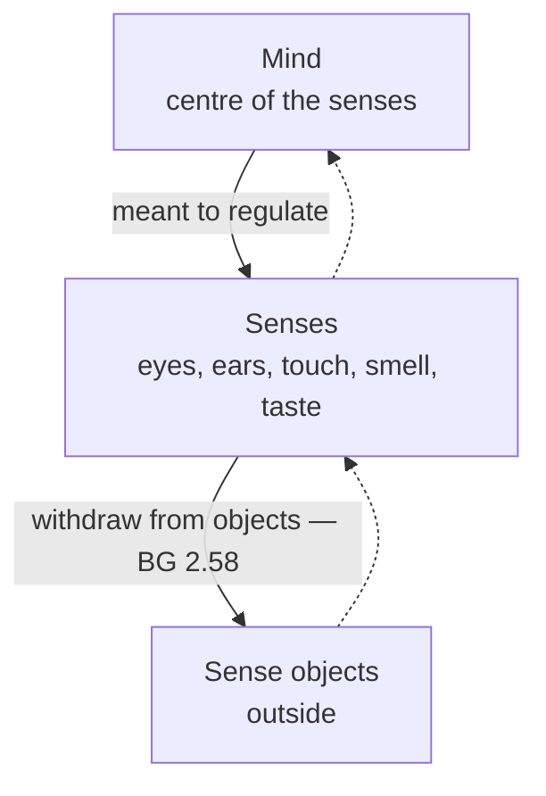

# BS 057 | BG 2.60 – 2.63 | Bhakti Shastri | HG Chaitanya Charan Das

> **Source note:** Commentary is written manually from this lecture's English auto-captions only, without Gemini or outside sources. Verse text is not reproduced; each verse appears as its embedded vedabase.io page.

---

## Class Snapshot & One-Line Argument Map

- **Lecture:** Bhakti Shastri (057) — Bhagavad-gītā Chapter 2, Texts 60 to 63 `00:00`
- **Scope:** The rest of Kṛṣṇa's answer to Arjuna's third question (how the transcendentalist "sits," i.e. regulates the senses): the power of the senses even over a striving _yogī_, the first verse in which Kṛṣṇa points to Himself as the object of the mind, and the step-by-step fall from contemplation of sense objects to destruction `00:00 – 63:05`.
- **Why it matters:** The teacher stresses that the fall is neither unstoppable nor irreversible — it can be checked at any stage, but the earlier the better `48:00 – 52:00`.

**One-Line Argument Map:** Even a discriminating, striving yogī's senses can forcibly drag his mind away -> so control alone is not enough: fix the mind on Kṛṣṇa, moving from control to concentration to conquest -> if the mind instead dwells on sense objects, contemplation leads step by step to attachment, lust, anger, delusion, forgetfulness, loss of intelligence and fall -> the fall can be checked at any stage, so stop early, spiritualise the imagination, and turn anger against the craving itself

---

## Continuity & Recap from Preceding Class

- Arjuna's four questions (2.54) are answered in sequence `00:00`:
  - the defining characteristics — 2.55;
  - how such a person speaks — 2.56–2.57;
  - how he "sits," i.e. regulates the senses — 2.58–2.63 (being completed now);
  - how he "walks" — from 2.64 onwards.
- 2.59 was discussed in the previous class, so this class starts with 2.60 `00:00`.
- In 2.58 Kṛṣṇa said one should withdraw the senses as a tortoise withdraws its limbs; 2.60 warns how hard that is `08:00`.

---

## Shloka-Wise Notes & Analytical Commentary

### Bhagavad-gita 2.60 [00:00 – 22:00]

<!-- vedabase:2.60 -->

**Context.** Even for a person of discrimination who is endeavouring, the senses are so strong and impetuous that they forcibly drag the mind away `00:00 – 02:00`.

**Key Terms Explained by the Teacher**

- _A person of discrimination_ — who knows right from wrong and the difference between matter and spirit `00:00`, `04:00`.
- _Wild and impetuous senses_ — they drag the mind away thoroughly, by force `02:00`.

#### Three kinds of people [02:00 – 06:00]

- **_Vikarmīs_** — chase sense gratification and defy _dharma_ in the process, e.g. extramarital or premarital relationships.
- **_Karmīs_** — seek sense gratification by religious means; Kṛṣṇa described them in 2.42–2.43 as attracted by the flowery words of the Vedas, taking the pleasures of _svarga_ as the ultimate goal and saying there is nothing else.
- **_Yogīs_** — understand that material enjoyment leads to suffering and bondage and perpetuates illusion, and try to break free.
- Kṛṣṇa is speaking here not of ordinary materialists but of _yogīs_ — those with both inner discrimination and active endeavour; even they are dragged away. Most of us are lower, often pursuing sense gratification within the precincts of _dharma_ `06:00`.

#### The hierarchy: objects, senses, mind [06:00 – 08:00]

- Sense objects are outside, the senses are in between, and the mind is inside; we contact sense objects through the senses — the eyes see a beautiful form, the tongue wants a delicious dish.
- The mind is the centre of all the senses: Kṛṣṇa describes in 15.9 that hearing, sight, touch, smell and taste are centred around the mind, just as the five fingers are centred around the palm.
- When we expose ourselves to sense objects, the mind is forcibly drawn toward them; desires get ignited, fuelled and inflamed, and like a moth to fire we are drawn to the objects `08:00`.



#### Viśvāmitra and the ankle bells [08:00 – 10:00]

- Śrīla Prabhupāda's purport gives the example of Viśvāmitra Muni, practising austerity in the forest: hearing the ankle bells of a celestial woman agitated him so much that he forgot everything else.
- How can mere jingling drag down a renunciant? It is not the sound itself: when the sound enters the mind it kindles the imagination, which bursts forth with fantasies of pleasure, and then we are dragged away `10:00`.
- Sense control is usually described from the male perspective, because the male body is considered more suitable for self-realisation; but the _Bhāgavatam_ also speaks from the female perspective — a woman too attracted to a man is like a deer and the man like the hunter. The principle is generic: sense objects differ, but they drag the mind down `10:00`.

#### Yāmunācārya's higher taste [10:00 – 14:00]

- Continuing from the previous verse's "higher taste," Śrīla Prabhupāda quotes a well-known verse of Yāmunācārya: since he began relishing the ever-new mellows of Kṛṣṇa consciousness at Kṛṣṇa's lotus feet, whenever he thinks of sex pleasure his mouth twists in distaste and he spits at the thought.
- This is jolting for sense gratifiers — what most people dream of, someone spits at; it shows the pleasure of Kṛṣṇa consciousness is so lofty that everything else seems insignificant.
- Why disgust and not just indifference? For a devotee anything that distracts from Kṛṣṇa is a source of danger and dismay — "for so long, for such a trivial pleasure, I let myself be distracted from Kṛṣṇa" `14:00`.

#### Thoughts may come — "nothing doing" [14:00 – 18:00]

- Even while relishing Kṛṣṇa consciousness, Yāmunācārya says the thought of sex pleasure may come. Yāmunācārya lived nearly a thousand years ago in a much purer culture; today there is far more impurity, and past memories can also surface.
- So getting bad thoughts does not mean we must fall. What differs between an advanced devotee and a neophyte is not the absence of impure thoughts, but the response:
  - **Pure devotee** — "No, get lost" — nothing doing.
  - **Materialist** — "Welcome, I was waiting for you"; he even searches out temptations.
  - **_Sādhaka_** — in between: sometimes yes, sometimes no, mostly "not now, maybe later, when nobody is around."
- Our journey is from "welcome" to "nothing doing," by filling the mind with Kṛṣṇa so sensual thoughts get no room; each time we say no and turn to Kṛṣṇa we grow stronger `18:00`.

#### Intelligence kills thoughts before they become actions [18:00]

- In a letter Śrīla Prabhupāda wrote that getting thoughts is not wrong; acting on them is. His striking definition: intelligence means to kill the thoughts before they grow into actions.
- If thoughts do not grow into actions, the problem is far less; the coming verses show how unchecked thoughts grow to disastrous proportions.

#### The satisfied hungry man [18:00 – 20:00]

- Śrīla Prabhupāda compares the higher taste to a hungry man who has satisfied his hunger with sufficient nutritious food.
- In 2.59 the word was "not taking in" — one feels deprived; but fixing the mind on Kṛṣṇa brings a deeper, richer inner happiness: "I don't need anything; I'm satisfied."
- The _Bhāgavatam_ says practising _bhakti_ leads to experience of the Supreme Lord and detachment from other things — what Yāmunācārya experienced.
- Śrīla Prabhupāda's purports go beyond the verse to show its application; he mentions Ambarīṣa Mahārāja here and elaborates his pastime in the next purport `20:00`.

<Callout type="idea" title="Takeaway">
Even a discriminating, striving yogī can be dragged away because the senses inflame the imagination; impure thoughts may still come to anyone, but the advanced devotee answers them with "nothing doing" — empowered by the higher taste of Kṛṣṇa. [02:00 – 20:00]
</Callout>

---

### Bhagavad-gita 2.61 [20:00 – 44:00]

<!-- vedabase:2.61 -->

**Context.** Having said we should seek the higher taste, Kṛṣṇa now describes how to get it `20:00 – 22:00`.

**Key Terms Explained by the Teacher**

- _Āsīta_ — situates oneself; related to the question "how does he sit" from 2.54 `22:00`.
- _Mat-para_ — fixing the mind on Me: the first place in the Gītā where Kṛṣṇa refers to Himself as the object of the mind — the first drop of _bhakti_ in the Gītā `22:00`.
- _Restraint_ (control) — needed only when an opposing force resists us — the stage of struggle `24:00`.

#### From teacher of sense control to object of the senses [22:00]

- Until now Kṛṣṇa has not referred to Himself directly and has been the teacher of sense control.
- From here He begins to say: "I am the object on which the controlled senses should be fixed."

#### Control → concentration → conquest [24:00 – 26:00]

1. **Control** — some basic self-control. Even in the temple, if our eyes run here and there — who has come, how they are dressed, what they are doing — we stay in bodily consciousness and experience nothing spiritual. That level of control is not easy, but everyone can have it.
2. **Concentration** — fixing the consciousness on Kṛṣṇa.
3. **Conquest** — then the senses are conquered, and the intelligence is well situated.

#### The wild horse [26:00]

- A horse neighing wildly, threatening to knock down anyone who comes near: first the trainer gets some grip with saddle and reins — **control**.
- Then he trains it to understand that if it behaves it will get food, nourishment, love and care; it calms down and focuses — **concentration**.
- Then the horse is **conquered**.
- Likewise the restless mind cannot focus even when Kṛṣṇa is before us as the deity or the holy name; it must come to see that its nourishment and satisfaction are here.

#### Control alone will fail [28:00]

- Kṛṣṇa uses the word _yukta_ — connected, engaged; what that engagement is will be told in 2.64.
- If we only try to control, control, control without moving to concentration and conquest, control itself fails: how long can we continue? The mind will go wild and knock us down.

#### Durvāsā and Ambarīṣa [28:00 – 30:00]

- By _varṇa_ and _āśrama_, Durvāsā Muni was higher than Ambarīṣa Mahārāja: _brāhmaṇas_ are first among the four _varṇas_ and _kṣatriyas_ second; and he was in the highest _āśrama_.
- But in this pastime his mind was not fixed on Kṛṣṇa; he was focused on "I am a renunciant, a great sage, I deserve to be honoured."
- Ambarīṣa Mahārāja was _mat-para_ — fixed on Kṛṣṇa; Śrīla Prabhupāda quotes a series of _Bhāgavatam_ verses showing how `30:00`.

#### Intention first, then engage the senses [30:00]

- "How can I fix the mind on Kṛṣṇa directly?" At least the intention must be there — "I want to think of Kṛṣṇa."
- From that intention one engages the senses, and when the senses are engaged the mind naturally becomes engaged.

#### How Ambarīṣa engaged every sense [30:00 – 36:00]

- **Speech** — described the glories of Vaikuṇṭha (the Lord's abode; also a name of Viṣṇu in the _Viṣṇu-sahasra-nāma_, and an incarnation of Viṣṇu).
- **Hands** — cleaned the temple.
- **Ears** — heard the true _kathā_ of the Lord, the essence of everything; the newspapers are full of the _kathā_ of politicians, cricketers, businessmen, scamsters and criminals `32:00`.
- **Eyes** — saw the form and temple of Mukunda. _Ālaya_ means abode — _Himālaya_ is the abode of snow; a library or bookstore is an abode of books. Even the temple reminds us of Kṛṣṇa: Śrī Caitanya Mahāprabhu, returning to Purī from His tours, would offer obeisances on first seeing the tall spire and _cakra_ of the Jagannātha temple `32:00 – 34:00`.
- **Touch** — touched the lotus feet of great devotees and took their dust on his head `34:00`.
- **Smell** — smelled the flowers offered to the Lord.
- **Taste** — relished the _tulasī_ offered to the Lord.
- **Feet** — went to the temple and holy places and circumambulated them.
- **Head** — offered obeisances to the Lord `36:00`.
- He made all desires his servants rather than becoming the servant of his desires; a related phrase will come in 2.70 `36:00`.
- In this way he developed _rati_ (attraction) for the Lord glorified by choice poetry `36:00`.

#### Five working senses and five knowledge-acquiring senses [36:00 – 40:00]

- The verses give samples showing all the senses engaged:
  - **_Karmendriyas_** — hands, legs and speech used to go to the temple, clean it and speak the Lord's glories; the excretory organs are not used directly in service.
  - **_Jñānendriyas_** — eyes to see the deity, ears to hear _kathā_, tongue to taste _prasādam_, nose to smell offered flowers, touch to touch devotees' feet.
- Ambarīṣa was a _kṣatriya_, not a _brāhmaṇa_. Generally _brāhmaṇas_ preach and _kṣatriyas_ create facilities; _kṣatriyas_ do give speeches — Pṛthu Mahārāja instructed his citizens after his 99 horse sacrifices (Fourth Canto, Chapter 21) — but administration leaves little time to teach scripture lifelong `38:00`.
- Still, everyone should glorify the Lord in their own way — not necessarily from the _vyāsāsana_, but with family, neighbours, relatives, or by distributing books `38:00`.

#### Lifelong practice prepares for crisis [40:00 – 42:00]

- Ambarīṣa was a king with kingly duties; these activities demonstrate how we can engage our senses. Likewise, Rūpa Gosvāmī's 64 items of devotional service are important but do not exclude worldly duties; levels of practice are given in 12.8–12.12 `40:00`.
- His steady lifelong engagement let him respond maturely when Durvāsā cursed him and a fearful demon arose from the sage's plucked hair: he neither ran away nor became fearful; he stayed calm with his mind on Kṛṣṇa `40:00`.
- We should not expect to remember Kṛṣṇa suddenly in a crisis. By Kṛṣṇa's grace we may cry out to Him, but if we have not prepared our consciousness, we may think of other shelters, lament their destruction, and even resent Kṛṣṇa — "why has He done this to me?" `40:00 – 42:00`.
- Link to the verse: the purport shows how to bring about _concentration_, which involves both fixing the mind and engaging the senses `42:00`.

<Callout type="idea" title="Takeaway">
Restraint alone cannot last; Kṛṣṇa — here naming Himself for the first time as the object of the mind — shows the path from control to concentration to conquest, exemplified by Ambarīṣa Mahārāja, whose every sense was engaged in service and whose lifelong practice held firm in crisis. [22:00 – 42:00]
</Callout>

---

### Bhagavad-gita 2.62 – 2.63 [42:00 – 63:05]

<!-- vedabase:2.62 -->

<!-- vedabase:2.63 -->

**Context.** If one does not regulate the senses rightly, one can fall disastrously; the teacher discusses the two verses together because they form one flow of thought `42:00 – 44:00`.

**Key Terms Explained by the Teacher**

- _Contemplating the sense objects_ — the starting point of the fall `42:00 – 44:00`.
- _Attachment_ — develops from contemplation `44:00`.
- _Kāma_ — lust, strong desire `44:00`.
- _Krodha_ — fury: "who can stop me? I must enjoy" `44:00`.
- _Sammoha_ — delusion: confusion about what to do and what not to do `44:00`, `48:00`.
- _Smṛti_ — memory; also the _smṛti-śāstra_ we are meant to keep in memory `44:00`.
- Loss of _buddhi_ (intelligence) — intelligence is based on memory, so losing memory means losing intelligence `44:00`.

#### The "-tion" ladder of the fall [44:00 – 48:00]

The teacher uses words ending in "-tion" for rhyme (from an article on his website):

1. **Contemplation** — I start thinking about something.
2. **Attraction** — "that's nice, that's nice."
3. **Obsession** — "I want it" (_kāma_).
4. **Irritation / infuriation** — "who can stop me?"; whatever obstructs the desire — no money, morality — provokes anger (_krodha_).
5. **Delusion** — undecided, confused about what to do (_sammoha_).
6. **Oblivion** — forgetfulness: normally when undecided we turn to scripture, but now we cannot.
7. **Stupefaction** — the _buddhi_ is destroyed.
8. **Destruction** — one falls from spiritual consciousness to sensual consciousness and sense gratification.

#### Not the frustrated-lust story [46:00]

- We often say unfulfilled lust leads to anger — true: in a love triangle two boys may fight or even kill; a rejected boy may throw acid on a girl — "if I can't enjoy, nobody can."
- But here Kṛṣṇa is not describing such actions; He is describing the sequence by which one falls away.

#### The horse that sees something juicy [48:00 – 52:00]

- Is the fall unstoppable or irreversible? No — it can be stopped and reversed.
- Riding a horse (or a chariot — the body with five senses), the horse sees something juicy and starts looking that way; one pull of the rein then brings its head back.
- Once it starts running, it gains momentum; the greater the momentum, the greater the exertion needed. It may even plunge into a ditch, throw us off and get injured.
- Even then we can get up, bring the horse out, treat it if needed, mount and move forward — it is never too late for a fresh start `50:00 – 52:00`.
- But it is far easier to control it early — that is why horses wear head coverings so they cannot look in too many directions. From contemplation to destruction, control becomes harder at each stage, yet is possible at every stage with steady determination `52:00`.

#### The snowball [52:00 – 54:00]

- At the top of a hill a small pebble of snow can be shattered with one kick.
- Left alone, it rolls down gathering snow, and by the bottom the same person might be steamrolled and crushed by it.
- So with negative thoughts: when a desire first comes, "nothing doing — I won't contemplate it," and that is the end of it.

#### Seeing is not contemplating [54:00 – 56:00]

- Every word of the Gītā is carefully chosen: Kṛṣṇa does not say "seeing" sense objects — we cannot walk through the world blindfolded — but _contemplating_ them.
- Contemplation begins when we see and let the imagination run wild: seeing a table is fine; "why does he have a bigger table than me — I must have one" is contemplation.
- Who gets carried away depends on past attachment: for an alcoholic the mind sprints like an Olympic runner on seeing alcohol `54:00 – 56:00`.
- Attachment may develop afresh from contemplation, or contemplation may awaken dormant past attachments — either way, avoid contemplating sense objects `56:00`.

#### Spiritualise the imagination [56:00 – 60:00]

- We need not suppress the imagination; we can spiritualise it — thinking of Kṛṣṇa's beautiful deity, services we can do, how to study, chant and share Kṛṣṇa's message powerfully.
- "Isn't that thinking of my own glory?" It is fine to want to be a good devotee — a good teacher, singer, _pūjārī_, cook or manager. Some ego may be mixed in, but we should not avoid the desire out of fear; do the services nicely for Kṛṣṇa's pleasure, and when praise comes, accept it graciously: "it is by Kṛṣṇa's and the devotees' mercy" `58:00`.
- A devotee visiting a hostel or homes sees not concrete and metal but homes of potential devotees — "how wonderful if this person became a devotee" `58:00`.
- The imagination has to go somewhere; if not toward Kṛṣṇa, then toward _māyā_ and sensual things `60:00`.

#### Redirect the anger [60:00 – 63:05]

- We can check ourselves at any stage, not only after falling — even after attachment and lust have developed.
- When we feel irritated at the rules or people that block our enjoyment, redirect the anger at the mind and senses: "Why are you craving for things that won't make me happy? I've done this so many times and got only a little pleasure followed by guilt, emptiness, frustration, lower consciousness and greater disconnection from Kṛṣṇa."
- Immoral indulgence brings karmic consequences, but more immediately it steals our taste for Kṛṣṇa consciousness: coming down to material consciousness cuts us off from spiritual consciousness, so we cannot perceive or relish Kṛṣṇa `62:00`.
- The discussion continues next class.

<Callout type="idea" title="Takeaway">
The fall runs from contemplation through attachment, lust, anger, delusion and forgetfulness to loss of intelligence and destruction — but it can be checked at every stage; stop it early like a snowball at the hilltop, spiritualise the imagination, and turn anger against the craving instead of the obstacles. [44:00 – 62:00]
</Callout>

---

## Cross-Shloka Conceptual Progression (BG 2.60 – 2.63)

```
BG 2.60: Even a discriminating, striving yogī's senses can forcibly drag the mind away, so only a higher taste truly protects.
        │
        ▼
BG 2.61: Fixing the mind on Kṛṣṇa takes one from control to concentration to conquest of the senses.
        │
        ▼
BG 2.62: Contemplating sense objects breeds attachment, from attachment lust, and from frustrated lust anger.
        │
        ▼
BG 2.63: Anger leads to delusion, forgetfulness and loss of intelligence, and one falls — yet the fall can be checked at any stage.
```

### Comparative Summary Table

| Verse | Primary Theme | Core Sanskrit Terms Explained | Central Mechanism / Principle | Practical Imperative |
| --- | --- | --- | --- | --- |
| 2.60 | Power of the senses | _vikarmī_, _karmī_, _yogī_ | Senses inflame the imagination and drag the mind | Answer impure thoughts with "nothing doing" |
| 2.61 | Fixing the mind on Kṛṣṇa | _mat-para_, restraint, _yukta_ | Control → concentration → conquest | Engage every sense in Kṛṣṇa's service, lifelong |
| 2.62 | Beginning of the fall | contemplation, attachment, _kāma_, _krodha_ | Contemplation, not seeing, starts the fall | Stop the snowball at the top |
| 2.63 | Completion of the fall | _sammoha_, _smṛti_, _buddhi_ | Loss of memory of scripture destroys intelligence | Spiritualise the imagination; redirect anger at the craving |

---

## Audience Q&A & Clarifications

- No audience Q&A appears in the captions. The teacher raises and answers his own questions:
  - How can mere ankle bells drag down an ascetic? They kindle the imagination `08:00 – 10:00`.
  - Why spit at the thought of a lower pleasure rather than ignore it? Because it distracts from Kṛṣṇa `14:00`.
  - Do bad thoughts mean I must fall? No — the response, not the thought, decides `14:00 – 18:00`.
  - How can I fix the mind directly on Kṛṣṇa? Start with the intention and engage the senses `30:00`.
  - Isn't imagining myself as a good devotee egoistic? Do it for Kṛṣṇa's pleasure and accept praise as mercy `56:00 – 58:00`.

---

## Last-Page Revision Sheet

### High-Yield Facts & Terminological Anchors

- Third question ("how does he sit") answered in 2.58–2.63; fourth from 2.64 `00:00`.
- _Vikarmīs_, _karmīs_, _yogīs_ — 2.60 is about _yogīs_ `02:00 – 06:00`.
- 15.9 — the five senses are centred around the mind like fingers around the palm `06:00`.
- Yāmunācārya's verse — spitting at the thought of sex pleasure `12:00`.
- Prabhupāda's definition: intelligence means to kill thoughts before they grow into actions `18:00`.
- 2.61 — the first place Kṛṣṇa refers to Himself as the object of the mind; the first drop of _bhakti_ in the Gītā `22:00`.
- Control → concentration → conquest `24:00`.
- Ambarīṣa Mahārāja engaged all five _karmendriyas_ and five _jñānendriyas_ `36:00 – 38:00`.
- Levels of practising _bhakti_: 12.8–12.12 `40:00`.
- The fall: contemplation → attraction → obsession → irritation → delusion → oblivion → stupefaction → destruction `46:00 – 48:00`.
- _Smṛti_ = memory and _smṛti-śāstra_ `44:00`.

### Core Analogies & Metaphors

- **Fingers around the palm** — senses centred on the mind `06:00`.
- **Moth drawn to fire** `08:00`.
- **Viśvāmitra and the ankle bells** `08:00 – 10:00`.
- **Deer and hunter** — the female perspective `10:00`.
- **"Welcome" versus "nothing doing"** — materialist, _sādhaka_, pure devotee `16:00 – 18:00`.
- **Hungry man satisfied by nutritious food** — the higher taste `18:00`.
- **Training a wild horse** — control, concentration, conquest `26:00`.
- **Himālaya as the abode of snow** — _ālaya_ `32:00`.
- **Horse turning toward something juicy** — rein it in early `48:00 – 52:00`.
- **Snowball rolling downhill** `52:00 – 54:00`.
- **Seeing a table versus wanting a bigger one** — seeing versus contemplating `54:00`.
- **The alcoholic's Olympic sprint** — past attachment `54:00 – 56:00`.

---

## Transcript Verification Flags

- `00:00` — The Sanskrit names of the four questions are garbled ("kabasha", "Kim prashi"); the note uses the English sense only.
- `00:00 – 02:00` — 2.60's key words appear as "IND is like Madness storm so indani"; the Sanskrit is not reconstructed, only the teacher's English sense is given.
- `02:00` — "V karies", "Kies", "wearies" read as _vikarmīs_ and _karmīs_.
- `02:00` — "2.4 243" read as 2.42–2.43.
- `08:00` — "the ankle bells of mina" — the name of the celestial woman is garbled; the note does not name her.
- `12:00` — Yāmunācārya ("yamara", "imara", "Yar") and his verse are garbled; paraphrased only, not reconstructed.
- `20:00` — "the bham says that bii ... leads to the par" — the _Bhāgavatam_ reference is paraphrased; the Sanskrit is not reconstructed.
- `22:00` — "aita" read as _āsīta_; "M" / "Mata" read as _mat-para_; "AAR" (first drop) unclear.
- `24:00` — The Sanskrit word for restraint is dropped in the captions; only the teacher's gloss "restraint or control" is used.
- `28:00` — "the mahaj AAS wasas" — Durvāsā's _āśrama_ is summarised as "the highest _āśrama_."
- `30:00 – 36:00` — The _Bhāgavatam_ verses on Ambarīṣa are heavily garbled; only the teacher's explanations are used, and no verse numbers are given.
- `30:00` — "in the eth cunta" read as an incarnation of Viṣṇu named Vaikuṇṭha (canto unclear).
- `36:00` — "we'll discuss about kakami later on in 2.7" — read as a related phrase recurring in 2.70; the Sanskrit term is uncertain.
- `38:00` — "pu Maharaj ... 99 house sacrifices ... fourth C 21st chapter" read as Pṛthu Mahārāja, 99 horse sacrifices, Fourth Canto Chapter 21.
- `40:00` — "when Swami gives the 64 items" read as Rūpa Gosvāmī.
- `48:00` — "staction" read as "stupefaction."
- `60:00` — "graic" read as sense gratification.
