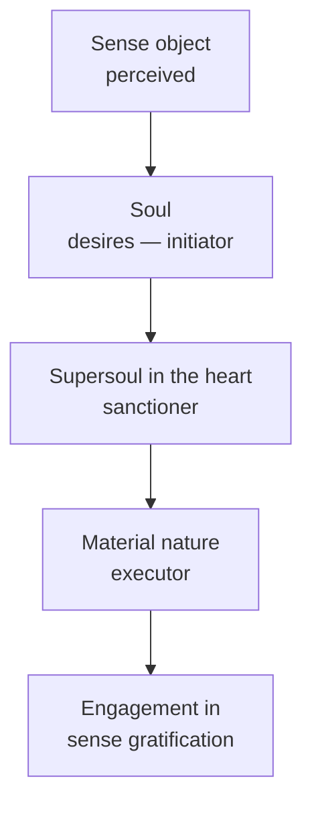

# BS 076 | BG 5.8 – 5.14 | Bhakti Shastri | HG Chaitanya Charan Das

> **Source note:** Commentary is written manually from this lecture's English auto-captions only, without Gemini or outside sources. Verse text is not reproduced; each verse appears as its embedded vedabase.io page.

---

## Class Snapshot & One-Line Argument Map

- **Lecture:** Bhakti Shastri (076) — Bhagavad-gītā Chapter 5, Texts 8–14 `00:00`
- **Scope:** BG 5.8 – 5.14 — how the _karma-yogī_ understands "I am not the doer," offers work to the Absolute, works for purification, contrasts with the fruitive worker, lives detached in the "city of nine gates," and acts according to nature without being bound `00:00 – 60:00`.
- **Why it matters:** Kṛṣṇa is answering Arjuna's question of how a person can work in the material world and still stay free from bondage; the answer is that bondage is caused not by action but by motivation `28:00`, `44:00`.

**One-Line Argument Map:** The wise see that only the senses contact sense objects -> the soul is not the independent doer but the initiating cause, with the Supersoul as sanctioner and nature as executor -> work offered to the Absolute does not stick, like water on a lotus leaf -> the karma-yogī works with body, mind, intelligence and even the senses for purification -> what binds is selfish motivation, not action itself -> the detached soul lives happily in the body, the city of nine gates -> act according to your nature, without identifying with it

---

## Continuity & Recap from Preceding Class

- The previous classes covered the first seven verses of Chapter 5 `00:00`.
- Section overview given by the teacher `00:00`:
  - First section — _karma-yoga_ is equal to, but easier than, _jñāna-yoga_.
  - Second section, verses 7 – 16 — by fixing the mind on the _ātmā_, the _karma-yogī_ stays free from bondage. This class continues within that section.
- Earlier discussions the teacher recalls: "automatic" means absence of awareness of control, not absence of control `06:00`; the tree-cutting example of instrumental and initiating causes `14:00`; the negative and positive axes of spiritual progress `36:00`; and different kinds of _muktas_ `36:00`.

---

## Shloka-Wise Notes & Analytical Commentary

### Bhagavad-gita 5.8 – 5.9 [00:00 – 22:00]

<!-- vedabase:5.8 -->

<!-- vedabase:5.9 -->

**Context.** Kṛṣṇa lists the many activities of the body — the ways things are taken in and sent out — and says the person in knowledge understands that simply the senses are contacting the sense objects; "I am not actually the doer" `00:00 – 02:00`.

**Key Terms Explained by the Teacher**

- Activities named in the verses, as the teacher groups them `02:00`:
  - Taking things inward — seeing, hearing, touching, smelling, eating.
  - Other functions — going here and there, breathing, talking, giving up, accepting.
  - Opening and closing the eyes.
- _Kartā_ — the doer; the soul is not the _independent_ doer, but a dependent doer working in coordination with other elements `14:00`.

#### The scientific level: so much happens without us [02:00 – 12:00]

- Some actions are conscious (raising a hand to explain a point); others happen subconsciously — we do not have to remember to breathe while speaking `02:00 – 04:00`.
- In a disease caused by damage to the involuntary nervous system, a person must consciously remember to breathe; if he falls asleep he may die of breathlessness unless placed on artificial respiration `04:00`.
- If we had to be consciously aware of chewing, digestion, the movements of the alimentary canal and the beating of the heart, the overload would leave us dysfunctional `04:00 – 06:00`.
- "Automatic" does not mean absence of control; it means absence of _awareness_ of control. The controller is the Supersoul — the teacher refers to Kṛṣṇa saying in the ninth chapter that He is the controller `06:00`.
- We think of digestion only when it does not work `08:00`.
- Healing: medicines are useless without the body's inbuilt healing — white blood cells, clotting. A doctor's remark: most of medicine is entertaining the patient while the body heals itself. Medicines should still be taken responsibly `08:00`.
- When the body's defence collapses, as in AIDS, a small infection can become fatal and medicine can go only so far `10:00`.
- Even voluntary action is not fully ours: in paralysis or Parkinson's one loses control of one's own hand. Calling these "unnatural conditions" misses the point — our stay in the body is itself temporary, and the normal functioning of the system only allows the illusion of being the doer to continue `10:00 – 12:00`.

#### The philosophical level: the body is a mechanism [12:00]

- The soul may be in a human body now and a dog's or horse's body next; in a dog's body it can only bark. We do not know how to produce those sounds — the faculties come with the body, and the soul expresses its desires through them.
- So the body is a mechanism, and people act according to that mechanism.

#### Three causes of every action [14:00 – 18:00]

- If the soul were absolutely a non-doer, it should not reap reactions, and scriptural injunctions would be meaningless — yet the soul does get reactions and scripture holds it responsible. So the point is that the soul is not the _independent_ doer `12:00 – 14:00`.
- Examples of causes `14:00 – 16:00`:
  - Tree-cutting — the axe is the instrumental cause, the woodcutter the initiating cause. The instrument may vary (axe, machine, bulldozer), and the action works out accordingly.
  - Voice — a soul with the desire to communicate is the initiating cause; the dog's, human's or horse's voice box is the instrumental cause, so the sound differs.
  - Jailing a criminal — the police are the instrumental cause, the judge the sanctioning cause, the criminal the initiating cause.
- Applied to the soul's suffering: material nature is the instrumental cause, the Supersoul the sanctioning cause, and the soul the initiating cause. We receive reactions according to time, place and circumstance, and according to what is best for our eventual reformation `16:00`.

#### The diagram: how action happens [16:00 – 18:00]

- The teacher shows a diagram in which the conditioned soul, the Supersoul and material nature are all within the body.
- The flow he describes:
  - A sense object is perceived; its input comes in.
  - The soul desires the object and intends to act.
  - The Supersoul in the heart perceives this and sanctions.
  - Material nature executes, and the person engages in sense gratification.



- So all three are "doers": the soul as the one who desires and initiates, the Supersoul as sanctioner, material nature as executor `18:00`.

#### Eat to live, not live to enjoy [18:00 – 20:00]

- The verse's point: the body has some inevitable needs that must be fulfilled, but beyond that there is no further drive toward sense gratification, because the soul is not motivated by materialism — so the person is not bound.
- The body is the soul's vehicle and needs fuel. One may object that eating requires desire; yes, but the desire can be to _eat to live_ or to _eat to enjoy_. With the first there is no enjoying mentality and no bondage; with the second the enjoying mentality takes hold and implicates one karmically `20:00`.
- Prabhupāda explains that a devotee acts for Kṛṣṇa's pleasure — which Kṛṣṇa will point to in the next verse `20:00`.

<Callout type="idea" title="Takeaway">
The soul is not the independent doer: it initiates by desire, the Supersoul sanctions and nature executes. Seeing this, the wise meet the body's needs — eating to live rather than to enjoy — and stay free from bondage. [12:00 – 20:00]
</Callout>

---

### Bhagavad-gita 5.10 [20:00 – 28:00]

<!-- vedabase:5.10 -->

**Context.** One who gives up attachment and offers work to the Absolute is not bound by karma, just as a lotus leaf is not wetted by water `22:00 – 24:00`.

**Key Terms Explained by the Teacher**

- _Brahman_ — the word is understood according to one's conception of the Absolute Truth. A devotee offers all work to Kṛṣṇa as _Bhagavān_; a _karma-yogī_ who does not yet know this may understand that material nature is acting `22:00`.
- _Brahman_ as material nature — the teacher points to the fourteenth chapter (verses 3 – 4), where Kṛṣṇa calls material nature the great womb in which He gives the seed, and all living beings receive their forms `22:00 – 24:00`.
- _Facades_ — the front faces of buildings; "lotus-effect facades" are designed like the lotus leaf `26:00`.

#### Not emotionally involved in nature's actions [24:00]

- When one does not get emotionally involved in the actions of material nature — does not think "I am the doer, I am the enjoyer" — one does not become bound.
- Without emotional attachment, karma does not bind the soul; it simply washes off.

#### The lotus leaf [24:00 – 26:00]

- Water falling on a lotus leaf slips away; even dirt on it is washed off along with the water.
- Researchers studied the leaf's surface construction and replicated it in skyscraper facades: they cannot be cleaned daily by people on ladders, so they are built so that nothing sticks — rain slides off and carries the particles away, keeping them clean.

#### Prabhupāda's purport [26:00 – 28:00]

- Prabhupāda correlates this verse with BG 3.30, where Kṛṣṇa asks that all work be given to Him.
- He also notes that the sum total of material manifestation, the three modes, is technically called _pradhāna_, though the teacher does not develop that point.

<Callout type="idea" title="Takeaway">
Work offered to the Absolute — whether understood as Kṛṣṇa or, at an earlier stage, as nature acting — leaves no karmic stain, because without emotional attachment there is nothing for karma to cling to, like water on a lotus leaf. [22:00 – 26:00]
</Callout>

---

### Bhagavad-gita 5.11 [28:00 – 42:00]

<!-- vedabase:5.11 -->

**Context.** If one is not to be attached to results, what is the motivation for working? Kṛṣṇa answers: purification — the _yogī_ acts with the body, the mind, the intelligence and even the senses, giving up attachment, to purify himself `28:00`.

**Key Terms Explained by the Teacher**

- Levels of motivation `28:00 – 30:00`:
  - Desire — "if I obey God, He will give me good results."
  - Duty — the level at which _sādhana-bhakti_ is performed: following the instructions of the spiritual master and of Kṛṣṇa so as to become purified, elevated, liberated, and return to Kṛṣṇa.
- The word for "the senses" in the verse can mean "_at least_ the senses" or "_even_ the senses" `30:00`.
- _Sensory_ vs. _sensuous_ — "sensuous" refers to what titillates or agitates the senses; "sensory" is functional, as in sensory perception `34:00`.
- _Jīvan-mukta_ — one who has a body but is liberated from all material attachments `36:00`.

#### "At least the senses" [30:00]

- If while chanting Hare Kṛṣṇa we cannot concentrate, at least do the external practice — at least let the senses be engaged.

#### "Even the senses": active yoga [30:00 – 36:00]

- Two methods of yoga `30:00`:
  - Contemplative — more the _jñānī_ process: sitting and pondering "I am not the body, I am the soul."
  - Active — using the senses in Kṛṣṇa's service: the eyes to behold His form, the tongue to speak about Him.
- The senses that normally cause bondage can lead to liberation when engaged properly.
- Progression the teacher describes `32:00 – 34:00`:
  - Now the senses cause agony — we see objects and crave them.
  - At the pure stage they bring ecstasy — a devotee says that chanting gives so much nectar he wishes for thousands of mouths and crores of ears. "I do not know how much nectar is there" is a statement not of ignorance but of amazement, like a diver who goes deep and says he does not know how big the ocean is.
  - In between, to go from agony to ecstasy, we need tolerance, patience and determination.
- In BG 2.58 the senses are withdrawn like a tortoise's limbs; here the point is that even the senses can be engaged for purification `34:00`.
- _Bhakti_ is "sensory spirituality": the senses are actively involved in purification. The same tongue that bound us by speaking nonsense purifies and liberates us when it speaks about Kṛṣṇa `34:00 – 36:00`.

#### Three kinds of liberated souls [36:00 – 42:00]

- Prabhupāda quotes Rūpa Gosvāmī's verse on the _jīvan-mukta_: one who engages body, mind and words in this way is actually liberated `36:00`.
- What causes bondage is attachment; one without material attachments is liberated even in the body.
- Three categories the teacher describes `36:00 – 40:00`:
  1. Both feet in the spiritual world — they have transcended the three modes and realised their _svarūpa_ (moved beyond zero on the "positive axis"). They are only waiting for the body's tenure to end.
     - Example: a Gosvāmī who ate almost nothing fell sick; a doctor diagnosed overeating, and the associates were outraged. The Gosvāmī explained that he had eaten a lot of _kheer_ in the spiritual world — he was acting here as a Gosvāmī and at the same time as an intimate associate of Rādhārāṇī and the _gopīs_ `38:00`.
  2. One foot in the spiritual world, one in the material — beyond the influence of the modes but not yet far advanced on the positive axis; still considered _jīvan-mukta_ `40:00`.
  3. Both feet in the material world, but eyes fixed on the spiritual world alone — not looking for pleasure here; topmost among souls still in the conditioned stage, and as good as liberated `40:00`.

<Callout type="idea" title="Takeaway">
The karma-yogī's motive for working is purification; even the senses, normally the cause of bondage, become instruments of liberation when engaged in Kṛṣṇa's service — moving from agony through tolerance to ecstasy. [28:00 – 36:00]
</Callout>

---

### Bhagavad-gita 5.12 [42:00 – 47:00]

<!-- vedabase:5.12 -->

**Context.** Kṛṣṇa compares the fruitive worker with the _karma-yogī_. In 5.6 the comparison was between the _karma-yogī_ and the _jñāna-yogī_ — trying for inactivity makes freedom from bondage difficult `42:00`.

**Key Terms Explained by the Teacher**

- _Param śāntim_ — supreme peace, used in 4.39; here Kṛṣṇa uses a further epithet meaning unshaken, unshakable, very deep, unflinching peace `44:00`.

#### Motivation, not action, binds [42:00 – 46:00]

- Arjuna's implicit worry: won't action cause bondage? Kṛṣṇa's answer: it is not action but motivation that causes bondage.
- One without selfish motivation is not bound; the one with it becomes bound.
- Arjuna longs for peace, but he will not get it simply by avoiding the war; as long as one has material attachments one will be agitated. By _karma-yoga_ that purifies attachments, one attains unshakable peace.
- People may wear a facade of peace, but big agitations disturb them `44:00`.

#### No existence besides Kṛṣṇa [46:00]

- Prabhupāda's purport: realising that there is no existence besides Kṛṣṇa is the platform of peace and fearlessness.
- Meaning: everything works under Kṛṣṇa's sanction, and whatever exists is His energy. Seeing something as separate from Kṛṣṇa is illusion; seeing everything connected with Him is reality.
- Why fearlessness: what takes away peace is fear — "what if this goes, what if that goes." When Kṛṣṇa is understood as always one's well-wisher, there is no loss.

<Callout type="idea" title="Takeaway">
Two people may do the same work, yet one is bound and the other attains unshakable peace — the difference is motivation; seeing everything connected with Kṛṣṇa removes the fear that destroys peace. [42:00 – 46:00]
</Callout>

---

### Bhagavad-gita 5.13 [46:00 – 56:00]

<!-- vedabase:5.13 -->

**Context.** Kṛṣṇa gives another illustration of staying detached: renouncing all work in the mind, the embodied soul lives happily in the city of nine gates, neither doing nor causing work to be done `46:00 – 50:00`.

**Key Terms Explained by the Teacher**

- _Mānasa-pūjā_ — worship in the mind: if we cannot afford jewelled necklaces for Kṛṣṇa, we offer them mentally and He accepts the intention `48:00`.
- _Pura / Purī_ — a city or place (as in the city of Lord Jagannātha); the body is the city of nine gates `48:00`.
- The nine gates — two eyes, two nostrils, two ears, one mouth, and the remaining openings `52:00`.

#### Renouncing in the mind [48:00]

- At the devotional level, mental offering is accepted because Kṛṣṇa sees the intention.
- At the _karma-yogī_ level: "I am not the doer; the body has certain needs, and I fulfil them" — such a person lives happily, functional but not emotionally entangled with troublesome sense objects.

#### The fortified city [52:00 – 54:00]

- In the past, fortified cities had walls, and the gates were the main entry and exit points to be defended.
- The body's gates are where the world's impressions enter and our actions exit; through them we interact with the world, and through them we get bound — seeing attractive objects, wanting to enjoy, pursuing them.
- A well-protected city does not let anything and everything in or out — like a country with a delicate foreign-exchange position restricting money going out.
- So too we regulate what enters and leaves the body. Necessary functions must continue — one cannot walk with eyes closed — but beyond that one does not become emotionally involved, like a person in a room where the TV is on but who is not absorbed in it `54:00`.

#### Kṛṣṇa's message to Arjuna [50:00, 54:00 – 56:00]

- To the extent we think we will enjoy the sense objects and that "I am doing," we are entangled; to the extent we do not, we are not bound `50:00`.
- Arjuna has a body whose nature is to fight; he cannot resist that nature by trying to act like a _sannyāsī_ — it will not work.
- But he should not become so identified with the _kṣatriya_ nature that he is consumed by it; that becomes bodily conception.
- Act according to your nature, but without emotional involvement — then there is no karmic entanglement, and the spiritual journey continues `54:00 – 56:00`.

<Callout type="idea" title="Takeaway">
The body is a city of nine gates: let its necessary functions go on, but guard the gates by not becoming emotionally involved with what passes through — then one lives happily, neither the doer nor the instigator. [48:00 – 56:00]
</Callout>

---

### Bhagavad-gita 5.14 [56:00 – 60:00]

<!-- vedabase:5.14 -->

**Context.** Kṛṣṇa continues the thread: the master of the city of the body does not create activities, does not make others act, and does not create the fruits of action; all this is enacted by the modes of material nature `56:00`.

**Key Terms Explained by the Teacher**

- _Prabhu_ — can refer to the Supreme Lord, but here Prabhupāda uses it for the master of the city of nine gates — the soul `56:00`.
- _Svabhāva_ — one's material nature; the body is a machine with particular propensities `56:00 – 58:00`.

#### The soul is never the doer [56:00 – 58:00]

- The soul neither does things nor makes others do them, nor becomes attached — all this happens by one's material nature.
- As long as the soul thinks "I am the doer," it becomes the reaper of the consequences; when it understands it is not the doer, it does not reap them.
- The conclusion of the Gītā is profoundly simple yet can be very deep: when the soul identifies with the body's propensities it is bound; when it uses them while staying detached, it stays free `58:00`.

#### The ocean of material existence [58:00 – 60:00]

- Prabhupāda's purport: the soul is in the midst of the material ocean, tossed by its waves, with no control over them; his best solution is to get out by transcendental Kṛṣṇa consciousness.
- The waves are the three modes:
  - Passion — "I want to show the world who I am."
  - Ignorance — "who bothers, let me sleep, let things happen."
  - Goodness — also a mood that comes and goes.
- These moods come and go and toss us up and down. To the extent we strengthen and steady our Kṛṣṇa connection, we get a boat to come out of this ocean; otherwise we are helpless `60:00`.

<Callout type="idea" title="Takeaway">
The modes of nature, not the soul, carry out bodily activities; by using the body's propensities without identifying with them, and by strengthening the Kṛṣṇa connection, the soul gets a boat out of the ocean of the modes. [56:00 – 60:00]
</Callout>

---

## Cross-Shloka Conceptual Progression (BG 5.8 – 5.14)

```
BG 5.8: The wise see that in all bodily activities simply the senses contact their objects, so they think "I am not the doer"
        │
        ▼
BG 5.10: Work offered to the Absolute without attachment does not stick to the soul, like water on a lotus leaf
        │
        ▼
BG 5.11: The karma-yogī's motive is purification, engaging body, mind, intelligence and even the senses
        │
        ▼
BG 5.12: Selfish motivation, not action, causes bondage, while the detached attain unshakable peace
        │
        ▼
BG 5.13: The detached soul lives happily in the body, the city of nine gates, neither doing nor causing others to do
        │
        ▼
BG 5.14: The modes of nature act, so the soul uses its nature without identifying with it and escapes the ocean of the modes
```

### Comparative Summary Table

| Verse | Primary Theme | Core Sanskrit Terms Explained | Central Mechanism / Principle | Practical Imperative |
| --- | --- | --- | --- | --- |
| 5.8 – 5.9 | Not the doer | _kartā_ | Soul initiates, Supersoul sanctions, nature executes | Eat to live, not to enjoy |
| 5.10 | Offering work | _Brahman_, _pradhāna_ | Without attachment, karma washes off like water on a lotus leaf | Offer all work to the Absolute |
| 5.11 | Work for purification | _jīvan-mukta_, sensory spirituality | Even the senses can liberate when engaged in service | At least engage the senses in devotion |
| 5.12 | Karma-yogī vs. fruitive worker | _param śāntim_ | Motivation, not action, binds | See everything as connected with Kṛṣṇa |
| 5.13 | City of nine gates | _mānasa-pūjā_, _pura_ | Regulate what enters and exits the body | Let functions continue without emotional involvement |
| 5.14 | Nature acts | _prabhu_, _svabhāva_ | The doer-conception makes one the reaper | Use propensities, but stay detached |

---

## Audience Q&A & Clarifications

- No separate audience Q&A appears in the captions. The teacher raises and answers several questions himself:
  - If the soul is not the doer, why does it get reactions and why are scriptures addressed to it? — The soul is not the _independent_ doer; it is the initiating cause `12:00 – 14:00`.
  - How can one eat without desire? — The desire may be to eat to live rather than to eat to enjoy `20:00`.
  - Aren't paralysis and disease just unnatural conditions? — Even normal functioning only lets the illusion of doership continue; our stay in the body is itself temporary `10:00 – 12:00`.

---

## Last-Page Revision Sheet

### High-Yield Facts & Terminological Anchors

- Chapter 5 sections: verses 1 – 6, _karma-yoga_ equal to but easier than _jñāna-yoga_; verses 7 – 16, fixing the mind on the _ātmā_ keeps the _karma-yogī_ free `00:00`.
- "Automatic" means absence of awareness of control, not absence of control `06:00`.
- Three causes: soul — initiating; Supersoul — sanctioning; material nature — instrumental/executor `16:00 – 18:00`.
- _Brahman_ can also mean material nature — see BG 14.3 – 14.4 `22:00 – 24:00`.
- Prabhupāda links 5.10 with BG 3.30 `26:00`.
- Two motivations below pure devotion: desire and duty; _sādhana-bhakti_ is at the level of duty `28:00 – 30:00`.
- Contemplative vs. active yoga; _bhakti_ is sensory spirituality `30:00 – 34:00`.
- Three categories of liberated souls: both feet in the spiritual world; one foot each; both feet here but eyes fixed there `36:00 – 40:00`.
- 5.6 compares _karma-yogī_ and _jñāna-yogī_; 5.12 compares _karma-yogī_ and fruitive worker `42:00`.
- Nine gates: two eyes, two nostrils, two ears, mouth, and the remaining openings `52:00`.
- In 5.14 _prabhu_ refers to the soul as master of the city of the body `56:00`.

### Core Analogies & Metaphors

- **Breathing disease** — if involuntary functions stopped, we would have to remember to breathe `04:00`.
- **Medicine entertains the patient** — the body's own healing does the real work `08:00`.
- **Woodcutter and axe; voice boxes of dog, human and horse** — initiating vs. instrumental cause `14:00`.
- **Criminal, police and judge** — initiating, instrumental and sanctioning causes `16:00`.
- **Body as vehicle needing fuel** — eat to live, not to enjoy `20:00`.
- **Lotus leaf and lotus-effect facades** — nothing sticks where there is no attachment `24:00 – 26:00`.
- **Diver in the ocean** — "I don't know how big it is" as an expression of wonder `32:00`.
- **Feet and eyes** — three levels of liberated souls `36:00 – 40:00`.
- **Mental offering of necklaces** — Kṛṣṇa accepts the intention `48:00`.
- **Fortified city and foreign exchange** — guarding the body's nine gates `52:00`.
- **TV on in the room** — functions go on without emotional involvement `54:00`.
- **Ocean and boat** — the modes toss us; the Kṛṣṇa connection is the boat `58:00 – 60:00`.

---

## Transcript Verification Flags

- `00:00` — Captions say "seventh verse we discussed was ... I am not the doer of anything" just before the list of bodily activities; the note treats the discussion from `00:00` as BG 5.8 – 5.9, since the teacher states the first seven verses were already covered.
- `00:00 – 02:00` — The Sanskrit names of the bodily activities are garbled ("ashnan," "gachan," "pralapan"); the note gives only their English meanings.
- `04:00` — "the body will forget to sleep" read as "forget to breathe," matching the surrounding sentences.
- `12:00` — "Cherry rabanta" — Sanskrit phrase not reconstructed.
- `22:00` — Verse recitation for 5.10 is not captioned; the summary of the verse is from the teacher's explanation.
- `24:00` — "Brahma mahatyanir" (BG 14.3) — not reconstructed.
- `26:00` — "neutrasound" / "Lotus and facades" read as lotus-effect facades.
- `28:00` — The verse recitation for 5.11 and the opening of the explanation are missing from the captions ("I'll be punished desire is actually where...").
- `30:00` — The verse word meaning "at least / even the senses" is captioned as "Cavalier"; not reconstructed.
- `32:00` — The Gosvāmī quoted about wishing for thousands of mouths and crores of ears is not identifiable from the captions ("goswami"); the note does not name him.
- `36:00` — The Rūpa Gosvāmī verse reference is captioned "one two eighty seven ... one two one eight seven"; the note does not give a number. The three categories "Guna Tita and swarupa" are partly garbled.
- `38:00` — The Gosvāmī in the _kheer_ story is captioned "saying goswami"; the note does not name him.
- `42:00` — The 5.12 verse recitation is not captioned.
- `46:00 – 48:00` — The 5.13 verse recitation is not captioned; "come was she" is garbled.
- `48:00` — "messing up with the Troublesome uh sense of objects ... will functional but he will be emotionally entangled" — read as "functional but not emotionally entangled," matching the teacher's point.
- `52:00` — "the United States" in the list of nine gates is a caption error; the note writes "the remaining openings" without naming them.
- `58:00` — The description of the three modes is garbled ("sometimes I don't really feel passionate ... stupid things happen who bothers"); summarised loosely.
