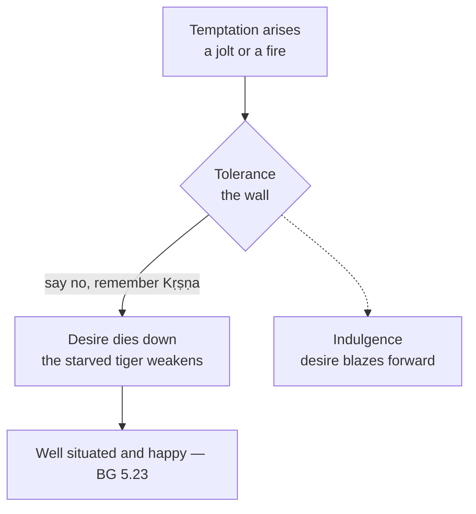

# BS 078 | BG 5.19 – 5.24 | Bhakti Shastri | HG Chaitanya Charan Das

> **Source note:** Commentary is written manually from this lecture's English auto-captions only, without Gemini or outside sources. Verse text is not reproduced; each verse appears as its embedded vedabase.io page.

---

## Class Snapshot & One-Line Argument Map

- **Lecture:** Bhakti Shastri (078) — Bhagavad-gītā Chapter 5, Texts 19–24 `00:00`
- **Scope:** BG 5.19 – 5.24 — equal vision as liberation in this life, equipoise amid the dear and the undesirable, turning inward for imperishable happiness, sense pleasure as the womb of misery, tolerating the urges of lust and anger, and _brahma-nirvāṇa_ `00:00 – 60:00`.
- **Why it matters:** From 5.20 the verses are both descriptive and prescriptive — naturally true of the perfected and consciously cultivated by practitioners — so they form a practical programme for dealing with sense pleasure and temptation `08:00`.

**One-Line Argument Map:** Those with equal vision conquer birth and death in this life and are situated in Brahman -> such a person neither rejoices at the pleasant nor laments the unpleasant -> detached from external contact, they turn inward and relish unlimited happiness -> they do not delight in sense pleasure because it is the womb of misery -> they tolerate the urges of lust and anger until death -> delighting within, they attain brahma-nirvāṇa: the end of material existence and revival of spiritual existence

---

## Continuity & Recap from Preceding Class

- Chapter 5 is nearing its end; the class is in the third section `00:00`:
  - First section — _karma-yoga_ gives the same result as _jñāna-yoga_ but can be practised more easily.
  - Verses 7 – 16 — fixing the mind on the _ātmā_ keeps the _karma-yogī_ free from bondage.
  - Verses 17 – 29 — fixing the mind on the _paramātmā_ frees the _karma-yogī_ from bondage.
- In 5.17 the four faculties — intelligence, mind, faith and goal — are centred on Kṛṣṇa; those who do so develop equal vision toward all beings (5.18) `00:00`.
- Earlier references the teacher recalls: the "not attainable, not palatable, not retainable" analysis of pleasure is used again later in the class `48:00`; Prabhupāda's quotation of the _Bhāgavatam_ in 5.1 `28:00`.

---

## Shloka-Wise Notes & Analytical Commentary

### Bhagavad-gita 5.19 [00:00 – 04:00]

<!-- vedabase:5.19 -->

**Context.** Kṛṣṇa describes the result of equal vision: those whose minds are situated in equanimity have conquered the cycle of birth and death even in this life; they are flawless like Brahman and are situated in Brahman `00:00 – 02:00`.

**Key Terms Explained by the Teacher**

- Equanimity — the verse's word is related to the word for "equal vision" in 5.18, which is repeated twice in 5.19 `00:00 – 02:00`.
- Flaws — not faults as we usually think, but the contaminating effects of the three modes; what is beyond the modes is Brahman `02:00`.
- _Rāga_ and _dveṣa_ — attraction and hatred; based on illusion, they create flaws within us `04:00`.
- _Brahman_ — can mean the _brahmajyoti_ or _Bhagavān_; Prabhupāda uses it here to mean the Lord. Later Arjuna will declare Kṛṣṇa to be the Supreme Brahman `04:00`.

#### Equal vision is liberation [02:00]

- The soul is transcendental; what happens in the temporary material realm does not really matter to it.
- It matters only because the soul is attached — "this will make me happy, that will make me miserable."
- When the soul understands "nothing material can make me happy, because I am not material," it sees everything material equally; attachment and excitement about material changes end — and that itself is liberation.
- Bondage is caused by our desires to enjoy, which exist because we consider some things enjoyable and others lamentable.

#### The Lord is flawless [04:00]

- Prabhupāda: the Lord is flawless because He is without attraction or hatred; a living entity without attraction or hatred also becomes flawless and eligible to enter the spiritual sky.

<Callout type="idea" title="Takeaway">
Equal vision is itself liberation in this life: when nothing material is seen as able to make the soul happy or miserable, attraction and hatred end, and one becomes flawless and situated in Brahman. [02:00 – 04:00]
</Callout>

---

### Bhagavad-gita 5.20 [04:00 – 10:00]

<!-- vedabase:5.20 -->

**Context.** How does one practically become situated on the Brahman platform? Kṛṣṇa describes a process: one who neither rejoices on getting something dear nor laments on getting something undesirable, whose intelligence is steady and who is not deluded, knows Brahman and is situated in Brahman `04:00 – 06:00`.

**Key Terms Explained by the Teacher**

- _Mūḍha_ — one who thinks "this is pleasurable, this is miserable"; the person described here is not deluded in this way `06:00`.
- Knower of Brahman vs. situated in Brahman — not only knowing Brahman but being situated in it `06:00`.
- _Siddha_ — the perfected; _sādhaka_ — the practitioner striving for perfection `08:00`.
- Descriptive and prescriptive — verses 20 – 29 describe characteristics naturally possessed by _siddhas_ and prescribe what _sādhakas_ consciously cultivate, like a doctor's prescription `08:00`.

#### Brahman, Paramātmā, Bhagavān [06:00]

- Prabhupāda explains that Brahman realisation means progressing from Brahman to Paramātmā to _Bhagavān_; _Bhagavān_ realisation is complete realisation.
- Equipoise amid happiness and distress, a theme Kṛṣṇa repeats often in the Gītā, indicates transcendence.

#### The sports match [06:00 – 08:00]

- Fans are infatuated with cricket in India, rugby or other sports elsewhere; at the end of a tennis match one player jumps with arms raised and the other sinks into the grass in misery — these are the dualities of attached existence.
- Someone not emotionally involved sees that one side won and one lost, and is not affected.
- Likewise, when purified, one is no longer affected — the test of authentic spiritual growth.

#### Consciously cultivated [08:00 – 10:00]

- Certain things may excite us because of attachment, but a devotee thinks, "As long as I keep serving Kṛṣṇa, nothing matters — let me not get too excited." So we stay detached, calm and focused.

<Callout type="idea" title="Takeaway">
Not rejoicing at the pleasant nor lamenting the unpleasant is natural for the perfected and a conscious practice for the practitioner; like an uninvolved spectator of a match, the purified soul sees the dualities without being shaken. [04:00 – 10:00]
</Callout>

---

### Bhagavad-gita 5.21 [10:00 – 20:00]

<!-- vedabase:5.21 -->

**Context.** Detached from external sense contact, which may be pleasurable or miserable, one finds happiness within; connected with Brahman, such a person enjoys unlimited happiness `10:00 – 12:00`.

**Key Terms Explained by the Teacher**

- Attached vs. detached — the verse's word for "unattached" differs from "attached" only by a prefix; a short or long vowel makes a world of difference `10:00`.
- Delight in the _ātmā_ — inner happiness `10:00`.
- _Brahma-yoga_ — not a separate kind of yoga like _karma-yoga_ or _jñāna-yoga_; _yoga_ here means connection: one connected with Brahman `10:00`.
- _Kṣaya_ / _akṣaya_ — that which deteriorates or is exhausted / that which never ends `12:00`.
- Kṛṣṇa uses words for "enjoy" twice in the verse `12:00`.

#### The four-step progression [12:00 – 14:00]

1. Become detached from external stimuli — not too excited about sensual pleasures.
2. Turn inward and seek happiness within.
3. Concentrate on the Supreme — if vision is outward, one cannot focus inward.
4. Relish imperishable happiness — Kṛṣṇa within the heart is an ocean of happiness, and not a finite one but infinite.

- Initially chanting brings a little happiness and we cannot concentrate; with practice we go deeper, become situated in our connection with Brahman, and experience unlimited happiness `12:00 – 14:00`.

#### Sex pleasure and spiritual realisation [14:00 – 16:00]

- Prabhupāda quotes a verse he has quoted earlier and writes that the highest material pleasure is sex pleasure; the whole world moves under its spell, and materialists cannot work without this motivation. A person in Kṛṣṇa consciousness can work with greater vigour without it — this is a test of spiritual realisation.
- They "go ill together": sexual pleasure is physical, spiritual pleasure transcendental. To the extent we identify with the body we cannot experience spiritual happiness; to the extent we identify with the soul we are not attracted to bodily happiness.
- At the level of _karma-kāṇḍa_, a happy family life is considered God's blessing. _Kāma_ there means all-round material well-being, not just sense gratification; _artha_ means all-round prosperity, not just a bank balance. These are considered dharmic `16:00`.
- A serious spiritual seeker understands that these are important at one level, but _mokṣa_ — becoming situated in one's relationship with Kṛṣṇa — is far more important `16:00`.

#### Inner and outer happiness: which comes first? [16:00 – 20:00]

- Feelings of spiritual pleasure — in _darśana_, chanting, devotee association — come and go; the test is steadily following the regulative principles, at the gross and subtle levels `16:00 – 18:00`.
- Experiencing inner happiness helps us give up outer happiness, and giving up outer happiness helps us experience inner happiness. Which comes first? Hearing — as Kṛṣṇa will say at the start of Chapter 7 (7.1) `18:00`.
- By hearing we understand outer happiness is temporary and leads to misery, while inner happiness keeps growing. Even when we get a little outer pleasure, hearing helps us see the agitation and irritation it brings for something so tiny — so we become detached.
- If we are not hearing regularly, chanting becomes inattentive, inner happiness fades, and we are dragged outward — how far we cannot say, so better not take that risk `18:00 – 20:00`.

<Callout type="idea" title="Takeaway">
Detach from outer stimuli, turn inward, concentrate on the Supreme, and relish unlimited happiness — a cycle that begins and is sustained by regular hearing. [12:00 – 20:00]
</Callout>

---

### Bhagavad-gita 5.22 [20:00 – 33:00]

<!-- vedabase:5.22 -->

**Context.** Why give up outer pleasures? Because pleasures born of contact between the senses and their objects are sources of misery; they have a beginning and an end, so the wise do not delight in them. Prabhupāda quoted this verse very often `20:00`.

**Key Terms Explained by the Teacher**

- _Bhoga_ — sense pleasure, from the senses contacting objects: the tongue eating delicious food, the hands touching soft objects, the eyes seeing beauty `20:00`.
- "Womb of misery" — Kṛṣṇa's precise word: sense pleasures are the womb of misery `26:00`.
- _Budha_ vs. _mūḍha_ — the wise person not infatuated by material pleasures vs. the one intoxicated and captivated by them; contrasted with the "not deluded" of 5.20 `24:00`.
- "Does not delight" — the wise person knows there is nothing in such pleasures to look forward to `24:00`.
- _Rāma_ — Prabhupāda connects the word with the _Padma Purāṇa_: the Absolute Truth in whom _yogīs_ enjoy unlimited real happiness is called Rāma. Another explanation: one who delights and gives delight `26:00 – 28:00`.

#### Not attainable, not palatable, not retainable [20:00 – 22:00]

- Not attainable — the eyes see so many attractive forms that no one can enjoy them all; this only creates craving.
- Not palatable — we finally get it and it disappoints, like the new hotel whose food turns out not to taste good.
- Not retainable — even the best object cannot be enjoyed for long; the body's capacity is limited and every object is time-bound.
- In all three ways, the end result is misery.

#### The sandwich [22:00 – 24:00]

- Two thick, tasteless, even terrible loaves with a thin tasty layer in between:
  - Upper loaf — hankering: "when will I get it?" The mind whips us; that torture is not pleasure.
  - Thin layer — the pleasure, which is largely relief and release from the torment of hankering, and quickly over.
  - Lower loaf — lamentation: "I wanted it to go on."
- Sometimes we are cheated: two loaves with nothing in between.

#### Pregnant with misery [26:00]

- Sense pleasure is pregnant with misery: there may be no immediate change, but delivery is certain and cannot be aborted; like a juggernaut it rolls over all protests.

#### Stories of the Supreme [28:00]

- Materialists ask what the big deal is about stories of the Lord, yet read Mickey Mouse, Harry Potter and fantasy novels. We all want something wonderful to think about; finding it in the Supreme Lord is wonderful.

#### Ṛṣabhadeva's instruction [28:00 – 33:00]

- Prabhupāda quotes _Śrīmad-Bhāgavatam_ 5.5.1, which begins Ṛṣabhadeva's instructions to his hundred sons headed by Bharata Mahārāja. Prabhupāda quoted Ṛṣabhadeva's teachings from this chapter frequently, and quoted another section of it at the start of Gītā Chapter 5 (5.1).
- Its message as the teacher explains it `30:00 – 32:00`:
  - Don't waste the human body in animal pleasures; one need not do enormous hard work to fulfil them.
  - Such pleasure is that of stool-eaters — the hogs — and animals live for eating, sleeping, mating and defending. If humans do the same, what is special about being human? The word is "like a slap on the face of the sense enjoyer."
  - Instead, perform divine austerity; consciousness becomes purified, and one experiences unlimited spiritual happiness.
- This correlates with 5.21's imperishable happiness `32:00`.
- Why austerity? In the transition, weaning ourselves from material pleasure toward spiritual pleasure is a struggle. Like treatment for a disease, the period of austerity leads to health, in which one can enjoy real happiness `32:00`.
- Prabhupāda: the more one is addicted to material pleasures, the more one is entrapped by material miseries `32:00`.

<Callout type="idea" title="Takeaway">
Sense pleasure is a thin layer between hankering and lamentation and is pregnant with misery; the wise do not delight in it but accept austerity, which purifies consciousness and opens unlimited spiritual happiness. [20:00 – 32:00]
</Callout>

---

### Bhagavad-gita 5.23 [32:00 – 48:00]

<!-- vedabase:5.23 -->

**Context.** Arjuna's implied question: even if sense enjoyment leads to misery, knowing this doesn't make my desires go away. Kṛṣṇa throws a challenge: if you can tolerate the urges of lust and anger before leaving the body, you will be well situated and happy `32:00 – 34:00`.

**Key Terms Explained by the Teacher**

- "Tolerate — if it is possible for you" — Kṛṣṇa's challenge to Arjuna `34:00`.
- Urges — sudden pushes of lust and anger, born from the body, so present as long as one has a body `34:00`.
- _Yukta_ — well situated; _sukhī_ — happy `46:00`.

#### Sobering and hope-giving [34:00]

- Sobering: the struggle lasts as long as we have a body.
- Hope-giving: as we become purified, the struggle becomes more manageable and winnable.
- A warrior keeps fighting even when wounded; can Arjuna tolerate the onslaughts of lust and anger and keep fighting back?

#### Tolerance is the wall [34:00 – 38:00]

- Tolerance is the wall between temptation and transgression. Everyone gets temptations; transgression is acting on them. The wall stops the vehicle of temptation from moving on to transgression.
- "I'll let the temptation come; I'll tolerate it; it will go away."
- We already tolerate a superior's harsh words rather than slapping back, using good intelligence and communicating our concerns properly later.
- Tolerance is not weakness — intolerance makes us slaves of our impulses. Tolerance is strength.
- Like a challenged warrior, we should respond, "Yes, I'll show I can do it" `38:00`.

#### Rumble strips on the highway [38:00 – 40:00]

- On long highways, bumps at the road's edge jolt a dozing driver awake when the vehicle drifts; the jolt is a warning to pull back, not a reason to go into the ditch.
- Likewise, temptation means our Kṛṣṇa connection has weakened and we are drifting; it does not mean we must act on it.
- See the arrival of temptation not as cause for capitulation but as cause for retaliation: "My mind led me off track; I will not be cheated."
- Keep a ready stock of weapons: chant, remember philosophy, pray, think of beautiful pictures of the Deities, sing melodious _bhajanas_ and prayers `40:00`.

#### The seasoned firefighter [40:00 – 44:00]

- Never let your guard down until death.
- Twenty years of experience does not make the city's fires smaller; it makes the firefighter expert — quick, precise, knowing exactly where to direct water.
- Lust is like fire: after 5, 10 or 20 years of practice the fires still get set off (though provocation should be less). Rather than lamenting, become seasoned and extinguish them at once.
- Our fire hose is remembrance of Kṛṣṇa.
- Desires do stop coming, but not because we expect them to — only when we repeatedly and insistently say no. Each indulgence makes them blaze; each refusal makes them die down `42:00`.

#### Starving the tiger [44:00 – 46:00]

- Prabhupāda's example: a circus tiger is trained through feeding; when not fed, it roars more menacingly, as if it will break the cage. An inexperienced observer says, "Feed it!" The experienced trainer knows it roars louder but is becoming weaker.
- Gradually it becomes docile — though even then it must be handled with caution.
- The mind is like the tiger: when we refuse its demands, it roars, and we become submissive to the mind instead of to Kṛṣṇa. If we don't fulfil its impulses, the roar becomes a whimper and then silence. We have to starve the mind.



#### Two lessons, and strenuous effort [46:00 – 48:00]

- Two aspects summarised:
  1. As we become spiritually seasoned, don't expect desires to vanish — become expert in responding.
  2. Don't be intimidated by the mind's threats; starve it and it will be silenced.
- Prabhupāda writes that the transcendentalist should "try strenuously" to control desire and anger. Materialists try strenuously to fulfil desires — a lover risks life and good name; devotees work strenuously to transcend desires.
- Spiritual life is hard work — inner work — but its result is ever fresh and ever relishable, whereas fulfilled desires fail as not attainable, not palatable or not retainable `48:00`.

<Callout type="idea" title="Takeaway">
Temptation will come as long as we have a body; tolerance is the wall that stops it becoming transgression — respond like a seasoned firefighter with remembrance of Kṛṣṇa, and starve the roaring mind until it falls silent. [34:00 – 48:00]
</Callout>

---

### Bhagavad-gita 5.24 [48:00 – 60:00]

<!-- vedabase:5.24 -->

**Context.** Having explained how to deal with outer desires, Kṛṣṇa again turns inward: one whose happiness is within, who delights within and is illumined within, is the perfect _yogī_; he attains spiritual existence and _brahma-nirvāṇa_ `48:00 – 50:00`.

**Key Terms Explained by the Teacher**

- "Within" is repeated three times — happiness within, delight within, light within — emphasising: turn inward `50:00`.
- _Nirvāṇa_ — cessation, termination; often thought of as a Buddhist word `50:00 – 52:00`.
- _Brahma-nirvāṇa_ — the end of material existence together with the simultaneous revival of spiritual existence `52:00 – 54:00`.
- Steady spiritual emotion — the stage where material emotions no longer trouble us `58:00`.

#### When does life begin? [50:00]

- Materialists think life ends with death.
- _Jñānīs_ think life begins with death — material existence is illusion; reality begins on leaving it.
- _Bhaktas_ understand life begins whenever we start serving Kṛṣṇa, because eternally we will serve Him; from that moment real life begins and continues eternally.

#### Brahma-nirvāṇa vs. mere nirvāṇa [50:00 – 54:00]

- Yes, there is cessation of material existence; but "Brahma" adds that there is life in Brahman — higher spiritual realisation.
- Occurrences of the term in the Gītā the teacher lists: 2.72 (one who remains in spiritual life, even at the time of death, attains it), 5.24, 5.25 (one purified, free from impurity, working for others' welfare), and 6.15 (one who practises yoga steadily).
- The Buddhist example: like a candle extinguished, illusory existence ends and we enter the void. But the energy that lit the candle is not extinguished — by conservation of energy it continues in another form. Likewise consciousness is not extinguished at death; it continues and can be channelled to a deeper reality `54:00`.

#### Factual experience, not sentiment [54:00 – 56:00]

- Prabhupāda: a liberated person enjoys happiness by factual experience. Onlookers wonder if devotees who chant and dance with bright faces are on drugs; their happiness is factual, not sentimental imagination.
- The soul contacting Kṛṣṇa through the holy name and spiritual sound experiences higher happiness.
- A devotee can sit silently anywhere and enjoy life from within — meditating on Kṛṣṇa's pastimes, chanting — and needs nothing external. He comes out to act in the world to share that happiness, but is not dependent on it `56:00`.

#### Make memory a treasury [56:00 – 60:00]

- We all get glimpses of spiritual happiness — on _yātrās_, in beautiful _kīrtanas_, in memorable classes.
- Instead of letting memory be filled with past sense gratification that keeps haunting us, replace those memories with devotional ones.
- Our memory doesn't naturally retain these, so cultivate them consciously — remember internally, or note them in a short personal diary of the most transforming realisations and experiences `58:00`.
- As we persevere, such experiences come more frequently and stay longer, leading to steady spiritual emotion — the pathway to spiritual perfection.
- Such a person attains _brahma-nirvāṇa_ — liberated from material existence and reinstated in spiritual existence `58:00 – 60:00`.

<Callout type="idea" title="Takeaway">
Brahma-nirvāṇa is not extinction but the end of material existence together with the revival of spiritual existence; by turning inward and treasuring our devotional experiences, glimpses of factual spiritual happiness become steady. [50:00 – 60:00]
</Callout>

---

## Cross-Shloka Conceptual Progression (BG 5.19 – 5.24)

```
BG 5.19: Those whose minds rest in equal vision conquer birth and death in this life and are situated in Brahman
        │
        ▼
BG 5.20: Such a person, steady in intelligence, neither rejoices at the pleasant nor laments the unpleasant
        │
        ▼
BG 5.21: Detached from external contact, they turn inward, concentrate on the Supreme and relish unlimited happiness
        │
        ▼
BG 5.22: The wise do not delight in sense pleasures, because they begin and end and are the womb of misery
        │
        ▼
BG 5.23: One who tolerates the urges of lust and anger until leaving the body is well situated and happy
        │
        ▼
BG 5.24: One who is happy, delighted and illumined within attains brahma-nirvāṇa, the revival of spiritual existence
```

### Comparative Summary Table

| Verse | Primary Theme | Core Sanskrit Terms Explained | Central Mechanism / Principle | Practical Imperative |
| --- | --- | --- | --- | --- |
| 5.19 | Liberation in this life | equanimity, _rāga_ / _dveṣa_, _Brahman_ | Equal vision ends attachment, which is liberation | See nothing material as source of happiness |
| 5.20 | Equipoise | _mūḍha_, _siddha_ / _sādhaka_ | Descriptive for the perfected, prescriptive for practitioners | Don't get too excited or dejected |
| 5.21 | Inner happiness | _brahma-yoga_, _akṣaya_ | Detach, turn inward, concentrate, relish | Hear regularly |
| 5.22 | Womb of misery | _bhoga_, _budha_ / _mūḍha_, _Rāma_ | Not attainable, palatable or retainable | Accept austerity for real happiness |
| 5.23 | Tolerance | tolerate, urges, _yukta_, _sukhī_ | Tolerance is the wall between temptation and transgression | Say no repeatedly; starve the mind |
| 5.24 | Brahma-nirvāṇa | _nirvāṇa_, _brahma-nirvāṇa_ | End of material and revival of spiritual existence | Turn inward; treasure devotional memories |

---

## Audience Q&A & Clarifications

- No separate audience Q&A appears in the captions. The teacher raises and answers several questions himself:
  - Do I first give up outer happiness or first experience inner happiness? — First comes hearing, which supports both `18:00`.
  - Knowing pleasure leads to misery doesn't remove my desires — what should I do? — Tolerate, as Kṛṣṇa challenges in 5.23 `32:00 – 34:00`.
  - Why does a desire seem to get stronger when I refuse it? — Like the starved tiger, it roars louder while becoming weaker `44:00`.

---

## Last-Page Revision Sheet

### High-Yield Facts & Terminological Anchors

- Chapter 5 sections: 1 – 6, 7 – 16 (_ātmā_), 17 – 29 (_paramātmā_) `00:00`.
- "Flaws" in 5.19 = contaminating effects of the three modes `02:00`.
- Brahman → Paramātmā → _Bhagavān_; _Bhagavān_ realisation is complete `06:00`.
- Verses 5.20 – 5.29: descriptive of _siddhas_, prescriptive for _sādhakas_ `08:00`.
- _Brahma-yoga_ = connection with Brahman, not a separate yoga `10:00`.
- Four steps of 5.21: detach → turn inward → concentrate on the Supreme → relish imperishable happiness `12:00`.
- Hearing comes first (BG 7.1) `18:00`.
- Pleasure: not attainable, not palatable, not retainable `20:00 – 22:00`.
- Prabhupāda quotes _Bhāgavatam_ 5.5.1 — Ṛṣabhadeva to his hundred sons `28:00`.
- Tolerance is the wall between temptation and transgression `34:00 – 36:00`.
- _Brahma-nirvāṇa_ occurs in 2.72, 5.24, 5.25 and 6.15 `52:00`.
- Life begins with serving Kṛṣṇa, not with death `50:00`.

### Core Analogies & Metaphors

- **Tennis match / sports fans** — dualities of the attached vs. the uninvolved spectator `06:00 – 08:00`.
- **Doctor's prescription** — the verses as prescriptive for practitioners `08:00`.
- **Ocean of happiness** — Kṛṣṇa within the heart `12:00`.
- **Disappointing new hotel** — pleasure not palatable `20:00`.
- **Sandwich** — hankering, a thin layer of pleasure, lamentation `22:00 – 24:00`.
- **Pregnancy and juggernaut** — sense pleasure is pregnant with misery `26:00`.
- **Mickey Mouse and Harry Potter** — we all want wonderful stories; the best are of the Lord `28:00`.
- **Hogs** — the standard of animal pleasure `30:00`.
- **Treatment of disease** — austerity as the transitional cure `32:00`.
- **Wounded warrior** — tolerating the onslaughts of lust and anger `34:00`.
- **Wall** — tolerance between temptation and transgression `36:00`.
- **Rumble strips** — temptation as a jolt to pull back on track `38:00 – 40:00`.
- **Seasoned firefighter and fire hose** — expert response through remembrance of Kṛṣṇa `40:00 – 42:00`.
- **Starved circus tiger** — the mind roars louder as it weakens `44:00 – 46:00`.
- **Extinguished candle and conservation of energy** — consciousness continues `54:00`.
- **Memory as a treasury** — keep devotional experiences `56:00 – 58:00`.

---

## Transcript Verification Flags

- `00:00 – 02:00` — The Sanskrit words of 5.19 are heavily garbled ("a certainly BYO," "Sam," "Samad," "D is repeated here twice in 5.19 b as well as C"); only the teacher's meanings are given.
- `02:00` — "no do this fults" read as the flaws (contaminations) the verse speaks of.
- `04:00` — "ra and DHA" read as _rāga_ and _dveṣa_.
- `06:00` — "aam muda," "brahmanist Brahman Brahma" — the terms for "not deluded" and "knower of / situated in Brahman" are garbled; not reconstructed.
- `10:00` — The prefixed word pair "aak / aak" (attached / detached) is garbled; not reconstructed.
- `12:00` — "aaya" read as _akṣaya_.
- `14:00` — The verse Prabhupāda quotes is attributed to "yunara"; the speaker's name is unclear and not given in the note.
- `18:00` — "tunu" (start of Chapter 7) not reconstructed.
- `26:00` — "Womb du" read as "womb of misery"; the Sanskrit word is not reconstructed; the Padma Purāṇa verse on "Rāma" is not reconstructed; "rati Ray" not reconstructed.
- `28:00 – 30:00` — The _Bhāgavatam_ verse (5.5.1) is garbled ("vid buam," "K means enormous hard work"); summarised only. "5.5.4 to six's teachings" is unclear; the note gives no verse range beyond 5.5.1.
- `34:00` — "Shak" read as the challenge "if it is possible"; the exact verse words are not reconstructed.
- `56:00` — "kyans" read as _kīrtanas_.
- `58:00` — "sty B" (steady spiritual emotion) — the Sanskrit term is not reconstructed.
